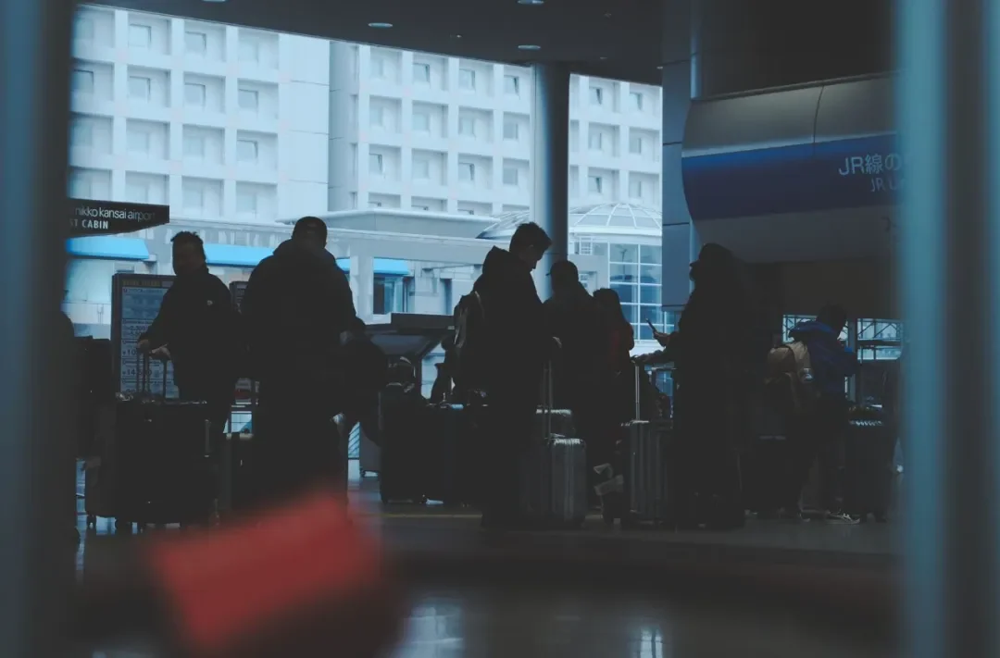

Місце прибуття формує подорож Японією більше, ніж час вильоту. Наріта й Ханеда обидва обслуговують Токіо, але одна розташована в сільській місцевості Тіби, а друга — на краю Токійської затоки; Кансай займає штучний острів в Осакській затоці; Чубу — ворота до Нагої та Хокуріку; аеропорт Наха притулений до краю однойменного міста. Дорога до міста різниться на годину-дві й на тисячі єн.

Цей путівник порівнює п’ять аеропортів в одній таблиці, а потім розбирає токійський вибір, Кансай і Чубу, Окінаву, етапи прибуття, які проходять усі, та ночівлю після нічного рейсу. Тарифи орієнтовні; перевіряйте сайти операторів.

## 1. П’ять аеропортів в одній таблиці

| Аеропорт | Місто | Відстань до міста | Основний транспорт | Час у дорозі | Орієнтовний тариф | Найкраще для |
| --- | --- | --- | --- | --- | --- | --- |
| Наріта (NRT) | Токіо (Тіба) | близько 60–70 км | JR Narita Express, Keisei Skyliner, експрес Keisei, автобус-лімузин | 60–90 хв | близько ¥1,050–3,200 | Токіо і Канто, дешевші квитки |
| Ханеда (HND) | Токіо (Токійська затока) | близько 15 км | лінія Keikyu, Tokyo Monorail, автобус-лімузин, таксі | 13–40 хв | близько ¥300–1,230 | Центральне Токіо, щільний графік |
| Кансай (KIX) | Осака, Кіото | штучний острів в Осакській затоці | JR Haruka, Nankai Rapi:t, швидкісний потяг JR Kansai Airport Rapid, автобус-лімузин | 40–80 хв | близько ¥1,210–3,490 | Осака, Кіото і Кансай |
| Чубу (NGO) | Нагоя | штучний острів на південь від Нагої | Meitetsu μ-Sky, експрес Meitetsu, автобус-лімузин | 28–35 хв | близько ¥890–1,500 | Нагоя, Чубу і Хокуріку |
| Наха (OKA) | Окінава (Наха) | місто Наха | монорейка Yui Rail, автобус, орендований автомобіль | 12–30 хв | близько ¥230–270 | Головний острів Окінави |

Відстані та час приблизні, до найближчого центру міста; тарифи — діапазони в один бік без урахування таксі. Ханеда або Наріта для Токіо, Кансай для Осаки й Кіото, Чубу для Нагої та Хокуріку, Наха для Окінави — і саме на токійській парі компроміс відчувається найсильніше.

## 2. Токіо: Ханеда (HND) проти Наріти (NRT)

Міжнародний аеропорт Наріта розташований у префектурі Тіба, за 60–70 км від Токіо: найбільші міжнародні ворота країни з найширшим вибором далекомагістральних рейсів, трьома терміналами (лоукостери використовують T3) і найбагатшим вибором безмитних покупок. Ціна цього — дорога до міста: навіть найшвидший потяг їде годину.

- **JR Narita Express (N’EX)**: близько 60 хвилин, орієнтовний тариф ¥3,070 — найшвидше й найдорожче.
- **Keisei Skyliner**: 36 хвилин до Ніппорі, ¥2,570 — зручно для лінії Яманоте.
- **Експрес Keisei**: близько 70 хвилин, ¥1,050 — найдешевший спосіб дістатися до міста.
- **Автобус-лімузин**: близько 100 хвилин до Сіндзюку, ¥3,200 — від дверей готелю до дверей.

Тож: N’EX або Skyliner, коли важливий час; експрес Keisei, коли важливі гроші — він на пів години довший, але коштує менш ніж половину тарифу; автобус для готелів у Сіндзюку та важких валіз, якщо дозволяє дорожній рух.

Офіційна назва Ханеди — Токійський міжнародний аеропорт. Він розташований на Токійській затоці приблизно за 15 км від центру й обслуговує пізні рейси: T1 і T2 — для внутрішніх рейсів, T3 — для міжнародних. Його перевага — відстань: дванадцять хвилин, і ви в місті.

- **Лінія Keikyu**: 13 хвилин до Сінаґави, приблизно ¥300–410.
- **Tokyo Monorail**: 13 хвилин до Хамамацучо, ¥500.
- **Автобус-лімузин**: 40–50 хвилин до Сіндзюку, ¥1,230.
- **Таксі**: близько 30 хвилин до Ґіндзи, ¥7,000–8,000.

Для подорожі лише Токіо Ханеда краща за Наріту: швидше до міста й доступна пізно вночі. Але квитки до Ханеди зазвичай дорожчі, тоді як Наріта дешевша й далі; якщо різниця в тарифі велика, перемагає Наріта. Для Токіо разом із Кансаєм летіть у Наріту, а назад — з Кансаю, або навпаки, і уникнете повернення тим самим шляхом.

## 3. Кансай (KIX): Осака, Кіото й регіон Кансай

Міжнародний аеропорт Кансай стоїть на штучному острові в Осакській затоці; T1 бере на себе основне навантаження, а T2 обслуговує лоукостери.

- **JR Haruka**: 80 хвилин до Кіото, ¥3,490.
- **Nankai Rapi:t**: 38 хвилин до Намби, ¥1,450.
- **JR Kansai Airport Rapid**: 65 хвилин до Осаки, ¥1,210.
- **Автобус-лімузин**: 50 хвилин до Осаки, ¥1,600.

Що вибрати, залежить від того, де ви ночуєте: Haruka для Кіото й Нари без пересадки; Rapi:t для Намби й Сінсайбасі; швидкісний потяг JR для Умеди й станції Осака за найнижчим тарифом; автобус, коли багаж важкий.

Кансай — приблизно за 40 хвилин від центру Осаки та за 80 від Кіото. Коли останні потяги пішли, таксі фактично єдиний варіант, тож врахуйте це, якщо прилітаєте пізно.

## 4. Чубу (NGO) і Наха (OKA)

### Нагоя і Хокуріку: Чубу Сентрайр

Міжнародний аеропорт Чубу Сентрайр розташований на штучному острові на південь від Нагої, менший за Ханеду, Наріту й Кансай, і обслуговує Нагою, Чубу та Хокуріку. Meitetsu — єдина залізниця; вона поперемінно запускає μ-Sky та експреси, тож пересадка не потрібна.

- **Meitetsu μ-Sky**: 28 хвилин до станції Нагоя, ¥1,250.
- **Експрес Meitetsu**: 35 хвилин до станції Нагоя, ¥890.
- **Автобус-лімузин**: 30 хвилин до Саке, ¥1,500.

μ-Sky економить сім хвилин приблизно за 40% вищу плату; біля станції Нагоя достатньо експреса, а до Саке зручніше автобусом. Для подорожі, побудованої навколо Нагої, Тоямо й Такаями, Чубу краще, ніж прилітати до Токіо й далі їхати сінкансеном.

### Окінава: аеропорт Наха

Аеропорт Наха розташований на краю Нахи на головному острові Окінави — найтропічніший із п’яти, з порівняно невеликою кількістю міжнародних рейсів, переважно з Тайваню, Гонконгу й Кореї.

- **Монорейка Yui Rail**: 12 хвилин до Кенчо-мае, ¥270.
- **Автобус**: 20 хвилин до Нахи, ¥230.

Це найдешевше з п’яти: дванадцять хвилин і кілька сотень єн. Але більшість маршрутів Окінавою охоплюють різні частини острова, де орендований автомобіль майже необхідний — стійки прокату стоять одразу за залою прибуття. Для міста й замку Сюрі достатньо монорейки та автобусів.

## 5. Потік прибуття: Visit Japan Web, багаж і митниця

Етапи однакові в усіх п’яти аеропортах; змінюються лише черги й планування терміналів. Зареєструйте дані для імміграції та митниці на Visit Japan Web перед польотом — система згенерує два QR-коди, які використовують по черзі.

1. **Імміграція**: прямуйте до стійок імміграції та покажіть QR-код Visit Japan Web (або паперову картку прибуття) разом із паспортом.
2. **Багаж**: заберіть валізи, звіряючи номер рейсу з екраном біля стрічки, а не чекаючи біля чужої.
3. **Митниця**: проведіть багаж через митницю та покажіть митний QR-код (або паперову декларацію); відкрийте валізу, якщо попросять.
4. **Вихід**: стійки обміну JR Pass, автомати для IC-карток і автобусні каси зазвичай на тому самому рівні прибуття.

Заздалегідь зробіть скріншоти обох QR-кодів: у повітрі немає сигналу, а до Wi-Fi аеропорту спершу треба підключитися. Обмін JR Pass є в Наріті, Ханеді й Кансаї; IC-картки продають на рівні прибуття — Suica поблизу Токіо, ICOCA у Кансаї. Черги залежать від хвилі прибуттів, тож якщо важливий останній потяг, сидіть ближче до виходу й ідіть швидко.

## 6. Нічні рейси та ночівля

Ханеда працює цілодобово й приймає більшість бюджетних нічних рейсів; нічні рейси Наріти — переважно лоукостери в T3. Приземлення після опівночі без плати за таксі означає чекати на перший потяг або зупинитися біля аеропорту, де готель при аеропорті часто дешевший за ніч у місті.

- **Сон в аеропорту**: у Ханеді й Наріті є зони для нічного відпочинку, але без душу; візьміть теплий шар одягу й дорожню подушку.
- **Готелі при аеропорту**: Toyoko Inn у Наріті, капсульний готель First Cabin усередині Ханеди — обидва в пішій доступності.

Вибір аеропорту — це баланс між швидкістю до міста й ціною квитка: Ханеда найзручніша й найдорожча, Наріта дешевша й далі. Складіть загальний час і вартість дороги до готелю — і відповідь часто економить годину-дві та ¥5,000.

## Пов’язані посилання

- **На цьому сайті**: [Міжнародний аеропорт Наріта (NRT)](/airport/NRT), [Аеропорт Ханеда (HND)](/airport/HND), [Міжнародний аеропорт Кансай (KIX)](/airport/KIX), [Японія (JP)](/country/JP)
- **Вікіпедія**: [Міжнародний аеропорт Наріта](https://en.wikipedia.org/wiki/Narita_International_Airport), [Аеропорт Ханеда](https://en.wikipedia.org/wiki/Haneda_Airport), [Міжнародний аеропорт Кансай](https://en.wikipedia.org/wiki/Kansai_International_Airport), [Міжнародний аеропорт Чубу Сентрайр](https://en.wikipedia.org/wiki/Ch%C5%ABbu_Centrair_International_Airport), [Аеропорт Наха](https://en.wikipedia.org/wiki/Naha_Airport)
- **Baidu Baike**: [Міжнародний аеропорт Наріта](https://baike.baidu.com/item/%E6%88%90%E7%94%B0%E5%9B%BD%E9%99%85%E6%9C%BA%E5%9C%BA), [Токійський аеропорт Ханеда](https://baike.baidu.com/item/%E4%B8%9C%E4%BA%AC%E7%BE%BD%E7%94%B0%E6%9C%BA%E5%9C%BA), [Міжнародний аеропорт Кансай](https://baike.baidu.com/item/%E5%85%B3%E8%A5%BF%E5%9B%BD%E9%99%85%E6%9C%BA%E5%9C%BA), [Міжнародний аеропорт Чубу](https://baike.baidu.com/item/%E4%B8%AD%E9%83%A8%E5%9B%BD%E9%99%85%E6%9C%BA%E5%9C%BA), [Аеропорт Наха](https://baike.baidu.com/item/%E9%82%A3%E9%9C%B8%E6%9C%BA%E5%9C%BA)

Фото: 乐意门. Тарифи й час походять із публікацій операторів у першій половині 2026 року й мають орієнтовний характер; перевіряйте сайти операторів і аеропортів у день подорожі.
