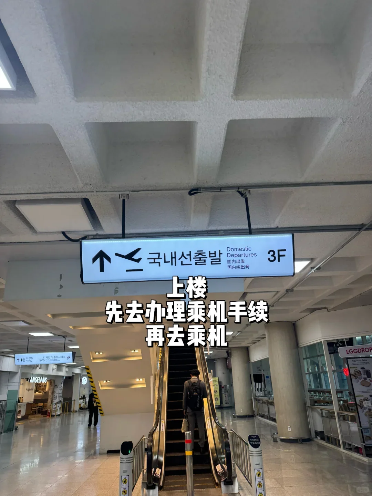
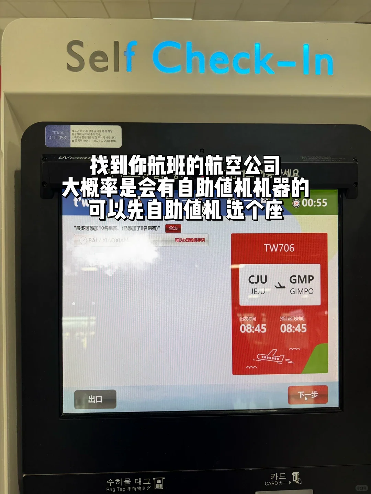
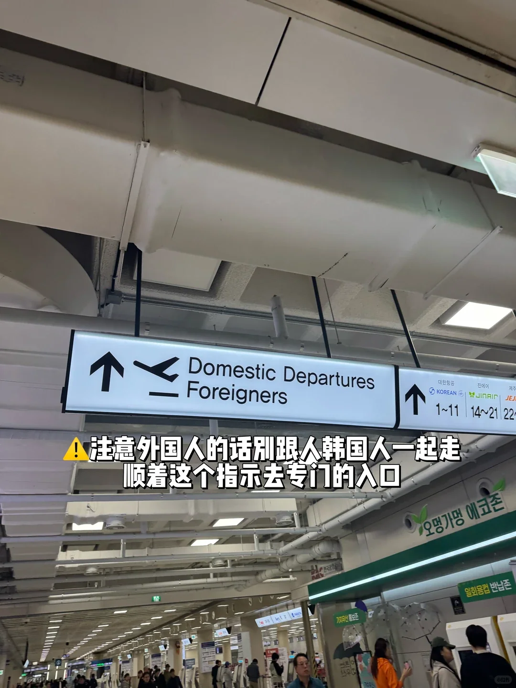
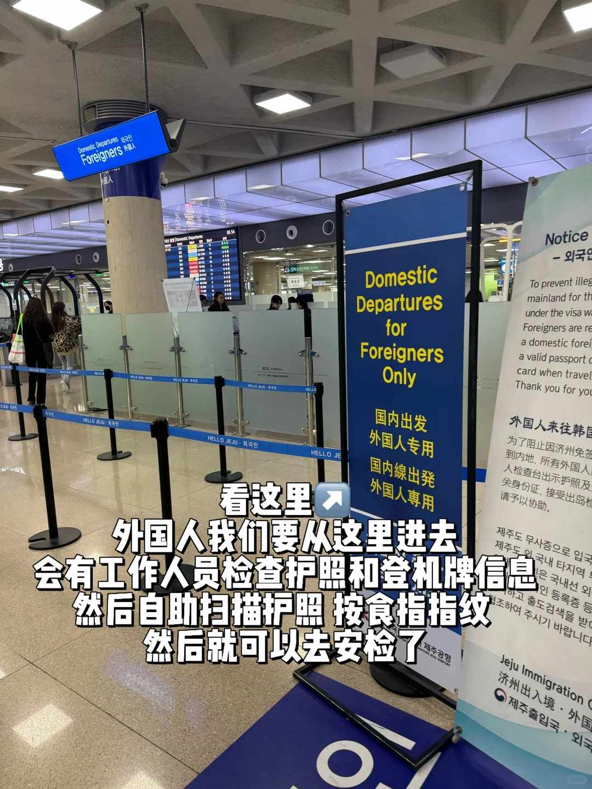
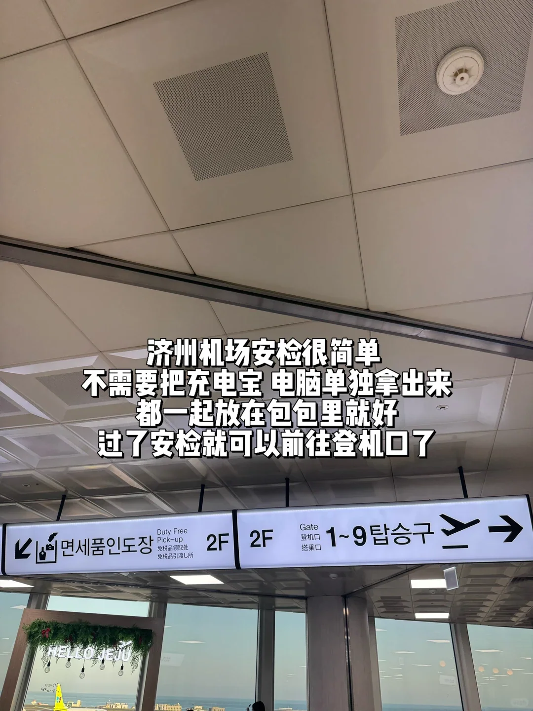

Jeju–Séoul est l'une des liaisons intérieures les plus fréquentées de Corée, et Gimpo en concentre le plus de vols. Le saut dure un peu plus d'une heure, et Korean Air, Asiana et plusieurs low-cost se partagent la ligne, avec des départs du petit matin jusqu'à tard le soir. Pour quiconque détient un visa coréen, c'est un vol intérieur ordinaire : pas d'immigration, pas de douane, il suffit de récupérer son bagage et de quitter le terminal.

Pour les voyageurs chinois entrés à Jeju sans visa, en revanche, il existe un piège facile à manquer. L'entrée sans visa à Jeju ne vaut que pour l'île de Jeju. Voler vers le continent constitue un secteur intérieur au sein de la Corée, et exige un visa coréen valide. Ce guide parcourt le trajet en cinq étapes — visa, enregistrement, file réservée aux étrangers, embarquement et arrivée à Gimpo —, les tarifs et heures limites n'étant donnés qu'à titre indicatif.

## 1. Vérifiez d'abord le visa : l'exemption de Jeju ne couvre pas le continent

Les détenteurs d'un passeport chinois peuvent entrer à Jeju sans visa, généralement pour 30 jours au maximum, mais cette autorisation s'arrête à l'île. Dès que vous prenez un vol vers Séoul, Busan ou n'importe où sur le continent, le vol est traité comme un secteur intérieur, et la compagnie vérifie à l'enregistrement que votre passeport porte un visa coréen ou un titre de résidence.

Sans cela, le comptoir ne délivrera pas de carte d'embarquement, et la file réservée aux étrangers, un peu plus loin, vous arrêtera aussi. Il n'y a pas de guichet de visa à l'aéroport : les seules options sont de modifier le retour ou de voler vers un pays tiers. Les voyageurs munis d'un visa touristique C-3-9, d'un visa étudiant ou d'un permis de travail et de résidence ne sont pas concernés ; et si vous êtes entré à Jeju sans visa puis en repartez, aucun visa coréen ne vous est demandé. Ne réservez pas « entrée par Jeju, sortie par Séoul » comme un seul voyage si vous n'avez pas le visa. Un visa d'un pays tiers ou un K-ETA ne remplacent pas ce visa, et la politique coréenne des visas change régulièrement : vérifiez la notice en vigueur de l'ambassade de Corée pour votre type de passeport avant de réserver.

## 2. Aéroport de Jeju : allez directement aux départs intérieurs, au niveau 3

Les terminaux intérieur et international de Jeju sont côte à côte, avec des halls de départ séparés. Les vols vers Gimpo utilisent le terminal intérieur, dont les départs se font au niveau 3. Depuis les arrivées, suivez les panneaux « 국내선출발 / Domestic Departures » et montez l'escalator ; la signalétique est en coréen, en anglais et en chinois.

Prévoyez une heure à une heure et demie. L'enregistrement intérieur ferme généralement 30 minutes avant le départ, et la file du dépôt des bagages peut serpenter dans le hall aux heures de pointe. Les bornes en libre-service passent en chinois et permettent de choisir un siège avec votre référence de réservation à six chiffres, mais un passeport étranger ne suffit généralement pas à produire une carte d'embarquement. Choisissez votre siège à la borne, puis rendez-vous au comptoir de la compagnie pour que le personnel vérifie votre passeport et votre visa, imprime la carte d'embarquement et prenne vos bagages. Vous devez encore passer par là même sans bagage en soute : ne vous dirigez pas vers le contrôle de sécurité avec le seul reçu de la borne.

## 3. La file réservée aux étrangers, près de la porte 3

La carte d'embarquement en main vient le faux pas le plus facile du voyage : ne suivez pas les passagers coréens. Près de la porte 3, dans la zone de départ intérieure, une file réservée aux étrangers est signalée par un panneau bleu « Foreigners / 外国人专用 » à côté de l'entrée du contrôle de sécurité.

Le personnel vérifie votre passeport, votre carte d'embarquement et votre visa avant de vous laisser passer au contrôle, et à certaines heures, vous scannez vous-même votre passeport et votre empreinte au portillon. C'est la seule partie de l'aéroport conçue spécifiquement pour les voyageurs étrangers, et c'est aussi là que toute personne sans visa est refoulée. Si vous voyagez avec quelqu'un muni d'un passeport coréen ou d'une carte de résident, cette personne peut emprunter la file normale et vous retrouver dans la salle d'embarquement après le contrôle.

## 4. Contrôle, embarquement et le vol d'une heure

Passé la file, le contrôle est routinier. Le poste intérieur de Jeju avance vite, et ordinateurs portables et batteries externes restent généralement dans le sac, mais liquides, couteaux et briquets suivent les mêmes règles qu'ailleurs, et l'agent du jour a le dernier mot. Les batteries externes doivent rester dans le bagage à main et ne peuvent pas aller en soute.

Repérez votre porte sur la carte d'embarquement : les portes 1 à 9 se trouvent au niveau 2, et la salle d'embarquement est petite, avec des supérettes et des cafés à deux minutes. L'embarquement commence généralement 15 à 20 minutes avant le départ, les low-cost appelant les passagers par zone de siège.

Le vol dure environ une heure, avec 55 minutes à 1 heure 5 minutes dans les airs. Il n'y a pas de service de repas, et sur une low-cost, même l'eau est payante. Les vents d'hiver au-dessus de Jeju peuvent rendre l'approche agitée : gardez la ceinture attachée au décollage et à l'atterrissage. À Gimpo, ni immigration ni douane : suivez les panneaux des arrivées intérieures et vous voilà dehors.

## 5. Arriver à Gimpo : arrivées intérieures et la ville

Les arrivées intérieures de Gimpo se font au niveau 1. Le tapis à bagages est à quelques minutes à pied de la porte, les écrans indiquent quel tapis dessert votre vol, et il n'y a pas de formulaire de douane à remplir. Gimpo n'est qu'à une douzaine de kilomètres du centre-ville, ce qui constitue son principal avantage sur Incheon.

Achetez et rechargez une carte T-money dans une supérette — CU et GS25 font l'affaire, et le prix de la carte est facturé séparément. Une seule carte couvre le métro, le train de l'aéroport, les bus et les taxis. La station Gimpo Airport se trouve au sous-sol du terminal, à environ cinq minutes de marche souterraine.

Trois moyens habituels permettent de rejoindre la ville. Le train AREX omnibus atteint la gare de Séoul en environ 22 minutes pour à peu près 1,750 won avec T-money. La ligne 5 du métro va vers Yeouido et Gwanghwamun, la ligne 9 vers Gangnam, toutes deux sans changement. Un taxi jusqu'au centre-ville prend 20 à 30 minutes et coûte environ 20,000 à 30,000 won. Pour Hongdae, l'AREX compte trois arrêts et prend environ 13 minutes ; pour Gangnam, la ligne 9 y va directement.

Au retour, Gimpo–Jeju est aussi un départ intérieur, mais Gimpo est l'aéroport le plus grand et ses files de sécurité sont plus longues : ajoutez 20 minutes. Un dernier point : ce vol ne crée pas de registre d'entrée et ne prolonge pas votre séjour. Une arrivée sans visa à Jeju conserve la durée accordée à l'entrée, et le vol vers Séoul ne la réinitialise pas.

## Liens utiles

- **Sur ce site** : [Corée du Sud (KR)](/country/KR)
- **Wikipédia** : [Aéroport international de Jeju](https://en.wikipedia.org/wiki/Jeju_International_Airport), [Aéroport international de Gimpo](https://en.wikipedia.org/wiki/Gimpo_International_Airport)
- **Baidu Baike** : [Aéroport international de Jeju](https://baike.baidu.com/item/%E6%B5%8E%E5%B7%9E%E5%9B%BD%E9%99%85%E6%9C%BA%E5%9C%BA), [Aéroport international de Gimpo](https://baike.baidu.com/item/%E9%87%91%E6%B5%A6%E5%9B%BD%E9%99%85%E6%9C%BA%E5%9C%BA)

Source : un guide de voyage WeChat, révisé en octobre 2026. Les règles de visa, les heures limites d'enregistrement et les tarifs suivent le ministère coréen de la Justice, les compagnies aériennes et les annonces actuelles des aéroports.
