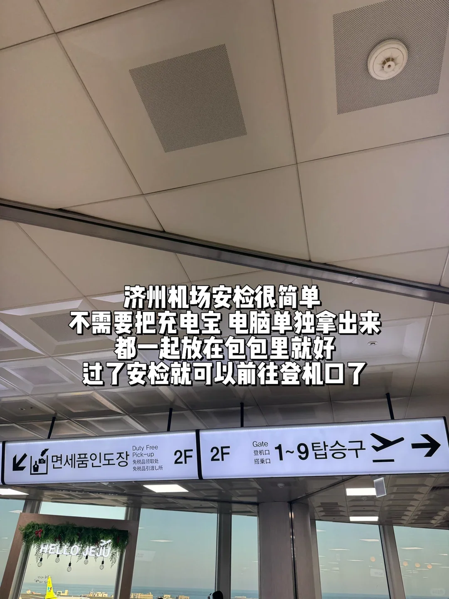

Jeju–Seoul is een van de drukste binnenlandse routes van Korea, en Gimpo heeft de meeste vluchten. De vlucht duurt iets meer dan een uur, en Korean Air, Asiana en verschillende lowcostmaatschappijen delen de route, met vertrekken van vroeg in de ochtend tot laat in de avond. Voor iedereen met een Koreaans visum is het een gewone binnenlandse vlucht: geen immigratie, geen douane, alleen je bagage ophalen en de terminal verlaten.

Voor Chinese reizigers die visumvrij Jeju zijn binnengekomen, ligt er echter een valkuil die makkelijk te missen is. De visumvrije binnenkomst van Jeju geldt alleen voor het eiland Jeju. Naar het vasteland vliegen is een binnenlandse sector binnen Korea, en daarvoor is een geldig Koreaans visum nodig. Deze gids neemt de reis in vijf stappen — visum, inchecken, de rij voor buitenlanders, instappen en aankomst op Gimpo — met tarieven en sluitingstijden alleen als referentie.

## 1. Controleer eerst het visum: visumvrij Jeju geldt niet voor het vasteland

Chinese paspoorthouders kunnen zonder visum Jeju binnenkomen, meestal voor maximaal 30 dagen, maar die toestemming stopt bij het eiland. Zodra je naar Seoul, Busan of ergens anders op het vasteland vliegt, wordt de vlucht als binnenlandse sector behandeld, en de luchtvaartmaatschappij controleert bij het inchecken je paspoort op een Koreaans visum of verblijfsvergunning.

Zonder visum geeft de balie geen instapkaart af, en ook de rij voor buitenlanders verderop houdt je tegen. Er is geen visumbalie op de luchthaven, dus de enige opties zijn de terugvlucht omboeken of naar een derde land vliegen. Reizigers met een C-3-9 toeristenvisum, een studentenvisum of een werk- en verblijfsvergunning ondervinden geen hinder; ook wie visumvrij Jeju is binnengekomen en vanuit Jeju weer vertrekt, heeft geen Koreaans visum nodig. Boek "in via Jeju, uit via Seoul" niet als één reis, tenzij je het visum hebt. Een visum voor een derde land of een K-ETA is geen vervanging, en het Koreaanse visumbeleid verandert regelmatig, dus controleer de actuele mededeling van de Koreaanse ambassade voor jouw paspoorttype voordat je boekt.

## 2. Jeju Airport: ga direct naar de binnenlandse vertrekhal op verdieping 3

De binnenlandse en internationale terminals van Jeju liggen naast elkaar, met aparte vertrekhallen. Vluchten naar Gimpo gebruiken de binnenlandse terminal, en het vertrek is op verdieping 3. Volg vanuit de aankomsthal de borden "국내선출발 / Domestic Departures" de roltrap op; de bewegwijzering is in het Koreaans, Engels en Chinees.

Reken op een tot anderhalf uur. Het binnenlandse inchecken sluit meestal 30 minuten voor vertrek, en de rij bij de bagageafgifte kan op drukke momenten door de hal kronkelen. De zelfbedieningskiosken schakelen over op Chinees en laten je met je zescijferige boekingsnummer een stoel kiezen, maar met een buitenlands paspoort krijg je bij de automaat meestal geen instapkaart. Kies je stoel bij de automaat en ga dan naar de balie van de luchtvaartmaatschappij, zodat het personeel je paspoort en visum controleert, de instapkaart print en je bagage aanneemt. Dat moet je ook doen als je geen ruimbagage hebt, dus ga niet met alleen de bon van de automaat naar de beveiligingscontrole.

## 3. De rij voor buitenlanders, bij gate 3

Met de instapkaart in de hand volgt de makkelijkste verkeerde afslag van de reis: volg de Koreaanse passagiers niet. Bij gate 3 in de binnenlandse vertrekhal is er een rij die alleen voor buitenlanders is, gemarkeerd met een blauw bord "Foreigners / 外国人专用" naast de ingang van de beveiligingscontrole.

Het personeel controleert je paspoort, instapkaart en visum voordat je door mag naar de beveiligingscontrole, en op sommige tijden scan je bij de gate zelf je paspoort en vingerafdruk. Dit is het enige deel van de luchthaven dat speciaal voor buitenlandse reizigers is ingericht, en het is ook de plek waar iedereen zonder visum wordt teruggestuurd. Reis je met iemand met een Koreaans paspoort of een verblijfskaart, dan kan die de gewone rij gebruiken en je na de controle in de vertrekhal ontmoeten.

## 4. Beveiligingscontrole, instappen en de vlucht van een uur

Voorbij de rij verloopt de beveiligingscontrole routineus. De binnenlandse controle op Jeju gaat snel, en laptops en powerbanks blijven meestal in de tas, maar vloeistoffen, messen en aanstekers volgen dezelfde regels als overal, en de medewerker van de dag heeft het laatste woord. Powerbanks moeten in je handbagage blijven en mogen niet in de ruimbagage.

Zoek je gate op de instapkaart: gates 1 tot 9 liggen op verdieping 2, en de hal is klein, met buurtwinkels en koffiebars op een paar minuten lopen. Het instappen begint meestal 15 tot 20 minuten voor vertrek, waarbij lowcostmaatschappijen passagiers per stoelzone oproepen.

De vlucht duurt ongeveer een uur, met 55 minuten tot 1 uur 5 minuten in de lucht. Er is geen maaltijdservice, en bij een lowcostmaatschappij kost zelfs water extra. Winterwind boven Jeju kan de nadering hobbelig maken, dus houd de gordel om bij het opstijgen en landen. Op Gimpo is er geen immigratie en geen douane: volg de borden voor binnenlandse aankomsten en je bent buiten.

## 5. Aankomst op Gimpo: binnenlandse aankomsten en de stad

Binnenlandse aankomsten op Gimpo zijn op verdieping 1. De bagageband is een paar minuten lopen van de gate, de schermen tonen welke band bij je vlucht hoort, en er is geen douaneformulier in te vullen. Gimpo ligt maar een twaalftal kilometer van het stadscentrum, wat het grootste voordeel is ten opzichte van Incheon.

Koop een T-money-kaart en zet er saldo op bij een buurtwinkel — zowel CU als GS25 kan, en de kosten van de kaart zelf komen erbij. Eén kaart geldt voor de metro, de luchthaventrein, bussen en taxi's. Gimpo Airport Station ligt in de kelder van de terminal, ongeveer vijf minuten lopen ondergronds.

Er zijn drie gebruikelijke manieren om de stad in te komen. De AREX-stoptrein bereikt Seoul Station in ongeveer 22 minuten voor ongeveer 1,750 won met T-money. Metrolijn 5 rijdt richting Yeouido en Gwanghwamun, en lijn 9 richting Gangnam, beide zonder overstap. Een taxi naar het centrum duurt 20 tot 30 minuten en kost ongeveer 20,000 tot 30,000 won. Voor Hongdae is de AREX drie haltes en ongeveer 13 minuten; voor Gangnam rijdt lijn 9 er rechtstreeks naartoe.

Op de terugweg is Gimpo–Jeju ook een binnenlandse vlucht, maar Gimpo is de grotere luchthaven en de rijen bij de beveiliging zijn er langer, dus reken 20 minuten extra. Nog één punt: deze vlucht levert geen inreisregistratie op en verlengt je verblijf niet. Een visumvrije aankomst op Jeju behoudt de termijn die bij binnenkomst is toegekend, en naar Seoul vliegen zet die niet opnieuw in.

## Gerelateerde links

- **Op deze site**: [Zuid-Korea (KR)](/country/KR)
- **Wikipedia**: [Jeju International Airport](https://en.wikipedia.org/wiki/Jeju_International_Airport), [Gimpo International Airport](https://en.wikipedia.org/wiki/Gimpo_International_Airport)
- **Baidu Baike**: [Jeju International Airport](https://baike.baidu.com/item/%E6%B5%8E%E5%B7%9E%E5%9B%BD%E9%99%85%E6%9C%BA%E5%9C%BA), [Gimpo International Airport](https://baike.baidu.com/item/%E9%87%91%E6%B5%A6%E5%9B%BD%E9%99%85%E6%9C%BA%E5%9C%BA)

Bron: een reisgids van WeChat, bewerkt in oktober 2026. Visumregels, inchecksluitingstijden en tarieven volgen het Koreaanse ministerie van Justitie, de luchtvaartmaatschappijen en actuele luchthavenmededelingen.
