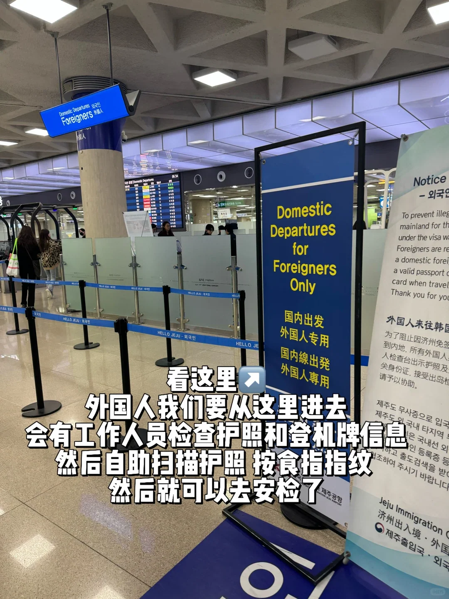

Jeju–Seoul este una dintre cele mai aglomerate rute interne din Coreea, iar Gimpo preia cele mai multe zboruri. Saltul durează puțin peste o oră, iar Korean Air, Asiana și mai multe companii low-cost împart ruta, cu plecări de dimineața devreme până târziu noaptea. Pentru oricine are o viză coreeană, este un zbor intern obișnuit: fără imigrare, fără vamă, doar ridicați bagajul și părăsiți terminalul.

Pentru călătorii chinezi care au intrat în Jeju fără viză, însă, există o capcană ușor de ratat. Intrarea fără viză în Jeju se aplică doar insulei Jeju. Zborul spre continent este un sector intern în Coreea și necesită o viză coreeană valabilă. Acest ghid parcurge călătoria în cinci pași — viza, check-inul, banda rezervată străinilor, îmbarcarea și sosirea la Gimpo — cu tarifele și orele-limită doar ca repere.

## 1. Verificați mai întâi viza: scutirea de viză din Jeju nu acoperă continentul

Deținătorii de pașapoarte chinezești pot intra în Jeju fără viză, de obicei pentru până la 30 de zile, dar această permisiune se oprește la insulă. În momentul în care zburați spre Seoul, Busan sau oriunde altundeva pe continent, zborul este tratat ca un sector intern, iar compania aeriană vă va verifica pașaportul pentru o viză coreeană sau un permis de ședere la check-in.

Fără aceasta, ghișeul nu va emite o carte de îmbarcare, iar banda rezervată străinilor, mai încolo, vă va opri și ea. Nu există un ghișeu de vize în aeroport, așa că singurele opțiuni sunt să replanificați întoarcerea sau să zburați într-o țară terță. Călătorii cu viză turistică C-3-9, viză de student sau permis de muncă și ședere nu sunt afectați; de asemenea, nu are nevoie de viză coreeană nimeni care a intrat în Jeju fără viză și zboară înapoi din Jeju. Nu rezervați „intrare prin Jeju, ieșire prin Seoul” ca o singură călătorie decât dacă aveți viza. O viză de țară terță sau un K-ETA nu sunt un substitut, iar politica de vize a Coreei se schimbă din când în când, așa că verificați notificarea actuală a ambasadei Coreei pentru tipul dumneavoastră de pașaport înainte de a rezerva.

## 2. Aeroportul Jeju: mergeți direct la plecările interne, la nivelul 3

Terminalele intern și internațional din Jeju sunt alăturate, cu săli de plecare separate. Zborurile spre Gimpo folosesc terminalul intern, iar plecările sunt la nivelul 3. Din zona sosirilor, urmați indicatoarele „국내선출발 / Domestic Departures” pe scara rulantă; semnalizarea este în coreeană, engleză și chineză.

Acordați-vă o oră până la o oră și jumătate. Check-inul intern se închide de obicei cu 30 de minute înainte de plecare, iar coada la predarea bagajelor poate șerpui prin sală la orele de vârf. Chioșcurile self-service pot fi comutate pe chineză și vă permit să alegeți un loc cu ajutorul codului de rezervare din șase cifre, dar un pașaport străin de obicei nu poate genera singur o carte de îmbarcare. Alegeți-vă locul la aparat, apoi mergeți la ghișeul companiei aeriene pentru ca personalul să vă verifice pașaportul și viza, să tipărească cartea de îmbarcare și să preia bagajele. Trebuie să faceți acest lucru chiar și fără bagaje de cală, așa că nu vă îndreptați spre controlul de securitate doar cu bonul de la chioșc.

## 3. Banda rezervată străinilor, lângă poarta 3

Cu cartea de îmbarcare în mână vine și cea mai ușoară cotitură greșită a călătoriei: nu urmați pasagerii coreeni. Lângă poarta 3, în zona de plecări interne, există o bandă rezervată străinilor, marcată cu un indicator albastru „Foreigners / 外国人专用” lângă intrarea în securitate.

Personalul vă verifică pașaportul, cartea de îmbarcare și viza înainte de a vă lăsa să treceți spre securitate, iar la anumite ore vă scanați singur pașaportul și amprenta la poartă. Aceasta este singura parte a aeroportului construită special pentru călătorii străini și tot aici sunt întorși din drum cei fără viză. Dacă călătoriți cu cineva cu pașaport coreean sau permis de ședere, acea persoană poate folosi banda obișnuită și vă poate întâlni în sala de plecări după securitate.

## 4. Securitatea, îmbarcarea și zborul de o oră

După bandă, securitatea este de rutină. Punctul de control intern din Jeju merge repede, iar laptopurile și bateriile externe rămân de obicei în geantă, dar lichidele, cuțitele și brichetele urmează aceleași reguli ca oriunde altundeva, iar ofițerul din ziua respectivă are ultimul cuvânt. Bateriile externe trebuie să rămână în bagajul de mână și nu pot fi puse în bagajele de cală.

Găsiți-vă poarta pe cartea de îmbarcare: porțile 1–9 sunt la nivelul 2, iar sala este mică, cu magazine de proximitate și cafenele la câteva minute. Îmbarcarea începe de obicei cu 15–20 de minute înainte de plecare, companiile low-cost chemând pasagerii pe zone de locuri.

Zborul durează circa o oră, cu 55 de minute până la 1 oră și 5 minute în aer. Nu există serviciu de masă, iar la o companie low-cost chiar și apa costă extra. Vânturile de iarnă deasupra Jeju pot face apropierea zbuciumată, așa că păstrați centura la decolare și aterizare. La Gimpo nu există imigrare și nici vamă: urmați indicatoarele pentru sosiri interne și ați ieșit.

## 5. Sosirea la Gimpo: sosirile interne și orașul

Sosirile interne la Gimpo sunt la nivelul 1. Banda de bagaje este la câteva minute de mers pe jos de poartă, ecranele arată ce bandă deservește zborul dumneavoastră și nu există niciun formular vamal de completat. Gimpo se află la doar vreo doisprezece kilometri de centrul orașului, ceea ce este principalul său avantaj față de Incheon.

Cumpărați și alimentați un card T-money la un magazin de proximitate — merge la CU și GS25, iar taxa pentru card este separată. Un singur card acoperă metroul, calea ferată aeroportuară, autobuzele și taxiurile. Stația Gimpo Airport se află la subsolul terminalului, la circa cinci minute de mers pe jos pe sub pământ.

Există trei moduri obișnuite de a ajunge în oraș. Trenul AREX cu toate stațiile ajunge la gara Seoul în circa 22 de minute, pentru aproximativ 1.750 de won cu T-money. Metroul, linia 5, merge spre Yeouido și Gwanghwamun, iar linia 9 spre Gangnam, ambele fără schimbare. Un taxi până în centrul orașului durează 20–30 de minute și costă în jur de 20.000–30.000 de won. Pentru Hongdae, AREX are trei stații și circa 13 minute; pentru Gangnam, linia 9 merge direct acolo.

La întoarcere, Gimpo–Jeju este de asemenea o plecare internă, dar Gimpo este aeroportul mai mare și cozile la securitate sunt mai lungi, așa că adăugați 20 de minute. Un ultim punct: acest zbor nu creează o înregistrare de intrare și nu vă prelungește șederea. O sosire fără viză în Jeju păstrează perioada acordată la intrare, iar zborul spre Seoul nu o resetează.

## Linkuri utile

- **Pe acest site**: [Coreea de Sud (KR)](/country/KR)
- **Wikipedia**: [Aeroportul Internațional Jeju](https://en.wikipedia.org/wiki/Jeju_International_Airport), [Aeroportul Internațional Gimpo](https://en.wikipedia.org/wiki/Gimpo_International_Airport)
- **Baidu Baike**: [Jeju International Airport](https://baike.baidu.com/item/%E6%B5%8E%E5%B7%9E%E5%9B%BD%E9%99%85%E6%9C%BA%E5%9C%BA), [Gimpo International Airport](https://baike.baidu.com/item/%E9%87%91%E6%B5%A6%E5%9B%BD%E9%99%85%E6%9C%BA%E5%9C%BA)

Sursă: un ghid de călătorie de pe WeChat, editat în octombrie 2026. Regulile de viză, orele-limită de check-in și tarifele urmează Ministerul Justiției din Coreea, companiile aeriene și anunțurile actuale ale aeroporturilor.
