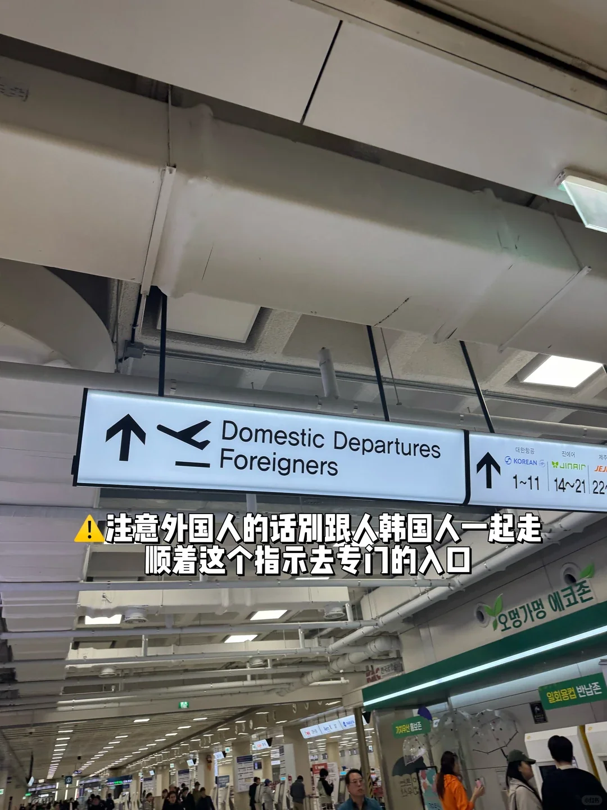

Kutoka Jeju hadi Seoul ni mojawapo ya njia za ndani zenye shughuli nyingi zaidi Korea, na Gimpo inachukua safari nyingi zaidi. Safari inachukua zaidi ya saa moja kidogo, na Korean Air, Asiana pamoja na kampuni kadhaa za bei nafuu wanashiriki njia hiyo, kwa kuondoka kuanzia asubuhi na mapema hadi usiku wa manane. Kwa yeyote mwenye visa ya Korea ni safari ya kawaida ya ndani: hakuna uhamiaji, hakuna forodha, chukua tu begi lako na utoke kituoni.

Kwa wasafiri wa China waliingia Jeju bila visa, hata hivyo, kuna jambo gumu ambalo ni rahisi kulikosa. Kuingia Jeju bila visa kunahusu Kisiwa cha Jeju pekee. Kuruka hadi bara ni safari ya ndani ndani ya Korea, na inahitaji visa halali ya Korea. Mwongozo huu unachukua safari kwa hatua tano — visa, kuingia, njia ya wageni pekee, kupanda ndege, na kuwasili Gimpo — huku nauli na muda wa mwisho zikiwa marejeleo tu.

## 1. Angalia visa kwanza: kutokuwa na visa huko Jeju hakuhusu bara

Wenye pasipoti za China wanaweza kuingia Jeju bila visa, kwa kawaida hadi siku 30, lakini idhini hiyo inaishia kisiwani. Unapopanda ndege kwenda Seoul, Busan au mahali pengine popote barani, safari inachukuliwa kama safari ya ndani, na shirika la ndege litakagua pasipoti yako kwa visa ya Korea au kibali cha makazi wakati wa kuingia.

Bila hivyo, kaunta haitatoa tikiti ya kupanda ndege, na njia ya wageni pekee inayofuata itakuzuia pia. Hakuna kaunta ya visa kwenye uwanja, kwa hivyo chaguo pekee ni kubadilisha safari ya kurudi au kuruka hadi nchi ya tatu. Wasafiri walio na visa ya utalii ya C-3-9, visa ya mwanafunzi au kibali cha kazi na makazi hawaathiriki; wala yeyote aliyeingia Jeju bila visa na anaruka kutoka Jeju harudi hahitaji visa ya Korea. Usakinishe "kuingia kupitia Jeju, kutoka kupitia Seoul" kama safari moja isipokuwa unayo visa. Visa ya nchi ya tatu au K-ETA si mbadala, na sera ya visa ya Korea hubadilika mara kwa mara, kwa hivyo angalia tangazo la sasa la ubalozi wa Korea kwa aina ya pasipoti yako kabla ya kukata tikiti.

## 2. Uwanja wa Ndege wa Jeju: nenda moja kwa moja kwenye kuondoka kwa ndani kwenye ghorofa ya 3

Vituo vya ndani na vya kimataifa vya Jeju viko kando kando, na kila kimoja kina ukumbi wake wa kuondoka. Safari za kwenda Gimpo hutumia kituo cha ndani, na kuondoka ni kwenye ghorofa ya 3. Kutoka eneo la kuwasili, fuata ishara za "국내선출발 / Domestic Departures" juu ya eskaleta; ishara ziko kwa Kikorea, Kiingereza na Kichina.

Toa muda wa saa moja hadi saa moja na nusu. Kuingia kwa safari za ndani kwa kawaida hufungwa dakika 30 kabla ya kuondoka, na foleni ya kuacha mizigo inaweza kujipinda kuzunguka ukumbi nyakati za kilele. Mashine za kujihudumia hubadilika kwenda Kichina na zinakuruhusu kuchagua kiti kwa kumbukumbu yako ya namba sita ya uhifadhi, lakini pasipoti ya kigeni kwa kawaida haiwezi kuzalisha tikiti ya kupanda ndege yenyewe. Chagua kiti kwenye mashine, kisha nenda kaunta ya shirika la ndege ili wafanyakazi wakague pasipoti yako na visa, wachapishe tikiti ya kupanda ndege na wachukue mizigo yako. Bado unapaswa kufanya hivi hata ukiwa huna mizigo iliyowekwa nje, kwa hivyo usielekee ukaguzi wa usalama ukiwa na risiti ya kioski pekee.

## 3. Njia ya wageni pekee, karibu na lango 3

Ukiwa na tikiti ya kupanda ndege mkononi, hii ndiyo sehemu rahisi zaidi ya kuchukua njia isiyo sahihi katika safari yote: usifuate abiria wa Korea. Karibu na lango 3 katika eneo la kuondoka kwa ndani kuna njia ya wageni pekee, yenye ishara ya bluu "Foreigners / 外国人专用" kando ya lango la ukaguzi wa usalama.

Wafanyakazi hukagua pasipoti yako, tikiti ya kupanda ndege na visa kabla ya kukuruhusu kupitia ukaguzi wa usalama, na nyakati fulani unapiga skani ya pasipoti yako na alama za vidole mwenyewe kwenye lango. Hii ni sehemu pekee ya uwanja iliyojengwa mahsusi kwa wasafiri wa kigeni, na pia ni mahali ambapo yeyote asiye na visa huzuiliwa. Ikiwa unasafiri na mtu aliye na pasipoti ya Korea au kadi ya makazi, wanaweza kutumia njia ya kawaida na kukutana nawe kwenye chumba cha kusubiri baada ya ukaguzi.

## 4. Usalama, kupanda ndege na safari ya saa moja

Baada ya njia hiyo, ukaguzi wa usalama ni wa kawaida. Kituo cha ukaguzi cha ndani cha Jeju husonga haraka, na kompyuta mpakato pamoja na benki za nishati kwa kawaida hubaki ndani ya begi, lakini vinywaji, visu na vibiriti vinafuata kanuni zilezile kama mahali pengine popote, na afisa wa siku hiyo ndiye mwenye neno la mwisho. Benki za nishati lazima zibaki kwenye mizigo ya mkono na haziwezi kuwekwa kwenye mizigo iliyowekwa nje.

Tafuta lango lako kutoka kwenye tikiti ya kupanda ndege: malango 1 hadi 9 yako ghorofa ya 2, na chumba cha kusubiri ni kidogo, na maduka ya bidhaa mchanganyiko na maduka ya kahawa ndani ya dakika kadhaa. Kupanda ndege kwa kawaida huanza dakika 15 hadi 20 kabla ya kuondoka, na kampuni za bei nafuu huwaita abiria kwa eneo la viti.

Safari inachukua saa moja hivi, ikiwa angani kati ya dakika 55 na saa 1 na dakika 5. Hakuna huduma ya chakula, na kwenye kampuni ya bei nafuu hata maji yanagharimu zaidi. Pepo za baridi juu ya Jeju zinaweza kufanya mteremko wa kutua kuwa wenye misukosuko, kwa hivyo funga mkanda wakati wa kupaa na kutua. Gimpo hakuna uhamiaji na hakuna forodha: fuata ishara za kuwasili kwa ndani na umetoka.

## 5. Kuwasili Gimpo: kuwasili kwa ndani na jiji

Kuwasili kwa ndani huko Gimpo ni kwenye ghorofa ya 1. Mzunguko wa mizigo uko umbali wa dakika chache kutoka lango, skrini zinaonyesha ukanda upi unahudumia safari yako, na hakuna fomu ya forodha ya kujaza. Gimpo iko kilomita kumi na mbili hivi tu kutoka katikati ya jiji, na hiyo ndiyo faida yake kuu juu ya Incheon.

Nunua na ongeza salio la kadi ya T-money kwenye duka la bidhaa mchanganyiko — CU na GS25 zote zinafanya kazi, na ada ya kadi ni tofauti. Kadi moja inashughulikia metro, reli ya uwanja wa ndege, mabasi na teksi. Kituo cha Uwanja wa Ndege wa Gimpo kiko chini ya kituo, umbali wa dakika tano hivi kwa miguu chini ya ardhi.

Kuna njia tatu za kawaida za kuingia mjini. Treni ya AREX inayosimama kila kituo hufika Kituo cha Seoul kwa dakika 22 hivi kwa takriban won 1,750 kwa T-money. Metro ya Njia ya 5 inaelekea Yeouido na Gwanghwamun, na Njia ya 9 inaelekea Gangnam, zote bila kubadilisha. Teksi hadi katikati ya jiji inachukua dakika 20 hadi 30 na hugharimu won 20,000 hadi 30,000 hivi. Kwa Hongdae, AREX inasimama mara tatu na inachukua dakika 13 hivi; kwa Gangnam, Njia ya 9 inakwenda moja kwa moja.

Unaporudi, Gimpo hadi Jeju pia ni safari ya kuondoka kwa ndani, lakini Gimpo ni uwanja mkubwa zaidi na foleni zake za ukaguzi ni ndefu zaidi, kwa hivyo ongeza dakika 20. Jambo la mwisho: safari hii haizalishi kumbukumbu ya kuingia na haiongezi muda wako wa kukaa. Kuwasili Jeju bila visa kunahifadhi kipindi ulichopewa wakati wa kuingia, na kuruka hadi Seoul hakukianzishi upya.

## Viungo vinavyohusiana

- **Kwenye tovuti hii**: [Korea Kusini (KR)](/country/KR)
- **Wikipedia**: [Uwanja wa Ndege wa Kimataifa wa Jeju](https://en.wikipedia.org/wiki/Jeju_International_Airport), [Uwanja wa Ndege wa Kimataifa wa Gimpo](https://en.wikipedia.org/wiki/Gimpo_International_Airport)
- **Baidu Baike**: [Uwanja wa Ndege wa Kimataifa wa Jeju](https://baike.baidu.com/item/%E6%B5%8E%E5%B7%9E%E5%9B%BD%E9%99%85%E6%9C%BA%E5%9C%BA), [Uwanja wa Ndege wa Kimataifa wa Gimpo](https://baike.baidu.com/item/%E9%87%91%E6%B5%A6%E5%9B%BD%E9%99%85%E6%9C%BA%E5%9C%BA)

Chanzo: mwongozo wa safari wa WeChat, uliohaririwa Oktoba 2026. Kanuni za visa, muda wa mwisho wa kuingia na nauli zinafuata Wizara ya Sheria ya Korea, mashirika ya ndege na matangazo ya sasa ya uwanja wa ndege.
