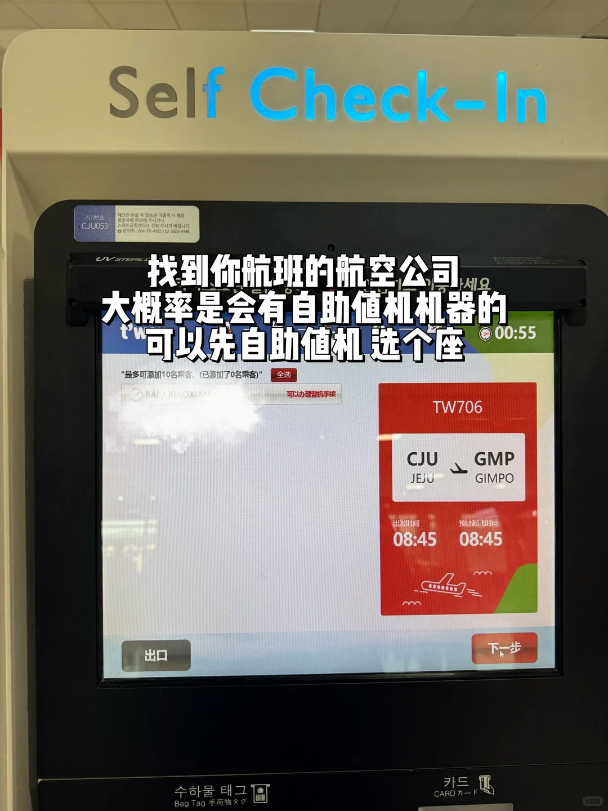

Чеджу — Сеул — один із найзавантаженіших внутрішніх маршрутів Кореї, і найбільше рейсів приймає Кімпхо. Переліт триває трохи більше години, маршрут ділять Korean Air, Asiana і кілька лоукостерів, а рейси вилітають від раннього ранку до пізнього вечора. Для всіх, хто має корейську візу, це звичайний внутрішній рейс: без імміграційного контролю й митниці — просто заберіть багаж і вийдіть із терміналу.

Однак для китайських мандрівників, які в’їхали до Чеджу без візи, є легко пропустити нюанс. Безвізовий в’їзд Чеджу поширюється лише на острів Чеджу. Переліт на материк — це внутрішній сегмент у межах Кореї, і для нього потрібна чинна корейська віза. Цей путівник проходить подорож у п’ять етапів — віза, реєстрація, коридор для іноземців, посадка й прибуття в Кімпхо — а тарифи та граничні часи наведені лише для орієнтиру.

## 1. Спершу перевірте візу: безвізовий в’їзд до Чеджу не поширюється на материк

Власники китайських паспортів можуть в’їжджати до Чеджу без візи, зазвичай до 30 днів, але цей дозвіл закінчується на острові. Щойно ви летите до Сеула, Пусана чи будь-куди на материк, рейс вважають внутрішнім сегментом, і авіакомпанія на реєстрації перевірить паспорт на наявність корейської візи або посвідки на проживання.

Без неї стійка не видасть посадковий талон, а коридор для іноземців далі вас теж зупинить. В аеропорту немає візового столу, тож єдиний вихід — перебронювати зворотний рейс або летіти до третьої країни. Мандрівників із туристичною візою C-3-9, студентською візою чи дозволом на роботу й проживання це не стосується; корейська віза не потрібна й тим, хто в’їхав до Чеджу без візи та вилітає назад із Чеджу. Не бронюйте «в’їзд через Чеджу, виїзд через Сеул» як одну подорож, якщо не маєте візи. Віза третьої країни чи K-ETA не замінюють її, а візова політика Кореї час від часу змінюється, тож перед бронюванням перевірте актуальне повідомлення корейського посольства для вашого типу паспорта.

## 2. Аеропорт Чеджу: одразу до внутрішніх вильотів на 3-му поверсі

Внутрішній і міжнародний термінали Чеджу стоять поруч, але мають окремі зали вильоту. Рейси до Кімпхо вирушають із внутрішнього терміналу, а вильоти — на 3-му поверсі. Із зали прибуття йдіть за вказівниками «국내선출발 / Domestic Departures» угору ескалатором; написи корейською, англійською та китайською.

Закладіть годину-півтори. Внутрішня реєстрація зазвичай закривається за 30 хвилин до вильоту, а в пікові години черга на здачу багажу може звиватися залою. Автомати самообслуговування перемикаються на китайську й дозволяють вибрати місце за шестизначним номером бронювання, але з іноземним паспортом зазвичай не видають посадковий талон самостійно. Виберіть місце в автоматі, потім підійдіть до стійки авіакомпанії, щоб персонал перевірив паспорт і візу, роздрукував посадковий талон і прийняв багаж. Це треба зробити навіть без зареєстрованого багажу, тож не йдіть до контролю лише з квитанцією з автомата.

## 3. Коридор лише для іноземців біля виходу 3

Із посадковим талоном у руці настає найпростіший неправильний поворот подорожі: не йдіть за корейськими пасажирами. Біля виходу 3 у зоні внутрішніх вильотів є коридор лише для іноземців, позначений синьою табличкою «Foreigners / 外国人专用» біля входу на контроль.

Персонал перевіряє паспорт, посадковий талон і візу, перш ніж пропустити вас до контролю, а в деякі години ви самі скануєте паспорт і відбиток пальця на вході. Це єдина частина аеропорту, створена спеціально для іноземних мандрівників, і саме тут розвертають тих, хто без візи. Якщо ви подорожуєте з кимось за корейським паспортом або посвідкою на проживання, ця людина може скористатися звичайним коридором і зустріти вас у залі очікування після контролю.

## 4. Контроль, посадка й годинний переліт

За коридором контроль звичайний. Внутрішній пункт перевірки Чеджу працює швидко, ноутбуки та павербанки зазвичай лишаються в сумці, але рідини, ножі й запальнички підлягають тим самим правилам, що й будь-де, і останнє слово за офіцером того дня. Павербанки мають бути в ручній поклажі й не можуть бути в зареєстрованому багажі.

Знайдіть свій вихід за посадковим талоном: виходи 1–9 розташовані на 2-му поверсі, а зала очікування невелика — кіоски й кав’ярні за кілька хвилин. Посадка зазвичай починається за 15–20 хвилин до вильоту, а лоукостери запрошують пасажирів за зонами місць.

Переліт триває близько години, у повітрі — від 55 хвилин до 1 години 5 хвилин. Харчування немає, а в лоукостері навіть вода коштує окремо. Зимові вітри над Чеджу можуть зробити захід на посадку тряским, тож тримайте ремінь застебнутим на зльоті й посадці. У Кімпхо немає ні імміграційного контролю, ні митниці: йдіть за вказівниками внутрішніх прибуттів — і ви на виході.

## 5. Прибуття в Кімпхо: внутрішні прибуття й місто

Внутрішні прибуття в Кімпхо — на 1-му поверсі. Багажна стрічка за кілька хвилин ходьби від виходу, екрани показують, яка стрічка обслуговує ваш рейс, а митну декларацію заповнювати не треба. Кімпхо розташований лише за дванадцять чи близько того кілометрів від центру міста — це його головна перевага над Інчхоном.

Купуйте й поповнюйте картку T-money у крамниці — CU і GS25 підходять, а вартість картки оплачується окремо. Одна картка покриває метро, аеропортову залізницю, автобуси й таксі. Станція «Аеропорт Кімпхо» — у підвалі терміналу, приблизно за п’ять хвилин пішки під землею.

До міста зазвичай їдуть трьома способами. Потяг AREX із усіма зупинками дістається до Сеульського вокзалу приблизно за 22 хвилини за близько 1,750 вон із T-money. Лінія метро 5 прямує до Йоїдо й Кванхвамуна, а лінія 9 — до Каннама, обидві без пересадок. Таксі до центру міста їде 20–30 хвилин і коштує близько 20,000–30,000 вон. Для Хондже AREX — три зупинки й близько 13 хвилин; для Каннама лінія 9 йде туди напряму.

На зворотному шляху Кімпхо — Чеджу також внутрішній виліт, але Кімпхо більший, і черги на контроль довші, тож додайте 20 хвилин. Останнє: цей рейс не створює запису про в’їзд і не подовжує перебування. Безвізовий в’їзд до Чеджу зберігає термін, наданий під час в’їзду, і переліт до Сеула його не скидає.

## Пов’язані посилання

- **На цьому сайті**: [Південна Корея (KR)](/country/KR)
- **Вікіпедія**: [Міжнародний аеропорт Чеджу](https://en.wikipedia.org/wiki/Jeju_International_Airport), [Міжнародний аеропорт Кімпхо](https://en.wikipedia.org/wiki/Gimpo_International_Airport)
- **Baidu Baike**: [Міжнародний аеропорт Чеджу](https://baike.baidu.com/item/%E6%B5%8E%E5%B7%9E%E5%9B%BD%E9%99%85%E6%9C%BA%E5%9C%BA), [Міжнародний аеропорт Кімпхо](https://baike.baidu.com/item/%E9%87%91%E6%B5%A6%E5%9B%BD%E9%99%85%E6%9C%BA%E5%9C%BA)

Джерело: путівник із WeChat, відредагований у жовтні 2026 року. Візові правила, граничні часи реєстрації та тарифи відповідають Міністерству юстиції Кореї, авіакомпаніям і чинним повідомленням аеропорту.
