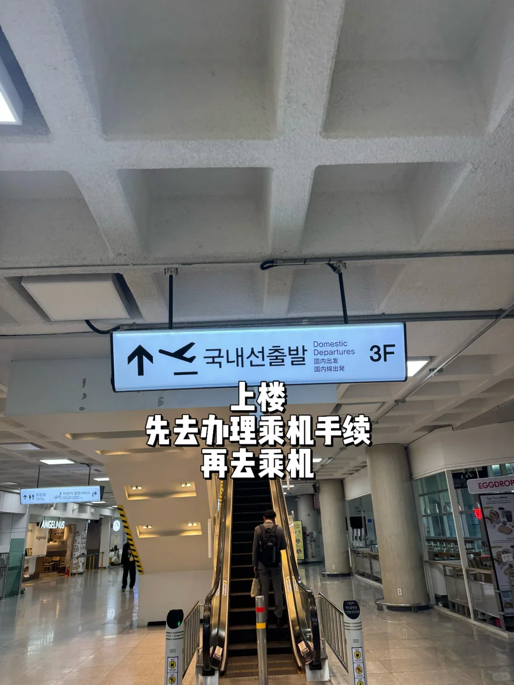

Jeju đến Seoul là một trong những đường bay nội địa bận rộn nhất Hàn Quốc, và Gimpo nhận nhiều chuyến nhất. Chặng bay chỉ hơn một giờ, Korean Air, Asiana và một số hãng giá rẻ cùng khai thác, với các chuyến từ sáng sớm đến đêm muộn. Với người có thị thực Hàn Quốc, đây là chuyến bay nội địa bình thường: không nhập cảnh, không hải quan, chỉ nhận vali rồi rời nhà ga.

Tuy nhiên, với du khách Trung Quốc nhập cảnh Jeju theo diện miễn thị thực, có một cái bẫy dễ bỏ sót. Diện miễn thị thực của Jeju chỉ áp dụng cho đảo Jeju. Bay vào đất liền là một chặng nội địa trong lãnh thổ Hàn Quốc, và chặng đó cần thị thực Hàn Quốc hợp lệ. Cẩm nang này chia chuyến đi thành năm bước — thị thực, check-in, làn dành riêng cho người nước ngoài, lên máy bay và đến Gimpo — với giá vé và giờ chốt chỉ mang tính tham khảo.

## 1. Kiểm tra thị thực trước: miễn thị thực Jeju không áp dụng cho đất liền

Người mang hộ chiếu Trung Quốc có thể nhập cảnh Jeju không cần thị thực, thường tối đa 30 ngày, nhưng sự cho phép đó dừng lại ở hòn đảo. Ngay khi bạn bay đến Seoul, Busan hay bất kỳ nơi nào khác trên đất liền, chuyến bay được coi là chặng nội địa, và hãng hàng không sẽ kiểm tra hộ chiếu của bạn để tìm thị thực Hàn Quốc hoặc giấy phép cư trú tại quầy check-in.

Không có thị thực, quầy sẽ không cấp thẻ lên máy bay, và làn dành riêng cho người nước ngoài phía sau cũng sẽ chặn bạn. Sân bay không có quầy thị thực, nên lựa chọn duy nhất là đổi vé về hoặc bay sang quốc gia thứ ba. Người có thị thực du lịch C-3-9, thị thực sinh viên hoặc giấy phép lao động và cư trú không bị ảnh hưởng; người nhập cảnh Jeju theo diện miễn thị thực rồi bay ra khỏi Jeju cũng không cần thị thực Hàn Quốc. Đừng đặt “vào qua Jeju, ra qua Seoul” như một chuyến đi trừ khi bạn có thị thực. Thị thực của quốc gia thứ ba hay K-ETA không thay thế được, và chính sách thị thực Hàn Quốc thay đổi theo thời gian, nên hãy kiểm tra thông báo hiện hành của đại sứ quán Hàn Quốc cho loại hộ chiếu của bạn trước khi đặt vé.

## 2. Sân bay Jeju: đi thẳng đến khu khởi hành nội địa ở tầng 3

Nhà ga nội địa và quốc tế của Jeju nằm cạnh nhau, với sảnh khởi hành riêng. Các chuyến đến Gimpo dùng nhà ga nội địa, và khu khởi hành ở tầng 3. Từ khu đến, đi theo biển “국내선출발 / Domestic Departures” lên thang cuốn; biển chỉ dẫn có tiếng Hàn, tiếng Anh và tiếng Trung.

Hãy dành một đến một tiếng rưỡi. Check-in nội địa thường đóng 30 phút trước giờ khởi hành, và hàng chờ gửi hành lý có thể uốn quanh sảnh vào giờ cao điểm. Máy tự phục vụ chuyển sang tiếng Trung và cho bạn chọn ghế bằng mã đặt chỗ sáu chữ số, nhưng hộ chiếu nước ngoài thường không thể tự tạo thẻ lên máy bay. Chọn ghế tại máy, rồi đến quầy hãng hàng không để nhân viên kiểm tra hộ chiếu và thị thực, in thẻ lên máy bay và nhận hành lý. Bạn vẫn phải làm bước này dù không có hành lý ký gửi, nên đừng đi thẳng đến an ninh chỉ với biên nhận từ máy.

## 3. Làn dành riêng cho người nước ngoài, gần cổng 3

Có thẻ lên máy bay trong tay, bạn đối mặt với ngã rẽ sai dễ nhất của chuyến đi: đừng đi theo hành khách Hàn Quốc. Gần cổng 3 trong khu khởi hành nội địa có một làn dành riêng cho người nước ngoài, được đánh dấu bằng biển xanh “Foreigners / 外国人专用” bên cạnh lối vào an ninh.

Nhân viên kiểm tra hộ chiếu, thẻ lên máy bay và thị thực trước khi cho bạn qua an ninh, và vào một số khung giờ bạn tự quét hộ chiếu và vân tay tại cổng. Đây là phần duy nhất của sân bay được xây riêng cho du khách nước ngoài, và cũng là nơi người không có thị thực bị quay lại. Nếu bạn đi cùng người mang hộ chiếu Hàn Quốc hoặc thẻ cư trú, họ có thể dùng làn thường và gặp bạn trong phòng chờ sau an ninh.

## 4. An ninh, lên máy bay và chuyến bay một giờ

Qua làn, an ninh diễn ra bình thường. Trạm kiểm soát nội địa của Jeju xử lý nhanh, và laptop cùng pin dự phòng thường được để trong túi, nhưng chất lỏng, dao và bật lửa theo cùng quy định như mọi nơi khác, và nhân viên trong ngày có tiếng nói cuối cùng. Pin dự phòng phải để trong hành lý xách tay và không được cho vào hành lý ký gửi.

Tìm cổng của bạn trên thẻ lên máy bay: cổng 1 đến 9 ở tầng 2, khu chờ nhỏ, với cửa hàng tiện lợi và quán cà phê trong vòng vài phút đi bộ. Việc lên máy bay thường bắt đầu 15 đến 20 phút trước giờ khởi hành, các hãng giá rẻ gọi hành khách theo khu ghế.

Chuyến bay kéo dài khoảng một giờ, với 55 phút đến 1 giờ 5 phút trên không. Không có suất ăn, và trên hãng giá rẻ ngay cả nước cũng tính thêm phí. Gió mùa đông trên Jeju có thể làm lúc hạ cánh xóc, nên hãy thắt dây an toàn khi cất và hạ cánh. Ở Gimpo không có nhập cảnh và không có hải quan: đi theo biển khu đến nội địa là bạn ra ngoài.

## 5. Đến Gimpo: khu đến nội địa và thành phố

Khu đến nội địa ở Gimpo nằm ở tầng 1. Băng chuyền hành lý cách cổng vài phút đi bộ, màn hình hiển thị băng nào phục vụ chuyến của bạn, và không có tờ khai hải quan phải điền. Gimpo chỉ cách trung tâm thành phố mười mấy kilômét, đó là lợi thế chính so với Incheon.

Mua và nạp thẻ T-money tại cửa hàng tiện lợi — CU và GS25 đều được, phí làm thẻ tính riêng. Một thẻ dùng cho tàu điện ngầm, đường sắt sân bay, xe buýt và taxi. Ga Sân bay Gimpo nằm ở tầng hầm nhà ga, đi bộ dưới lòng đất khoảng năm phút.

Có ba cách thường dùng để vào trung tâm. Tàu AREX dừng mọi ga đến Ga Seoul trong khoảng 22 phút với giá khoảng 1.750 won khi dùng T-money. Tuyến tàu điện ngầm số 5 chạy về Yeouido và Gwanghwamun, tuyến số 9 về Gangnam, cả hai không cần đổi tàu. Taxi vào trung tâm mất 20 đến 30 phút và khoảng 20.000 đến 30.000 won. Đến Hongdae, AREX đi ba ga và khoảng 13 phút; đến Gangnam, tuyến số 9 chạy thẳng.

Lúc quay lại, Gimpo đến Jeju cũng là khởi hành nội địa, nhưng Gimpo là sân bay lớn hơn và hàng chờ an ninh dài hơn, nên cộng thêm 20 phút. Một điểm cuối: chuyến bay này không tạo bản ghi nhập cảnh và không gia hạn thời gian lưu trú. Việc nhập cảnh Jeju theo diện miễn thị thực giữ nguyên thời hạn được cấp khi nhập cảnh, và bay đến Seoul không làm mới thời hạn đó.

## Liên kết liên quan

- **Trên trang này**: [Hàn Quốc (KR)](/country/KR)
- **Wikipedia**: [Sân bay Quốc tế Jeju](https://en.wikipedia.org/wiki/Jeju_International_Airport), [Sân bay Quốc tế Gimpo](https://en.wikipedia.org/wiki/Gimpo_International_Airport)
- **Baidu Baike**: [Sân bay Quốc tế Jeju](https://baike.baidu.com/item/%E6%B5%8E%E5%B7%9E%E5%9B%BD%E9%99%85%E6%9C%BA%E5%9C%BA), [Sân bay Quốc tế Gimpo](https://baike.baidu.com/item/%E9%87%91%E6%B5%A6%E5%9B%BD%E9%99%85%E6%9C%BA%E5%9C%BA)

Nguồn: một cẩm nang du lịch trên WeChat, biên tập tháng 10 năm 2026. Quy định thị thực, giờ chốt check-in và giá vé theo Bộ Tư pháp Hàn Quốc, các hãng hàng không và thông báo hiện hành của sân bay.
