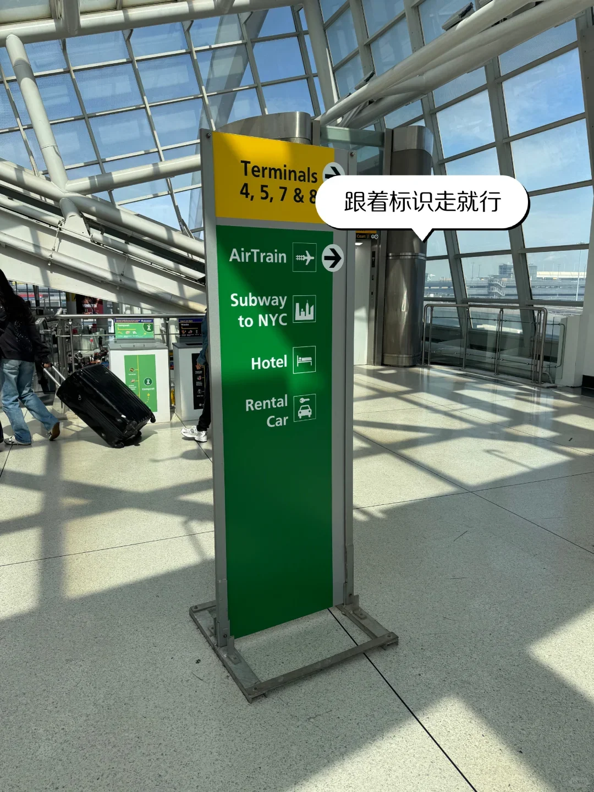
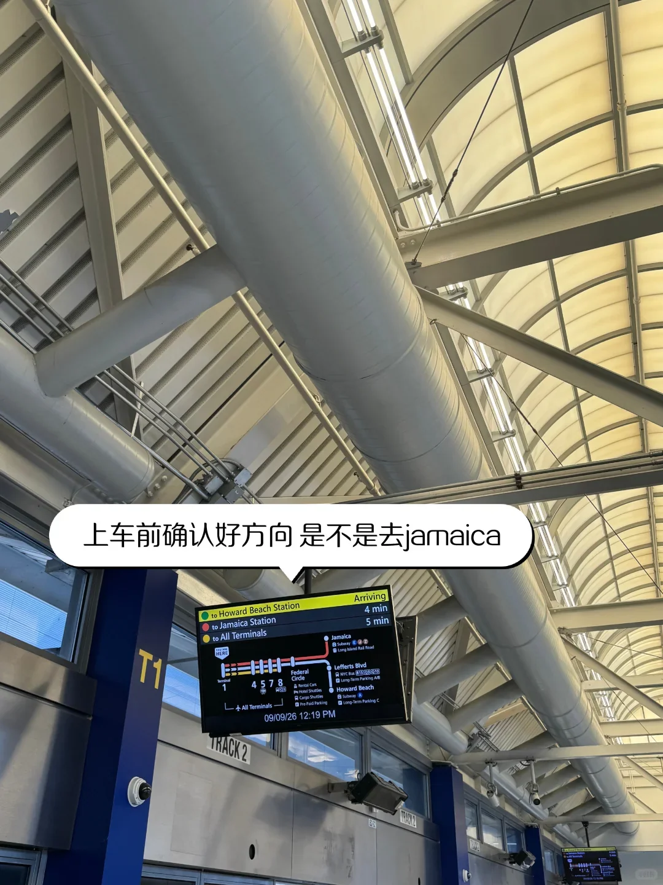

আন্তর্জাতিক গেট থেকে ম্যানহাটনের সাবওয়েতে একটি আসন পর্যন্ত JFK-তে চারটি ধাপ: ইমিগ্রেশন, ব্যাগেজ, কাস্টমস, তারপর AirTrain আর শহরে ঢোকার ট্রেন। ধাপ কম, কিন্তু বিমানবন্দর বড় আর সাইনগুলো শাখা-প্রশাখায় ভাগ; স্যুটকেস হাতে একবার ভুল বাঁক নিলে আধা ঘণ্টা খরচ।

নিচে সেগুলো আপনার সামনে যেভাবে আসবে সেই ক্রমে: T1 আগমন, CBP লাইন, AirTrain-এর দুই শাখা, আর জ্যামাইকায় পরিবর্তন। অপেক্ষার সময় ফ্লাইট ও সময়ভেদে বদলায়, তাই সংখ্যাগুলো আনুমানিক ধরুন।

## 1. আগমন: ভিজিটর লেন খুঁজুন

আন্তর্জাতিক আগমন নিচতলায়; "Arrivals" অনুসরণ করুন। যারা মার্কিন নাগরিক নন তাঁরা সবাই ভিজিটর লেন ব্যবহার করেন, ESTA-তে ভ্রমণ করুন বা ভিসায়, আর মার্কিন নাগরিক ও স্থায়ী বাসিন্দারা অন্যদিকে লাইনে দাঁড়ান। T1 JFK-এর পুরোনো আন্তর্জাতিক টার্মিনালগুলোর একটি এবং আগমন এলাকা ছোট: ট্রানজিট এলাকা পেরিয়ে নিচে ইমিগ্রেশন হলে নামেন।

লাইনে দাঁড়ানোর আগেই কাগজপত্র হাতে রাখুন: পাসপোর্ট, ESTA বা ভিসা, দশ বছরের B1/B2 ভিসার জন্য EVUS প্রিন্টআউট, ফেরার বা পরবর্তী গন্তব্যের টিকিট, হোটেল বুকিং। ফোনের স্ক্রিনশটও চলে, কিন্তু সিগন্যাল না পেলে কাগজই বেশি নির্ভরযোগ্য।

লাইন নির্ভর করে একসঙ্গে কতগুলো ফ্লাইট নামছে তার উপর: একসঙ্গে দুই-তিনটি ওয়াইড-বডি মানে চল্লিশ-পঞ্চাশ মিনিট, ছড়িয়ে ছিটিয়ে এলে পনেরো মিনিটে পার। ইমিগ্রেশন হলে ফোন ও ছবি তোলা নিষিদ্ধ, তাই ফোন সরিয়ে রাখুন। ছোট শিশু নিয়ে পরিবারগুলো ফ্যামিলি লেন ব্যবহার করতে পারেন।

## 2. CBP ও কাস্টমস: কী কী জিজ্ঞেস করা হয়

কাস্টমস অ্যান্ড বর্ডার প্রোটেকশনের অফিসার সাধারণত চারটি জিনিস জিজ্ঞেস করেন: ভ্রমণের উদ্দেশ্য, কতদিন থাকবেন, কোথায় থাকবেন, এবং সঙ্গে খাবার বা $10,000-এর বেশি নগদ আছে কি না। এরপর আঙুলের ছাপ ও ছবি, সাধারণত এতটুকুই। সেকেন্ডারি ইন্সপেকশনে পাঠালে শান্ত থাকুন এবং বুকিং নিশ্চিতকরণ দেখিয়ে যাত্রাসূচি বুঝিয়ে দিন।

ইমিগ্রেশনের পর আসে ব্যাগেজ। স্ক্রিনে আপনার ফ্লাইটের কনভেয়ার খুঁজে স্যুটকেস নিন, তারপর কাস্টমস: ঘোষণার কিছু না থাকলে সবুজ চ্যানেল, খাবার, মাত্রাতিরিক্ত মদ বা তামাক, বা $10,000-এর বেশি নগদ থাকলে লাল চ্যানেল। ঘোষণাপত্র বিমানেই বা হলে থাকা কিয়স্কে পূরণ করা যায়; মাংস, ফল ও পোষা প্রাণীর খাবার — সবই ঘোষণাযোগ্য।

পরের ফ্লাইট অভ্যন্তরীণ হলে প্রতিটি ব্যাগ নামিয়ে কাস্টমস পার হতে হবে, তারপর আবার চেক-ইন করে প্রস্থান তলায় নিরাপত্তা তল্লাশি দিতে হবে — JFK-তে আন্তর্জাতিক থেকে অভ্যন্তরীণে সরাসরি ট্রান্সফার নেই।

কাস্টমসের পরে আগমন হল, যেখানে মানুষ আপনাকে নিতে অপেক্ষা করে। সেখানকার সিম কার্ড, মানি এক্সচেঞ্জ ও পরিবহনের ডেস্কগুলো বাধ্য যাত্রীদের দামে চলে; যা অনলাইনে সাজানো যায়, উড়ানের আগেই সেরে রাখুন।

## 3. AirTrain: জ্যামাইকা নাকি হাওয়ার্ড বিচ

টার্মিনাল থেকে AirTrain-এর সাইন অনুসরণ করে লিফট বা এস্কেলেটরে প্ল্যাটফর্মে উঠুন। টার্মিনালগুলোর মধ্যে AirTrain ফ্রি, টাকা লাগে শুধু বিমানবন্দর ছাড়ার সময়, তাই ভুল টার্মিনালে নামলে খরচ নেই আর কানেকশনে টার্মিনাল বদলাতে টিকিট লাগে না। পিক সময়ে ট্রেন 5–10 মিনিট পর পর, গভীর রাতে প্রায় 15 মিনিট পর পর, বগির দুই মাথায় লাগেজ রাখার র্যাক।

T1 থেকে দুই দিকে ট্রেন যায়। একটি যায় জ্যামাইকা, আগে টার্মিনাল 4, 5, 7 ও 8-এ থেমে, প্রায় 10–15 মিনিটে; অন্যটি যায় হাওয়ার্ড বিচ, A ট্রেনের জন্য। প্ল্যাটফর্মের স্ক্রিনে পরের ট্রেন ও তার গন্তব্য লেখা থাকে, তাই ভিড়ের পিছু না নিয়ে ওঠার আগে দেখে নিন।

জ্যামাইকা বা হাওয়ার্ড বিচে বেরোনোর সময় প্রায় $8.50 দিতে হয়। গেটে OMNY বা কন্টাক্টলেস কার্ড বা ফোন চলে, নগদ নয়; নগদ হাতে থাকলে আগে কনকোর্সের মেশিন থেকে টিকিট কিনুন। জ্যামাইকা AirTrain, লং আইল্যান্ড রেল রোড ও সাবওয়ের জন্য বহুতল ইন্টারচেঞ্জ, আর সাইনগুলো আপনাকে ঘুরপথে হাঁটতে দেয় না।

## 4. জ্যামাইকা: E, J ও Z, এবং OMNY

AirTrain থেকে নেমে "Subway" সাইন অনুসরণ করে ইনডোর ওয়াকওয়ে দিয়ে সাটফিন বুলেভার্ড–আর্চার এভিনিউ–JFK স্টেশনে যান, হাঁটা প্রায় পাঁচ মিনিট। E ট্রেন কুইন্স বুলেভার্ড ধরে মিডটাউনে যায়, 53 স্ট্রিট–7 এভিনিউ ও লেক্সিংটন এভিনিউ–53 স্ট্রিটের আশপাশে থামে; J ও Z উইলিয়ামসবার্গ ব্রিজ পেরিয়ে লোয়ার ম্যানহাটনে যায়, ফুলটন স্ট্রিট ও ব্রড স্ট্রিটে থেমে। মিডটাউন মানে E; লোয়ার ম্যানহাটন মানে J বা Z।

সাবওয়েতে প্রতি রাইডে প্রায় $3, কার্ড বা ফোন OMNY-তে ট্যাপ করে দিতে হয়। MetroCard ধাপে ধাপে বন্ধ হচ্ছে, স্টেশনগুলো নতুন কার্ড আর বিক্রি করে না; ব্যালেন্স থাকা পুরোনো কার্ড শেষ পর্যন্ত ব্যবহার করা যায়। ট্যাপ করতে হয় শুধু ঢোকার সময় — বেরোনোর সময় ট্যাপ নেই, আর সিস্টেমের ভেতরে লাইন বদলানো ফ্রি। সাত দিনে 12 বার ট্যাপের পর বাকিগুলো ফ্রি, সাপ্তাহিক সীমা প্রায় $35, যা দীর্ঘ থাকলে লাভজনক।

মিডটাউনে পৌঁছাতে 45–60 মিনিট, ট্যাক্সির চেয়ে ধীর কিন্তু খরচের ভগ্নাংশ। E ট্রেন সারারাত চলে; মধ্যরাতের পর J ও Z কম, তাই দেরিতে নামলে আর ডাউনটাউনে থাকলে শেষ ট্রেন দেখে নিন। টাইমস স্কয়ারের জন্য 42 স্ট্রিটে পরিবর্তন করুন, যেখানে উত্তর-দক্ষিণমুখী লাইনগুলো মিলিত হয়।

## 5. দ্রুততর বিকল্প: LIRR, A ট্রেন ও ট্যাক্সি

লং আইল্যান্ড রেল রোড দ্রুততর: জ্যামাইকায় বদলে প্রায় 20 মিনিটে গ্র্যান্ড সেন্ট্রাল ম্যাডিসন বা পেন স্টেশনে পৌঁছান, CityTicket প্রায় $5–6 আর ট্রেনও ঘন ঘন; বগিতে বড় স্যুটকেসও ধরে। CityTicket হলো শহরের সীমার ভেতরে ভ্রমণের ছাড়ের ভাড়া, আর এটি কোন সময়ে প্রযোজ্য তা MTA ঠিক করে। মিডটাউনে থাকা আর ভারী ব্যাগ হলে পরিশ্রমের বিচারে এটি সাবওয়ের চেয়ে ভালো।

অন্য শাখাটি AirTrain ধরে হাওয়ার্ড বিচে, A ট্রেনের জন্য; এটি মিডটাউন না ছুঁয়ে লোয়ার ম্যানহাটন ও ব্রুকলিনে পৌঁছায় প্রায় 60 মিনিটে; লিফটসহ একটি ছাদযুক্ত ওয়াকওয়ে AirTrain-কে A প্ল্যাটফর্মের সঙ্গে জোড়ে। ট্যাক্সি ও রাইড-হেইলিং টার্মিনালের বাইরে নির্ধারিত এলাকায় যাত্রী তোলে, আর মিডটাউন পর্যন্ত ট্যাক্সিতে প্রায় $70–80 প্লাস টোল ও টিপ, রাতে বা জ্যামে আরও বেশি। রাতে ট্যাক্সির লাইনে দাঁড়ান আর রাস্তা থেকে হাত না নেড়ে রাইড-হেইলের নির্ধারিত পিকআপ ব্যবহার করুন।

| বিকল্প | মিডটাউনে সময় | আনুমানিক খরচ |
| --- | --- | --- |
| AirTrain + E ট্রেন | 60–75 মিনিট | প্রায় $11.50 |
| AirTrain + LIRR | 40–50 মিনিট | প্রায় $14–15 |
| ট্যাক্সি | 40–70 মিনিট | $70–80 থেকে |

## 6. যেসব বিষয়ে মানুষ আটকে পড়ে

- শাখা গুলিয়ে ফেলবেন না: E, J, Z ও LIRR-এর জন্য জ্যামাইকা; A-এর জন্য হাওয়ার্ড বিচ।
- টার্মিনালগুলোর মধ্যে AirTrain ফ্রি, কিন্তু সিস্টেম থেকে বেরিয়ে আবার ঢুকলে আবার টাকা লাগে।
- গভীর রাতে AirTrain সারারাত চলে আর E ট্রেনও সারারাত, তবে J ও Z কম।
- কানেকশনের জন্য টার্মিনাল বদলাতে অন্তত তিন ঘণ্টা ধরুন: AirTrain প্লাস আরেকবার নিরাপত্তা তল্লাশি।
- বেশিরভাগ সাবওয়ে স্টেশনে লিফট নেই, তাই দুটি বড় স্যুটকেস মানে সিঁড়ি; যেখানে সম্ভব লিফটওয়ালা এক্সিট বেছে নিন।
- প্ল্যাটফর্মের কিনার থেকে সরে দাঁড়ান, আর গভীর রাতে ভিড়ভর্তি বগিতে বসুন।

## সম্পর্কিত লিংক

- **এই সাইটে**: [জন এফ. কেনেডি আন্তর্জাতিক বিমানবন্দর (JFK)](/airport/JFK), [মার্কিন যুক্তরাষ্ট্র (US)](/country/US)
- **উইকিপিডিয়া**: [জন এফ. কেনেডি আন্তর্জাতিক বিমানবন্দর](https://en.wikipedia.org/wiki/John_F._Kennedy_International_Airport), [AirTrain JFK](https://en.wikipedia.org/wiki/AirTrain_JFK), [নিউ ইয়র্ক সিটি সাবওয়ে](https://en.wikipedia.org/wiki/New_York_City_Subway)
- **বাইদু বাইক**: [জন এফ. কেনেডি আন্তর্জাতিক বিমানবন্দর](https://baike.baidu.com/item/%E7%BA%A6%E7%BF%B0%C2%B7F%C2%B7%E8%82%AF%E5%B0%BC%E8%BF%AA%E5%9B%BD%E9%99%85%E6%9C%BA%E5%9C%BA), [AirTrain JFK](https://baike.baidu.com/item/AirTrain%20JFK), [নিউ ইয়র্ক সিটি সাবওয়ে](https://baike.baidu.com/item/%E7%BA%BD%E7%BA%A6%E5%9C%B0%E9%93%81)

ভাড়া ও সময় MTA ও JFK বিমানবন্দরের প্রকাশিত তথ্য অনুসারে; প্রবেশের নিয়ম CBP ও মার্কিন দূতাবাসের সর্বশেষ বিজ্ঞপ্তি অনুসারে। সূত্র: WeChat ভ্রমণ নির্দেশিকা।
