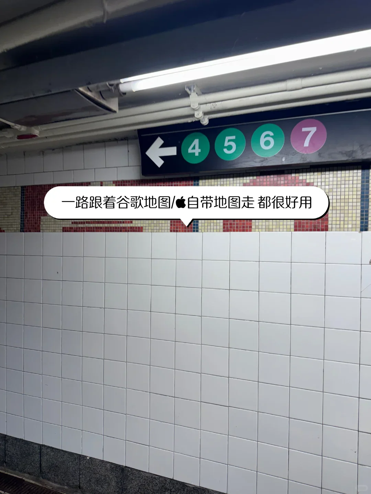
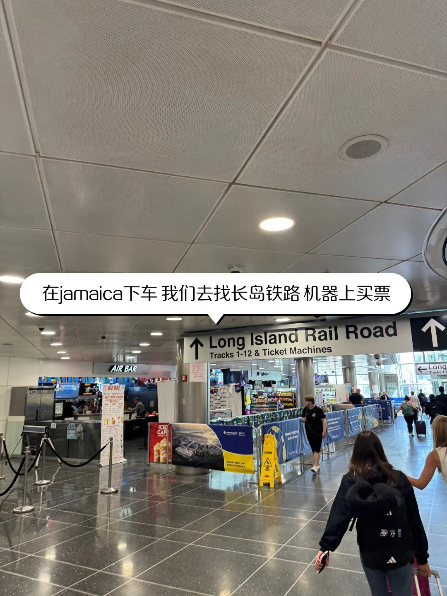

Dış hat kapısından Manhattan metrosunda bir koltuğa kadar JFK dört adım: göçmenlik, bagaj, gümrük, ardından AirTrain ve şehre giden bir tren. Adımlar az, ama havalimanı büyük ve tabelalar dallanıyor; valizle bir yanlış dönüş yarım saate mal oluyor.

Aşağıda karşılaşacağınız sırayla geliyorlar: T1 varışları, CBP kuyruğu, iki AirTrain hattı ve Jamaica'daki aktarma. Bekleme süreleri uçuşa ve saate göre değişir, bu yüzden rakamları referans alın.

## 1. Varışlar: ziyaretçi şeridini bulun

Dış hat varışları zemin katta; “Arrivals” tabelasını izleyin. ABD vatandaşı olmayan herkes, ESTA ya da vizeyle seyahat etsin, ziyaretçi şeridini kullanır; ABD vatandaşları ve kalıcı oturum sahipleri diğer tarafta kuyruğa girer. T1, JFK'nin daha eski dış hat terminallerinden biri ve varışlar derli toplu: aktarma alanını geçip göçmenlik salonuna iniyorsunuz.

Kuyruğa girmeden önce belgeleri elinizde tutun: pasaport, ESTA veya vize, on yıllık B1/B2 vizesi için EVUS çıktısı, dönüş veya devam bileti, otel rezervasyonu. Telefondaki ekran görüntüleri işe yarar, ama sinyal kesildiğinde kâğıt daha güvenilirdir.

Kuyruk aynı anda kaç uçağın indiğine bağlı: aynı anda iki üç geniş gövde kırk elli dakika demek, kademeli varışlar on beş dakikada geçiyor. Göçmenlik salonunda telefon ve fotoğraf yasak, bu yüzden telefonu kaldırın. Küçük çocuklu aileler aile şeridini kullanabilir.

## 2. CBP ve gümrük: neler sorulur

Bir Gümrük ve Sınır Koruma memuru genellikle dört şey sorar: seyahatin amacı, kalış süresi, nerede kalacağınız ve yiyecek ya da 10.000 $'dan fazla nakit taşıyıp taşımadığınız. Ardından parmak izi ve fotoğraf gelir, normalde bu kadardır. İkincil denetime gönderilirseniz sakin kalın ve güzergâhı rezervasyon onaylarınızla açıklayın.

Bagaj göçmenlikten sonra gelir. Uçuşunuzun bandını ekranlarda bulun, valizi alın, ardından gümrükten geçin: beyan edecek bir şeyiniz yoksa yeşil kanal, yiyecek, fazla alkol veya tütün ya da 10.000 $ üzeri nakit için kırmızı kanal. Beyan formu uçakta veya salondaki kiosklarda doldurulabilir; et, meyve ve evcil hayvan maması beyan edilebilir sayılır.

Sonraki uçuşunuz iç hat olsa bile tüm çantalarınızı alır, gümrükten geçer, sonra kalkış katında yeniden check-in yapıp güvenlikten geçersiniz — JFK'de dış hattan iç hatta steril aktarma yok.

Gümrüğün ötesinde varış salonu var, insanlar sizi karşılamak için orada bekler. Oradaki SIM kart, döviz ve ulaşım gişeleri mahsur kalanlara göre fiyatlandırılmıştır; yapabildiğiniz her şeyi uçmadan önce çevrim içi halledin.

## 3. AirTrain: Jamaica veya Howard Beach

Terminalden çıkıp AirTrain tabelalarını izleyin ve asansör ya da yürüyen merdivenle platforma çıkın. AirTrain terminaller arasında ücretsizdir ve yalnızca havalimanından çıkarken ücret alır; bu yüzden yanlış terminal hiçbir şeye mal olmaz ve aktarmada terminal değiştirmek bilet gerektirmez. Trenler yoğun saatlerde her 5–10 dakikada, gece geç saatlerde yaklaşık her 15 dakikada bir çalışır, vagon uçlarında bagaj rafları var.

T1'den iki yön var. Biri önce Terminal 4, 5, 7 ve 8'e uğrayarak yaklaşık 10–15 dakikada Jamaica'ya gider; diğeri A treni için Howard Beach'e gider. Platform ekranı sıradaki treni ve gideceği yeri yazar, kalabalığı izlemek yerine binmeden önce kontrol edin.

Jamaica veya Howard Beach'te çıkarken yaklaşık 8,50 $ ödersiniz. Kapılar OMNY ya da temassız kart veya telefon kabul eder, nakit almaz; yanınızda nakit varsa önce holdeki makinelerden bilet alın. Jamaica, AirTrain, Long Island Rail Road ve metro için çok katlı bir aktarma merkezidir ve tabelalar uzun yoldan yürümenizi önler.

## 4. Jamaica: E, J ve Z hatları ile OMNY

AirTrain'den inin ve “Subway” tabelalarını izleyerek kapalı yürüyüş yolundan Sutphin Blvd–Archer Av–JFK'ye gidin, yürüyerek yaklaşık beş dakika. E hattı Queens Boulevard boyunca Midtown'a iner, 53 St–7 Av ve Lexington Av–53 St civarında durur; J ve Z Williamsburg Köprüsü'nü geçerek Aşağı Manhattan'a gider, Fulton St ve Broad St'de durur. Midtown için E; Aşağı Manhattan için J veya Z.

Metro yolculuk başına yaklaşık 3 $, kart veya telefonla OMNY'ye dokunarak ödenir. MetroCard kaldırılıyor ve istasyonlar artık yeni kart satmıyor; bakiyesi olan eski kartlar hâlâ kullanılabilir. Yalnızca girişte dokunulur — çıkışta dokunma yoktur ve sistem içinde hat değiştirmek ücretsizdir. Yedi günde 12 dokunuştan sonra gerisi ücretsizdir, haftalık üst sınır yaklaşık 35 $'dır ve daha uzun bir konaklamada kendini amorti eder.

Midtown yaklaşık 45–60 dakika sürer, taksiye göre daha yavaş ama fiyatının çok küçük bir kısmı. E hattı gece boyunca çalışır; J ve Z gece yarısından sonra seyrektir, geç iniyorsanız ve şehir merkezinde kalıyorsanız son treni kontrol edin. Times Square için kuzey-güney hatlarının birleştiği 42 St'de aktarma yapın.

## 5. Daha hızlı seçenekler: LIRR, A treni ve taksiler

Long Island Rail Road daha hızlıdır: Jamaica'da aktarma yapın ve yaklaşık 20 dakikada Grand Central Madison veya Penn Station'a ulaşın; CityTicket yaklaşık 5–6 $ ve trenler sık; vagonlar büyük valizleri alır. CityTicket şehir sınırları içinde seyahat için indirimli ücrettir ve geçerli olduğu saatleri MTA belirler. Midtown'da konaklama ve ağır bagaj varsa, efor açısından metroyu yener.

Diğer hat, A treni için Howard Beach'e giden AirTrain'dir; Midtown'ı geçmeden Aşağı Manhattan ve Brooklyn'e yaklaşık 60 dakikada ulaşır; asansörlü kapalı bir yürüyüş yolu AirTrain'i A platformuna bağlar. Taksiler ve uygulama araçları terminal dışındaki işaretli alanlardan alır; Midtown'a taksi yaklaşık 70–80 $ artı otoyol ücretleri ve bahşiş, gece veya trafikte daha fazla. Gece taksi kuyruğuna girin ve kaldırımdan çağırmak yerine belirlenmiş uygulama alma noktasını kullanın.

| Seçenek | Midtown'a süre | Referans maliyet |
| --- | --- | --- |
| AirTrain + E treni | 60–75 dk | yaklaşık 11,50 $ |
| AirTrain + LIRR | 40–50 dk | yaklaşık 14–15 $ |
| Taksi | 40–70 dk | 70–80 $'dan başlar |

## 6. İnsanları yakalayan şeyler

- Şubeleri karıştırmayın: E, J, Z ve LIRR için Jamaica; A için Howard Beach.
- AirTrain terminaller arasında ücretsizdir, ama sistemden çıkıp yeniden girmek tekrar ücretlendirilir.
- Gece geç saatlerde AirTrain bütün gece, E hattı gece boyunca çalışır; J ve Z seyrektir.
- Aktarma için terminal değiştirmeye en az üç saat ayırın: AirTrain artı ikinci güvenlik kontrolü.
- Çoğu metro istasyonunda asansör yok, iki büyük valiz merdiven demektir; mümkünse asansörlü bir çıkış seçin.
- Platform kenarından geri durun ve gece geç saatlerde kalabalık bir vagonda oturun.

## İlgili bağlantılar

- **Bu sitede**: [John F. Kennedy Uluslararası Havalimanı (JFK)](/airport/JFK), [Amerika Birleşik Devletleri (US)](/country/US)
- **Wikipedia**: [John F. Kennedy Uluslararası Havalimanı](https://en.wikipedia.org/wiki/John_F._Kennedy_International_Airport), [AirTrain JFK](https://en.wikipedia.org/wiki/AirTrain_JFK), [New York City Subway](https://en.wikipedia.org/wiki/New_York_City_Subway)
- **Baidu Baike**: [John F. Kennedy Uluslararası Havalimanı](https://baike.baidu.com/item/%E7%BA%A6%E7%BF%B0%C2%B7F%C2%B7%E8%82%AF%E5%B0%BC%E8%BF%AA%E5%9B%BD%E9%99%85%E6%9C%BA%E5%9C%BA), [AirTrain JFK](https://baike.baidu.com/item/AirTrain%20JFK), [New York City Subway](https://baike.baidu.com/item/%E7%BA%BD%E7%BA%A6%E5%9C%B0%E9%93%81)

Ücretler ve süreler MTA ve JFK Havalimanı'nın yayımladığı bilgilere; giriş kuralları en güncel CBP ve ABD büyükelçiliği duyurularına göredir. Kaynak: WeChat seyahat rehberi.
