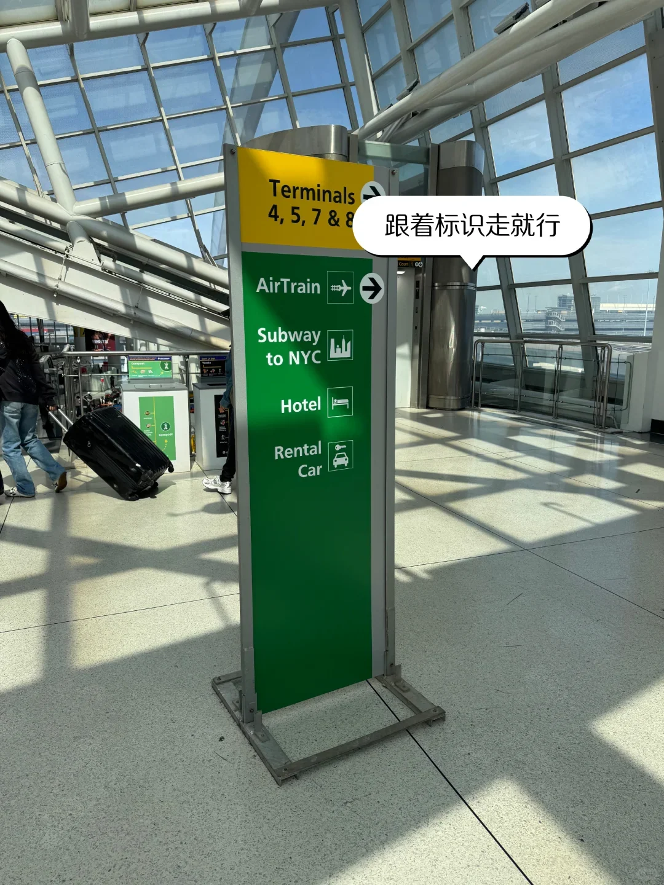
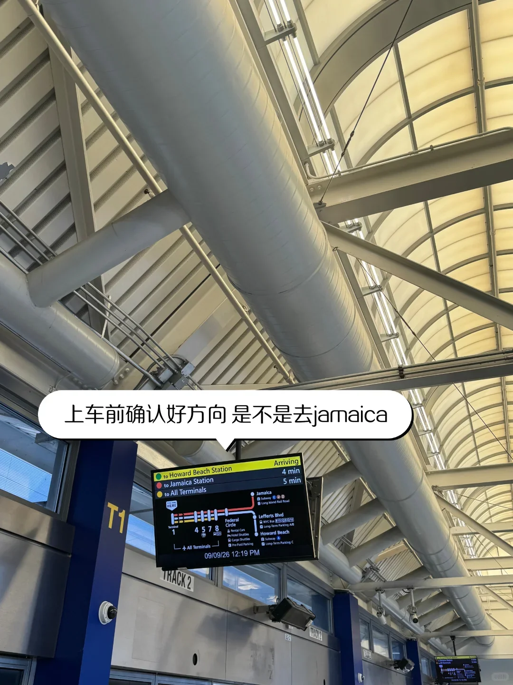
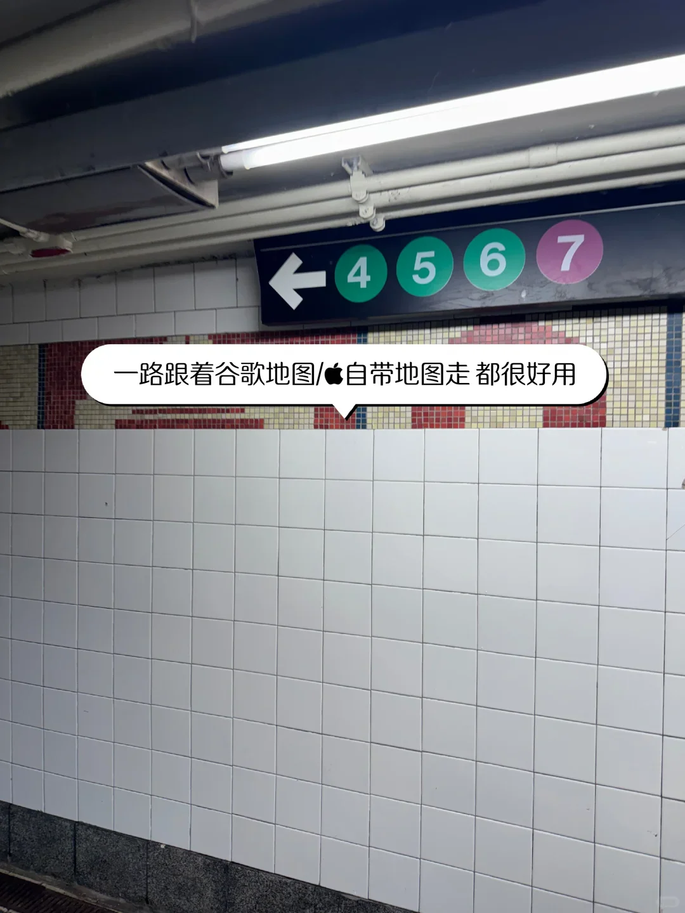
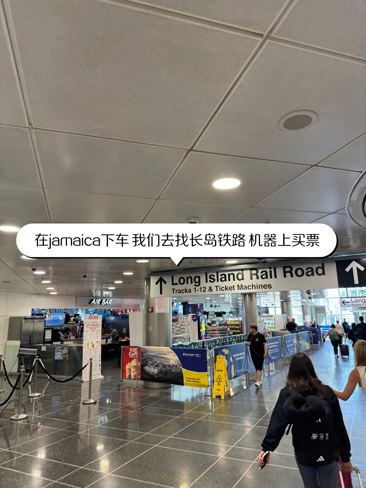
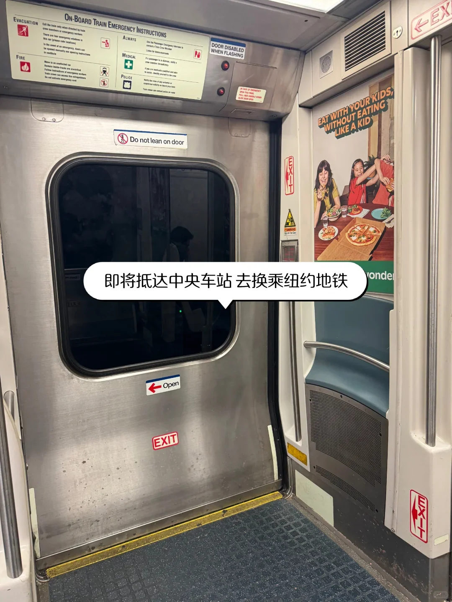

從國際航班下來，到坐上進曼哈頓的地鐵，JFK 這一段只有四步：入境、取行李、過海關、坐 AirTrain 換地鐵。步驟不多，但機場大、方向多，拖著箱子走錯一次就要多花半小時。

下面按落地後的順序，把 T1 到達、CBP 排隊、AirTrain 的兩條支線和 Jamaica 換乘講清楚。等待時間因航班和時段而異，文中數字只作參考。

## 一、下飛機先認清訪客通道

國際到達在航廈一層，跟著「Arrivals」走。非美國公民一律走 Visitors 通道，持 ESTA 的免籤旅客和持簽證的旅客都在這裡排隊，美國公民與永久居民走另一側。T1 是肯尼迪較早的國際航廈，到達層不大，下飛機後跟著人流先經過轉機區，再下到入境大廳，不會走丟。

排隊前把材料拿在手裡：護照、ESTA 或簽證、EVUS 登記列印件（持十年 B1/B2 簽證者）、回程或續程機票、酒店訂單。手機裡的截圖也能用，但列印件在訊號不好時更穩。

隊伍長短取決於同時到達的航班數量。同一時段落兩三架寬體機，排四五十分鐘很常見；航班錯開時十幾分鐘就過。入境大廳禁止使用手機和拍照，排隊時把手機收起來。帶小孩或老人的旅客可以留意家庭通道，現場工作人員會引導。

## 二、CBP 與海關：會問什麼

海關與邊境保護局（CBP）的官員通常問四件事：來美國做什麼、待多久、住在哪裡、有沒有帶食品或超過一萬美元的現金。按指紋、拍照，回答清楚就放行。被引導到二次檢查的旅客不用緊張，把行程單、酒店訂單和返程票拿出來說明即可。

入境之後才取行李。看大屏找到航班對應的轉盤，等箱子出來，再推著行李過海關：沒有需要申報的物品走無申報通道，帶了食品、菸酒超量或現金超一萬美元就走申報通道。申報單可以在飛機上填，也可以在入境大廳的自助機上填；肉類、水果、寵物食品都屬於要申報的類別。

如果下一段是美國國內航班，入境後仍要取出全部行李、過海關，再到出發層重新託運和安檢——JFK 沒有國際轉國內的免檢通道。

過了海關就是到達大廳，接機的人在這裡等。大廳裡的電話卡、換匯和交通櫃檯價格偏高，能提前在網上辦好的事不必在這裡辦。

## 三、AirTrain：Jamaica 還是 Howard Beach

出航廈跟著「AirTrain」的標識走，坐電梯或扶梯上到站臺。AirTrain 在航廈之間免費乘坐，只有出站時才收費，所以走錯航廈可以直接坐回去，轉機換樓也不必買票。高峰時段 5–10 分鐘一班，深夜約 15 分鐘一班，車廂兩端有行李架。

從 T1 出發有兩條方向：一條去 Jamaica，途中經 4、5、7、8 號航廈，約 10–15 分鐘；另一條去 Howard Beach，接地鐵 A 線。站臺螢幕會寫明下一班車的方向和到站時間，上車前確認一眼，別跟著人流上錯車。

到 Jamaica 或 Howard Beach 出閘時付費，約 8.50 美元。閘機可以刷 OMNY 或帶閃付標誌的信用卡、手機，不收現金；帶現金的旅客要先去站廳的售票機買票。Jamaica 站是 AirTrain、長島鐵路和地鐵的交匯點，站廳分幾層，跟著標識走不會繞遠。

## 四、Jamaica 換地鐵：E、J、Z 與 OMNY

出 AirTrain 後跟著「Subway」標識走，經室內通道到 Sutphin Blvd–Archer Av–JFK 站，步行約 5 分鐘。E 線走皇后大道進中城，停 53 St–7 Av、Lexington Av–53 St 一帶；J、Z 線過威廉斯堡橋到下城，停 Fulton St、Broad St。住中城選 E，住下城選 J/Z。

地鐵單程約 3 美元，用 OMNY 感應刷卡或用手機錢包；MetroCard 正逐步停用，車站不再賣新卡，手裡還有舊卡和餘額的可以先用完。進站刷一次即可，出站不用刷，站內換乘其他線路也不另收費。七天內刷滿 12 次之後不再扣費，一週上限約 35 美元，停留時間長反而划算。

到中城大約 45–60 分鐘，比叫車慢，但價格差著十幾倍。E 線通宵執行，J、Z 深夜班次很少；凌晨落地又住下城，先看末班車時間再決定。去時代廣場一帶可以在 42 St 換乘，往北的線路都在那一帶交匯。

## 五、更快的選擇：長島鐵路、A 線與計程車

想快可以坐長島鐵路（LIRR）：在 Jamaica 站換乘，到中央車站或賓州車站約 20 分鐘，CityTicket 約 5–6 美元，班次密，車廂裡能放大箱子。CityTicket 是市界內的優惠票，適用時段以 MTA 公佈為準；住中城、行李又多，這條線比地鐵省力。

另一條是 AirTrain 到 Howard Beach 換 A 線，去下城、布魯克林不用繞中城，全程約 60 分鐘；出站走天橋到 A 線站廳，通道有電梯。計程車和網約車在航廈外的指定區域上車，到中城約 70–80 美元，另加過路費和小費，深夜和堵車時更高。深夜叫車在指定區域排隊，網約車要到停車樓或指定上車點，別在路邊招手。

| 方式 | 到中城用時 | 參考費用 |
| --- | --- | --- |
| AirTrain + 地鐵 E | 60–75 分鐘 | 約 11.5 美元 |
| AirTrain + 長島鐵路 | 40–50 分鐘 | 約 14–15 美元 |
| 計程車 | 40–70 分鐘 | 70–80 美元起 |

## 六、幾個容易踩的坑

- 兩條支線別坐反：去地鐵 E、J、Z 和長島鐵路是 Jamaica，去 A 線是 Howard Beach。
- 航廈之間免費，但出閘再進要重新付費。
- 深夜到達：AirTrain 通宵執行，地鐵 E 線通宵，J、Z 班次很少。
- 換航廈轉機要留足時間：坐 AirTrain 加重新安檢，建議 3 小時以上。
- 多數地鐵站沒有電梯，兩隻大箱子走樓梯很吃力，儘量選有電梯的出口。
- OMNY 一週刷滿 12 次後免費，但多人同行不能共用一張卡。
- 站臺邊緣不要站太近，深夜坐人多的車廂。

## 相關連結

- **本站頁面**：[紐約肯尼迪國際機場（JFK）](/tw/airport/JFK)、[美國（US）](/tw/country/US)
- **維基百科**：[約翰·F·肯尼迪國際機場](https://zh.wikipedia.org/wiki/%E7%BA%A6%E7%BF%B0%C2%B7F%C2%B7%E8%82%AF%E5%B0%BC%E8%BF%AA%E5%9B%BD%E9%99%85%E6%9C%BA%E5%9C%BA)、[AirTrain JFK](https://zh.wikipedia.org/wiki/%E7%94%98%E8%BF%BA%E8%BF%AA%E5%9C%8B%E9%9A%9B%E6%A9%9F%E5%A0%B4%E6%8D%B7%E9%81%8B)、[紐約地鐵](https://zh.wikipedia.org/wiki/%E7%BA%BD%E7%BA%A6%E5%9C%B0%E9%93%81)

票價與時刻參考 MTA 與 JFK 機場的公開資訊，入境政策以美國海關與邊境保護局及美國駐華使領館的最新公告為準。資料來源：微信旅行攻略。
