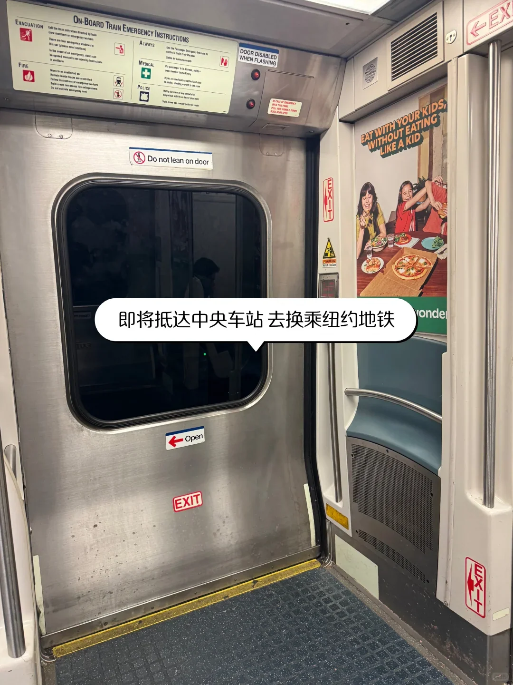

Từ cổng quốc tế đến một chỗ ngồi trên tàu điện ngầm Manhattan, JFK có bốn bước: nhập cảnh, hành lý, hải quan, rồi AirTrain và một chuyến tàu vào thành phố. Các bước ít, nhưng sân bay lớn và biển chỉ dẫn phân nhánh; một lần rẽ sai với chiếc vali mất nửa giờ.

Dưới đây là chúng theo đúng thứ tự bạn gặp: khu đến T1, hàng chờ CBP, hai nhánh AirTrain, và điểm đổi tàu ở Jamaica. Thời gian chờ thay đổi theo chuyến bay và khung giờ, nên hãy coi các con số là tham khảo.

## 1. Khu đến: tìm làn dành cho du khách

Khu đến quốc tế nằm ở tầng trệt; đi theo biển “Arrivals”. Mọi người không phải công dân Mỹ đều dùng làn dành cho du khách, dù đi theo ESTA hay thị thực, còn công dân và thường trú nhân Mỹ xếp hàng phía bên kia. T1 là một trong những nhà ga quốc tế cũ hơn của JFK và khu đến khá gọn: bạn đi qua khu quá cảnh, rồi xuống sảnh nhập cảnh.

Hãy cầm sẵn giấy tờ trước khi xếp hàng: hộ chiếu, ESTA hoặc thị thực, bản in EVUS nếu dùng thị thực B1/B2 mười năm, vé khứ hồi hoặc vé đi tiếp, đặt phòng khách sạn. Ảnh chụp trên điện thoại dùng được, nhưng giấy ổn định hơn khi mất sóng.

Hàng chờ tùy vào việc bao nhiêu chuyến cùng hạ cánh: hai ba máy bay thân rộng cùng lúc nghĩa là bốn mươi hay năm mươi phút, các chuyến đến rải đều thì qua trong mười lăm phút. Điện thoại và chụp ảnh bị cấm trong sảnh nhập cảnh, nên hãy cất điện thoại. Gia đình có trẻ nhỏ có thể dùng làn gia đình.

## 2. CBP và hải quan: những câu được hỏi

Nhân viên Hải quan và Bảo vệ Biên giới thường hỏi bốn điều: mục đích chuyến đi, thời gian lưu trú, bạn ở đâu, và bạn có mang thực phẩm hay hơn 10.000 USD tiền mặt không. Sau đó là vân tay và ảnh, thường chỉ vậy. Nếu bị đưa sang khu kiểm tra thứ cấp, hãy bình tĩnh và giải thích lịch trình bằng xác nhận đặt chỗ.

Hành lý đến sau nhập cảnh. Tìm băng chuyền cho chuyến của bạn trên màn hình, nhận vali, rồi làm thủ tục hải quan: làn xanh nếu không có gì để khai, làn đỏ nếu có thực phẩm, rượu hay thuốc lá vượt mức, hoặc tiền mặt trên 10.000 USD. Tờ khai có thể điền trên máy bay hoặc tại kiosk trong sảnh; thịt, trái cây và thức ăn cho thú cưng đều thuộc diện phải khai.

Nếu chuyến tiếp theo là nội địa, bạn vẫn phải nhận toàn bộ hành lý, làm thủ tục hải quan, rồi ký gửi lại và qua an ninh lần nữa ở tầng khởi hành — JFK không có khu chuyển tiếp quốc tế sang nội địa khép kín.

Qua hải quan là sảnh đến, nơi mọi người chờ đón bạn. SIM, đổi tiền và quầy giao thông ở đó có giá dành cho khách không còn lựa chọn; hãy sắp xếp trực tuyến mọi thứ có thể trước khi bay.

## 3. AirTrain: Jamaica hay Howard Beach

Đi theo biển AirTrain ra khỏi nhà ga và lên sân ga bằng thang máy hoặc thang cuốn. AirTrain miễn phí giữa các nhà ga và chỉ thu phí khi bạn rời sân bay, nên đi nhầm nhà ga không mất tiền và đổi nhà ga khi nối chuyến không cần vé. Tàu chạy mỗi 5–10 phút vào giờ cao điểm và khoảng 15 phút vào đêm muộn, có giá để hành lý ở đầu toa.

Từ T1 có hai hướng. Một hướng đến Jamaica, dừng ở Nhà ga 4, 5, 7 và 8 trước, trong khoảng 10–15 phút; hướng kia đến Howard Beach để bắt tàu A. Màn hình trên sân ga ghi chuyến tiếp theo và điểm đến, nên hãy kiểm tra trước khi lên thay vì đi theo đám đông.

Bạn trả khoảng 8,50 USD khi ra ở Jamaica hoặc Howard Beach. Cổng nhận OMNY hoặc thẻ hay điện thoại không tiếp xúc, và không nhận tiền mặt; nếu mang tiền mặt, hãy mua vé từ máy trong sảnh trước. Jamaica là điểm trung chuyển nhiều tầng cho AirTrain, Long Island Rail Road và tàu điện ngầm, và biển chỉ dẫn giúp bạn khỏi đi vòng đường dài.

## 4. Jamaica: tàu E, J và Z, và OMNY

Rời AirTrain và đi theo biển “Subway” qua hành lang trong nhà đến Sutphin Blvd–Archer Av–JFK, khoảng năm phút đi bộ. Tàu E chạy dọc Đại lộ Queens vào Midtown, dừng ở khu 53 St–7 Av và Lexington Av–53 St; tàu J và Z qua Cầu Williamsburg đến Hạ Manhattan, dừng ở Fulton St và Broad St. Midtown thì đi tàu E; Hạ Manhattan thì đi tàu J hoặc Z.

Tàu điện ngầm tốn khoảng 3 USD mỗi lượt, trả bằng cách chạm OMNY bằng thẻ hoặc điện thoại. MetroCard đang bị loại bỏ và các ga không còn bán thẻ mới; thẻ cũ còn số dư vẫn dùng được. Bạn chỉ chạm khi vào — không có chạm khi ra, và đổi tuyến trong hệ thống là miễn phí. Sau 12 lần chạm trong bảy ngày, các lần sau miễn phí, với mức trần khoảng 35 USD mỗi tuần, có lợi nếu bạn ở lâu.

Đến Midtown mất khoảng 45–60 phút, chậm hơn taxi và chỉ tốn một phần nhỏ giá. Tàu E chạy qua đêm; tàu J và Z thưa sau nửa đêm, nên hãy kiểm tra chuyến cuối nếu bạn hạ cánh muộn và ở khu trung tâm. Đến Quảng trường Times, đổi tàu ở 42 St, nơi các tuyến bắc–nam hội tụ.

## 5. Lựa chọn nhanh hơn: LIRR, tàu A và taxi

Long Island Rail Road nhanh hơn: đổi tàu ở Jamaica và đến Grand Central Madison hoặc Ga Penn trong khoảng 20 phút, với CityTicket khoảng 5–6 USD và tàu chạy thường xuyên; toa tàu chở được vali lớn. CityTicket là giá ưu đãi cho việc đi lại trong giới hạn thành phố, và khung giờ áp dụng do MTA quy định. Với chỗ ở Midtown và hành lý nặng, nó nhẹ nhàng hơn tàu điện ngầm.

Nhánh còn lại là AirTrain đến Howard Beach để bắt tàu A, chạy đến Hạ Manhattan và Brooklyn mà không qua Midtown, trong khoảng 60 phút; một hành lang có mái với thang máy nối AirTrain với sân ga tàu A. Taxi và xe công nghệ đón bên ngoài nhà ga ở khu vực được đánh dấu, và taxi đến Midtown khoảng 70–80 USD cộng phí cầu đường và tiền tip, đắt hơn vào ban đêm hoặc khi kẹt xe. Ban đêm hãy xếp hàng taxi và dùng điểm đón xe công nghệ được chỉ định thay vì vẫy xe từ lề đường.

| Lựa chọn | Thời gian đến Midtown | Chi phí tham khảo |
| --- | --- | --- |
| AirTrain + tàu E | 60–75 phút | khoảng 11,50 USD |
| AirTrain + LIRR | 40–50 phút | khoảng 14–15 USD |
| Taxi | 40–70 phút | từ 70–80 USD |

## 6. Những điều dễ khiến người ta trượt

- Đừng nhầm hai nhánh: Jamaica cho tàu E, J, Z và LIRR; Howard Beach cho tàu A.
- AirTrain miễn phí giữa các nhà ga, nhưng ra rồi vào lại hệ thống sẽ bị thu phí lần nữa.
- Đêm muộn, AirTrain chạy suốt đêm và tàu E chạy qua đêm, trong khi tàu J và Z thưa.
- Dành ít nhất ba giờ để đổi nhà ga nối chuyến: AirTrain cộng thêm một lần kiểm tra an ninh.
- Hầu hết ga tàu điện ngầm không có thang máy, nên hai vali lớn nghĩa là phải khiêng cầu thang; hãy chọn lối ra có thang máy khi có thể.
- Đứng cách mép sân ga, và ngồi ở toa đông người vào đêm muộn.

## Liên kết liên quan

- **Trên trang này**: [Sân bay Quốc tế John F. Kennedy (JFK)](/airport/JFK), [Hoa Kỳ (US)](/country/US)
- **Wikipedia**: [Sân bay Quốc tế John F. Kennedy](https://en.wikipedia.org/wiki/John_F._Kennedy_International_Airport), [AirTrain JFK](https://en.wikipedia.org/wiki/AirTrain_JFK), [Tàu điện ngầm Thành phố New York](https://en.wikipedia.org/wiki/New_York_City_Subway)
- **Baidu Baike**: [Sân bay Quốc tế John F. Kennedy](https://baike.baidu.com/item/%E7%BA%A6%E7%BF%B0%C2%B7F%C2%B7%E8%82%AF%E5%B0%BC%E8%BF%AA%E5%9B%BD%E9%99%85%E6%9C%BA%E5%9C%BA), [AirTrain JFK](https://baike.baidu.com/item/AirTrain%20JFK), [Tàu điện ngầm Thành phố New York](https://baike.baidu.com/item/%E7%BA%BD%E7%BA%A6%E5%9C%B0%E9%93%81)

Giá vé và thời gian theo thông tin công bố của MTA và sân bay JFK; quy định nhập cảnh theo thông báo mới nhất của CBP và đại sứ quán Mỹ. Nguồn: cẩm nang du lịch WeChat.
