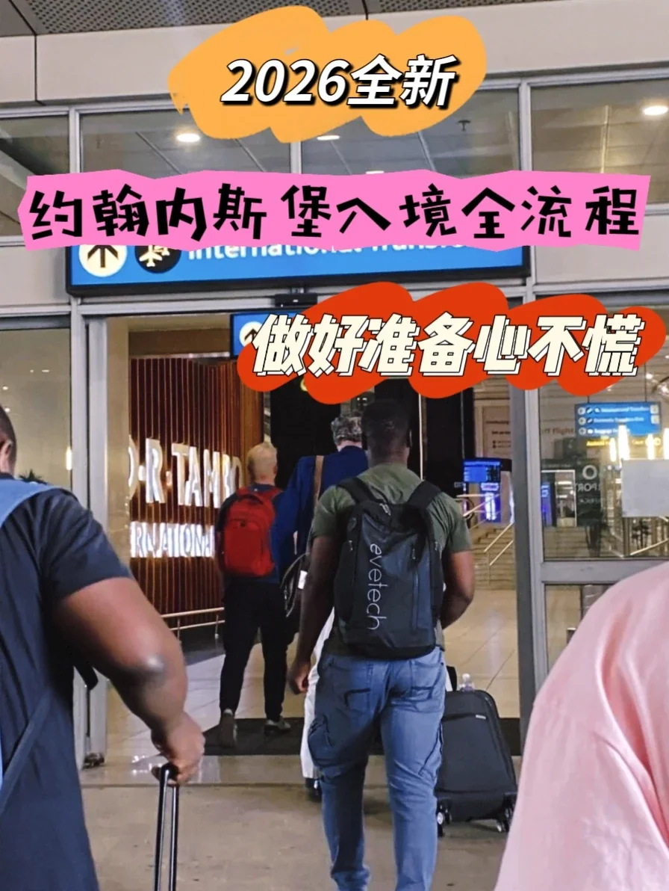

Trong lần đầu đến Nam Phi, điều bạn lo nhất là hạ cánh mà giấy tờ và quy trình chưa ổn. Cẩm nang này trình bày rõ bốn việc: **chuẩn bị trước khi bay, quy trình nhập cảnh, đi từ sân bay vào thành phố, và những cái bẫy cần tránh**.

## Trước khi bay: ở đây không bỏ qua được gì

1. **Lo thị thực/ETA trước**: người mang hộ chiếu Trung Quốc cần **thị thực sắp xếp trước** để nhập cảnh Nam Phi. Nộp trực tuyến qua kênh chính thức, một đến hai tuần trước khi khởi hành, để không có gì làm hỏng chuyến đi — **đừng bao giờ tin người môi giới hứa “không cần thị thực, chỉ cần trả tiền”**.
2. **Chuẩn bị giấy tờ hỗ trợ**: đặt phòng khách sạn, lịch trình du lịch và vé khứ hồi — **in từng loại ra giấy**; đừng chỉ giữ trên điện thoại. Đưa ra khi bị kiểm tra đột xuất đỡ phiền hơn nhiều.
3. **Sao lưu hộ chiếu đúng cách**: hộ chiếu phải còn hạn **hơn 6 tháng** và không bị hư hỏng; photocopy và chụp ảnh trang thông tin và trang thị thực, và **để bản gốc và bản sao ở hai nơi khác nhau**, để nếu mất có thể xử lý nhanh.

## Quy trình nhập cảnh, theo thứ tự

Khi bạn hạ cánh tại Sân bay Quốc tế O. R. Tambo (JNB):

1. **Điền thẻ nhập cảnh trên máy bay**: ghi rõ **địa chỉ và số điện thoại khách sạn** bằng tiếng Anh, chữ viết dễ đọc.
2. **Kiểm soát hộ chiếu**: **nghiêm cấm dùng điện thoại**. Nhân viên sẽ hỏi mục đích chuyến đi và thời gian lưu trú — trả lời trung thực và đưa giấy tờ khi được yêu cầu, đồng thời để mắt đến hành lý xách tay.
3. **Hạn mức hải quan**: thuốc lá ≤ 200 điếu; rượu vang ≤ 2 lít, rượu khác ≤ 1 lít; vượt mức phải khai báo. Sau khi qua, **kiểm tra dấu nhập cảnh và thời hạn lưu trú được phép**, và giải quyết mọi vấn đề ngay tại chỗ.
4. **Tiêm phòng sốt vàng**: không bắt buộc với chuyến bay thẳng từ Trung Quốc; chỉ khi bạn **quá cảnh vùng có dịch** mới cần thẻ vàng chứng nhận đã tiêm 10 ngày trước.

## Từ sân bay vào thành phố: bốn cách

| Lựa chọn | Chi tiết |
| --- | --- |
| **Gautrain (lựa chọn đầu tiên)** | An toàn và nhanh, khoảng 15 phút đến Sandton, giá khoảng 158 rand, chạy khoảng 05:30–20:30 |
| **Ứng dụng gọi xe** | Đặt Uber hoặc Bolt trong ứng dụng và đến **điểm đón được chỉ định** của sân bay; từ chối những người chèo kéo |
| **Xe khách sạn đón / shuttle chính thức** | Đặt xe khách sạn đón trước, hoặc đi shuttle chính thức như EZ Shuttle — không phiền và an toàn |
| **Tự lái (chọn cẩn thận)** | Cần bản dịch bằng lái được chứng nhận và xác thực kép; Nam Phi lái bên trái với xe tay lái bên phải, nên không khuyến khích người mới |

> Tần suất và chuyến cuối của Gautrain có thay đổi, nên hãy kiểm tra lịch trên trang chính thức cho ngày bạn đi — **chuyến bay muộn rất dễ lỡ tàu**, và khi đó gọi xe là lựa chọn ổn định hơn.

## Mẹo thực tế tại địa phương

- **Tiền và tiền tip**: tiền tệ là rand Nam Phi (ZAR). **Tỷ giá ở sân bay kém, nên chỉ đổi một ít tiền mặt**; nhà hàng thường mong **10%–15%** tiền tip, còn người khuân vác **5–10 rand mỗi túi**.
- **An toàn trước hết**: đừng ra ngoài một mình ban đêm và đừng khoe đồ đắt; khi lái xe, hãy kéo cửa kính lên và khóa cửa, tránh khu vực hẻo lánh.
- **Điện thoại**: mua SIM Vodacom hoặc MTN tại sân bay — đáng giá hơn chuyển vùng quốc tế, và **chỉ cần hộ chiếu**.
- **Số khẩn cấp**: cảnh sát **10111**; cấp cứu **999** hoặc **082911**; nếu gặp rắc rối, bạn cũng có thể liên hệ đại sứ quán hoặc lãnh sự quán Trung Quốc tại Nam Phi.

## Sáu cái bẫy bạn phải đề phòng

1. **Đừng bao giờ lên taxi không có giấy phép ở sân bay** — chỉ dùng phương tiện chính thức.
2. **Mang ít tiền mặt**, và khóa đồ đắt trong két khách sạn.
3. Đừng tiếp chuyện người lạ đến gần bạn, và tránh khu đông đúc, lộn xộn.
4. **Không được mang trái cây, thịt và hạt vào** — hải quan kiểm tra chặt.
5. Ở **khu an toàn như Sandton**; đừng chạy theo giá rẻ mà vào khu xa xôi.
6. Điền thông tin ETA/thị thực **trung thực** — thông tin sai nghĩa là bị từ chối nhập cảnh.
