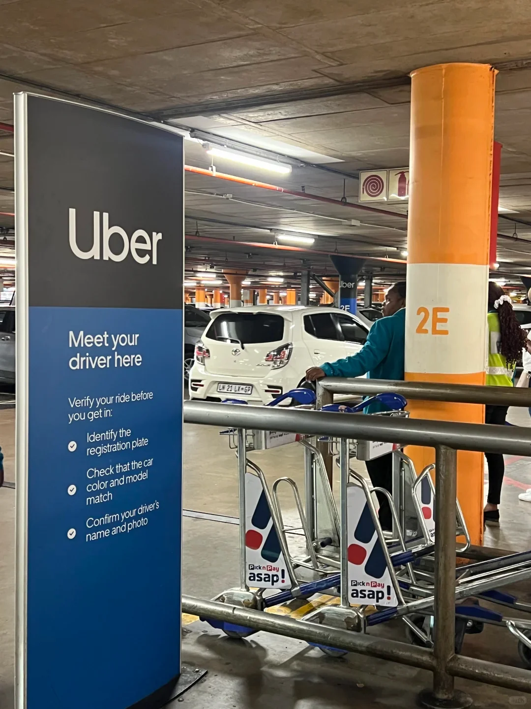
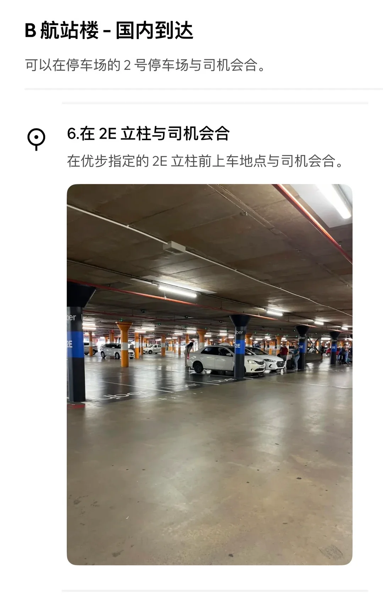

Většina návodů na přivolání vozidla na letišti v Johannesburgu, které najdete online, se týká **terminálu A**, ale vnitrostátní lety přilétají na **terminál B**. Tento článek doplňuje celou trasu pro vnitrostátní přílety na terminálu B.

## Krok první: při objednávce zvolte správný terminál

Poté co v Uberu zadáte cíl, **místo vyzvednutí musí být nastaveno na „Terminal B - Domestic Arrivals“**.

Aplikace ve výchozím nastavení umístí špendlík na **terminál A**. Oba terminály nejsou daleko od sebe, ale tahat kufr zdlouhavou oklikou není nic příjemného. Zkontrolujte to dřív, než jízdu objednáte.

## Trasa v šesti krocích

Navigační pokyny pro pěší v aplikaci Uberu jsou velmi podrobné; zde je šest kroků v pořadí.

### 1. Z výdeje zavazadel nahoru do patra 1 (L1)

Když vyjdete z výdeje zavazadel, **dejte se vpravo** k eskalátorům a vyjeďte do patra 1.

### 2. V patře 1 se dejte vpravo k restauracím

Nahoře u eskalátoru jděte stále rovně, poté se **dejte vpravo** a mířte k restauracím.

### 3. Přes nadchod do Parkade 2

Přejděte přes nadchod vedle přepážky SAPS (po vaší pravici) do parkovacího domu **Parkade 2**.

### 4. Vstupte do Parkade 2 a dejte se vpravo

Pokračujte po pěším přechodu a odbočte vpravo do Parkade 2.

### 5. Stále rovně k pilíři 2E

Jděte pořád rovně přes pěší přechod k **pilíři 2E**.

### 6. Setkejte se s řidičem u pilíře 2E

Sejděte se s řidičem na určeném místě vyzvednutí před pilířem 2E.

## Kolik jízda stojí

Z terminálu B do **Sandtonu (u Sandton City) to vyšlo asi na 350 randů** — levné to není.

Autor přiletěl v poledne a odlétal v poledne následujícího dne, takže na místě strávil jen 24 hodin. Pokud má vaše cesta stejný krátký rytmus, **půjčení auta na den je často méně komplikované** — vyzvedněte ho v blízkosti letiště a při odjezdu ho tam vraťte.

## Několik věcí, které je dobré vědět

- Místo vyzvednutí je **uvnitř parkovacího domu**, ne u dveří terminálu; stačí sledovat pěší navigaci v Uberu.
- Místa vyzvednutí Uberu v Jihoafrické republice jsou obvykle označena čísly pilířů a **uvedení čísla pilíře** (zde 2E) je přesnější než popisovat, kde se nacházíte.
- Pokud přiletíte v noci, objednejte jízdu v aplikaci a dojděte na určené místo vyzvednutí, místo abyste přijímali nabídky přepravců před halou příletů.
