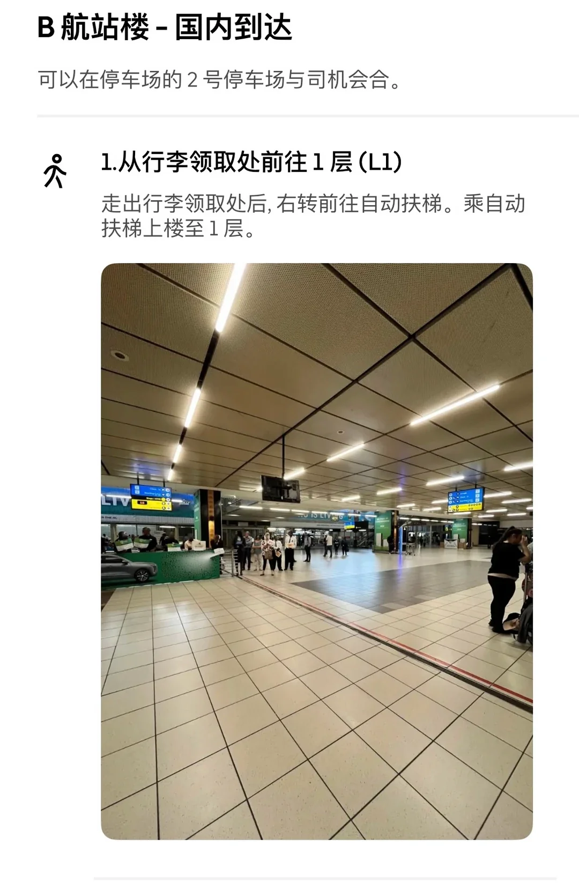

La mayoría de las guías que encuentras online para tomar un coche en el aeropuerto de Johannesburgo hablan de la **Terminal A**, pero los vuelos nacionales llegan a la **Terminal B**. Este artículo completa la ruta entera para las llegadas nacionales en la Terminal B.

## Paso uno: elige la terminal correcta al reservar

Después de introducir el destino en Uber, **el punto de recogida debe quedar en “Terminal B - Domestic Arrivals”**.

La app fija por defecto tu ubicación en la **Terminal A**. No están muy lejos, pero arrastrar una maleta dando un rodeo largo no tiene ninguna gracia. Compruébalo antes de pedir el coche.

## El recorrido en seis pasos

Las indicaciones a pie dentro de la app de Uber son muy detalladas; aquí están, los seis pasos en orden.

### 1. De la cinta de equipajes a la planta 1 (L1)

Al salir de la cinta de equipajes, **gira a la derecha** hacia las escaleras mecánicas y sube a la planta 1.

### 2. En la planta 1, gira a la derecha hacia los restaurantes

Al llegar arriba de la escalera, sigue recto y luego **gira a la derecha** hacia los restaurantes.

### 3. Cruza la pasarela hasta Parkade 2

Cruza la pasarela junto al mostrador de la SAPS (a tu derecha) hasta el aparcamiento **Parkade 2**.

### 4. Entra en Parkade 2 y gira a la derecha

Sigue el paso de peatones y gira a la derecha para entrar en Parkade 2.

### 5. Recto hasta el pilar 2E

Ve recto por el paso de peatones hasta el **pilar 2E**.

### 6. Encuentra a tu conductor en el pilar 2E

Encuentra a tu conductor en el punto de recogida designado, frente al pilar 2E.

## Cuánto cuesta el trayecto

De la Terminal B a **Sandton (cerca de Sandton City) salió por unos 350 rands**: no es barato.

El autor llegó a mediodía y se fue a mediodía del día siguiente, así que solo 24 horas en el destino. Si tu viaje mantiene el mismo ritmo de escala corta, **alquilar un coche por un día suele dar menos complicaciones**: recógelo cerca del aeropuerto y devuélvelo de camino a la salida.

## Algunas cosas que conviene saber

- El punto de recogida está **dentro del aparcamiento**, no en la puerta de la terminal; sigue las indicaciones a pie de Uber.
- Los puntos de recogida de Uber en Sudáfrica suelen estar marcados con números de pilar, y **anotar el número de pilar** (aquí el 2E) es más preciso que describir dónde estás.
- Si aterrizas de noche, pide el coche en la app y camina hasta el punto de recogida designado en lugar de aceptar ofertas de captadores a la salida de llegadas.
