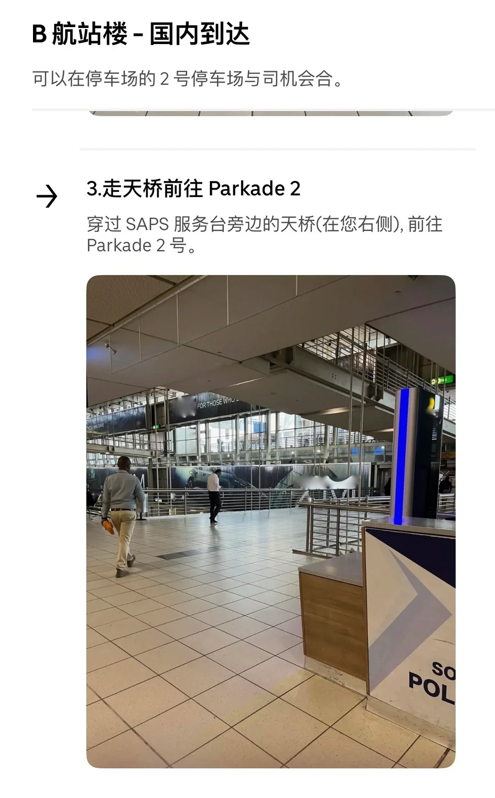
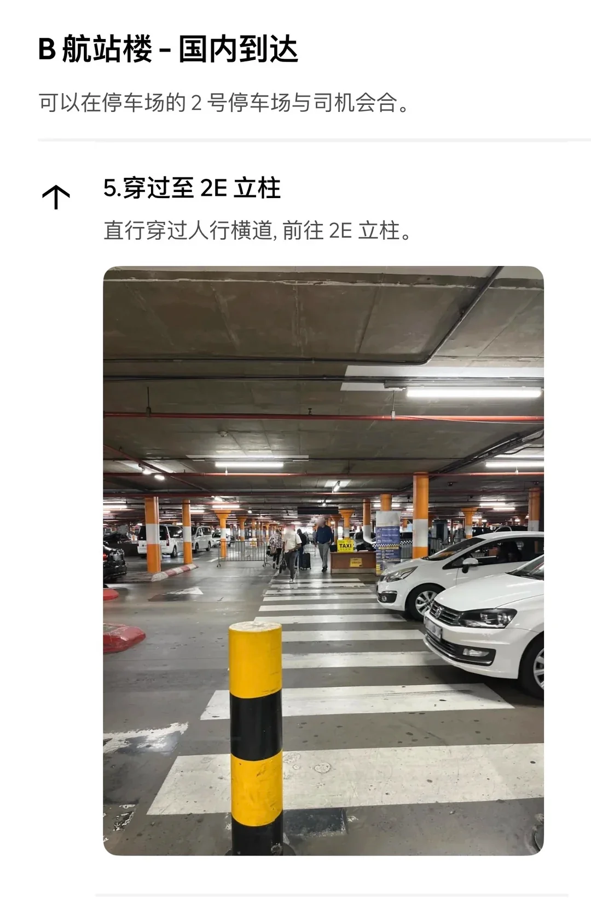

Większość poradników o łapaniu przejazdu na lotnisku w Johannesburgu, jakie znajdziesz w internecie, dotyczy **terminalu A**, tymczasem loty krajowe przylatują na **terminal B**. Ten artykuł uzupełnia pełną trasę dla przylotów krajowych na terminalu B.

## Krok pierwszy: przy rezerwacji wybierz właściwy terminal

Po wpisaniu w Uberze miejsca docelowego **punkt odbioru musi być ustawiony na „Terminal B - Domestic Arrivals”** (terminal B – przyloty krajowe).

Aplikacja domyślnie przypina Twoją lokalizację do **terminalu A**. Oba terminale nie są daleko od siebie, ale ciągnięcie walizki naokoło nie jest przyjemne. Sprawdź to, zanim zamówisz przejazd.

## Trasa w sześciu krokach

Wskazówki piesze w aplikacji Ubera są bardzo szczegółowe; oto te sześć kroków po kolei.

### 1. Z hali odbioru bagażu na poziom 1 (L1)

Wychodząc z hali odbioru bagażu, **skręć w prawo** do schodów ruchomych i wjedź na poziom 1.

### 2. Na poziomie 1 skręć w prawo w stronę restauracji

Na szczycie schodów ruchomych idź prosto, a potem **skręć w prawo** i kieruj się w stronę restauracji.

### 3. Kładką do parkingu Parkade 2

Przejdź kładką obok stanowiska SAPS (po prawej stronie) do parkingu **Parkade 2**.

### 4. Wejdź do Parkade 2 i skręć w prawo

Idź wzdłuż przejścia dla pieszych i skręć w prawo, wchodząc do Parkade 2.

### 5. Prosto do filaru 2E

Przejdź prosto przez przejście dla pieszych do **filaru 2E**.

### 6. Spotkaj się z kierowcą przy filarze 2E

Spotkaj się z kierowcą w wyznaczonym miejscu odbioru przed filarem 2E.

## Ile kosztuje przejazd

Z terminalu B do **Sandton (w pobliżu Sandton City) wyszło około 350 randów** — tanio nie jest.

Autor przyleciał w południe i wyjechał w południe następnego dnia, czyli miał tylko 24 godziny na miejscu. Jeśli Twój wyjazd ma podobny krótki rytm, **wynajęcie samochodu na dobę często jest mniej kłopotliwe** — odbierz go w pobliżu lotniska i oddaj po drodze na powrót.

## Kilka rzeczy, które warto wiedzieć

- Miejsce odbioru znajduje się **wewnątrz parkingu**, a nie przy drzwiach terminalu; wystarczy podążać za wskazówkami pieszymi Ubera.
- Miejsca odbioru Ubera w RPA są zwykle oznaczone numerami filarów, a **zapamiętanie numeru filaru** (tutaj 2E) jest dokładniejsze niż opisywanie, gdzie jesteś.
- Jeśli lądujesz nocą, zamów przejazd w aplikacji i dojdź do wyznaczonego miejsca odbioru, zamiast przyjmować oferty naganiaczy przed halą przylotów.
