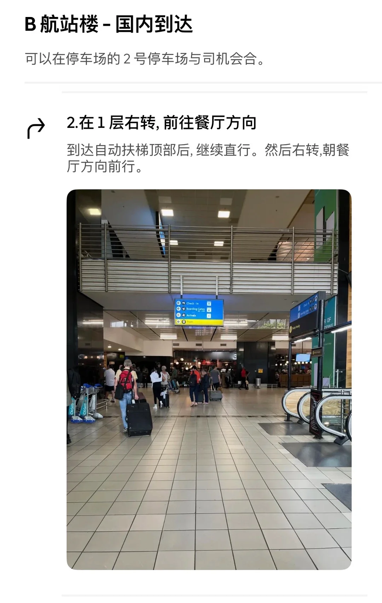

คู่มือการเรียกรถที่สนามบินโยฮันเนสเบิร์กที่คุณหาออนไลน์ส่วนใหญ่เขียนเกี่ยวกับ**อาคารผู้โดยสาร A** แต่เที่ยวบินในประเทศมาถึงที่**อาคารผู้โดยสาร B** บทความนี้เติมเส้นทางเต็มสำหรับขาเข้าในประเทศที่อาคารผู้โดยสาร B

## ขั้นแรก: เลือกอาคารผู้โดยสารให้ถูกเมื่อจอง

หลังจากใส่จุดหมายใน Uber แล้ว **จุดรับต้องตั้งเป็น "Terminal B - Domestic Arrivals"**

ค่าเริ่มต้นของแอปจะปักหมุดตำแหน่งของคุณที่**อาคารผู้โดยสาร A** ทั้งสองไม่ไกลกันนัก แต่การลากกระเป๋าเดินอ้อมไกลไม่สนุกเลย ตรวจสอบก่อนเรียกรถ

## เส้นทางเดินหกขั้นตอน

เส้นทางเดินในแอปของ Uber ละเอียดมาก นี่คือหกขั้นตอนตามลำดับ

### 1. จากรับกระเป๋าขึ้นไปชั้น 1 (L1)

เดินออกจากจุดรับกระเป๋า **เลี้ยวขวา**ไปยังบันไดเลื่อนแล้วขึ้นไปชั้น 1

### 2. ที่ชั้น 1 เลี้ยวขวาไปทางร้านอาหาร

ที่ด้านบนบันไดเลื่อนให้เดินตรงต่อไป แล้ว**เลี้ยวขวา**มุ่งไปทางร้านอาหาร

### 3. ใช้สะพานลอยไป Parkade 2

ข้ามสะพานลอยข้างเคาน์เตอร์ SAPS (ทางขวาของคุณ) ไปยังที่จอดรถ **Parkade 2**

### 4. เข้า Parkade 2 แล้วเลี้ยวขวา

ตามทางม้าลายและเลี้ยวขวาเข้า Parkade 2

### 5. ตรงไปจนถึงเสา 2E

เดินตรงข้ามทางม้าลายไปยัง**เสา 2E**

### 6. พบคนขับที่เสา 2E

พบคนขับที่จุดรับที่กำหนดหน้าเสา 2E

## ค่าโดยสารเท่าไร

จากอาคารผู้โดยสาร B ถึง**แซนตัน (ใกล้ Sandton City) ราคาประมาณ 350 แรนด์** — ไม่ถูก

ผู้เขียนมาถึงตอนเที่ยงและออกตอนเที่ยงวันถัดไป จึงอยู่บนพื้นดินเพียง 24 ชั่วโมง หากทริปของคุณมีจังหวะแวะสั้นแบบเดียวกัน **การเช่ารถหนึ่งวันมักยุ่งยากน้อยกว่า** — รับรถใกล้สนามบินและคืนระหว่างทางออก

## ข้อควรรู้ไม่กี่ประการ

- จุดรับอยู่**ภายในที่จอดรถ** ไม่ใช่หน้าประตูอาคารผู้โดยสาร ทำตามเส้นทางเดินในแอปของ Uber
- จุดรับ Uber ในแอฟริกาใต้มักทำเครื่องหมายด้วยหมายเลขเสา และ**การจดหมายเลขเสา** (2E ในที่นี้) แม่นยำกว่าการอธิบายตำแหน่ง
- หากลงเครื่องตอนกลางคืน ให้เรียกรถในแอปและเดินไปจุดรับที่กำหนด แทนการรับข้อเสนอจากคนที่มาตีตลาดนอกโถงขาเข้า
