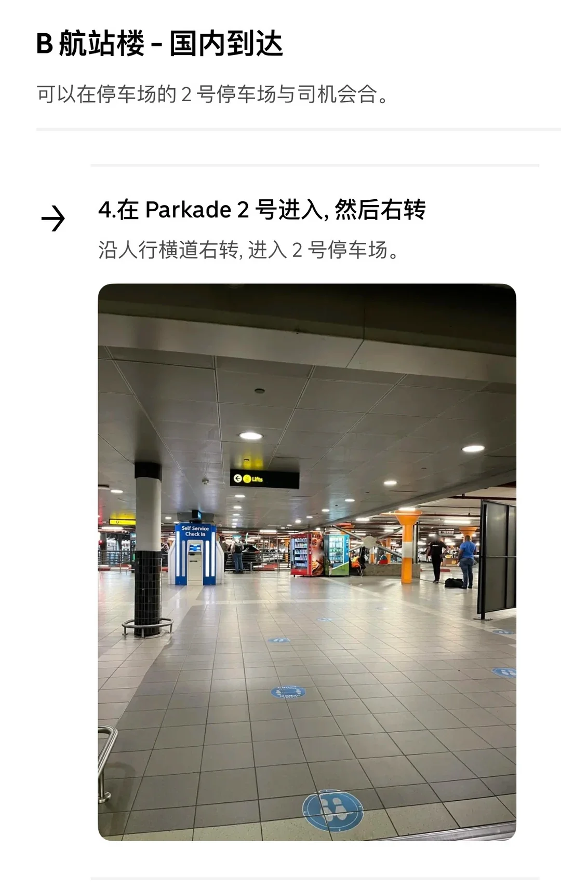

İnternette bulduğunuz Johannesburg havalimanında araç yakalama rehberlerinin çoğu **Terminal A** için yazılmış, ama iç hat uçuşları **Terminal B**'ye iniyor. Bu makale Terminal B'deki iç hat varışları için tam rotayı dolduruyor.

## Birinci adım: rezervasyon yaparken doğru terminali seçin

Uber'de hedefinizi girdikten sonra **alma noktası “Terminal B - Domestic Arrivals” olarak ayarlanmalı**.

Uygulama varsayılan olarak konumunuzu **Terminal A**'ya sabitler. İkisi birbirinden uzak değil, ama valizi uzun yoldan sürüklemek hiç eğlenceli değil. Araç çağırmadan önce kontrol edin.

## Altı adımda yürüyüş

Uber'in uygulama içi yürüyüş tarifi çok ayrıntılı; işte altı adım sırasıyla.

### 1. Bagaj alımından 1. kata (L1) çıkış

Bagaj alımından çıkarken yürüyen merdivenler için **sağa dönün** ve 1. kata çıkın.

### 2. 1. katta restoranlara doğru sağa dönün

Yürüyen merdivenin tepesinde düz devam edin, sonra **sağa dönün** ve restoranlara doğru ilerleyin.

### 3. Parkade 2'ye yürüyüş köprüsünü kullanın

SAPS masasının (sağınızda) yanındaki yürüyüş köprüsünden geçerek **Parkade 2** otoparkına gidin.

### 4. Parkade 2'ye girin, sonra sağa dönün

Yaya geçidini izleyin ve Parkade 2'ye girerek sağa dönün.

### 5. Doğrudan 2E sütununa gidin

Yaya geçidini düz geçerek **2E sütununa** gidin.

### 6. Sürücünüzle 2E sütununda buluşun

Sürücünüzle 2E sütununun önündeki belirlenmiş alma noktasında buluşun.

## Yolculuk ne kadar tutuyor

Terminal B'den **Sandton'a (Sandton City yakını)** yaklaşık 350 rand tuttu — ucuz değil.

Yazar öğlen varmış ve ertesi gün öğlen ayrılmış, yani yerde yalnızca 24 saat. Seyahatiniz de aynı kısa mola ritmini koruyorsa **bir günlüğüne araba kiralamak çoğu zaman daha az zahmetlidir** — havalimanı yakınında alın ve çıkışta bırakın.

## Bilinmesi gereken birkaç şey

- Alma noktası terminal kapısında değil **otoparkın içinde**; Uber'in yürüyüş tarifini izlemeniz yeterli.
- Güney Afrika'daki Uber alma noktaları genellikle sütun numaralarıyla işaretlenir ve **sütun numarasını not etmek** (burada 2E) nerede olduğunuzu tarif etmekten daha doğrudur.
- Gece inerseniz uygulamadan araç çağırın ve belirlenmiş alma noktasına yürüyün; varış salonu dışındaki yoldan çağıranların tekliflerini kabul etmeyin.
