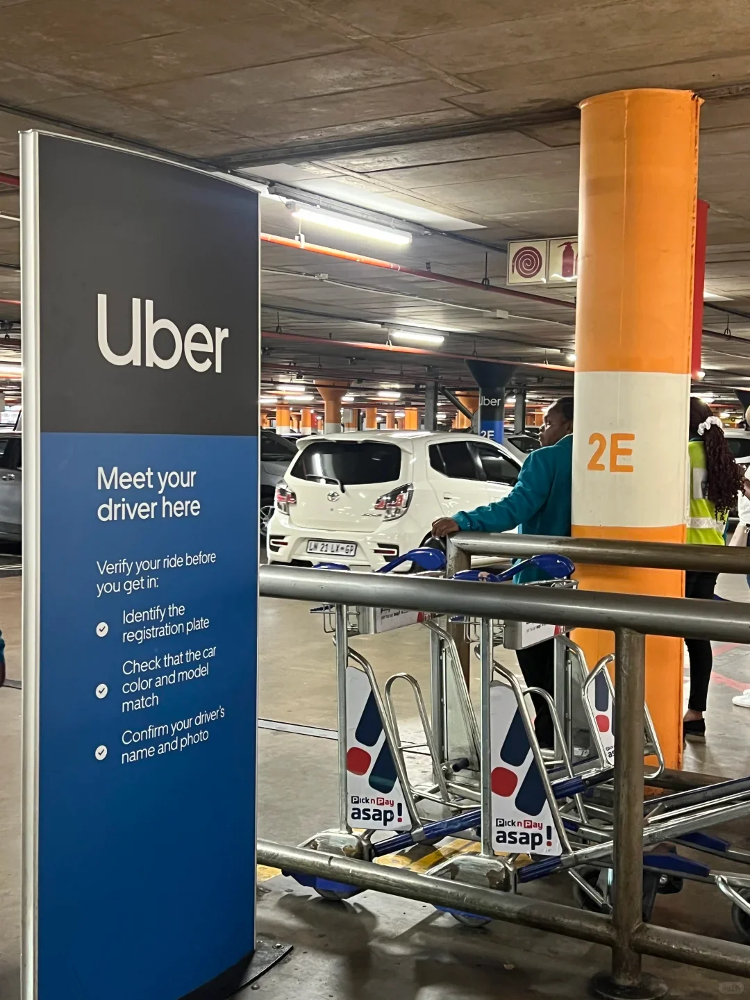
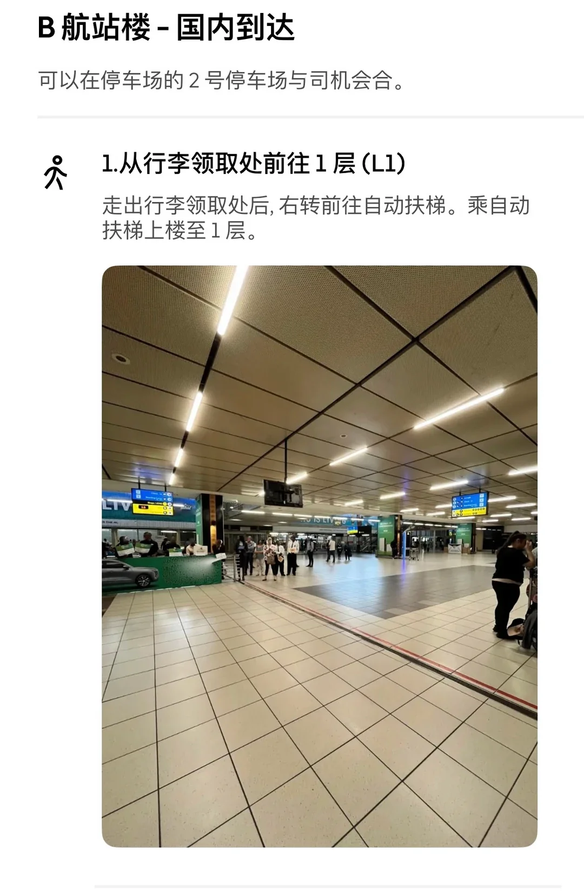
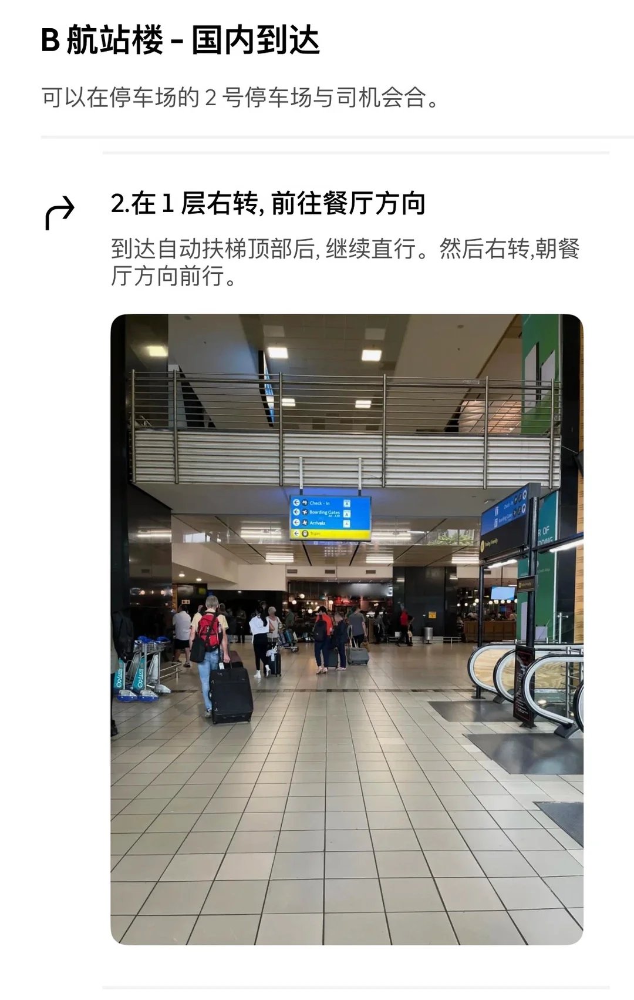
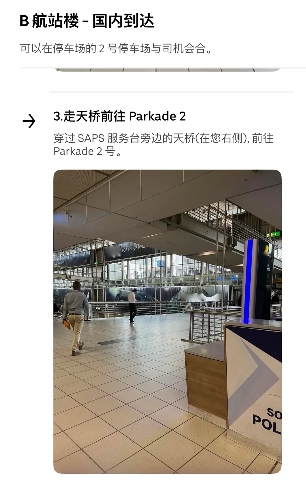
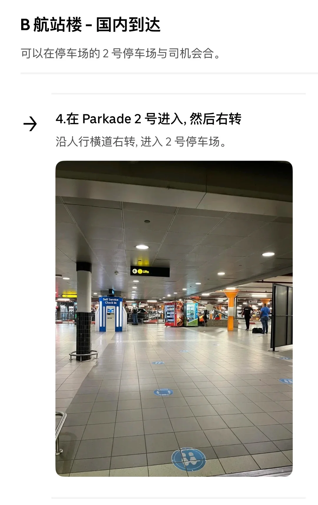
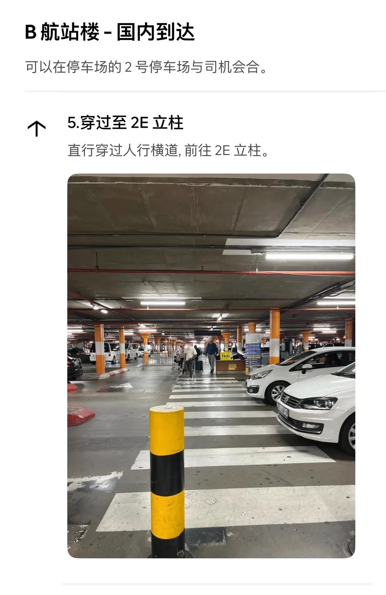
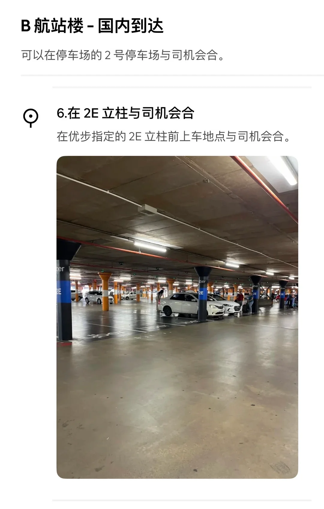

網上的約翰尼斯堡機場叫車攻略大多寫的是 **A 航廈**，但國內航班的到達口在 **B 航廈**。這篇補上 B 航廈國內到達的完整叫車路線。

## 第一步：叫車時一定要選對航廈

在 Uber 裡輸入目的地後，**上車點必須選「B 航廈 - 國內到達」**。

App 會預設把定位放在 **A 航廈**——兩者雖然隔得不算遠，但拖著箱子繞一大圈並不輕鬆。檢查一下再下單。

## 六步走到上車點

Uber 在 App 裡給的步行指引很詳細，下面按它的六步走：

### 1. 從行李領取處前往 1 層（L1）

走出行李領取處後**右轉**前往自動扶梯，乘扶梯上樓至 1 層。

### 2. 在 1 層右轉，前往餐廳方向

到達扶梯頂部後繼續直行，然後**右轉**，朝餐廳方向前行。

### 3. 走天橋前往 Parkade 2

穿過 SAPS 服務檯旁的天橋（在您的右側），前往 **Parkade 2 號**停車場。

### 4. 在 Parkade 2 號進入，然後右轉

沿人行橫道右轉，進入 2 號停車場。

### 5. 穿過至 2E 立柱

直行穿過人行橫道，前往 **2E 立柱**。

### 6. 在 2E 立柱與司機會合

在指定的 2E 立柱前上車點與司機會合。

## 車費參考

從 B 航廈到**桑頓區（Sandton City 附近）實際約 350 蘭特**，並不便宜。

作者中午到、第二天中午走，只待 24 小時；如果行程也是這種「短停」節奏，**租一天車往往更省心**——機場周邊提車，走的時候直接還車。

## 小提醒

- 上車點在**停車場**裡，不在航廈門口，跟著 Uber 的步行指引走就好。
- 南非的 Uber 上車點通常標有立柱編號，**記下立柱號**（這裡是 2E）比描述位置更準確。
- 夜間到達建議直接在 App 內叫車、走到指定上車點，不要在到達廳外接受攬客。
