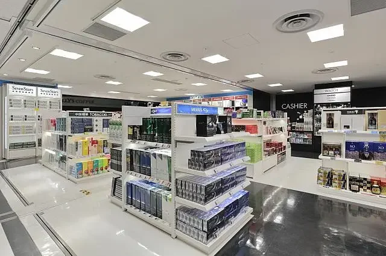

Mezinárodní letiště Kansai (kód letiště **KIX**) leží na umělém ostrově v Ósackém zálivu, na který vede jediný most přes moře, a je vstupní branou do regionu Kansai — pro mnoho cestovatelů první kus Japonska, na kterém kdy stanuli.

První věc, kterou je po přistání třeba ujasnit, je, ze které ze tří letištních budov vycházíte, protože přesun mezi nimi funguje v každém případě jinak; druhá je, kam míříte, protože jižní Ósaka, Umeda, Kjóto a Nara znamenají každé jiný vlak. Tento průvodce pokrývá **terminály**, **stravování**, **nakupování**, **přespání**, **čtyři způsoby dopravy do města** a **praktické tipy**. Jízdné a jízdní řády se mění podle sezóny a dopravce, proto si před cestou zkontrolujte stránky letiště a dopravců.

## 1. Tři budovy: T1, T2 a Aeroplaza

Terminály se dělí podle letecké společnosti a typu letu; v rezervaci najdete, který potřebujete.

- **Terminál 1** je hlavní budova. Přilétá a odlétá odsud většina mezinárodních letů a soustředí se v něm restaurace, obchody duty free a salónky.
- **Terminál 2** obsluhuje nízkonákladové dopravce, jako je Peach. Je prostší, s méně obchody, a z terminálu 1 se do něj dostanete kyvadlovým autobusem, jízda trvá asi 5–10 minut.
- **Aeroplaza** vedle terminálu 1 ukrývá hotely, večerku a kapslový hotel — dočasný domov každého, kdo přiletí pozdě v noci.

Než se vydáte na cestu, ověřte si, zda přilétáte na terminál 1, nebo 2; špatná volba znamená tahat zavazadla do kyvadlového autobusu. Pokud přilétáte na terminál 2 a chcete jet vlakem, připočítejte si tuto jízdu k časovému plánu — u pozdního příletu může těch deset minut rozhodnout o tom, zda stihnete poslední vlak.

Terminál 1 a Aeroplaza jsou od sebe pěšky; terminál 2 je samostatná budova. V patře 2 terminálu 1 vede krytá chodba na vlakové nádraží: po příletu se držte značek směrem k vlakům.

## 2. Kde se na letišti najíst: Edo-koji, food court ve 4. patře a Lawson

Terminál 1 vrství své stravovací možnosti podle toho, kolik máte času.

- **Stravovací zóna Edo-koji** je pojatá jako stará japonská ulice a nabízí suši, tempuru a ramen — dobré místo na první pořádné jídlo v Japonsku.
- **Food court ve 4. patře** je levnější a rychlejší, stavěný na to, abyste se najedli a šli dál.
- **Snídaně z večerky** je standardní volbou u časných letů a Lawson je otevřený nonstop.

Pokud přiletíte pozdě, restaurace v Edo-koji i food court zavírají jedna po druhé a spolehlivou záchranou zůstává večerka. Když máte hodiny času nazbyt, pořádné posezení porazí onigiri u nástupní brány. S dětmi nebo staršími příbuznými je food court pohodlnější: místa k sezení se hledají snáz a nestojí se ve frontě.

Stravovací zóna je také dobrým místem setkání: Edo-koji se hledá snadno, takže skupiny, které projdou imigrací různou rychlostí, se tam mohou sejít.

## 3. Nakupování: duty free, suvenýry a drogistické zboží

- **Obchody duty free** nabízejí kosmetiku, alkohol a sladkosti — poslední šance zásobit se před odletem.
- **Mezi oblíbené suvenýry** patří Royce nama chocolate, Shiroi Koibito a kjótské yatsuhashi a prodává je téměř každý obchod se suvenýry.
- **Drogistické zboží**, jako jsou oční kapky a pleťové masky, se dá koupit i na letišti.

Drogérie ve městě bývají levnější, takže letiště slouží k doplnění zásob, ne k velkému nákupu: objemné věci ve městě, drobnosti a dárky na letišti. Čokoládu, kterou je třeba chladit, jako Royce, je lepší koupit nakonec, aby neležela v hotelové lednici.

## 4. Přespání: First Cabin a Nikko Kansai Airport

U přespání existují dva směry: ušetřit v kapsli, nebo připlatit za hotelový pokoj.

- **Kapslový hotel First Cabin** v budově Aeroplaza je otevřený nonstop a hodí se pro přestupy a noční lety.
- **Hotel Nikko Kansai Airport** je propojený s terminálem 1, je pohodlnější a je první volbou pro rodiny a služební cestující.

Rozhodnutí je jednoduché: pokud přestupujete brzy ráno nebo přilétáte v hluboké noci, kapsle stačí; s dětmi nebo velkým množstvím zavazadel se hotel vyplatí. Rezervujte si obojí předem — v sezóně není na Kansai postelí na přespání nazbyt.

Kromě spaní letiště zvládne i několik drobných úkolů po přistání:

- **Úschovna zavazadel a služba takuhaibin:** nechte zavazadla v příletové hale, nebo je pošlete rovnou do hotelu v Kjótu či Ósace a cestujte nalehko.
- **Salónky a sprchy:** KIX Airport Lounge má sprchy (asi 1 000 ¥) a masážní křesla.
- **Připojení:** v příletové hale jsou přepážky půjčovny Wi-Fi a prodeje SIM karet.

## 5. Cesta do města: volba ze čtyř možností

Odpověď téměř vždy určí váš cíl. Pokud bydlíte v Nambě nebo v Šinsaibashi, jeďte linkou Nankai. Pokud začínáte v Kjótu nebo přestupujete na šinkansen, jeďte JR. Pokud máte hodně zavazadel nebo míříte do Nary, Kóbe či do Universal Studios, jeďte autobusem. Při pozdním příletu vám zbývá taxi.

| Možnost | Hlavní cíle | Doba jízdy | Orientační jízdné |
| --- | --- | --- | --- |
| Linka Nankai | Namba (pro Šinsaibashi) | asi 38 min | od asi 950 ¥ za základní jízdenku; asi 1 450 ¥ za expres Rapi:t |
| Expres JR HARUKA | Tendži, Šin-Ósaka, Kjóto | asi 75 min do Kjóta | asi 2 200 ¥ za jednosměrnou zvýhodněnou jízdenku pro zahraniční návštěvníky |
| Letištní autobus | centrální Ósaka, Nara, Kóbe, Universal Studios | asi 45–90 min | asi 1 600–2 600 ¥ |
| Taxi | centrální Ósaka | asi 50–70 min | asi 20 000 ¥ |

### Linka Nankai: pro Nambu a Šinsaibashi

Pro jižní Ósaku — Nambu, Šinsaibashi — je linka Nankai nejpřímější cestou. Nejrychlejší spoj dorazí do Namby asi za 38 minut, základní jízdenka stojí od asi 950 ¥; expres Rapi:t stojí navíc (asi 1 450 ¥) a nabízí širší sedadlo, což se s těžkými zavazadly vyplatí. Vlaky jezdí často a zajíždějí až do srdce nákupní čtvrti.

Z Namby obsluhuje linka metra Midosudži Šinsaibashi i Umedu na jednu jízdu, a proto se pro jižní Ósaku hodí Nankai.

### JR HARUKA: pro Kjóto, Šin-Ósaku a Tendži

Pokud je vaší první zastávkou Kjóto, Šin-Ósaka (kvůli šinkansenu) nebo Tendži, HARUKA se hodí lépe. Do Kjóta dorazí asi za 75 minut a s pasem si můžete koupit zvýhodněnou jednosměrnou jízdenku HARUKA pro zahraniční návštěvníky za asi 2 200 ¥, tedy levněji než za standardní jízdné. Jedna věc k zapamatování: HARUKA nezastavuje v Umedě ani na nádraží Ósaka, takže do Umedy přestupujte v Šin-Ósace nebo v Tendži.

Při nákupu mějte pas po ruce; pokud je šinkansen součástí vaší cesty, Šin-Ósaka nabízí přímý přestup.

### Letištní autobus: těžká zavazadla a rozptýlené cíle

Do Nary, Kóbe nebo do Universal Studios, případně k určitému hotelu v Umedě, vás autobus ušetří přestupování s zavazadly. Jízda do centrální Ósaky trvá asi 45–90 minut a jízdné se pohybuje kolem 1 600–2 600 ¥. Některé linky obsluhují noční a časné ranní lety, ale ne každá linka jezdí nonstop, proto si zkontrolujte jízdní řád.

Další výhodou je vystoupení přímo u hotelu: se dvěma velkými kufry bývá poslední úsek z nástupiště do lobby často to nejtěžší. Protihodnotou je provoz; když spěcháte, vlak je předvídatelnější.

### Taxi: pozdní noci a společná jízda

Do centrální Ósaky to trvá asi 50–70 minut a stojí to asi 20 000 ¥. Hodí se to pro skupinu, která se podělí o jízdné, pro pozdní přílet po posledním vlaku nebo pro každého, kdo chce jet ode dveří ke dveřím. Sám je to nevýhodné; když přiletíte ve dvě ráno ve třech s hromadou kufrů, jsou to dobře investované peníze.

Stanoviště taxi je před terminálem, takže se řadí do fronty, místo aby se objednávalo předem, a v noci si k odhadu připočtěte i čekání.

## 6. Praktické tipy

- **Hotovost:** většina obchodů přijímá dopravní karty, kreditní karty, Alipay a WeChat Pay, ale malé restaurace a autobusy stále chtějí hotovost. Mějte u sebe 10 000–20 000 ¥.
- **Časování:** na mezinárodní let buďte na letišti alespoň 3 hodiny před odletem; v sezóně může bezpečnostní kontrola trvat přes hodinu.
- **Předběžné deklarace:** Visit Japan Web umožňuje vyplnit imigrační a celní deklarace ještě před odletem, což zrychlí přílet.
- **Dopravní karty:** pravidla pro kauci a vrácení peněz u karty ICOCA se v posledních letech změnila; ověřte si, co zveřejňuje JR West.
- **Užitečné nástroje:** Google Maps na trasy a japonská aplikace pro přestupy na návazná spojení.

Přílety a odlety se řídí jinými hodinami: při příletu nic neztratíte, když to potrvá; při odletu nakupujte a jezte před bezpečnostní kontrolou, protože se už nevrátíte.

## Související odkazy

- **Na tomto webu**: [Mezinárodní letiště Kansai (KIX)](/airport/KIX), [Japonsko (JP)](/country/JP)
- **Wikipedie**: [Mezinárodní letiště Kansai](https://en.wikipedia.org/wiki/Kansai_International_Airport)
- **Baidu Baike**: [Mezinárodní letiště Kansai](https://baike.baidu.com/item/%E5%85%B3%E8%A5%BF%E5%9B%BD%E9%99%85%E6%9C%BA%E5%9C%BA)

Zdroj obrázků: sestaveno z veřejných materiálů. Uspořádání terminálů, obchody, jízdné a jízdní řády odpovídají tomu, co zveřejňuje letiště a dopravci; v den cesty si ověřte jejich webové stránky.
