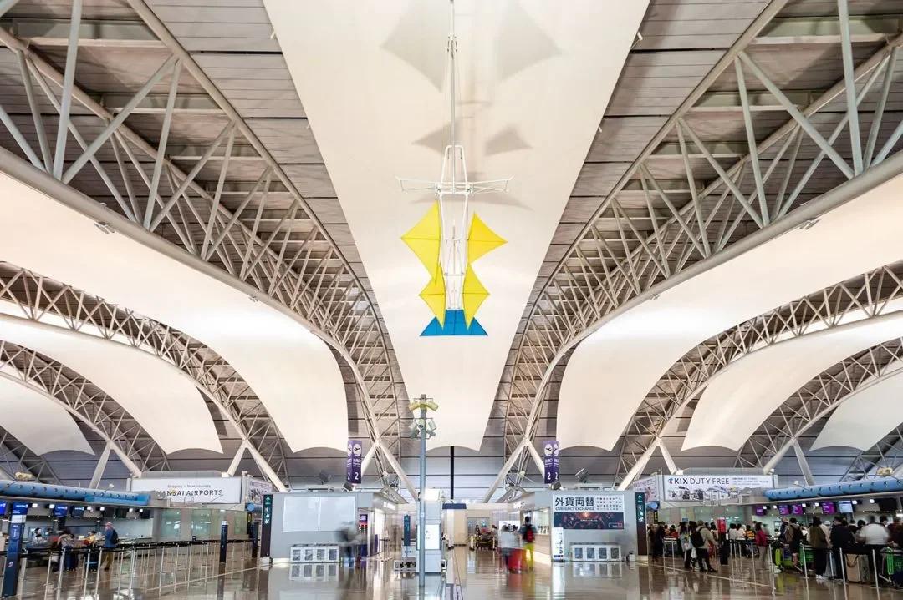
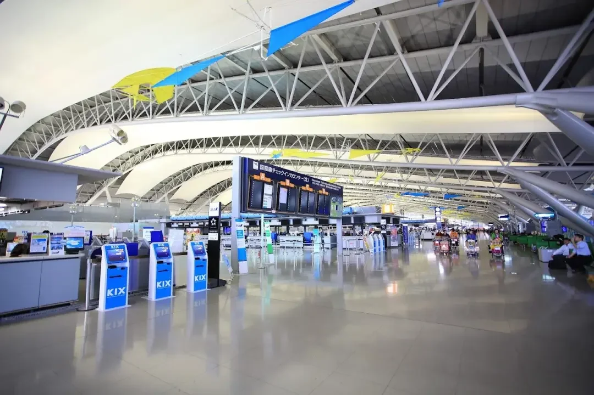
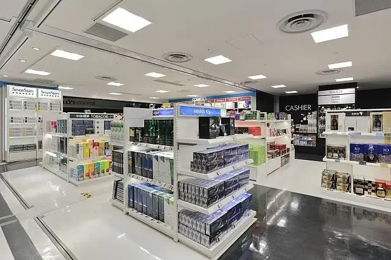
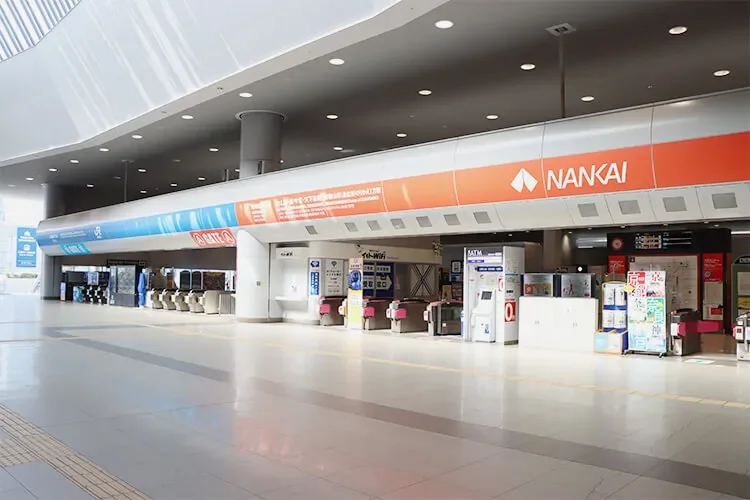
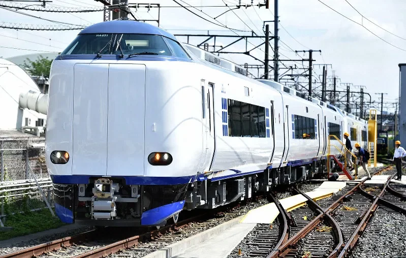
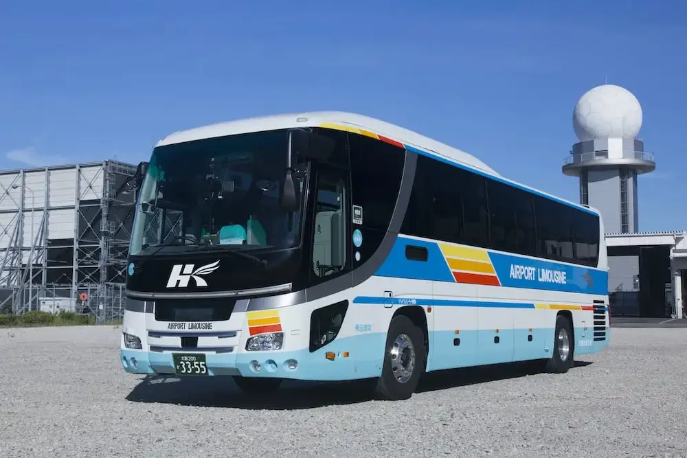
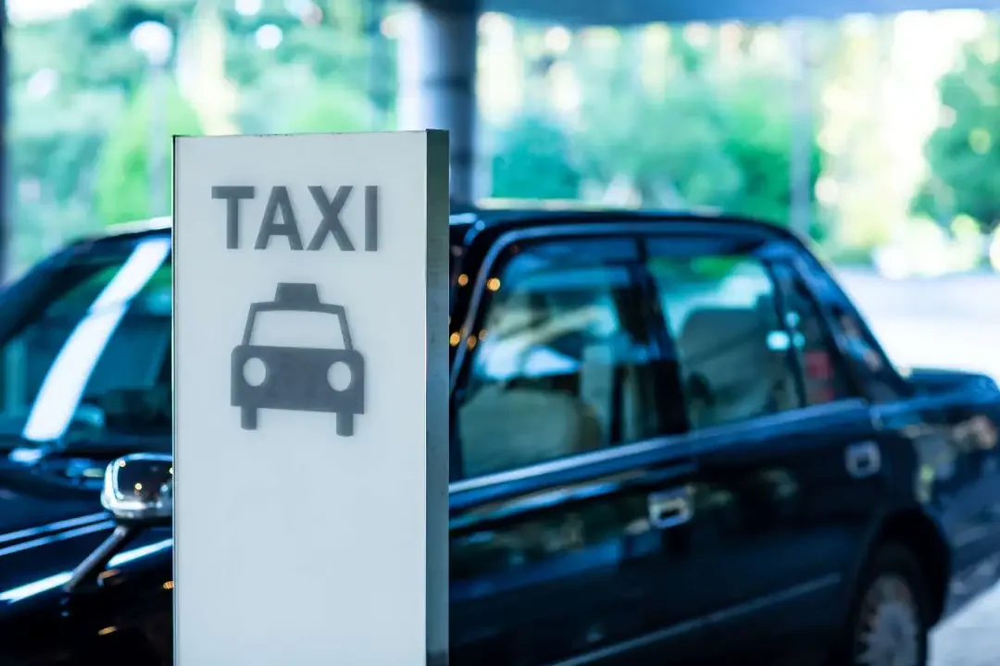

---
slug: kansai-airport-arrival-guide
title: 'Kansai International Airport: A First-Landing Guide to T1, T2 and the City'
summary: 'A first-landing guide to Kansai International Airport (KIX): how Terminal 1, Terminal 2 and the Aeroplaza building divide up, where to eat and shop inside the terminal, the First Cabin capsule hotel and the Nikko Kansai Airport hotel, and the four ways into the city — the Nankai line, the JR HARUKA, the airport bus and taxis — with the fares and journey times to expect.'
date: 2026-10-20
updated: 2026-10-20
source: 霓虹酱日本资讯 (Neon-chan Japan Info)
tags: Kansai International Airport, KIX, Osaka travel, airport terminals, airport transport, Japan
cover: images/0.webp
---

Kansai International Airport (airport code **KIX**) sits on an artificial island in Osaka Bay, reached by a single sea bridge, and it is the gateway to the Kansai region — for many travellers, the first piece of Japan they ever stand on.

The first thing to settle after landing is which of the airport's three buildings you are walking out of, since moving between them works differently in each case; the second is where you are heading, because southern Osaka, Umeda, Kyoto and Nara each mean a different train. This guide covers **the terminals**, **eating**, **shopping**, **staying overnight**, **the four ways into the city** and **practical tips**. Fares and timetables shift with the season and the operator, so check the airport's and the operators' own sites before you travel.

## 1. Three buildings: T1, T2 and Aeroplaza

The terminals divide up by airline and flight type; your booking says which one you need.

- **Terminal 1** is the main building. Most international flights arrive and depart here, and the restaurants, duty-free shops and lounges are concentrated in it.
- **Terminal 2** handles low-cost carriers such as Peach. It is plainer, with fewer shops, and you reach it from Terminal 1 on a shuttle bus that takes about 5–10 minutes.
- **Aeroplaza**, next to Terminal 1, holds hotels, a convenience store and a capsule hotel — the temporary home of anyone landing late at night.

Confirm Terminal 1 or Terminal 2 before you set out; the wrong choice means hauling bags onto a shuttle bus. If you land at Terminal 2 and want the trains, add that ride to your timings — on a late arrival those ten minutes can decide whether you make the last train.

Terminal 1 and Aeroplaza are a walk apart; Terminal 2 is a separate building. Level 2 of Terminal 1 has a covered walkway to the railway station: follow the signs for trains after arrivals.

## 2. Eating at the airport: Edo-koji, the 4th-floor food court and Lawson

Terminal 1 layers its food options by how much time you have.

- **The Edo-koji dining area** is styled as an old Japanese street and covers sushi, tempura and ramen — a good place for a first proper meal in Japan.
- **The 4th-floor food court** is cheaper and quicker, built for getting food in and moving on.
- **Convenience-store breakfast** is the standard choice for early flights, and the Lawson is open 24 hours.

Land late and the Edo-koji restaurants and food court close one by one, leaving the convenience store as the reliable fallback. Land with hours to spare and sitting down properly beats a rice ball at the gate. With children or older relatives the food court is easier: seats are easier to find and there is no queue.

The dining area also makes a good meeting point: Edo-koji is easy to find, so groups that clear immigration at different speeds can agree to meet there.

## 3. Shopping: duty-free, souvenirs and drugstore items

- **Duty-free shops** cover cosmetics, alcohol and sweets — the last chance to stock up before you fly.
- **The popular souvenirs** are Royce nama chocolate, Shiroi Koibito and Kyoto's yatsuhashi, and nearly every gift shop carries them.
- **Drugstore items** such as eye drops and sheet masks are available at the airport too.

Drugstores in the city are usually cheaper, so the airport is for topping up rather than a big shop: bulky items in town, small items and gifts at the airport. Chocolate that needs chilling, like Royce, is better bought last so it does not sit in a hotel fridge.

## 4. Staying overnight: First Cabin and the Nikko Kansai Airport

There are two directions for an overnight: save money in a capsule, or pay more for a hotel room.

- **The First Cabin capsule hotel**, inside Aeroplaza, is open 24 hours and suits transfers and red-eye flights.
- **The Nikko Kansai Airport hotel** is connected to Terminal 1, is more comfortable, and is the first choice for families and business travellers.

The test is simple: connecting early the next morning or landing in the small hours, a capsule is enough; with children or a lot of luggage, the hotel is worth it. Book either in advance — overnight beds at Kansai are not plentiful in peak season.

Beyond sleeping, the airport handles a few small post-landing jobs:

- **Left luggage and takuhaibin delivery:** leave bags on the arrivals level, or send them straight to a hotel in Kyoto or Osaka and travel light.
- **Lounges and showers:** the KIX Airport Lounge has showers (about ¥1,000) and massage chairs.
- **Connectivity:** the arrivals level has Wi-Fi rental and SIM card counters.

## 5. Getting into the city: choosing between four options

The answer is almost always decided by your destination. Staying in Namba or Shinsaibashi, take the Nankai line. Starting in Kyoto, or connecting to the shinkansen, take JR. Carrying a lot of luggage, or heading to Nara, Kobe or Universal Studios, take the bus. Landing late at night, you are down to a taxi.

| Option | Main destinations | Journey time | Reference fare |
| --- | --- | --- | --- |
| Nankai line | Namba (for Shinsaibashi) | about 38 min | from about ¥950 standard; about ¥1,450 for the Rapi:t limited express |
| JR HARUKA limited express | Tennoji, Shin-Osaka, Kyoto | about 75 min to Kyoto | about ¥2,200 for the foreign-visitor one-way discount ticket |
| Airport bus | Central Osaka, Nara, Kobe, Universal Studios | about 45–90 min | about ¥1,600–2,600 |
| Taxi | Central Osaka | about 50–70 min | about ¥20,000 |

### The Nankai line: for Namba and Shinsaibashi

For southern Osaka — Namba, Shinsaibashi — the Nankai line is the straightest route. The fastest service reaches Namba in about 38 minutes, with standard tickets from about ¥950; the Rapi:t limited express costs extra (about ¥1,450) and gives you a wider seat, worth it with heavy bags. Trains are frequent and run into the middle of the shopping district.

From Namba, the Midosuji metro line covers Shinsaibashi and Umeda in one run, which is why southern Osaka suits the Nankai.

### The JR HARUKA: for Kyoto, Shin-Osaka and Tennoji

If your first stop is Kyoto, Shin-Osaka (for the shinkansen) or Tennoji, the HARUKA fits better. It reaches Kyoto in about 75 minutes, and with your passport you can buy the foreign-visitor HARUKA one-way discount ticket for about ¥2,200, cheaper than the standard fare. One thing to remember: the HARUKA does not serve Umeda or Osaka Station, so for Umeda you change at Shin-Osaka or Tennoji.

Keep your passport to hand when buying; if the shinkansen is part of your trip, Shin-Osaka connects directly.

### The airport bus: heavy bags and scattered destinations

For Nara, Kobe or Universal Studios, or for a specific hotel in Umeda, the bus saves you changing trains with your luggage. Journeys into central Osaka run about 45–90 minutes, with fares of about ¥1,600–2,600. Some routes cover late-night and early-morning flights, but not every route runs around the clock, so check the timetable.

The other advantage is the hotel-door drop-off: with two large cases, the last stretch from a platform to the lobby is often the hardest part. The trade-off is traffic; if time is tight, the train is more predictable.

### Taxis: late nights and shared rides

Into central Osaka it is about 50–70 minutes and about ¥20,000. That suits a group splitting the fare, a late arrival after the last train, or anyone who wants door to door. On your own it is poor value; landing at two in the morning with three people and a pile of suitcases, it is money well spent.

The rank is outside the terminal, so queue rather than book ahead, and at night add the wait to your estimate.

## 6. Practical tips

- **Cash:** most shops take transport cards, credit cards, Alipay and WeChat Pay, but small restaurants and buses still want cash. Carry ¥10,000–20,000.
- **Timing:** be at the airport at least 3 hours before an international flight; security in peak season can take over an hour.
- **Advance declaration:** Visit Japan Web lets you file immigration and customs declarations before you fly, which speeds up arrival.
- **Transport cards:** the deposit and refund rules for ICOCA have changed in recent years; check what JR West publishes.
- **Useful tools:** Google Maps for routes, and a Japanese transfer app for connections.

Arrivals and departures run on different clocks: on arrival, slowness costs nothing; on departure, shop and eat before security, because you cannot come back.

## Related links

- **On this site**: [Kansai International Airport (KIX)](/airport/KIX), [Japan (JP)](/country/JP)
- **Wikipedia**: [Kansai International Airport](https://en.wikipedia.org/wiki/Kansai_International_Airport)
- **Baidu Baike**: [Kansai International Airport](https://baike.baidu.com/item/%E5%85%B3%E8%A5%BF%E5%9B%BD%E9%99%85%E6%9C%BA%E5%9C%BA)

Image source: compiled from public material. Terminal layout, shops, fares and timetables are as published by the airport and the operators; check their websites on the day you travel.
