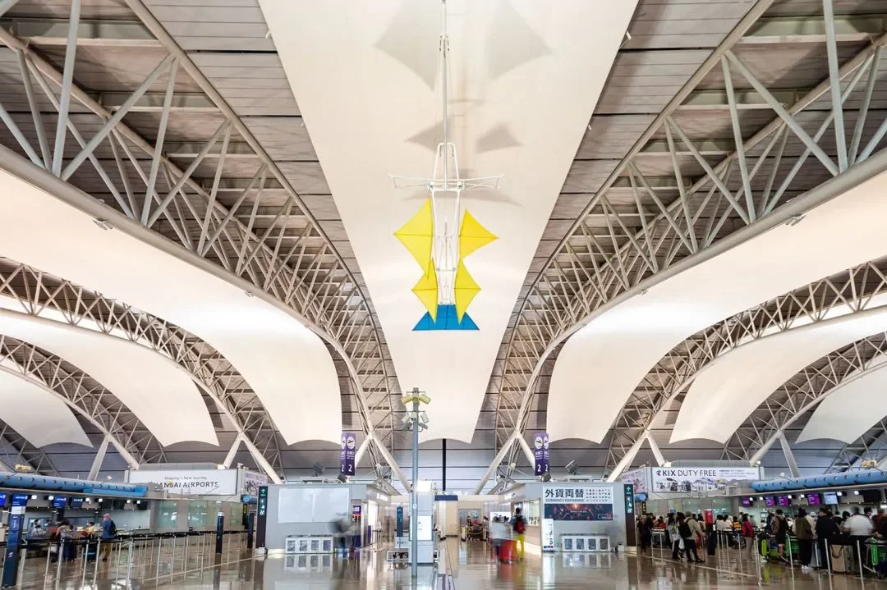

कांसाई अंतरराष्ट्रीय हवाई अड्डा (हवाई अड्डा कोड **KIX**) ओसाका खाड़ी में एक कृत्रिम द्वीप पर बसा है, जहाँ एक ही समुद्री पुल से पहुँचा जाता है, और यह कांसाई क्षेत्र का प्रवेश द्वार है — कई यात्रियों के लिए तो यही जापान का पहला टुकड़ा होता है जिस पर वे कदम रखते हैं।

उतरने के बाद सबसे पहले यह तय करें कि आप हवाई अड्डे की तीन इमारतों में से किससे बाहर निकल रहे हैं, क्योंकि हर हाल में उनके बीच आना-जाना अलग तरह से होता है; दूसरा यह कि आप कहाँ जा रहे हैं, क्योंकि दक्षिणी ओसाका, उमेदा, क्योटो और नारा — हर एक के लिए अलग ट्रेन है। यह गाइड **टर्मिनलों**, **खाने**, **खरीदारी**, **रात रुकने**, **शहर तक पहुँचने के चार रास्तों** और **व्यावहारिक सलाहों** को कवर करता है। किराए और समय-पत्रक मौसम और ऑपरेटर के साथ बदलते रहते हैं, इसलिए यात्रा से पहले हवाई अड्डे और ऑपरेटरों की अपनी साइटें देख लें।

## 1. तीन इमारतें: T1, T2 और एरोप्लाज़ा

टर्मिनल एयरलाइन और उड़ान के प्रकार के हिसाब से बँटे हैं; आपकी बुकिंग बताती है कि आपको कौन-सा चाहिए।

- **टर्मिनल 1** मुख्य इमारत है। ज़्यादातर अंतरराष्ट्रीय उड़ानें यहीं आती-जाती हैं, और रेस्टोरेंट, ड्यूटी-फ़्री दुकानें और लाउंज इसी में केंद्रित हैं।
- **टर्मिनल 2** Peach जैसी लो-कॉस्ट एयरलाइनों को संभालता है। यह सादा है, दुकानें कम हैं, और यहाँ टर्मिनल 1 से शटल बस से पहुँचा जाता है, जिसमें लगभग 5–10 मिनट लगते हैं।
- **एरोप्लाज़ा**, टर्मिनल 1 के बगल में, में होटल, एक कन्वीनियंस स्टोर और एक कैप्सूल होटल है — देर रात उतरने वाले किसी भी व्यक्ति का अस्थायी ठिकाना।

निकलने से पहले पुष्टि कर लें कि टर्मिनल 1 है या टर्मिनल 2; गलत चुनाव का मतलब है बैग घसीटकर शटल बस में चढ़ना। अगर आप टर्मिनल 2 पर उतरें और ट्रेन पकड़नी हो, तो उस सफ़र को अपने समय में जोड़ लें — देर से आने पर वही दस मिनट तय करते हैं कि अंतिम ट्रेन मिलेगी या नहीं।

टर्मिनल 1 और एरोप्लाज़ा पैदल दूरी पर हैं; टर्मिनल 2 अलग इमारत है। टर्मिनल 1 के स्तर 2 से रेलवे स्टेशन तक एक ढका हुआ वॉकवे है: आगमन के बाद ट्रेनों के साइन का अनुसरण करें।

## 2. हवाई अड्डे पर खाना: Edo-koji, चौथी मंज़िल का फ़ूड कोर्ट और Lawson

टर्मिनल 1 अपने खाने के विकल्प इस हिसाब से परतों में रखता है कि आपके पास कितना समय है।

- **Edo-koji भोजन क्षेत्र** पुरानी जापानी गली के अंदाज़ में बना है और सुशी, टेम्पुरा और रामेन तक फैला है — जापान में पहला पूरा भोजन करने के लिए अच्छी जगह।
- **चौथी मंज़िल का फ़ूड कोर्ट** सस्ता और तेज़ है, खाना लेकर आगे बढ़ने के लिए बना।
- **कन्वीनियंस स्टोर का नाश्ता** सुबह की उड़ानों के लिए आम चुनाव है, और Lawson 24 घंटे खुला रहता है।

देर से उतरें तो Edo-koji के रेस्टोरेंट और फ़ूड कोर्ट एक-एक करके बंद हो जाते हैं, और कन्वीनियंस स्टोर ही भरोसेमंद सहारा बचता है। कुछ घंटे बचे हों तो ठीक से बैठकर खाना गेट पर राइस बॉल से बेहतर है। बच्चों या बुज़ुर्ग रिश्तेदारों के साथ फ़ूड कोर्ट आसान है: सीटें जल्दी मिल जाती हैं और कतार नहीं लगती।

भोजन क्षेत्र मिलने की अच्छी जगह भी है: Edo-koji ढूँढना आसान है, इसलिए जो समूह अलग-अलग गति से इमिग्रेशन पार करते हैं, वे वहीं मिलने का तय कर सकते हैं।

## 3. खरीदारी: ड्यूटी-फ़्री, स्मृति-चिह्न और ड्रगस्टोर का सामान

- **ड्यूटी-फ़्री दुकानें** कॉस्मेटिक्स, शराब और मिठाइयों तक हैं — उड़ान से पहले सामान भरने का आख़िरी मौका।
- **लोकप्रिय स्मृति-चिह्न** हैं Royce नामा चॉकलेट, Shiroi Koibito और क्योटो की यात्सुहाशी, और लगभग हर गिफ़्ट शॉप पर ये मिलते हैं।
- **ड्रगस्टोर का सामान** जैसे आई ड्रॉप्स और शीट मास्क हवाई अड्डे पर भी उपलब्ध हैं।

शहर के ड्रगस्टोर आम तौर पर सस्ते होते हैं, इसलिए हवाई अड्डा बड़ी खरीदारी के बजाय ज़रूरत पूरी करने के लिए है: बड़े-भारी सामान शहर में, छोटा सामान और तोहफ़े हवाई अड्डे पर। ठंडा रखने वाली चॉकलेट, जैसे Royce, आख़िर में खरीदना बेहतर है ताकि वह होटल के फ़्रिज में पड़ी न रहे।

## 4. रात रुकना: First Cabin और Nikko Kansai Airport

रात बिताने के दो रास्ते हैं: कैप्सूल में पैसे बचाएँ, या ज़्यादा देकर होटल का कमरा लें।

- एरोप्लाज़ा के अंदर **First Cabin कैप्सूल होटल** 24 घंटे खुला है और कनेक्टिंग उड़ानों तथा रेड-आई उड़ानों के लिए उपयुक्त है।
- **Nikko Kansai Airport होटल** टर्मिनल 1 से जुड़ा है, ज़्यादा आरामदेह है, और परिवारों तथा बिज़नेस यात्रियों की पहली पसंद है।

कसौटी सीधी है: अगली सुबह कनेक्टिंग उड़ान हो या भोर में उतरें, कैप्सूल काफ़ी है; बच्चों या बहुत सारे सामान के साथ होटल लायक है। किसी भी विकल्प को पहले से बुक करें — पीक सीज़न में कांसाई में रात के लिए बिस्तर भरपूर नहीं मिलते।

सोने के अलावा, हवाई अड्डा उतरने के बाद के कुछ छोटे काम भी संभालता है:

- **सामान रखने की सुविधा और तकुहाइबिन डिलीवरी:** बैग आगमन स्तर पर छोड़ दें, या सीधे क्योटो या ओसाका के होटल भेज दें और हल्के होकर चलें।
- **लाउंज और शॉवर:** KIX Airport Lounge में शॉवर (लगभग ¥1,000) और मसाज कुर्सियाँ हैं।
- **कनेक्टिविटी:** आगमन स्तर पर Wi-Fi किराए और सिम कार्ड के काउंटर हैं।

## 5. शहर तक पहुँचना: चार विकल्पों में से चुनाव

जवाब लगभग हमेशा आपके गंतव्य से तय होता है। नांबा या शिन्साइबाशी में ठहरें तो ननकाई लाइन लें। क्योटो से शुरुआत करें या शिंकानसेन पकड़नी हो तो JR लें। बहुत सारा सामान हो, या नारा, कोबे या यूनिवर्सल स्टूडियो जाना हो, तो बस लें। देर रात उतरें तो टैक्सी ही बचती है।

| विकल्प | मुख्य गंतव्य | यात्रा समय | संदर्भ किराया |
| --- | --- | --- | --- |
| ननकाई लाइन | नांबा (शिन्साइबाशी के लिए) | लगभग 38 मिनट | साधारण श्रेणी लगभग ¥950 से; Rapi:t लिमिटेड एक्सप्रेस लगभग ¥1,450 |
| JR HARUKA लिमिटेड एक्सप्रेस | तेन्नोजी, शिन-ओसाका, क्योटो | क्योटो तक लगभग 75 मिनट | विदेशी यात्री के एक-तरफ़ा छूट टिकट पर लगभग ¥2,200 |
| हवाई अड्डा बस | मध्य ओसाका, नारा, कोबे, यूनिवर्सल स्टूडियो | लगभग 45–90 मिनट | लगभग ¥1,600–2,600 |
| टैक्सी | मध्य ओसाका | लगभग 50–70 मिनट | लगभग ¥20,000 |

### ननकाई लाइन: नांबा और शिन्साइबाशी के लिए

दक्षिणी ओसाका — नांबा, शिन्साइबाशी — के लिए ननकाई लाइन सबसे सीधा रास्ता है। सबसे तेज़ सेवा नांबा पहुँचने में लगभग 38 मिनट लेती है, साधारण टिकट लगभग ¥950 से; Rapi:t लिमिटेड एक्सप्रेस का किराया अलग (लगभग ¥1,450) है और इसमें चौड़ी सीट मिलती है, जो भारी बैग के साथ लायक है। ट्रेनें बार-बार आती हैं और सीधे शॉपिंग इलाके के बीच जाती हैं।

नांबा से मिदोसुजी मेट्रो लाइन एक ही सफ़र में शिन्साइबाशी और उमेदा कवर करती है, इसीलिए दक्षिणी ओसाका के लिए ननकाई उपयुक्त है।

### JR HARUKA: क्योटो, शिन-ओसाका और तेन्नोजी के लिए

अगर आपका पहला पड़ाव क्योटो, शिन-ओसाका (शिंकानसेन के लिए) या तेन्नोजी है, तो HARUKA ज़्यादा फ़िट बैठती है। यह क्योटो लगभग 75 मिनट में पहुँचती है, और अपने पासपोर्ट के साथ आप विदेशी यात्री का HARUKA एक-तरफ़ा छूट टिकट लगभग ¥2,200 में खरीद सकते हैं, जो साधारण किराए से सस्ता है। एक बात याद रखें: HARUKA उमेदा या ओसाका स्टेशन तक नहीं जाती, इसलिए उमेदा के लिए शिन-ओसाका या तेन्नोजी में बदलें।

खरीदते समय पासपोर्ट हाथ में रखें; अगर आपकी यात्रा में शिंकानसेन भी है, तो शिन-ओसाका सीधा जुड़ता है।

### हवाई अड्डा बस: भारी बैग और बिखरे गंतव्य

नारा, कोबे या यूनिवर्सल स्टूडियो के लिए, या उमेदा के किसी ख़ास होटल के लिए, बस आपको सामान के साथ ट्रेन बदलने से बचाती है। मध्य ओसाका तक की यात्राएँ लगभग 45–90 मिनट की होती हैं, किराया लगभग ¥1,600–2,600। कुछ रूट देर रात और सुबह की उड़ानों को कवर करते हैं, लेकिन हर रूट चौबीसों घंटे नहीं चलता, इसलिए समय-पत्रक देख लें।

दूसरा फ़ायदा होटल के दरवाज़े तक छोड़ना है: दो बड़े सूटकेस के साथ प्लेटफ़ॉर्म से लॉबी तक का आख़िरी हिस्सा अक्सर सबसे कठिन होता है। एवज में ट्रैफ़िक है; समय कम हो तो ट्रेन ज़्यादा भरोसेमंद है।

### टैक्सी: देर रात और साझा सवारी

मध्य ओसाका तक लगभग 50–70 मिनट और क़रीब ¥20,000। यह किराया बाँटने वाले समूह, अंतिम ट्रेन के बाद देर से आने वाले, या दरवाज़े से दरवाज़े तक जाना चाहने वाले किसी भी व्यक्ति के लिए ठीक है। अकेले के लिए यह घाटे का सौदा है; रात दो बजे तीन लोगों और सूटकेस के ढेर के साथ उतरें, तो यह पैसा वसूल है।

टैक्सी स्टैंड टर्मिनल के बाहर है, इसलिए पहले से बुक करने के बजाय कतार में लगें, और रात में इंतज़ार को अपने अनुमान में जोड़ लें।

## 6. व्यावहारिक सलाहें

- **नकदी:** ज़्यादातर दुकानें ट्रांसपोर्ट कार्ड, क्रेडिट कार्ड, Alipay और WeChat Pay लेती हैं, लेकिन छोटे रेस्टोरेंट और बसें आज भी नकद चाहती हैं। ¥10,000–20,000 साथ रखें।
- **समय:** अंतरराष्ट्रीय उड़ान से कम से कम 3 घंटे पहले हवाई अड्डे पर पहुँचें; पीक सीज़न में सुरक्षा जाँच में एक घंटे से ज़्यादा लग सकता है।
- **पहले से घोषणा:** Visit Japan Web से आप उड़ान से पहले इमिग्रेशन और सीमा शुल्क की घोषणाएँ भर सकते हैं, जिससे आगमन तेज़ होता है।
- **ट्रांसपोर्ट कार्ड:** ICOCA की जमा और वापसी के नियम हाल के वर्षों में बदले हैं; JR West जो प्रकाशित करता है, वह देख लें।
- **काम के टूल:** रास्तों के लिए Google Maps, और कनेक्शन के लिए कोई जापानी ट्रांसफ़र ऐप।

आगमन और प्रस्थान अलग घड़ियों पर चलते हैं: आगमन पर धीमापन कुछ नहीं बिगाड़ता; प्रस्थान पर सुरक्षा जाँच से पहले खरीदारी और खाना कर लें, क्योंकि लौट नहीं सकते।

## संबंधित लिंक

- **इस साइट पर**: [कांसाई अंतरराष्ट्रीय हवाई अड्डा (KIX)](/airport/KIX), [जापान (JP)](/country/JP)
- **विकिपीडिया**: [कांसाई अंतरराष्ट्रीय हवाई अड्डा](https://en.wikipedia.org/wiki/Kansai_International_Airport)
- **बाइडू बाइके**: [कांसाई अंतरराष्ट्रीय हवाई अड्डा](https://baike.baidu.com/item/%E5%85%B3%E8%A5%BF%E5%9B%BD%E9%99%85%E6%9C%BA%E5%9C%BA)

चित्र स्रोत: सार्वजनिक सामग्री से संकलित। टर्मिनल लेआउट, दुकानें, किराए और समय-पत्रक हवाई अड्डे और ऑपरेटरों द्वारा प्रकाशित जानकारी के अनुसार हैं; यात्रा के दिन उनकी वेबसाइटें देख लें।
