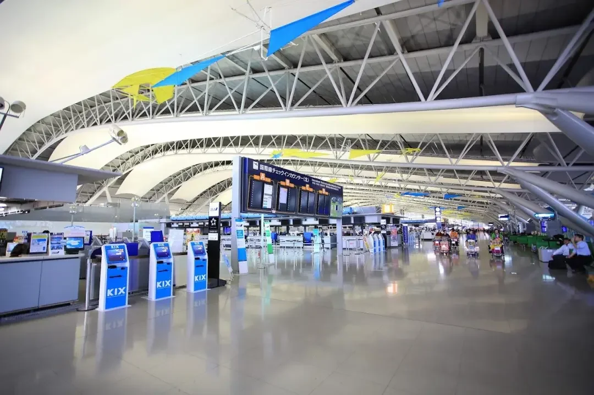

関西国際空港（空港コード**KIX**）は大阪湾の人工島にあり、1本の海上橋で結ばれています。関西地方の玄関口であり、多くの旅行者にとって日本で最初に立つ土地です。

到着後にまず整理すべきは、空港の3つの建物のどれを出るかです。建物間の移動方法がそれぞれ違うからです。次にどこへ向かうかで、大阪南部、梅田、京都、奈良では乗る電車が変わります。このガイドでは**ターミナル**、**食事**、**買い物**、**宿泊**、**市内への4つの方法**、**実用情報**を扱います。運賃と時刻表は季節と運行会社で変わるので、旅行前に空港と運行会社のサイトで確認してください。

## 1. 3つの建物：T1、T2、エアロプラザ

ターミナルは航空会社と便の種類で分かれ、予約確認書にどちらを使うか書かれています。

- **ターミナル1**はメインの建物です。国際線の多くがここに発着し、レストラン、免税店、ラウンジも集中しています。
- **ターミナル2**はピーチなどのLCCを扱います。より簡素で店も少なく、ターミナル1からシャトルバスで約5〜10分です。
- **エアロプラザ**はターミナル1の隣にあり、ホテル、コンビニ、カプセルホテルが入っています。深夜に到着した人の一時的な拠点です。

出発前にターミナル1か2かを確認してください。間違えると荷物を引いてシャトルバスに乗ることになります。ターミナル2に着いて電車を使うなら、その移動時間を予定に加えてください。遅い到着では、その10分が終電に間に合うかどうかを左右します。

ターミナル1とエアロプラザは徒歩圏で、ターミナル2は別の建物です。ターミナル1の2階には駅への屋根付き通路があり、到着後は電車の表示に従ってください。

## 2. 空港で食べる：江戸小路、4階フードコート、ローソン

ターミナル1は、使える時間に応じて食事の選択肢を分けています。

- **江戸小路の飲食エリア**は江戸の街並みを模し、寿司、天ぷら、ラーメンがそろっています。日本で最初のちゃんとした食事に良い場所です。
- **4階のフードコート**は安く速く、さっと食べて次へ向かうための場所です。
- **コンビニの朝食**は早朝便の定番で、ローソンは24時間営業です。

遅く着くと江戸小路のレストランとフードコートは次々に閉まり、コンビニが確実な逃げ道になります。時間に余裕があるなら、ゲートでおにぎりを食べるより、ちゃんと座って食べる方が良いです。子供や高齢の家族連れならフードコートが楽です。席を見つけやすく、行列もありません。

飲食エリアは待ち合わせ場所にも向いています。江戸小路は見つけやすいので、入国審査の速さが違うグループでもそこで会うと決めておけます。

## 3. 買い物：免税店、土産、ドラッグストア商品

- **免税店**は化粧品、酒、菓子を扱い、出発前に買い込む最後のチャンスです。
- **人気の土産**はロイズの生チョコ、白い恋人、京都の八ツ橋で、ほぼどの土産店にも置いています。
- **目薬やシートマスクなどのドラッグストア商品**も空港で買えます。

市街のドラッグストアの方が通常安いので、空港は買い足しの場と考えてください。かさばる物は街で、小物と土産は空港で。ロイズのように冷やす必要のあるチョコレートは、ホテルの冷蔵庫に置きっぱなしにしないよう、最後に買うのが良いです。

## 4. 宿泊：ファーストキャビンと日航関西空港

泊まり方には2つの方向があります。カプセルで費用を抑えるか、ホテルの部屋に多く払うかです。

- **ファーストキャビンのカプセルホテル**はエアロプラザ内にあり、24時間営業で、乗り継ぎや深夜便に向いています。
- **日航関西空港ホテル**はターミナル1直結で、より快適で、家族連れやビジネス旅行者の第一選択です。

判断は簡単です。翌朝早く乗り継ぐ、または深夜に着くならカプセルで十分です。子供連れや荷物が多いならホテルの価値があります。どちらも事前予約を。関西の繁忙期は宿泊ベッドが潤沢ではありません。

睡眠以外にも、到着後に片付けられる小さな用事が空港で済みます。

- **手荷物預かりと宅配便**：到着階で荷物を預けるか、京都や大阪のホテルへ直接送って身軽に移動できます。
- **ラウンジとシャワー**：KIXエアポートラウンジにはシャワー（約¥1,000）とマッサージチェアがあります。
- **通信**：到着階にはWi-FiレンタルとSIMカードのカウンターがあります。

## 5. 市内へ：4つの選択肢から選ぶ

答えはほぼ必ず目的地で決まります。難波や心斎橋に泊まるなら南海線。京都から始める、または新幹線に乗り継ぐならJR。荷物が多い、または奈良、神戸、ユニバーサル・スタジオへ向かうならバス。深夜に着くならタクシーしかありません。

| 選択肢 | 主な行き先 | 所要時間 | 参考運賃 |
| --- | --- | --- | --- |
| 南海線 | 難波（心斎橋方面） | 約38分 | 普通約¥950から、ラピート特急は約¥1,450 |
| JRはるか特急 | 天王寺、新大阪、京都 | 京都まで約75分 | 外国人旅行者向け片道割引切符で約¥2,200 |
| 空港バス | 大阪市中心部、奈良、神戸、ユニバーサル・スタジオ | 約45〜90分 | 約¥1,600〜2,600 |
| タクシー | 大阪市中心部 | 約50〜70分 | 約¥20,000 |

### 南海線：難波と心斎橋に

大阪南部、難波、心斎橋なら南海線が最もまっすぐなルートです。最速便は難波まで約38分、普通切符は約¥950からです。ラピート特急は追加料金（約¥1,450）で座席が広く、重い荷物があるなら価値があります。本数が多く、繁華街の中心まで乗り入れます。

難波からは地下鉄御堂筋線で心斎橋も梅田も一度で行けるので、大阪南部には南海が合っています。

### JRはるか：京都、新大阪、天王寺に

最初の目的地が京都、新大阪（新幹線）、天王寺ならはるかの方が合っています。京都まで約75分で、パスポートがあれば外国人旅行者向けの片道割引切符を約¥2,200で買え、通常運賃より安いです。注意点がひとつ。はるかは梅田や大阪駅には行かないので、梅田へは新大阪か天王寺で乗り換えます。

購入時はパスポートを手元に。新幹線が旅程に入っているなら、新大阪で直接乗り継げます。

### 空港バス：重い荷物と分散した行き先に

奈良、神戸、ユニバーサル・スタジオ、または梅田の特定ホテルへ行くなら、バスなら荷物を持って電車を乗り換えずに済みます。大阪市中心部まで約45〜90分、運賃は約¥1,600〜2,600です。深夜便や早朝便に対応する路線もありますが、すべての路線が24時間運行しているわけではないので、時刻表を確認してください。

もうひとつの利点はホテルの前で降ろしてもらえることです。大きなスーツケース2つなら、ホームからロビーまでの最後の一区間が最も大変なことがよくあります。代償は渋滞で、時間が厳しいなら電車の方が予測できます。

### タクシー：深夜と相乗りに

大阪市中心部まで約50〜70分、約¥20,000です。グループで割り勘する、終電後の遅い到着、ドアツードアを望む人に向いています。一人なら割高ですが、深夜2時に3人とスーツケースの山なら、払う価値があります。

乗り場はターミナル外なので、事前予約より並ぶ方が早く、夜は待ち時間を予定に加えてください。

## 6. 実用情報

- **現金**：ほとんどの店は交通系カード、クレジットカード、Alipay、WeChat Payに対応しますが、小さな飲食店とバスは現金が必要です。¥10,000〜20,000を持ち歩いてください。
- **時間**：国際線は少なくとも3時間前に空港へ。繁忙期の保安検査は1時間以上かかることがあります。
- **事前申告**：Visit Japan Webで入国と税関の申告を出発前に済ませられ、到着が速くなります。
- **交通系カード**：ICOCAのデポジットと払い戻しの規則は近年変わりました。JR西日本の公表内容を確認してください。
- **便利なツール**：経路はGoogleマップ、乗り換えは日本の乗換アプリが役立ちます。

到着と出発は別の時計で動きます。到着時はゆっくりしても損はありませんが、出発時は保安検査の前に買い物と食事を済ませてください。戻ることはできません。

## 関連リンク

- **このサイト内**：[関西国際空港 (KIX)](/airport/KIX)、[日本 (JP)](/country/JP)
- **Wikipedia**：[関西国際空港](https://en.wikipedia.org/wiki/Kansai_International_Airport)
- **百度百科**：[関西国際空港](https://baike.baidu.com/item/%E5%85%B3%E8%A5%BF%E5%9B%BD%E9%99%85%E6%9C%BA%E5%9C%BA)

画像出典：公開資料から編集。ターミナル配置、店舗、運賃、時刻表は空港と運行会社の公表内容です。旅行当日は各社のウェブサイトで確認してください。
