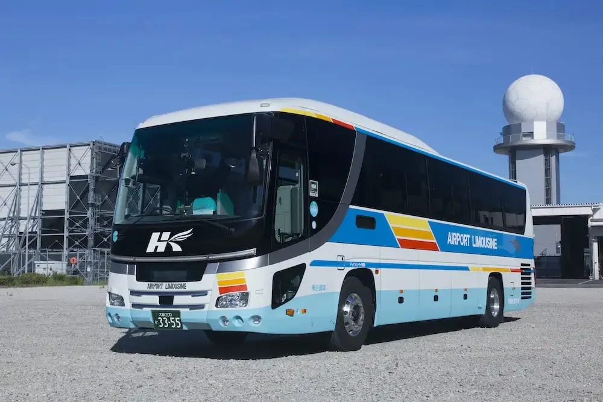

Międzynarodowy Port Lotniczy Kansai (kod lotniska **KIX**) leży na sztucznej wyspie w zatoce Osaka, połączonej z lądem jednym morskim mostem, i jest bramą do regionu Kansai — dla wielu podróżnych pierwszym skrawkiem Japonii, na jakim stają.

Pierwsza rzecz do ustalenia po wylądowaniu to z którego z trzech budynków lotniska wychodzisz, bo przemieszczanie się między nimi wygląda za każdym razem inaczej; druga to kierunek, bo południowa Osaka, Umeda, Kioto i Nara oznaczają różne pociągi. Ten przewodnik obejmuje **terminale**, **jedzenie**, **zakupy**, **nocleg**, **cztery sposoby dotarcia do miasta** i **praktyczne wskazówki**. Opłaty i rozkłady zmieniają się z sezonem i operatorem, więc przed podróżą sprawdź strony lotniska i przewoźników.

## 1. Trzy budynki: T1, T2 i Aeroplaza

Terminale dzielą się według linii lotniczej i typu lotu; w rezerwacji znajdziesz informację, którego potrzebujesz.

- **Terminal 1** to budynek główny. Przylatuje i odlatuje tu większość lotów międzynarodowych, a restauracje, sklepy wolnocłowe i lounge'e są skupione właśnie w nim.
- **Terminal 2** obsługuje tanie linie, takie jak Peach. Jest skromniejszy i ma mniej sklepów, a z terminalu 1 dojeżdża się do niego autobusem wahadłowym w około 5–10 minut.
- **Aeroplaza**, sąsiadująca z terminalem 1, mieści hotele, sklep convenience i hotel kapsułowy — tymczasowy dom wszystkich, którzy lądują późną nocą.

Przed wyjściem upewnij się, czy wychodzisz z terminalu 1, czy 2; zły wybór oznacza taszczenie bagaży do autobusu wahadłowego. Jeśli lądujesz na terminalu 2 i chcesz jechać pociągiem, dolicz ten przejazd do planu — przy późnym przylocie te dziesięć minut może zdecydować, czy zdążysz na ostatni pociąg.

Terminal 1 i Aeroplaza dzieli krótki spacer; terminal 2 to osobny budynek. Poziom 2 terminalu 1 ma zadaszoną kładkę do stacji kolejowej: po przylocie idź za znakami kierującymi do pociągów.

## 2. Jedzenie na lotnisku: Edo-koji, strefa gastronomiczna na 4. piętrze i Lawson

Terminal 1 porządkuje opcje gastronomiczne według tego, ile masz czasu.

- **Strefa gastronomiczna Edo-koji** jest urządzona na wzór starej japońskiej ulicy i obejmuje sushi, tempurę i ramen — dobre miejsce na pierwszy porządny posiłek w Japonii.
- **Strefa gastronomiczna na 4. piętrze** jest tańsza i szybsza, stworzona do szybkiego zjedzenia i ruszenia dalej.
- **Śniadanie ze sklepu convenience** to standardowy wybór przy wczesnych lotach, a Lawson jest otwarty całodobowo.

Przy późnym przylocie restauracje w Edo-koji i strefa gastronomiczna zamykają się jedna po drugiej, więc niezawodnym ratunkiem zostaje sklep convenience. Jeśli masz kilka godzin zapasu, porządne posiedzenie przy stole bije onigiri przy bramce. Z dziećmi lub starszymi krewnymi łatwiej w strefie gastronomicznej: miejsca łatwiej znaleźć i nie ma kolejki.

Strefa gastronomiczna to także dobry punkt zbiórki: Edo-koji łatwo znaleźć, więc grupy, które przechodzą odprawę imigracyjną w różnym tempie, mogą się tam umówić.

## 3. Zakupy: sklepy wolnocłowe, pamiątki i drogeria

- **Sklepy wolnocłowe** obejmują kosmetyki, alkohol i słodycze — ostatnia szansa na zapasy przed odlotem.
- **Najpopularniejsze pamiątki** to czekolada Royce nama, Shiroi Koibito i kiotyjskie yatsuhashi, i mają je niemal wszystkie sklepy z upominkami.
- **Artykuły drogerii**, takie jak krople do oczu i maseczki w płachcie, też są dostępne na lotnisku.

Drogerie w mieście są zwykle tańsze, więc lotnisko służy do dokupienia drobiazgów, a nie do dużych zakupów: gabaryty w mieście, drobiazgi i prezenty na lotnisku. Czekoladę wymagającą chłodu, jak Royce, lepiej kupić na końcu, żeby nie leżała w hotelowej lodówce.

## 4. Nocleg: First Cabin i Nikko Kansai Airport

Nocleg ma dwa kierunki: oszczędzać w kapsule albo zapłacić więcej za pokój hotelowy.

- **Hotel kapsułowy First Cabin** w Aeroplazie jest otwarty całodobowo i pasuje do przesiadek oraz lotów nocnych.
- **Hotel Nikko Kansai Airport** jest połączony z terminalem 1, jest wygodniejszy i stanowi pierwszy wybór dla rodzin oraz podróżujących służbowo.

Kryterium jest proste: przy wczesnej przesiadce następnego ranka albo lądowaniu w środku nocy kapsuła wystarczy; z dziećmi lub dużym bagażem hotel jest wart swojej ceny. Zarezerwuj jedno lub drugie z wyprzedzeniem — w szczycie sezonu miejsc noclegowych w Kansai nie ma w nadmiarze.

Poza noclegiem lotnisko załatwia kilka drobnych spraw po przylocie:

- **Przechowalnia bagażu i dostawa takuhaibin:** zostaw torby na poziomie przylotów albo wyślij je prosto do hotelu w Kioto lub Osace i podróżuj lekko.
- **Lounge'e i prysznice:** KIX Airport Lounge ma prysznice (około 1000 jenów) i fotele do masażu.
- **Łączność:** na poziomie przylotów są punkty wynajmu Wi-Fi i sprzedaży kart SIM.

## 5. Droga do miasta: wybór spośród czterech opcji

Odpowiedź niemal zawsze zależy od celu podróży. Nocujesz w Nambie lub Shinsaibashi — wybierz linię Nankai. Zaczynasz w Kioto albo przesiadasz się na shinkansen — wybierz JR. Masz dużo bagażu lub jedziesz do Nary, Kobe albo Universal Studios — wybierz autobus. Lądujesz późną nocą — zostaje taksówka.

| Opcja | Główne cele | Czas przejazdu | Opłata orientacyjna |
| --- | --- | --- | --- |
| Linia Nankai | Namba (dla Shinsaibashi) | około 38 min | od około 950 jenów w klasie zwykłej; około 1450 jenów za ekspres Rapi:t |
| Ekspres JR HARUKA | Tennoji, Shin-Osaka, Kioto | około 75 min do Kioto | około 2200 jenów za bilet jednorazowy zniżkowy dla turystów zagranicznych |
| Autobus lotniskowy | centrum Osaki, Nara, Kobe, Universal Studios | około 45–90 min | około 1600–2600 jenów |
| Taksówka | centrum Osaki | około 50–70 min | około 20 000 jenów |

### Linia Nankai: do Namby i Shinsaibashi

Dla południowej Osaki — Namby, Shinsaibashi — linia Nankai jest najprostszą trasą. Najszybsze połączenie dociera do Namby w około 38 minut, a zwykłe bilety kosztują od około 950 jenów; ekspres Rapi:t jest droższy (około 1450 jenów), ale daje szersze miejsce, co przydaje się przy ciężkich torbach. Pociągi jeżdżą często i wjeżdżają w środek dzielnicy handlowej.

Z Namby linia metra Midosuji łączy Shinsaibashi i Umedę jednym przejazdem, dlatego południowa Osaka dobrze współgra z Nankai.

### JR HARUKA: do Kioto, Shin-Osaki i Tennoji

Jeśli pierwszym przystankiem jest Kioto, Shin-Osaka (dla shinkansenu) lub Tennoji, lepiej pasuje HARUKA. Dociera do Kioto w około 75 minut, a z paszportem możesz kupić zniżkowy bilet jednorazowy HARUKA dla turystów zagranicznych za około 2200 jenów, taniej niż normalna opłata. O jednym trzeba pamiętać: HARUKA nie obsługuje Umedy ani stacji Osaka, więc do Umedy przesiadasz się w Shin-Osace lub Tennoji.

Przy zakupie miej paszport pod ręką; jeśli w planach jest shinkansen, Shin-Osaka łączy się bezpośrednio.

### Autobus lotniskowy: ciężkie torby i rozproszone cele

Do Nary, Kobe lub Universal Studios albo pod konkretny hotel w Umedzie autobus oszczędza przesiadek z bagażem. Przejazdy do centrum Osaki trwają około 45–90 minut, a bilety kosztują około 1600–2600 jenów. Niektóre trasy obsługują loty późnonocne i wczesnoporanne, ale nie każda kursuje całą dobę, więc sprawdź rozkład.

Drugą zaletą jest podwiezienie pod drzwi hotelu: z dwiema dużymi walizkami ostatni odcinek z peronu do lobby bywa najtrudniejszy. Minusem jest ruch uliczny; jeśli czasu jest mało, pociąg jest bardziej przewidywalny.

### Taksówki: późne noce i wspólne przejazdy

Do centrum Osaki to około 50–70 minut i około 20 000 jenów. To rozwiązanie dla grupy dzielącej koszty, dla późnego przylotu po ostatnim pociągu czy dla każdego, kto chce dojechać od drzwi do drzwi. W pojedynkę to nieopłacalne; przy lądowaniu o drugiej w nocy w trzy osoby i z górą walizek to dobrze wydane pieniądze.

Postój jest przed terminalem, więc stań w kolejce, zamiast rezerwować z wyprzedzeniem, a nocą dolicz czas oczekiwania do szacunków.

## 6. Praktyczne wskazówki

- **Gotówka:** większość sklepów przyjmuje karty transportowe, karty kredytowe, Alipay i WeChat Pay, ale małe restauracje i autobusy nadal wolą gotówkę. Miej przy sobie 10 000–20 000 jenów.
- **Czas:** bądź na lotnisku co najmniej 3 godziny przed lotem międzynarodowym; w szczycie sezonu kontrola bezpieczeństwa może potrwać ponad godzinę.
- **Deklaracja z wyprzedzeniem:** Visit Japan Web pozwala złożyć deklarację imigracyjną i celną przed lotem, co przyspiesza przylot.
- **Karty transportowe:** zasady kaucji i zwrotu dla ICOCA zmieniły się w ostatnich latach; sprawdź komunikaty JR West.
- **Przydatne narzędzia:** Google Maps do tras i japońska aplikacja do przesiadek.

Przylot i odlot rządzą się innym zegarem: przy przylocie powolność nic nie kosztuje; przy odlocie zrób zakupy i zjedz przed kontrolą bezpieczeństwa, bo nie wrócisz już na tę stronę.

## Powiązane linki

- **Na tej stronie**: [Port lotniczy Kansai (KIX)](/airport/KIX), [Japonia (JP)](/country/JP)
- **Wikipedia**: [Port lotniczy Kansai](https://en.wikipedia.org/wiki/Kansai_International_Airport)
- **Baidu Baike**: [Port lotniczy Kansai](https://baike.baidu.com/item/%E5%85%B3%E8%A5%BF%E5%9B%BD%E9%99%85%E6%9C%BA%E5%9C%BA)

Źródło zdjęć: opracowanie własne na podstawie materiałów publicznych. Układ terminali, sklepy, opłaty i rozkłady są zgodne z publikacjami lotniska i przewoźników; sprawdź ich strony w dniu podróży.
