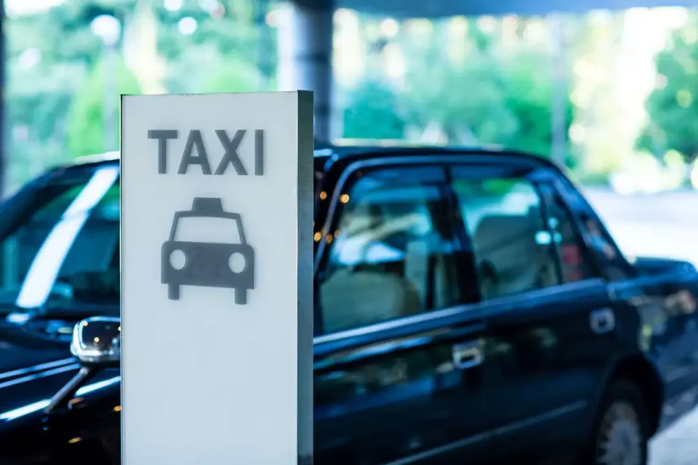

Kansai internationella flygplats (flygplatskod **KIX**) ligger på en konstgjord ö i Osakabukten, nås via en enda havsbro, och är porten till Kansai-regionen — för många resenärer den första biten Japan de någonsin står på.

Det första du behöver reda ut efter landningen är vilken av flygplatsens tre byggnader du går ut ur, eftersom förflyttningarna mellan dem fungerar olika i varje fall; det andra är vart du ska, för södra Osaka, Umeda, Kyoto och Nara innebär olika tåg. Den här guiden täcker **terminalerna**, **maten**, **shoppandet**, **övernattningen**, **de fyra sätten in till staden** och **praktiska tips**. Biljettpriser och tidtabeller ändras med säsong och operatör, så kontrollera flygplatsens och operatörernas egna webbplatser innan du reser.

## 1. Tre byggnader: T1, T2 och Aeroplaza

Terminalerna är uppdelade efter flygbolag och flygtyp; din bokning anger vilken du behöver.

- **Terminal 1** är huvudbyggnaden. De flesta internationella flyg ankommer och avgår här, och restaurangerna, taxfreebutikerna och loungerna är samlade där.
- **Terminal 2** hanterar lågprisbolag som Peach. Den är enklare, med färre butiker, och du når den från Terminal 1 med en transferbuss som tar cirka 5–10 minuter.
- **Aeroplaza**, intill Terminal 1, rymmer hotell, en närbutik och ett kapselhotell — det tillfälliga hemmet för alla som landar sent på natten.

Bekräfta Terminal 1 eller Terminal 2 innan du ger dig iväg; fel val innebär att du måste släpa väskorna upp på en transferbuss. Om du landar på Terminal 2 och vill ta tåget, lägg till den resan i din tidsplan — vid en sen ankomst kan de tio minuterna avgöra om du hinner med sista tåget.

Terminal 1 och Aeroplaza ligger en kort promenad från varandra; Terminal 2 är en separat byggnad. Plan 2 i Terminal 1 har en överdäckad gångväg till järnvägsstationen: följ skyltningen mot tåg efter ankomsten.

## 2. Mat på flygplatsen: Edo-koji, matgallerian på plan 4 och Lawson

Terminal 1 lägger upp sitt matutbud efter hur mycket tid du har.

- **Matområdet Edo-koji** är utformat som en gammal japansk gata och omfattar sushi, tempura och ramen — en bra plats för den första riktiga måltiden i Japan.
- **Matgallerian på plan 4** är billigare och snabbare, byggd för att äta snabbt och gå vidare.
- **Frukost från närbutiken** är standardvalet för tidiga flyg, och Lawson är öppen dygnet runt.

Landar du sent stänger restaurangerna i Edo-koji och matgallerian en efter en, och närbutiken blir den pålitliga reserven. Landar du med timmar till godo slår en ordentlig sittning en riskaka vid gaten. Med barn eller äldre släktingar är matgallerian enklare: det är lättare att hitta plats och ingen kö.

Matområdet fungerar också bra som mötesplats: Edo-koji är lätt att hitta, så sällskap som passerar immigrationen olika snabbt kan komma överens om att mötas där.

## 3. Inköp: taxfree, souvenirer och apoteksvaror

- **Taxfreebutikerna** omfattar kosmetika, alkohol och godis — sista chansen att fylla på innan du flyger.
- **De populära souvenirerna** är Royce nama chocolate, Shiroi Koibito och Kyotos yatsuhashi, och nästan varje presentbutik har dem.
- **Apoteksvaror** som ögondroppar och arkansiktsmasker finns också på flygplatsen.

Apotek i staden är oftast billigare, så flygplatsen är för påfyllning snarare än storhandel: skrymmande varor i stan, småsaker och presenter på flygplatsen. Choklad som behöver kyla, som Royce, köps bäst sist så att den inte blir liggande i hotellets kylskåp.

## 4. Övernattning: First Cabin och Nikko Kansai Airport

Det finns två vägar för en övernattning: spara pengar i en kapsel eller betala mer för ett hotellrum.

- **Kapselhotellet First Cabin**, inne i Aeroplaza, är öppet dygnet runt och passar vid byten och nattflyg.
- **Hotellet Nikko Kansai Airport** är sammankopplat med Terminal 1, är bekvämare och är förstahandsvalet för familjer och affärsresenärer.

Testet är enkelt: vid ett tidigt byte nästa morgon eller landning mitt i natten räcker en kapsel; med barn eller mycket bagage är hotellet värt det. Boka endera i förväg — övernattningsplatserna på Kansai är inte gott om under högsäsong.

Utöver sömn sköter flygplatsen några små sysslor efter landningen:

- **Bagageförvaring och takuhaibin-leverans:** lämna väskorna på ankomstplanet, eller skicka dem direkt till ett hotell i Kyoto eller Osaka och res lätt.
- **Lounger och duschar:** KIX Airport Lounge har duschar (cirka 1 000 yen) och massagestolar.
- **Uppkoppling:** på ankomstplanet finns diskar för Wi-Fi-hyra och SIM-kort.

## 5. In till staden: att välja bland fyra alternativ

Svaret avgörs nästan alltid av din destination. Ska du bo i Namba eller Shinsaibashi tar du Nankai-linjen. Ska du börja i Kyoto eller byta till shinkansen tar du JR. Har du mycket bagage, eller ska till Nara, Kobe eller Universal Studios, tar du bussen. Landar du sent på natten återstår bara taxi.

| Alternativ | Huvuddestinationer | Restid | Ungefärligt pris |
| --- | --- | --- | --- |
| Nankai-linjen | Namba (för Shinsaibashi) | cirka 38 min | från cirka 950 yen standard; cirka 1 450 yen för snabbtåget Rapi:t |
| Snabbtåget JR HARUKA | Tennoji, Shin-Osaka, Kyoto | cirka 75 min till Kyoto | cirka 2 200 yen för enkelbiljetten med utländsk besöksrabatt |
| Flygbuss | Centrala Osaka, Nara, Kobe, Universal Studios | cirka 45–90 min | cirka 1 600–2 600 yen |
| Taxi | Centrala Osaka | cirka 50–70 min | cirka 20 000 yen |

### Nankai-linjen: för Namba och Shinsaibashi

För södra Osaka — Namba, Shinsaibashi — är Nankai-linjen den rakaste vägen. Den snabbaste avgången når Namba på cirka 38 minuter, med standardbiljetter från cirka 950 yen; snabbtåget Rapi:t kostar extra (cirka 1 450 yen) och ger ett bredare säte, värt det med tunga väskor. Tågen går ofta och rakt in i mitten av butiksdistriktet.

Från Namba täcker tunnelbanelinjen Midosuji både Shinsaibashi och Umeda i en och samma färd, vilket är anledningen till att södra Osaka passar Nankai.

### JR HARUKA: för Kyoto, Shin-Osaka och Tennoji

Om ditt första stopp är Kyoto, Shin-Osaka (för shinkansen) eller Tennoji passar HARUKA bättre. Det når Kyoto på cirka 75 minuter, och med passet kan du köpa HARUKA:s enkelbiljett med rabatt för utländska besökare för cirka 2 200 yen, billigare än standardpriset. En sak att komma ihåg: HARUKA trafikerar inte Umeda eller Osaka Station, så för Umeda byter du i Shin-Osaka eller Tennoji.

Ha passet till hands när du köper biljetten; om shinkansen ingår i resan ansluter Shin-Osaka direkt.

### Flygbussen: tunga väskor och utspridda destinationer

För Nara, Kobe eller Universal Studios, eller för ett specifikt hotell i Umeda, sparar bussen dig byten med bagaget. Resorna in till centrala Osaka tar cirka 45–90 minuter, med biljettpriser på cirka 1 600–2 600 yen. Vissa linjer täcker sena nattflyg och tidiga morgonflyg, men inte alla linjer går dygnet runt, så kontrollera tidtabellen.

Den andra fördelen är att du blir avsläppt vid hotellporten: med två stora väskor är den sista sträckan från perrongen till lobbyn ofta det jobbigaste. Avvägningen är trafiken; om tiden är knapp är tåget mer förutsägbart.

### Taxi: sena nätter och delade resor

In till centrala Osaka tar det cirka 50–70 minuter och kostar cirka 20 000 yen. Det passar ett sällskap som delar på notan, en sen ankomst efter sista tåget eller den som vill åka dörr till dörr. Ensam är det dåligt värde; landar du klockan två på natten med tre personer och en hög resväskor är det väl använda pengar.

Taxistationen ligger utanför terminalen, så ställ dig i kö i stället för att förboka, och lägg på väntetiden på din tidsuppskattning på natten.

## 6. Praktiska tips

- **Kontanter:** de flesta butiker tar transportkort, kreditkort, Alipay och WeChat Pay, men små restauranger och bussar vill fortfarande ha kontanter. Ha 10 000–20 000 yen på dig.
- **Tajming:** var på flygplatsen minst 3 timmar före ett internationellt flyg; säkerhetskontrollen kan ta över en timme under högsäsong.
- **Deklaration i förväg:** Visit Japan Web låter dig lämna in immigrations- och tulldeklarationer innan du flyger, vilket snabbar på ankomsten.
- **Transportkort:** reglerna för deposition och återbetalning för ICOCA har ändrats de senaste åren; kontrollera vad JR West publicerar.
- **Användbara verktyg:** Google Maps för rutter och en japansk bytesapp för anslutningar.

Ankomster och avgångar går efter olika klockor: vid ankomst kostar det inget att ta det lugnt; vid avresa ska du handla och äta före säkerhetskontrollen, för du kan inte komma tillbaka.

## Relaterade länkar

- **På den här webbplatsen**: [Kansai internationella flygplats (KIX)](/airport/KIX), [Japan (JP)](/country/JP)
- **Wikipedia**: [Kansai International Airport](https://en.wikipedia.org/wiki/Kansai_International_Airport)
- **Baidu Baike**: [Kansai International Airport](https://baike.baidu.com/item/%E5%85%B3%E8%A5%BF%E5%9B%BD%E9%99%85%E6%9C%BA%E5%9C%BA)

Bildkälla: sammanställt från offentligt material. Terminalernas utformning, butiker, biljettpriser och tidtabeller är enligt vad flygplatsen och operatörerna publicerar; kontrollera deras webbplatser samma dag du reser.
