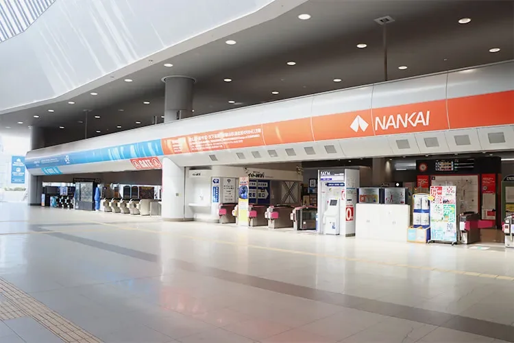

ท่าอากาศยานนานาชาติคันไซ (รหัสสนามบิน **KIX**) ตั้งอยู่บนเกาะเทียมในอ่าวโอซากะ เข้าถึงด้วยสะพานข้ามทะเลเพียงสายเดียว และเป็นประตูสู่ภูมิภาคคันไซ — สำหรับนักเดินทางหลายคน นี่คือแผ่นดินญี่ปุ่นผืนแรกที่พวกเขาเคยยืน

สิ่งแรกที่ต้องจัดการหลังลงเครื่องคือคุณกำลังเดินออกจากอาคารใดในสามอาคารของสนามบิน เพราะการเคลื่อนย้ายระหว่างอาคารแตกต่างกันในแต่ละกรณี สิ่งที่สองคือคุณจะมุ่งไปที่ไหน เพราะโอซากะตอนใต้ อูเมดะ เกียวโต และนาระ ต่างหมายถึงรถไฟคนละสาย คู่มือนี้ครอบคลุม**อาคารผู้โดยสาร** **การกิน** **การช้อปปิ้ง** **การค้างคืน** **สี่วิธีเข้าเมือง** และ**เคล็ดลับใช้ได้จริง** ค่าโดยสารและตารางเวลาเปลี่ยนตามฤดูกาลและผู้ให้บริการ ตรวจสอบเว็บไซต์ของสนามบินและผู้ให้บริการก่อนเดินทาง

## 1. สามอาคาร: T1, T2 และ Aeroplaza

อาคารผู้โดยสารแบ่งตามสายการบินและประเภทเที่ยวบิน การจองของคุณระบุว่าต้องใช้อาคารใด

- **อาคารผู้โดยสาร 1** คืออาคารหลัก เที่ยวบินระหว่างประเทศส่วนใหญ่มาถึงและออกจากที่นี่ และร้านอาหาร ร้านปลอดภาษี และเลานจ์กระจุกตัวอยู่ในนี้
- **อาคารผู้โดยสาร 2** รับสายการบินต้นทุนต่ำเช่น Peach เรียบง่ายกว่า มีร้านน้อยกว่า และเข้าถึงจากอาคาร 1 ด้วยรถรับส่งที่ใช้เวลาประมาณ 5–10 นาที
- **Aeroplaza** ข้างอาคารผู้โดยสาร 1 มีโรงแรม ร้านสะดวกซื้อ และโรงแรมแคปซูล — บ้านชั่วคราวของผู้ที่ลงเครื่องดึก

ยืนยันอาคาร 1 หรืออาคาร 2 ก่อนออกเดินทาง ตัวเลือกผิดหมายถึงต้องลากกระเป๋าขึ้นรถรับส่ง หากคุณลงที่อาคาร 2 และต้องการรถไฟ ให้บวกการเดินทางนั้นเข้าไปในเวลา — เมื่อมาถึงดึก สิบนาทีนั้นตัดสินได้ว่าคุณจะทันรถขบวนสุดท้ายหรือไม่

อาคารผู้โดยสาร 1 กับ Aeroplaza เดินถึงกันได้ ส่วนอาคาร 2 เป็นอาคารแยก ชั้น 2 ของอาคาร 1 มีทางเดินมีหลังคาไปสถานีรถไฟ ให้ตามป้ายรถไฟหลังขาเข้า

## 2. กินที่สนามบิน: เอโดะโคจิ ฟู้ดคอร์ตชั้น 4 และ Lawson

อาคารผู้โดยสาร 1 เรียงตัวเลือกอาหารตามเวลาที่คุณมี

- **พื้นที่รับประทานอาหารเอโดะโคจิ** ตกแต่งเป็นถนนญี่ปุ่นโบราณ ครอบคลุมซูชิ เทมปุระ และราเมน — ที่ดีสำหรับมื้อจริงมื้อแรกในญี่ปุ่น
- **ฟู้ดคอร์ตชั้น 4** ถูกกว่าและเร็วกว่า สร้างมาเพื่อกินแล้วไปต่อ
- **อาหารเช้าจากร้านสะดวกซื้อ** เป็นตัวเลือกมาตรฐานสำหรับเที่ยวบินเช้า และ Lawson เปิด 24 ชั่วโมง

ลงเครื่องดึก ร้านในเอโดะโคจิและฟู้ดคอร์ตจะปิดทีละร้าน เหลือร้านสะดวกซื้อเป็นที่พึ่งที่มั่นคง ลงเครื่องแล้วมีเวลาหลายชั่วโมง การนั่งกินจริงจังดีกว่าข้าวปั้นที่ประตูขึ้นเครื่อง หากมาถึงกับเด็กหรือผู้สูงอายุ ฟู้ดคอร์ตง่ายกว่า: หาที่นั่งง่ายและไม่ต้องต่อคิว

พื้นที่รับประทานอาหารยังเป็นจุดนัดพบที่ดี: เอโดะโคจิหาง่าย กลุ่มที่ผ่านตรวจคนเข้าเมืองด้วยความเร็วต่างกันจึงนัดเจอกันที่นั่นได้

## 3. ช้อปปิ้ง: ปลอดภาษี ของฝาก และของจากร้านขายยา

- **ร้านปลอดภาษี** ครอบคลุมเครื่องสำอาง แอลกอฮอล์ และขนม — โอกาสสุดท้ายในการตุนก่อนบิน
- **ของฝากยอดนิยม** คือช็อกโกแลต Royce nama, Shiroi Koibito และยัตสึฮาชิของเกียวโต และร้านของฝากเกือบทุกแห่งมีขาย
- **ของจากร้านขายยา** เช่น น้ำตาเทียมและมาสก์แผ่น ก็มีที่สนามบิน

ร้านขายยาในเมืองมักถูกกว่า สนามบินจึงเหมาะกับการเติมของมากกว่าซื้อครั้งใหญ่: ของชิ้นใหญ่ซื้อในเมือง ของชิ้นเล็กและของฝากซื้อที่สนามบิน ช็อกโกแลตที่ต้องแช่เย็นอย่าง Royce ควรซื้อเป็นอย่างสุดท้ายเพื่อไม่ให้ค้างในตู้เย็นโรงแรม

## 4. ค้างคืน: First Cabin และ Nikko Kansai Airport

การค้างคืนมีสองแนวทาง: ประหยัดด้วยแคปซูล หรือจ่าย יותרเพื่อห้องโรงแรม

- **โรงแรมแคปซูล First Cabin** ภายใน Aeroplaza เปิด 24 ชั่วโมง เหมาะกับการเปลี่ยนเครื่องและเที่ยวบินดึก
- **โรงแรม Nikko Kansai Airport** เชื่อมต่ออาคารผู้โดยสาร 1 สบายกว่า และเป็นตัวเลือกแรกสำหรับครอบครัวและนักเดินทางธุรกิจ

บททดสอบง่าย ๆ: ต่อเครื่องเช้าวันรุ่งขึ้นหรือลงเครื่องดึกดื่น แคปซูลก็พอ หากมีเด็กหรือกระเป๋าเยอะ โรงแรมคุ้มค่า จองทั้งสองแบบล่วงหน้า — เตียงค้างคืนที่คันไซมีไม่มากในฤดูท่องเที่ยว

นอกจากการนอน สนามบินยังจัดการงานเล็ก ๆ หลังลงเครื่องได้:

- **ฝากกระเป๋าและบริการส่งกระเป๋า takuhaibin:** ฝากกระเป๋าที่ชั้นขาเข้า หรือส่งตรงไปโรงแรมในเกียวโตหรือโอซากะแล้วเดินทางเบา ๆ
- **เลานจ์และฝักบัว:** KIX Airport Lounge มีฝักบัว (ประมาณ ¥1,000) และเก้าอี้นวด
- **การเชื่อมต่อ:** ชั้นขาเข้ามีเคาน์เตอร์เช่า Wi-Fi และซิมการ์ด

## 5. เข้าเมือง: เลือกจากสี่ทาง

คำตอบมักถูกกำหนดจากจุดหมายของคุณเกือบทั้งหมด พักที่นัมบะหรือชินไซบาชิ ใช้สาย Nankai เริ่มที่เกียวโตหรือต่อชินคันเซ็น ใช้ JR ถือกระเป๋าเยอะหรือมุ่งไปนาระ โกเบ หรือ Universal Studios ใช้รถบัส ลงเครื่องดึก คุณเหลือแค่แท็กซี่

| ทางเลือก | จุดหมายหลัก | เวลาเดินทาง | ค่าโดยสารอ้างอิง |
| --- | --- | --- | --- |
| สาย Nankai | นัมบะ (สำหรับชินไซบาชิ) | ประมาณ 38 นาที | เริ่มประมาณ ¥950 สำหรับตั๋วปกติ; ประมาณ ¥1,450 สำหรับ Rapi:t limited express |
| JR HARUKA limited express | เท็นโนจิ ชินโอซากะ เกียวโต | ประมาณ 75 นาทีถึงเกียวโต | ประมาณ ¥2,200 สำหรับตั๋วส่วนลดเที่ยวเดียวสำหรับผู้มาเยือนต่างชาติ |
| รถบัสสนามบิน | ใจกลางโอซากะ นาระ โกเบ Universal Studios | ประมาณ 45–90 นาที | ประมาณ ¥1,600–2,600 |
| แท็กซี่ | ใจกลางโอซากะ | ประมาณ 50–70 นาที | ประมาณ ¥20,000 |

### สาย Nankai: สำหรับนัมบะและชินไซบาชิ

สำหรับโอซากะตอนใต้ — นัมบะ ชินไซบาชิ — สาย Nankai เป็นเส้นทางตรงที่สุด บริการที่เร็วที่สุดถึงนัมบะในประมาณ 38 นาที ตั๋วปกติเริ่มประมาณ ¥950 ส่วน Rapi:t limited express มีค่าใช้จ่ายเพิ่ม (ประมาณ ¥1,450) และให้ที่นั่งกว้างกว่า คุ้มเมื่อกระเป๋าหนัก รถออกบ่อยและวิ่งเข้าใจกลางย่านช้อปปิ้ง

จากนัมบะ รถไฟใต้ดินสายมิโดซูจิครอบคลุมชินไซบาชิและอูเมดะในเที่ยวเดียว โอซากะตอนใต้จึงเข้ากับสาย Nankai

### JR HARUKA: สำหรับเกียวโต ชินโอซากะ และเท็นโนจิ

หากจุดแรกคือเกียวโต ชินโอซากะ (สำหรับชินคันเซ็น) หรือเท็นโนจิ HARUKA เข้ากว่า ถึงเกียวโตในประมาณ 75 นาที และด้วยหนังสือเดินทางคุณซื้อตั๋วส่วนลดเที่ยวเดียว HARUKA สำหรับผู้มาเยือนต่างชาติได้ในราคาประมาณ ¥2,200 ถูกกว่าค่าโดยสารปกติ ข้อควรจำ: HARUKA ไม่ให้บริการอูเมดะหรือสถานีโอซากะ สำหรับอูเมดะให้เปลี่ยนที่ชินโอซากะหรือเท็นโนจิ

พกหนังสือเดินทางไว้ตอนซื้อ หากชินคันเซ็นเป็นส่วนหนึ่งของทริป ชินโอซากะเชื่อมต่อได้โดยตรง

### รถบัสสนามบิน: กระเป๋าหนักและจุดหมายกระจัดกระจาย

สำหรับนาระ โกเบ หรือ Universal Studios หรือโรงแรมเฉพาะในอูเมดะ รถบัสช่วยให้ไม่ต้องเปลี่ยนรถไฟพร้อมกระเป๋า การเดินทางเข้าใจกลางโอซากะใช้เวลาประมาณ 45–90 นาที ค่าโดยสารประมาณ ¥1,600–2,600 บางเส้นทางรองรับเที่ยวบินดึกและเช้าตรู่ แต่ไม่ทุกเส้นทางวิ่งตลอด 24 ชั่วโมง ตรวจสอบตารางเวลา

ข้อดีอีกอย่างคือส่งถึงหน้าโรงแรม: ด้วยกระเป๋าใหญ่สองใบ ช่วงสุดท้ายจากชานชาลาถึงล็อบบี้มักเป็นส่วนที่ยากที่สุด แลกมาด้วยการจราจร หากเวลากระชั้น รถไฟคาดการณ์ได้กว่า

### แท็กซี่: กลางคืนและการแบ่งค่าโดยสาร

เข้าใจกลางโอซากะใช้เวลาประมาณ 50–70 นาที และประมาณ ¥20,000 เหมาะกับกลุ่มที่แบ่งค่าโดยสาร การมาถึงดึกหลังรถขบวนสุดท้าย หรือใครก็ตามที่อยากถึงหน้าประตู หากไปคนเดียวไม่คุ้มค่า แต่การลงเครื่องตีสองกับสามคนและกระเป๋ากองใหญ่ เงินจำนวนนั้นก็คุ้ม

จุดจอดอยู่นอกอาคารผู้โดยสาร ให้ต่อคิวแทนการจองล่วงหน้า และตอนกลางคืนบวกเวลารอเข้าไปในการประเมิน

## 6. เคล็ดลับใช้ได้จริง

- **เงินสด:** ร้านส่วนใหญ่รับบัตรขนส่ง บัตรเครดิต Alipay และ WeChat Pay แต่ร้านเล็กและรถบัสยังต้องการเงินสด พกไว้ ¥10,000–20,000
- **เวลา:** ถึงสนามบินอย่างน้อย 3 ชั่วโมงก่อนเที่ยวบินระหว่างประเทศ การตรวจความปลอดภัยในฤดูท่องเที่ยวอาจใช้เกินหนึ่งชั่วโมง
- **สำแดงล่วงหน้า:** Visit Japan Web ให้กรอกใบตรวจคนเข้าเมืองและศุลกากรก่อนบิน ซึ่งเร่งการมาถึง
- **บัตรขนส่ง:** กฎเงินมัดจำและการคืนเงินของ ICOCA เปลี่ยนในปีหลัง ๆ ตรวจสอบสิ่งที่ JR West ประกาศ
- **เครื่องมือที่มีประโยชน์:** Google Maps สำหรับเส้นทาง และแอปเปลี่ยนรถไฟญี่ปุ่นสำหรับการต่อขบวน

ขาเข้าและขาออกเดินคนละนาฬิกา: ตอนมาถึง ความช้าไม่มีค่าใช้จ่าย ตอนออกเดินทาง ให้ช้อปและกินก่อนจุดตรวจความปลอดภัย เพราะคุณกลับออกมาไม่ได้

## ลิงก์ที่เกี่ยวข้อง

- **ในเว็บไซต์นี้**: [ท่าอากาศยานนานาชาติคันไซ (KIX)](/airport/KIX), [ญี่ปุ่น (JP)](/country/JP)
- **Wikipedia**: [ท่าอากาศยานนานาชาติคันไซ](https://en.wikipedia.org/wiki/Kansai_International_Airport)
- **Baidu Baike**: [ท่าอากาศยานนานาชาติคันไซ](https://baike.baidu.com/item/%E5%85%B3%E8%A5%BF%E5%9B%BD%E9%99%85%E6%9C%BA%E5%9C%BA)

ที่มาของภาพ: รวบรวมจากสื่อสาธารณะ ผังอาคาร ร้านค้า ค่าโดยสาร และตารางเวลาเป็นไปตามที่สนามบินและผู้ให้บริการเผยแพร่ ตรวจสอบเว็บไซต์ของพวกเขาในวันที่เดินทาง
