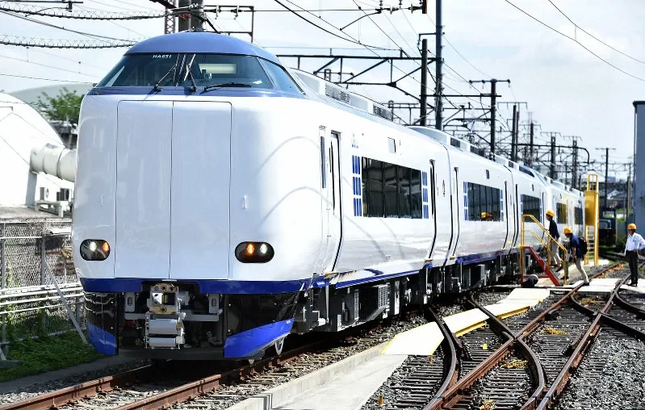

Міжнародний аеропорт Кансай (код аеропорту **KIX**) розташований на штучному острові в Осакській затоці, до якого веде єдиний міст через море. Це ворота регіону Кансай — для багатьох мандрівників перша часточка Японії, на яку вони ступають.

Перше, що потрібно з’ясувати після прильоту, — з якої з трьох будівель аеропорту ви виходите, адже переміщення між ними в кожному випадку відбувається по-різному. Друге — куди ви прямуєте, бо південна Осака, Умеда, Кіото й Нара вимагають різних потягів. У цьому путівнику — **термінали**, **харчування**, **покупки**, **ночівля**, **чотири способи дістатися до міста** та **практичні поради**. Тарифи й розклади змінюються залежно від сезону й оператора, тому перед поїздкою перевіряйте сайти аеропорту та перевізників.

## 1. Три будівлі: T1, T2 і Aeroplaza

Термінали розподілені за авіакомпаніями й типами рейсів; у бронюванні зазначено, який вам потрібен.

- **Термінал 1** — головна будівля. Більшість міжнародних рейсів прибуває й вилітає звідси, тут же зосереджені ресторани, магазини безмитної торгівлі та лаунжі.
- **Термінал 2** обслуговує лоукостери, як-от Peach. Він простіший, має менше магазинів, і до нього з термінала 1 ходить шатл приблизно 5–10 хвилин.
- **Aeroplaza** поруч із терміналом 1 вміщує готелі, мінімаркет і капсульний готель — тимчасовий прихисток для тих, хто прилітає пізно вночі.

Перед виходом уточніть, термінал 1 чи термінал 2 вам потрібен; помилка означатиме, що доведеться тягнути валізи в шатл. Якщо ви прилітаєте в термінал 2 і хочете скористатися потягом, додайте цю поїздку до розрахунку часу — під час пізнього прильоту ці десять хвилин можуть вирішити, чи встигнете ви на останній потяг.

Термінал 1 і Aeroplaza розташовані за кілька хвилин пішки один від одного; термінал 2 — окрема будівля. На рівні 2 термінала 1 є критий пішохідний перехід до залізничної станції: після прильоту йдіть за вказівниками до потягів.

## 2. Харчування в аеропорту: Edo-koji, фудкорт на 4-му поверсі та Lawson

У терміналі 1 варіанти харчування впорядковані за тим, скільки у вас часу.

- **Зона харчування Edo-koji** оформлена як старовинна японська вулиця; тут готують суші, темпуру й рамен — гарне місце для першої повноцінної трапези в Японії.
- **Фудкорт на 4-му поверсі** дешевший і швидший — його створено для того, щоб швидко поїсти й рухатися далі.
- **Сніданок у мінімаркеті** — типовий вибір для ранніх рейсів, а Lawson працює цілодобово.

Якщо прилітаєте пізно, ресторани Edo-koji та фудкорт зачиняються один за одним, і надійним запасним варіантом залишається мінімаркет. Якщо маєте кілька годин запасу, краще нормально посидіти в ресторані, ніж з’їсти онігірі біля виходу на посадку. Із дітьми чи старшими родичами простіше у фудкорті: там легше знайти місце й немає черги.

Зона харчування також зручна як місце зустрічі: Edo-koji легко знайти, тож групи, які проходять імміграційний контроль із різною швидкістю, можуть домовитися зустрітися там.

## 3. Покупки: безмитна торгівля, сувеніри та товари з аптеки

- **Магазини безмитної торгівлі** пропонують косметику, алкоголь і солодощі — остання нагода зробити запаси перед вильотом.
- **Популярні сувеніри** — шоколад Royce nama, Shiroi Koibito і яцухасі з Кіото; вони є майже в кожному сувенірному магазині.
- **Аптечні товари**, як-от краплі для очей і тканинні маски, також можна купити в аеропорту.

Аптеки в місті зазвичай дешевші, тому в аеропорту краще докуповувати дрібниці, а не робити великі закупи: об’ємні речі — в місті, дрібні товари й подарунки — в аеропорту. Шоколад, який потребує охолодження, як-от Royce, краще купувати останнім, щоб він не лежав у холодильнику готелю.

## 4. Ночівля: First Cabin і Nikko Kansai Airport

Є два підходи до ночівлі: заощадити в капсулі або заплатити більше за готельний номер.

- **Капсульний готель First Cabin** у будівлі Aeroplaza працює цілодобово й добре підходить для пересадок і нічних рейсів.
- **Готель Nikko Kansai Airport** з’єднаний із терміналом 1, він комфортніший і є першим вибором для сімей та ділових мандрівників.

Критерій простий: якщо наступного ранку у вас пересадка або ви прилітаєте посеред ночі, капсули достатньо; якщо подорожуєте з дітьми чи маєте багато багажу, готель того вартий. Бронюйте заздалегідь — у сезон пік місць для ночівлі в Кансаї небагато.

Крім сну, в аеропорту можна швидко вирішити кілька справ після прильоту:

- **Камера схову й доставка takuhaibin:** залиште валізи на рівні прильотів або надішліть їх одразу до готелю в Кіото чи Осаці й подорожуйте налегке.
- **Лаунжі й душові:** у KIX Airport Lounge є душові (близько ¥1,000) і масажні крісла.
- **Зв’язок:** на рівні прильотів є стійки оренди Wi-Fi і продажу SIM-карток.

## 5. Дорога до міста: вибір із чотирьох варіантів

Вибір майже завжди визначає пункт призначення. Якщо ви зупиняєтеся в Намбі чи Сінсайбасі, їдьте лінією Nankai. Якщо прямуєте до Кіото або пересідаєте на сінкансен, обирайте JR. Якщо маєте багато багажу або їдете до Нари, Кобе чи Universal Studios, беріть автобус. А якщо прилітаєте пізно вночі, залишається таксі.

| Варіант | Основні напрямки | Час у дорозі | Орієнтовний тариф |
| --- | --- | --- | --- |
| Лінія Nankai | Намба (для Сінсайбасі) | близько 38 хв | від приблизно ¥950 за звичайний квиток; близько ¥1,450 за експрес Rapi:t |
| Експрес JR HARUKA | Теннодзі, Сін-Осака, Кіото | близько 75 хв до Кіото | близько ¥2,200 за дисконтний квиток в один бік для іноземних туристів |
| Аеропортовий автобус | Центр Осаки, Нара, Кобе, Universal Studios | близько 45–90 хв | близько ¥1,600–2,600 |
| Таксі | Центр Осаки | близько 50–70 хв | близько ¥20,000 |

### Лінія Nankai: для Намби та Сінсайбасі

Для південної Осаки — Намби й Сінсайбасі — лінія Nankai є найпрямішим маршрутом. Найшвидший потяг доїжджає до Намби приблизно за 38 хвилин, звичайні квитки коштують приблизно від ¥950; експрес Rapi:t дорожчий (близько ¥1,450) і має ширші сидіння, що варто оцінити з важкими валізами. Потяги ходять часто й прямують до самого центру торгового району.

Від Намби лінія метро Midosuji за один рейс охоплює Сінсайбасі й Умеду — саме тому для південної Осаки зручна Nankai.

### JR HARUKA: для Кіото, Сін-Осаки та Теннодзі

Якщо ваша перша зупинка — Кіото, Сін-Осака (для пересадки на сінкансен) або Теннодзі, HARUKA підходить краще. Він доїжджає до Кіото приблизно за 75 хвилин, а з паспортом можна купити дисконтний квиток HARUKA в один бік для іноземних туристів приблизно за ¥2,200 — дешевше за звичайний тариф. Що варто пам’ятати: HARUKA не обслуговує Умеду чи станцію Осака, тому до Умеди доведеться пересісти в Сін-Осаці або Теннодзі.

Купуйте квиток із паспортом під рукою; якщо у вашій подорожі є сінкансен, у Сін-Осаці зручна пряма пересадка.

### Аеропортовий автобус: важкий багаж і різні напрямки

Для Нари, Кобе чи Universal Studios, а також для конкретного готелю в Умеді автобус позбавляє необхідності пересідати з багажем. Поїздка до центру Осаки триває близько 45–90 хвилин, квиток коштує приблизно ¥1,600–2,600. Деякі маршрути обслуговують нічні й ранкові рейси, але не всі працюють цілодобово, тому перевіряйте розклад.

Ще одна перевага — висадка біля дверей готелю: із двома великими валізами останній відрізок від платформи до лобі часто буває найважчим. Зворотний бік — дорожні затори; якщо час обмежений, потяг передбачуваніший.

### Таксі: пізні вечори й спільні поїздки

До центру Осаки — приблизно 50–70 хвилин і близько ¥20,000. Це підходить групі, яка ділить вартість, тим, хто прилітає після останнього потяга, або всім, хто хоче дістатися від дверей до дверей. Самому їхати невигідно; але прилетіти о другій ночі втрьох із купою валіз — і таксі цілком виправдане.

Стоянка таксі розташована біля термінала, тому там треба стояти в черзі, а не бронювати заздалегідь; уночі додайте час очікування до своїх розрахунків.

## 6. Практичні поради

- **Готівка:** більшість крамниць приймає транспортні картки, кредитні картки, Alipay і WeChat Pay, але невеликі ресторани й автобуси досі потребують готівки. Майте при собі ¥10,000–20,000.
- **Час:** прибувайте в аеропорт щонайменше за 3 години до міжнародного рейсу; у сезон пік перевірка безпеки може тривати понад годину.
- **Попередня декларація:** Visit Japan Web дає змогу подати імміграційну та митну декларації до вильоту, що прискорює проходження контролю після прильоту.
- **Транспортні картки:** правила застави й повернення коштів для ICOCA останніми роками змінилися; перевіряйте публікації JR West.
- **Корисні інструменти:** Google Maps для маршрутів і японський застосунок для планування пересадок.

Приліт і виліт підкоряються різному відчуттю часу: під час прильоту повільність нічого не коштує; під час вильоту робіть покупки й їжте до перевірки безпеки, бо повернутися вже не зможете.

## Пов’язані посилання

- **На цьому сайті**: [Міжнародний аеропорт Кансай (KIX)](/airport/KIX), [Японія (JP)](/country/JP)
- **Вікіпедія**: [Міжнародний аеропорт Кансай](https://en.wikipedia.org/wiki/Kansai_International_Airport)
- **Baidu Baike**: [Міжнародний аеропорт Кансай](https://baike.baidu.com/item/%E5%85%B3%E8%A5%BF%E5%9B%BD%E9%99%85%E6%9C%BA%E5%9C%BA)

Джерело зображень: укладено з публічних матеріалів. Схема терміналів, магазини, тарифи й розклади наведені за даними аеропорту та перевізників; перевіряйте їхні сайти в день поїздки.
