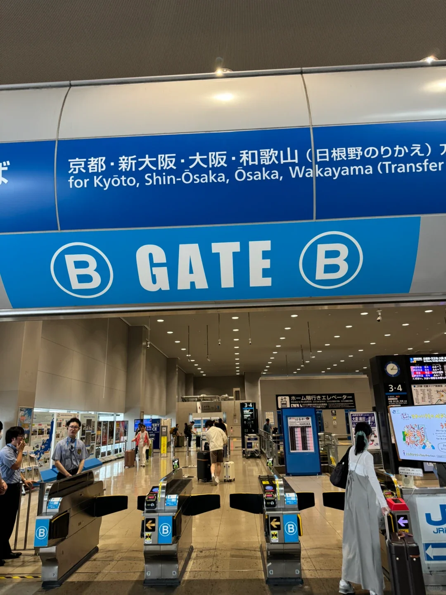

কানসাই আন্তর্জাতিক বিমানবন্দর (KIX) থেকে কিয়োতোতে যাওয়ার সবচেয়ে শান্ত পথ JR ওয়েস্টের হারুকা লিমিটেড এক্সপ্রেস। এটি সরাসরি বিমানবন্দর স্টেশন থেকেই ছাড়ে, শুধু হিনেনো, তেন্নোজি ও শিন-ওসাকায় থামে, আর কোনো বদল ছাড়াই প্রায় 75–80 মিনিটে কিয়োতো স্টেশনে পৌঁছায়, আসনও কমিউটার ট্রেনের চেয়ে অনেক প্রশস্ত।

এই গাইডে শুধু ওই একটি ট্রেন: টিকিট কোথায় কিনবেন, কোন টিকিট লাভজনক, গেট ও প্ল্যাটফর্ম কীভাবে খুঁজবেন, কোন কোচে বসবেন, লাগেজ কোথায় যাবে, এবং কিয়োতো স্টেশন থেকে মেট্রো ও বাস ধরার উপায়। নাম্বা, উমেদা ও নারার জন্য দেখুন [কানসাই বিমানবন্দর আগমন গাইড](/blog/kansai-airport-arrival-guide)। ভাড়া ও সময়সূচি ঋতু অনুযায়ী বদলায়, তাই যাত্রার আগে JR ওয়েস্টের নিজস্ব সাইট দেখে নিন।

## 1. লেভেল 2-এ উঠে JR টিকিট অফিস

আগমন শেষে 鉄道 / Railways-এর সাইন অনুসরণ করুন, এস্কেলেটরে টার্মিনাল 1-এর লেভেল 2-এ উঠুন এবং ওয়াকওয়ে পার হয়ে স্টেশনে যান। কানসাই এয়ারপোর্ট স্টেশন নানকাই ও JR-এ ভাগ; JR-এর দিকটি নীল-সাদা অফিস, দরজার উপরে লেখা "JR Ticket Office"।

ভেতরে তিনটি কাজ হয়: কাউন্টারে টিকিট কেনা, রেল পাস বদলানো, এবং অনলাইনে কেনা ই-টিকিট সবুজ মেশিন থেকে সংগ্রহ করা, যার স্ক্রিন ইংরেজিতে বদলে যায়। নীল সাইনের নিচের মেশিনে একই দিনের টিকিট বিক্রি হয়। প্রথমবার লাগেজ নিয়ে গেলে কর্মী থাকা কাউন্টারই সবচেয়ে সহজ।

## 2. খরচ কত: সাধারণ ভাড়া ও দর্শনার্থী টিকিট

সাধারণ ভাড়া মানে বেস টিকিট প্লাস লিমিটেড-এক্সপ্রেস চার্জ, বিমানবন্দর থেকে কিয়োতো পর্যন্ত প্রায় 3,490 ইয়েন, শিশুদের প্রায় অর্ধেক দাম। যেকোনো ভ্রমণকারী এটি কিনতে পারেন।

| টিকিট | রেফারেন্স ভাড়া (KIX থেকে কিয়োতো) | শর্ত |
| --- | --- | --- |
| সাধারণ (বেস টিকিট + লিমিটেড এক্সপ্রেস) | প্রায় 3,490 ইয়েন | যেকোনো ভ্রমণকারী; কাউন্টার বা মেশিন |
| হারুকা ওয়ান-ওয়ে টিকিট | প্রায় 2,200 ইয়েন | বিদেশি পাসপোর্ট, সাময়িক ভিজিটর, নির্দিষ্ট রুট |
| শিশু | প্রাপ্তবয়স্ক ভাড়ার প্রায় অর্ধেক | 6–11 বছর, পরিচয়পত্র যাচাই হতে পারে |

বিদেশি ভ্রমণকারীরা একই রুটে হারুকা ওয়ান-ওয়ে টিকিট পান প্রায় 2,200 ইয়েনে, প্রায় এক-তৃতীয়াংশ কম। শর্ত হলো বিদেশি পাসপোর্ট ও সাময়িক ভিজিটরের মর্যাদা, আর রুট নির্দিষ্ট: বিমানবন্দর থেকে কিয়োতো শহর এলাকা। ওড়ার আগেই JR ওয়েস্ট, ট্রাভেল এজেন্ট বা পার্টনার প্ল্যাটফর্মের মাধ্যমে কিনুন, তারপর মেশিন বা কাউন্টারে কাগজের টিকিটে বদলান। কোটা ও বিক্রির সময়সীমা সীমিত, তাই তারিখ ঠিক হলে আগেই কিনুন।

একটা কথা পরিষ্কার থাকুক: আইকোকা বা সুইকার মতো IC কার্ড শুধু বেস ভাড়া কভার করে। লিমিটেড-এক্সপ্রেস চার্জ আলাদা, তাই কার্ড ট্যাপ করে হারুকায় উঠতে পারবেন না। অনারক্ষিত লিমিটেড-এক্সপ্রেস টিকিটেও সংরক্ষিত আসনের অধিকার থাকে না; সংরক্ষণে আরও কয়েকশ ইয়েন লাগে, যা পিক সিজনে খরচ করাই ভালো।

## 3. গেট ও প্ল্যাটফর্ম: কিয়োতো খুঁজুন

টিকিট নিয়ে সোজা পাশের গেটে যান। চৌম্বক টিকিট ঢুকিয়ে দিন, অপর প্রান্তে বেরিয়ে এলে ফিরিয়ে নিন, আর সেটি রাখুন — কিয়োতো স্টেশন থেকে বেরোনোর সময় আবার লাগবে। উপরের নীল সাইনে লেখা কিয়োতো, শিন-ওসাকা, ওসাকা ও ওয়াকায়ামা (হিনেনোতে বদল), ভুল করা কঠিন।

প্ল্যাটফর্মে নেমে হারুকা সাধারণত 3 ও 4 নম্বর প্ল্যাটফর্ম থেকে ছাড়ে, "Exp. HARUKA" সাইন ও কোচের চিত্র দিয়ে চিহ্নিত। ওসাকাগামী কানসাই এয়ারপোর্ট র‍্যাপিডও একই প্ল্যাটফর্ম ব্যবহার করে, তাই প্রথম যে ট্রেন দেখবেন তাতে উঠবেন না: হারুকার গন্তব্য ডিসপ্লেতে কিয়োতো লেখা থাকে আর বগিতে নিজস্ব লেখা।

ট্রেন মোটামুটি প্রতি 30 মিনিটে ছাড়ে, প্রথমটি প্রায় 06:30-এ আর শেষটি প্রায় 22:00-তে, যাত্রা 75–80 মিনিট। সময়সূচি ঋতু অনুযায়ী বদলায়, তাই JR ওয়েস্টের সাইট বা প্ল্যাটফর্মের ডিসপ্লেতে নিশ্চিত করুন। শেষ ট্রেন ধরতে চাইলে ইমিগ্রেশন ও লাগেজে লাগা 45–60 মিনিট যোগ করুন।

## 4. ট্রেনে: সংরক্ষিত আসন, অনারক্ষিত কোচ ও লাগেজ

হারুকা সাধারণত নয়টি কোচে চলে: 1–4 ও 8–9 সংরক্ষিত, আর 5, 6 ও 7 অনারক্ষিত (প্ল্যাটফর্মের চিত্রই শেষ কথা)। অনারক্ষিত টিকিটে ওই তিন কোচের যেকোনো খালি আসনে বসুন; সংরক্ষণ থাকলে টিকিটে যেখানে লেখা সেখানেই।

অনারক্ষিত মানে নির্দিষ্ট ছাড়ার সময়ে বাঁধা নন, কিন্তু পিক সিজনে দাঁড়িয়েও থাকতে হতে পারে। চেরি ফুল, শরতের পাতা ও লম্বা সপ্তাহান্তে, শিশু বা দুটি বড় স্যুটকেস নিয়ে গেলে কেনার সময়ই সংরক্ষণ করুন।

লাগেজ দরজার পাশের র‍্যাকে বা প্রতিটি কোচের প্রান্তের জায়গায় যায়, যেখানে 28 ইঞ্চি স্যুটকেস ধরে, কিন্তু আগে এলে আগে পাবেন। শিনকানসেনের মতো বড় ব্যাগের আগাম বুকিংয়ের নিয়ম হারুকার নেই; তবু ট্রেন ভর্তি থাকলে আইল বা দরজা আটকে রাখবেন না। ট্রেনে টয়লেট আছে, আর ঘোষণা জাপানি ও ইংরেজিতে।

## 5. কিয়োতো পর্যন্ত পঁচাত্তর মিনিট

ট্রেন সমুদ্রসেতু পার হয়, ডান দিকে ওসাকা উপসাগর, হিনেনোতে হানওয়া লাইনে মেশে, প্রায় 35 মিনিটে তেন্নোজিতে পৌঁছায়, ওসাকার কিনারা ধরে শিন-ওসাকা পর্যন্ত যায়, তারপর কিয়োতো লাইনে উত্তরে উঠে বিমানবন্দর ছাড়ার 75–80 মিনিট পর পৌঁছায়।

কিয়োতো স্টেশনে সাধারণত পশ্চিম দিকের 30 ও 31 নম্বর প্ল্যাটফর্মে আসে; সেন্ট্রাল এক্সিট বা হাচিজো এক্সিটের সাইন অনুসরণ করুন, আর লাগেজ নিয়ে পাঁচ মিনিট সময় রাখুন।

সস্তা বিকল্পও আছে: ওসাকা স্টেশন পর্যন্ত কানসাই এয়ারপোর্ট র‍্যাপিড, তারপর কিয়োতো পর্যন্ত স্পেশাল র‍্যাপিড, প্রায় 1 ঘণ্টা 45 মিনিট, ভাড়া প্রায় অর্ধেক, কিন্তু ওসাকায় ব্যাগ নিয়ে বদলাতে হবে। সময় কম থাকলে বা শিনকানসেন ধরতে হলে এক ট্রেনে যাওয়াই জেতে।

## 6. কিয়োতো স্টেশনে বদল: আগে JR থেকে বেরোনো, তারপর মেট্রো

কিয়োতো স্টেশন বিশাল, প্রথমবার গেলে গেটেই একবার থামতে হয়। ক্রমটা গুরুত্বপূর্ণ: আগে JR গেট ছাড়ুন, তারপর মেট্রো বা বাসে বদলান।

কারাসুমা মেট্রো লাইনের সাইন আন্ডারগ্রাউন্ড ইস্ট এক্সিট থেকে, আর তার গেট JR প্রস্থানের পাশেই, এমনভাবে লুকানো যে সোজা হেঁটে ঢুকে দেখবেন আপনি এখনও JR-এর পরিশোধিত এলাকাতেই আছেন, টিকিট বাকি। JR গেটে টিকিট ঢুকিয়ে বেরোন, তারপর মেট্রোর টিকিট কিনুন বা ট্যাপ করুন। শিজো, গোজো ও কারাসুমা ওইকে সবই ওই লাইনে।

বাস টার্মিনাল সেন্ট্রাল এক্সিটের বাইরে, যেখান থেকে কিয়োমিজু-দেরা, কিনকাকু-জি ও আরাশিয়ামার শহর বাস ছাড়ে। নারার কিনতেতসু হাচিজো দিক থেকে ছাড়ে, শিনকানসেনও সেখানেই — স্টেশন পার হতে দশ মিনিট লাগে। অনেক লাগেজ থাকলে কয়েন লকার বা তাকুহাইবিন কাউন্টার ব্যবহার করে স্যুটকেস ছাড়াই ঘুরে আসুন।

## সম্পর্কিত লিংক

- **এই সাইটে**: [কানসাই আন্তর্জাতিক বিমানবন্দর (KIX)](/airport/KIX), [জাপান (JP)](/country/JP)
- **আরও লেখা**: [কানসাই বিমানবন্দর আগমন গাইড](/blog/kansai-airport-arrival-guide), [কানসাই বিমানবন্দরে আপনার প্রথম ঘণ্টা: ইমিগ্রেশন, সিম কার্ড ও আইকোকা](/blog/kansai-airport-transport-sim-card)
- **উইকিপিডিয়া**: [কানসাই আন্তর্জাতিক বিমানবন্দর](https://en.wikipedia.org/wiki/Kansai_International_Airport), [হারুকা (ট্রেন)](https://en.wikipedia.org/wiki/Haruka_%28train%29), [কিয়োতো স্টেশন](https://en.wikipedia.org/wiki/Kyoto_Station)
- **বাইদু বাইকে**: [কানসাই আন্তর্জাতিক বিমানবন্দর](https://baike.baidu.com/item/%E5%85%B3%E8%A5%BF%E5%9B%BD%E9%99%85%E6%9C%BA%E5%9C%BA), [হারুকা](https://baike.baidu.com/item/%E9%81%A5%E5%8F%B7%E5%88%97%E8%BD%A6), [কিয়োতো স্টেশন](https://baike.baidu.com/item/%E4%BA%AC%E9%83%BD%E7%AB%99)

ভাড়া, ডিসকাউন্টের শর্ত ও সময়সূচি JR ওয়েস্ট যা প্রকাশ করে তা অনুসরণ করে; দিনের পরিচালনকারীর নোটিশই চূড়ান্ত। ছবির কৃতিত্ব: প্রকাশ্য উপাদান থেকে সংকলিত।
