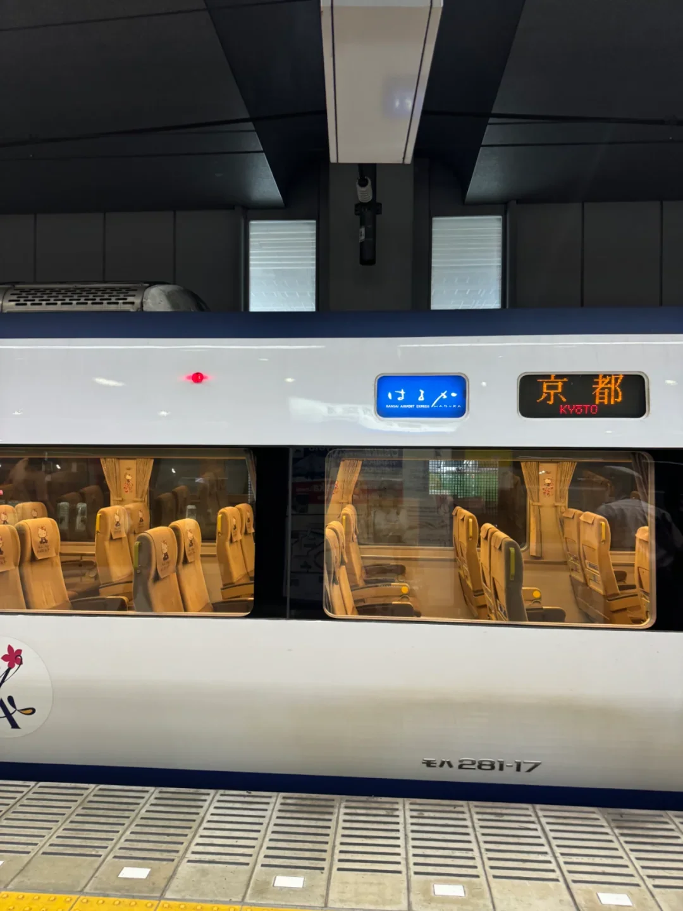
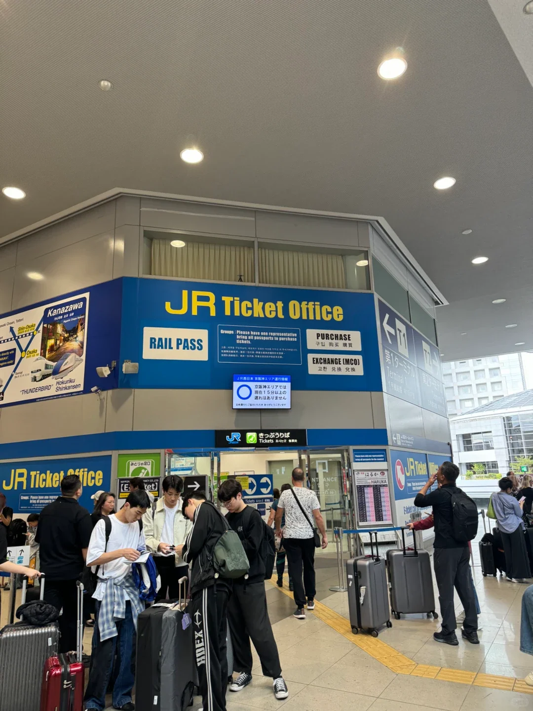
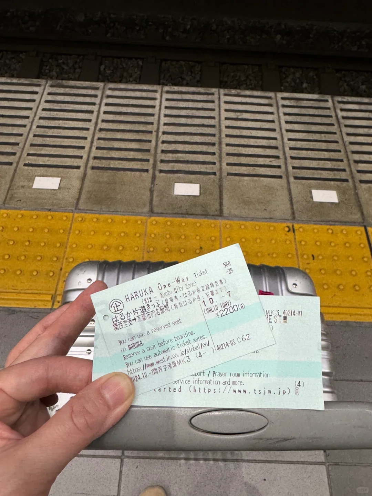
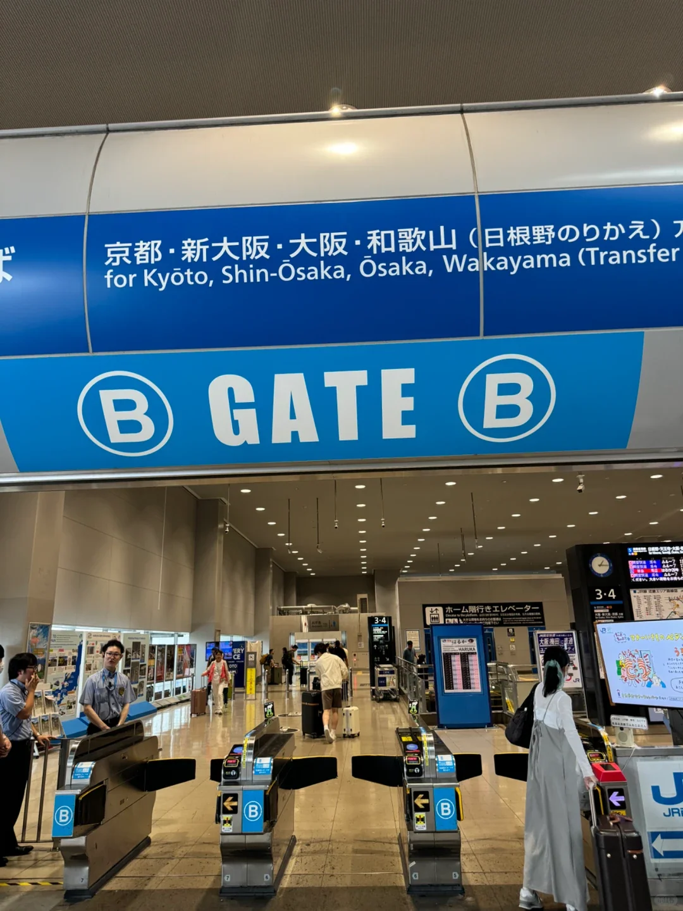
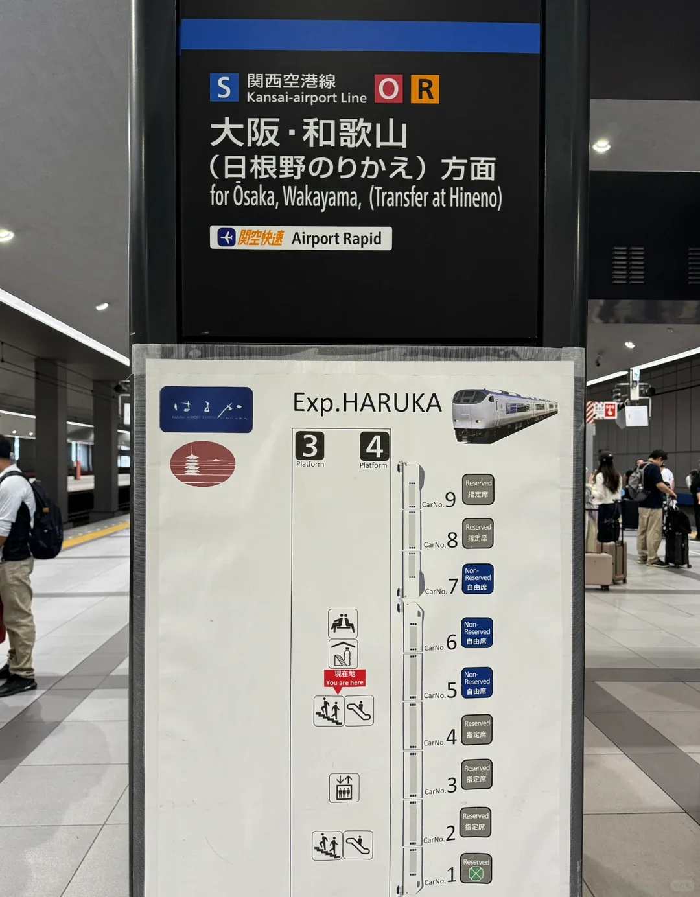
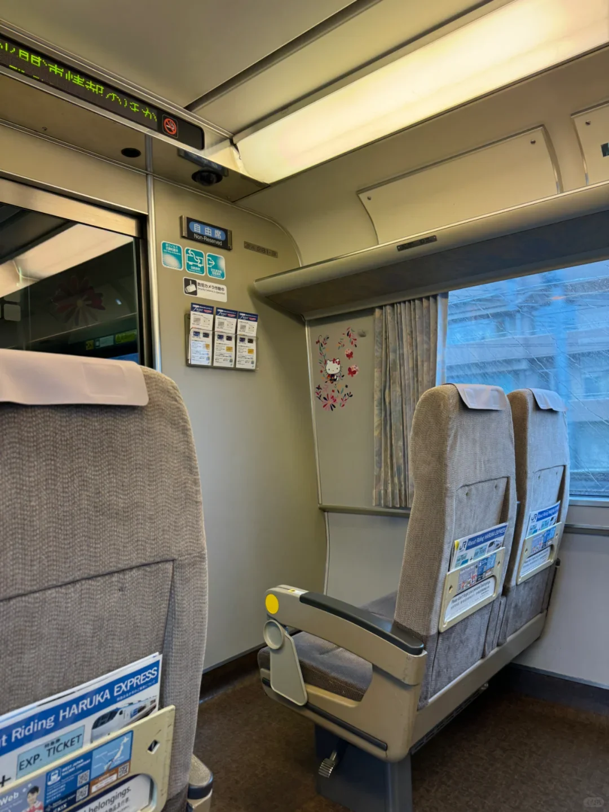
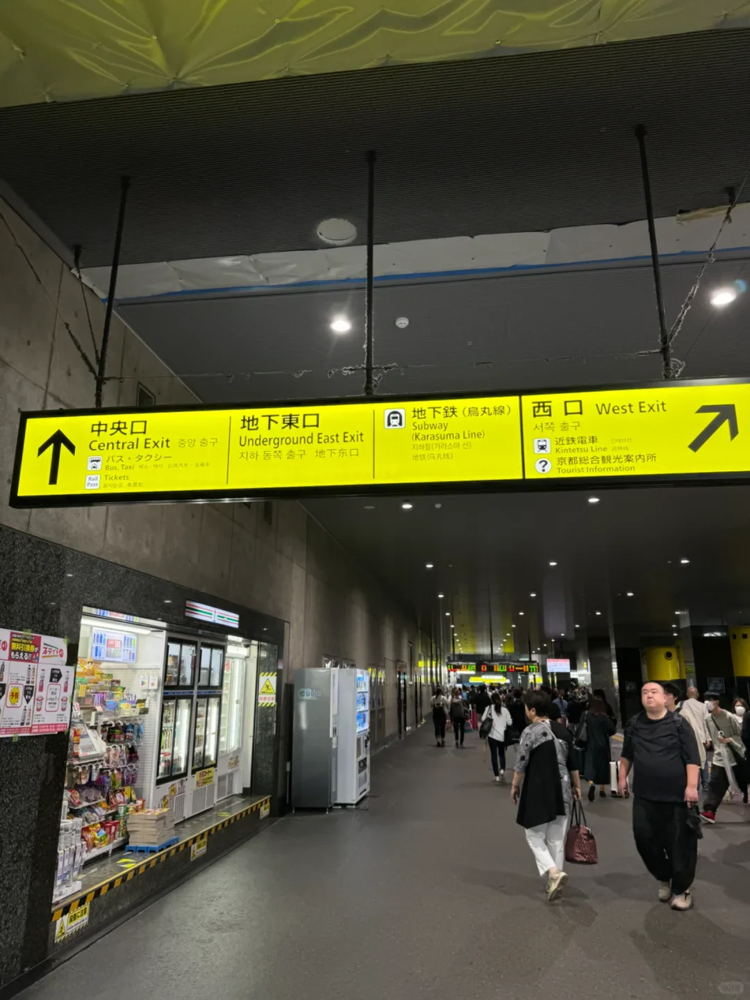

Der ruhigste Weg vom Flughafen Kansai (KIX) nach Kyoto ist der HARUKA Limited Express von JR West. Er fährt direkt vom Flughafenbahnhof ab, hält nur in Hineno, Tennoji und Shin-Osaka und erreicht die Kyoto Station in etwa 75–80 Minuten ohne Umstieg, mit Sitzen, die weit geräumiger sind als in einem Nahverkehrszug.

Dieser Leitfaden behandelt diesen einen Zug: wo Sie die Fahrkarte kaufen, welches Ticket sich lohnt, wie Sie Gate und Bahnsteig finden, in welchem Wagen Sie sitzen, wo das Gepäck hinkommt und wie Sie die Kyoto Station zur Metro und zu den Bussen verlassen. Für Namba, Umeda und Nara sehen Sie den [Leitfaden zur Ankunft am Flughafen Kansai](/blog/kansai-airport-arrival-guide). Fahrpreise und Fahrpläne ändern sich mit der Jahreszeit, prüfen Sie also vor der Reise die Website von JR West.

## 1. Hinauf auf Ebene 2 und zum JR-Fahrkartenbüro

Folgen Sie nach der Ankunft den Schildern 鉄道 / Railways, nehmen Sie die Rolltreppe hinauf zu Ebene 2 von Terminal 1 und gehen Sie über den Gang zum Bahnhof. Der Bahnhof Flughafen Kansai teilt sich zwischen Nankai und JR; die JR-Seite ist ein blau-weißes Büro mit „JR Ticket Office“ über der Tür.

Drei Dinge passieren drinnen: eine Fahrkarte am Schalter kaufen, einen Rail Pass eintauschen und ein online gekauftes E-Ticket an den grünen Automaten abholen, deren Bildschirme auf Englisch umschalten. Die Automaten unter dem blauen Schild verkaufen Fahrkarten für den gleichen Tag. Beim ersten Besuch mit Gepäck ist der besetzte Schalter am einfachsten.

## 2. Was es kostet: der Normalfahrpreis und das Besucherticket

Der Normalfahrpreis besteht aus einer Grundfahrkarte plus einem Limited-Express-Zuschlag, etwa 3.490 Yen vom Flughafen nach Kyoto, Kinder zum halben Preis. Jeder Reisende kann ihn kaufen.

| Ticket | Richtpreis (KIX nach Kyoto) | Bedingungen |
| --- | --- | --- |
| Normal (Grundfahrkarte + Limited Express) | etwa 3.490 Yen | Jeder Reisende; Schalter oder Automat |
| HARUKA One-Way Ticket | etwa 2.200 Yen | Ausländischer Reisepass, Besucherstatus, feste Strecke |
| Kind | etwa der halbe Erwachsenenpreis | 6–11 Jahre, Ausweis kann geprüft werden |

Ausländische Besucher bekommen das HARUKA One-Way Ticket auf derselben Strecke für etwa 2.200 Yen, rund ein Drittel weniger. Die Bedingungen sind ein ausländischer Reisepass und der Status als Besucher, und die Strecke ist fest: vom Flughafen in die Stadtzone Kyoto. Kaufen Sie es vor dem Abflug, über JR West, ein Reisebüro oder eine Partnerplattform, und tauschen Sie es am Automaten oder Schalter gegen eine Papierfahrkarte. Kontingente und Verkaufszeiträume sind begrenzt, kaufen Sie also früh, sobald Ihre Daten feststehen.

Einen Punkt sollten Sie klarstellen: Eine IC-Karte wie ICOCA oder Suica deckt nur den Grundfahrpreis ab. Der Limited-Express-Zuschlag ist separat, mit einer Karte am Gate ein- und auszutippen bringt Sie also nicht in den HARUKA. Ein nicht reserviertes Limited-Express-Ticket berechtigt zudem nicht zu einem reservierten Sitzplatz; die Reservierung kostet ein paar hundert Yen mehr, was in der Hochsaison sein Geld wert ist.

## 3. Das Gate und der Bahnsteig: Suchen Sie Kyoto

Nehmen Sie Ihre Fahrkarte zu den gegenüberliegenden Gates. Schieben Sie die Magnetfahrkarte hinein, nehmen Sie sie zurück, wenn sie auf der anderen Seite herauskommt, und behalten Sie sie – Sie brauchen sie erneut, um die Kyoto Station zu verlassen. Das blaue Schild darüber nennt Kyoto, Shin-Osaka, Osaka und Wakayama (Umstieg in Hineno), das ist kaum zu verwechseln.

Unten am Bahnsteig fährt der HARUKA meist von den Bahnsteigen 3 und 4 ab, gekennzeichnet durch ein Schild „Exp. HARUKA“ und ein Wagenschema. Der Kansai Airport Rapid nach Osaka nutzt dieselben Bahnsteige, steigen Sie also nicht in den ersten Zug ein, den Sie sehen: Der HARUKA hat Kyoto auf der Zielanzeige und eine eigene Beschriftung am Wagenkasten.

Die Abfahrten erfolgen etwa alle 30 Minuten, die erste gegen 06:30, die letzte gegen 22:00, und die Fahrt dauert 75–80 Minuten. Fahrpläne verschieben sich mit der Jahreszeit, bestätigen Sie sie also auf der Website von JR West oder auf der Bahnsteiganzeige. Wenn Sie den letzten Zug anpeilen, rechnen Sie die 45–60 Minuten für Einreise und Gepäck dazu.

## 4. An Bord: reservierte Plätze, nicht reservierte Wagen und Gepäck

Der HARUKA fährt meist als Neun-Wagen-Zug: Die Wagen 1–4 und 8–9 sind reserviert, die Wagen 5, 6 und 7 nicht reserviert (das Bahnsteigschema ist maßgeblich). Mit einem nicht reservierten Ticket nehmen Sie einen freien Platz in diesen drei Wagen; mit Reservierung sitzen Sie dort, wo die Fahrkarte es sagt.

Nicht reserviert heißt, Sie sind nicht an eine Abfahrt gebunden, aber es heißt auch Stehen in der Hochsaison. Zur Kirschblüte, zum Herbstlaub und an langen Wochenenden, mit Kindern oder zwei großen Koffern, reservieren Sie beim Kauf.

Das Gepäck kommt auf die Regale an den Türen oder in die Flächen an den Wagenenden, wo ein 28-Zoll-Koffer Platz findet, aber es entscheidet die Reihenfolge des Eintreffens. Der HARUKA hat keine Vorabbuchungsregel für Übergepäck wie der Shinkansen; blockieren Sie trotzdem nicht den Gang oder die Ausgänge, wenn der Zug voll ist. An Bord gibt es Toiletten, und die Ansagen sind auf Japanisch und Englisch.

## 5. Fünfundsiebzig Minuten nach Kyoto

Der Zug überquert die Seebrücke mit der Bucht von Osaka auf der rechten Seite, wechselt in Hineno auf die Hanwa-Linie, ist nach etwa 35 Minuten in Tennoji, fährt am Rand von Osaka entlang nach Shin-Osaka und dann nach Norden die Kyotolinie hinauf, um 75–80 Minuten nach der Abfahrt am Flughafen anzukommen.

An der Kyoto Station kommt er meist an den Bahnsteigen 30 und 31 auf der Westseite an; folgen Sie den Schildern zum Central Exit oder zum Hachijo Exit, und rechnen Sie mit Gepäck fünf Minuten.

Es gibt eine günstigere Alternative: den Kansai Airport Rapid zur Osaka Station und dann einen Special Rapid nach Kyoto, etwa 1 Stunde 45 Minuten für rund die Hälfte des Fahrpreises, zum Preis eines Umstiegs in Osaka mit dem Gepäck. Bei knappem Zeitplan oder einem Shinkansen, den Sie erreichen müssen, gewinnt die Fahrt ohne Umstieg.

## 6. Umsteigen an der Kyoto Station: erst aus JR heraus, dann in die Metro

Die Kyoto Station ist riesig, und der erste Besuch endet meist in einem Zögern an den Gates. Die Reihenfolge zählt: Verlassen Sie zuerst die JR-Gates, wechseln Sie dann zur Metro oder zu den Bussen.

Die Metro-Linie Karasuma ist vom Underground East Exit ausgeschildert, und ihre Gates liegen neben dem JR-Ausgang, so versteckt, dass Sie leicht direkt hineinlaufen und feststellen, dass Sie sich mit einer unbezahlten Fahrkarte noch im kostenpflichtigen JR-Bereich befinden. Schieben Sie Ihre Fahrkarte durch das JR-Gate, gehen Sie hinaus und kaufen Sie dann eine Metrofahrkarte oder tippen Sie ein. Shijo, Gojo und Karasuma Oike liegen alle an dieser Linie.

Der Busbahnhof liegt außerhalb des Central Exit, wo die Stadtbusse nach Kiyomizu-dera, Kinkaku-ji und Arashiyama starten. Kintetsu nach Nara fährt von der Hachijo-Seite ab, und der Shinkansen ist ebenfalls dort – die Station zu durchqueren dauert zehn Minuten. Mit viel Gepäck nutzen Sie die Schließfächer oder den Takuhaibin-Schalter und gehen ohne die Koffer auf Sightseeing.

## Weiterführende Links

- **Auf dieser Website**: [Flughafen Kansai (KIX)](/airport/KIX), [Japan (JP)](/country/JP)
- **Weitere Artikel**: [Leitfaden zur Ankunft am Flughafen Kansai](/blog/kansai-airport-arrival-guide), [Ihre erste Stunde am Flughafen Kansai: Einreise, SIM-Karten und ICOCA](/blog/kansai-airport-transport-sim-card)
- **Wikipedia**: [Flughafen Kansai](https://en.wikipedia.org/wiki/Kansai_International_Airport), [Haruka (Zug)](https://en.wikipedia.org/wiki/Haruka_%28train%29), [Kyoto Station](https://en.wikipedia.org/wiki/Kyoto_Station)
- **Baidu Baike**: [Flughafen Kansai](https://baike.baidu.com/item/%E5%85%B3%E8%A5%BF%E5%9B%BD%E9%99%85%E6%9C%BA%E5%9C%BA), [Haruka](https://baike.baidu.com/item/%E9%81%A5%E5%8F%B7%E5%88%97%E8%BD%A6), [Kyoto Station](https://baike.baidu.com/item/%E4%BA%AC%E9%83%BD%E7%AB%99)

Fahrpreise, Rabattbedingungen und Fahrpläne folgen den Veröffentlichungen von JR West; die Hinweise des Betreibers am Tag gelten. Bildquelle: aus öffentlichem Material zusammengestellt.
