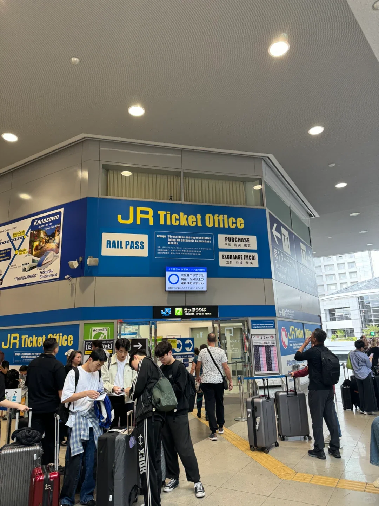

Cara paling tenang dari Bandara Internasional Kansai (KIX) ke Kyoto adalah HARUKA limited express milik JR West. Kereta ini berangkat langsung dari stasiun bandara, hanya berhenti di Hineno, Tennoji, dan Shin-Osaka, dan mencapai Stasiun Kyoto dalam sekitar 75–80 menit tanpa transit dan dengan kursi yang jauh lebih lega daripada kereta komuter.

Panduan ini membahas satu kereta itu: di mana membeli tiket, tiket mana yang sepadan, cara menemukan gerbang dan peron, gerbong mana yang harus diduduki, tempat bagasi, dan cara keluar dari Stasiun Kyoto menuju metro dan bus. Untuk Namba, Umeda, dan Nara, lihat [panduan kedatangan Bandara Kansai](/blog/kansai-airport-arrival-guide). Tarif dan jadwal bergerak mengikuti musim, jadi periksa situs JR West sendiri sebelum Anda bepergian.

## 1. Naik ke lantai 2 dan kantor tiket JR

Setelah kedatangan, ikuti papan 鉄道 / Railways, naik eskalator ke lantai 2 Terminal 1, dan seberangi jalur pejalan kaki ke stasiun. Stasiun Bandara Kansai terbagi antara Nankai dan JR; sisi JR adalah kantor biru-putih dengan tulisan “JR Ticket Office” di atas pintu.

Tiga hal terjadi di dalam: membeli tiket di loket, menukar rail pass, dan mengambil e-tiket yang dibeli online dari mesin hijau, yang layarnya dapat beralih ke bahasa Inggris. Mesin di bawah papan biru menjual tiket hari yang sama. Pada kunjungan pertama dengan bagasi, loket yang dijaga petugas adalah yang paling sederhana.

## 2. Berapa biayanya: tarif standar dan tiket pengunjung

Tarif standar adalah tiket dasar plus biaya limited express, sekitar 3.490 yen dari bandara ke Kyoto, dengan anak-anak sekitar setengah harga. Pelancong mana pun dapat membelinya.

| Tiket | Tarif referensi (KIX ke Kyoto) | Ketentuan |
| --- | --- | --- |
| Standar (tiket dasar + limited express) | sekitar 3.490 yen | Pelancong mana pun; loket atau mesin |
| HARUKA One-Way Ticket | sekitar 2.200 yen | Paspor asing, pengunjung sementara, rute tetap |
| Anak | sekitar setengah tarif dewasa | Usia 6–11 tahun, identitas mungkin diperiksa |

Pengunjung asing mendapatkan HARUKA One-Way Ticket pada rute yang sama seharga sekitar 2.200 yen, sekitar sepertiga lebih murah. Syaratnya adalah paspor asing dan status pengunjung sementara, dan rutenya tetap: dari bandara ke zona Kota Kyoto. Beli sebelum terbang, melalui JR West, agen perjalanan, atau platform mitra, lalu tukarkan dengan tiket kertas di mesin atau loket. Kuota dan periode penjualan terbatas, jadi beli lebih awal setelah tanggal Anda ditetapkan.

Satu hal yang perlu jelas: kartu IC seperti ICOCA atau Suica hanya mencakup tarif dasar. Biaya limited express terpisah, jadi mengetuk kartu tidak akan membawa Anda naik HARUKA. Tiket limited express tidak dipesan juga tidak memberi Anda hak atas kursi dipesan; reservasinya berbiaya beberapa ratus yen lebih, yang sepadan pada musim puncak.

## 3. Gerbang dan peron: cari Kyoto

Bawa tiket Anda ke gerbang di seberang. Dorong tiket magnetik ke dalam, ambil kembali saat keluar di sisi jauh, dan simpan — Anda memerlukannya lagi untuk keluar dari Stasiun Kyoto. Papan biru di atasnya bertuliskan Kyoto, Shin-Osaka, Osaka, dan Wakayama (transit di Hineno), yang sulit salah baca.

Di peron, HARUKA biasanya berangkat dari peron 3 dan 4, ditandai papan “Exp. HARUKA” dan diagram gerbong. Kansai Airport Rapid ke Osaka menggunakan peron yang sama, jadi jangan naik kereta pertama yang Anda lihat: HARUKA memiliki Kyoto di layar tujuan dan tulisan tersendiri di badan kereta.

Keberangkatan berjalan kira-kira setiap 30 menit, pertama sekitar pukul 06.30 dan terakhir sekitar pukul 22.00, dan perjalanannya memakan 75–80 menit. Jadwal bergeser mengikuti musim, jadi pastikan di situs JR West atau layar peron. Jika Anda mengejar kereta terakhir, tambahkan 45–60 menit yang dibutuhkan imigrasi dan bagasi.

## 4. Di dalam kereta: kursi dipesan, gerbong tidak dipesan, dan bagasi

HARUKA biasanya berjalan sebagai rangkaian sembilan gerbong: gerbong 1–4 dan 8–9 adalah dipesan, dan gerbong 5, 6, dan 7 tidak dipesan (diagram peron adalah penentu akhir). Dengan tiket tidak dipesan, ambil kursi kosong mana pun di ketiga gerbong itu; dengan reservasi, duduklah sesuai yang tertera di tiket.

Tidak dipesan berarti Anda tidak terikat pada satu keberangkatan, tetapi juga berarti berdiri pada musim puncak. Selama musim sakura, daun musim gugur, dan akhir pekan panjang, dengan anak-anak atau dua koper besar, pesanlah saat membeli.

Bagasi diletakkan di rak dekat pintu atau di ruang di ujung setiap gerbong, tempat koper 28 inci muat, tetapi siapa cepat dia dapat. HARUKA tidak memiliki aturan pemesanan awal untuk bagasi luar ukuran seperti shinkansen; meskipun demikian, jangan menghalangi lorong atau pintu keluar saat kereta penuh. Ada toilet di dalam kereta, dan pengumuman dalam bahasa Jepang dan Inggris.

## 5. Tujuh puluh lima menit ke Kyoto

Kereta menyeberangi jembatan laut dengan Teluk Osaka di kanan, bergabung dengan jalur Hanwa di Hineno, mencapai Tennoji dalam sekitar 35 menit, berjalan di tepi Osaka ke Shin-Osaka, lalu ke utara menyusuri jalur Kyoto untuk tiba 75–80 menit setelah meninggalkan bandara.

Di Stasiun Kyoto, kereta biasanya tiba di peron 30 dan 31 di sisi barat; ikuti papan menuju Central Exit atau Hachijo Exit, dan sisihkan lima menit dengan bagasi.

Ada alternatif yang lebih murah: Kansai Airport Rapid ke Stasiun Osaka, lalu Special Rapid ke Kyoto, sekitar 1 jam 45 menit dengan tarif kira-kira setengahnya, dengan konsekuensi transit di Osaka bersama bagasi Anda. Dengan jadwal ketat atau shinkansen yang harus dikejar, perjalanan satu kereta menang.

## 6. Transit di Stasiun Kyoto: keluar dari JR dulu, baru metro

Stasiun Kyoto sangat besar, dan kunjungan pertama biasanya berakhir dengan berhenti ragu di gerbang. Urutannya penting: keluar dari gerbang JR dulu, baru beralih ke metro atau bus.

Jalur metro Karasuma ditandai dari Underground East Exit, dan gerbangnya berada di samping pintu keluar JR, cukup tersembunyi sehingga mudah berjalan lurus masuk dan mendapati Anda masih di dalam area berbayar JR dengan tiket yang belum diselesaikan. Dorong tiket Anda melalui gerbang JR, keluar, lalu beli tiket metro atau ketuk masuk. Shijo, Gojo, dan Karasuma Oike semuanya berada di jalur itu.

Terminal bus berada di luar Central Exit, tempat bus kota berangkat ke Kiyomizu-dera, Kinkaku-ji, dan Arashiyama. Kintetsu untuk Nara berangkat dari sisi Hachijo, dan shinkansen juga di sana — menyeberangi stasiun memakan sepuluh menit. Dengan banyak bagasi, gunakan loker koin atau loket takuhaibin dan berwisata tanpa koper.

## Tautan terkait

- **Di situs ini**: [Bandara Internasional Kansai (KIX)](/airport/KIX), [Jepang (JP)](/country/JP)
- **Artikel lain**: [Panduan kedatangan Bandara Kansai](/blog/kansai-airport-arrival-guide), [Jam pertama Anda di Bandara Kansai: imigrasi, kartu SIM, dan ICOCA](/blog/kansai-airport-transport-sim-card)
- **Wikipedia**: [Bandara Internasional Kansai](https://en.wikipedia.org/wiki/Kansai_International_Airport), [Haruka (kereta)](https://en.wikipedia.org/wiki/Haruka_%28train%29), [Stasiun Kyoto](https://en.wikipedia.org/wiki/Kyoto_Station)
- **Baidu Baike**: [Bandara Internasional Kansai](https://baike.baidu.com/item/%E5%85%B3%E8%A5%BF%E5%9B%BD%E9%99%85%E6%9C%BA%E5%9C%BA), [Haruka](https://baike.baidu.com/item/%E9%81%A5%E5%8F%B7%E5%88%97%E8%BD%A6), [Stasiun Kyoto](https://baike.baidu.com/item/%E4%BA%AC%E9%83%BD%E7%AB%99)

Tarif, ketentuan diskon, dan jadwal mengikuti yang diterbitkan JR West; pemberitahuan operator pada hari tersebut yang berlaku. Kredit gambar: disusun dari materi publik.
