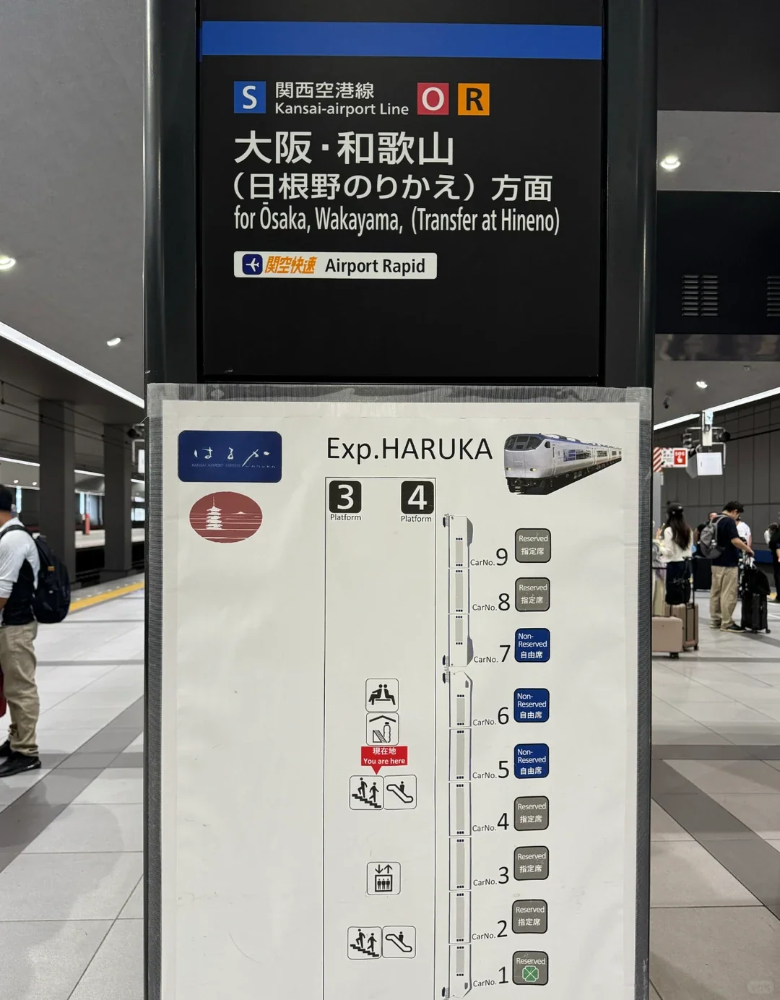

De rustigste manier van Kansai International Airport (KIX) naar Kyoto is de HARUKA limited express van JR West. Hij vertrekt rechtstreeks van het luchthavenstation, stopt alleen in Hineno, Tennoji en Shin-Osaka, en bereikt Kyoto Station in ongeveer 75–80 minuten zonder overstappen en met stoelen die veel ruimer zijn dan in een forensentrein.

Deze gids gaat over die ene trein: waar je het kaartje koopt, welk kaartje de moeite waard is, hoe je de poort en het perron vindt, in welk rijtuig je gaat zitten, waar de bagage heen gaat, en hoe je Kyoto Station verlaat voor de metro en de bussen. Voor Namba, Umeda en Nara zie de [aankomstgids voor Kansai Airport](/blog/kansai-airport-arrival-guide). Tarieven en dienstregelingen veranderen met het seizoen, dus check voor je reis de eigen site van JR West.

## 1. Naar niveau 2 en het JR-kaartjesloket

Volg na de aankomst de borden 鉄道 / Railways, neem de roltrap naar niveau 2 van Terminal 1 en steek de loopbrug over naar het station. Kansai Airport Station is verdeeld tussen Nankai en JR; de JR-kant is een blauw-wit loket met "JR Ticket Office" boven de deur.

Binnen gebeuren drie dingen: een kaartje kopen aan de balie, een railpass omwisselen, en een online gekocht e-ticket ophalen bij de groene machines, waarvan de schermen naar het Engels omschakelen. De machines onder het blauwe bord verkopen kaartjes voor dezelfde dag. Op een eerste bezoek met bagage is de bemande balie het eenvoudigst.

## 2. Wat het kost: het standaardtarief en het bezoekerskaartje

Het standaardtarief is een basisticket plus een limited-express-toeslag, ongeveer 3.490 yen van de luchthaven naar Kyoto, met kinderen op ongeveer de helft. Elke reiziger kan het kopen.

| Kaartje | Indicatief tarief (KIX naar Kyoto) | Voorwaarden |
| --- | --- | --- |
| Standaard (basisticket + limited express) | ongeveer 3.490 yen | Elke reiziger; balie of automaat |
| HARUKA One-Way Ticket | ongeveer 2.200 yen | Buitenlands paspoort, tijdelijk bezoeker, vaste route |
| Kind | ongeveer de helft van het volwassenentarief | Leeftijd 6–11, identificatie kan worden gecontroleerd |

Buitenlandse bezoekers krijgen het HARUKA One-Way Ticket op dezelfde route voor ongeveer 2.200 yen, ruwweg een derde minder. De voorwaarden zijn een buitenlands paspoort en de status van tijdelijk bezoeker, en de route ligt vast: van de luchthaven naar de stadzone Kyoto. Koop het voor je vliegt, via JR West, een reisbureau of een partnerplatform, en wissel het dan bij de automaat of balie in voor een papieren kaartje. Quota en verkoopperiodes zijn beperkt, dus koop vroeg zodra je data vaststaan.

Eén punt om duidelijk over te zijn: een IC-kaart zoals ICOCA of Suica dekt alleen het basistarief. De limited-express-toeslag komt er apart bij, dus met een kaart inchecken brengt je niet in de HARUKA. Een niet-gereserveerd limited-express-kaartje geeft je ook geen recht op een gereserveerde stoel; de reservering kost een paar honderd yen extra, en dat is in het hoogseizoen de moeite waard.

## 3. De poort en het perron: zoek Kyoto

Neem je kaartje mee naar de poortjes ertegenover. Duw het magneetkaartje erin, pak het terug wanneer het aan de andere kant uitkomt, en houd het bij je — je hebt het weer nodig om Kyoto Station te verlaten. Het blauwe bord erboven vermeldt Kyoto, Shin-Osaka, Osaka en Wakayama (overstappen in Hineno), dus vergissen is lastig.

Beneden op het perron vertrekt de HARUKA meestal van perrons 3 en 4, gemarkeerd met een bord "Exp. HARUKA" en een rijtuigdiagram. De Kansai Airport Rapid naar Osaka gebruikt dezelfde perrons, dus stap niet in de eerste trein die je ziet: de HARUKA heeft Kyoto op zijn bestemmingsdisplay en zijn eigen belettering op de trein.

De vertrekken rijden ongeveer elke 30 minuten, de eerste rond 06:30 en de laatste rond 22:00, en de rit duurt 75–80 minuten. Dienstregelingen veranderen met het seizoen, dus bevestig op de site van JR West of op het perrondisplay. Richt je op de laatste trein, tel dan de 45–60 minuten op die immigratie en bagage kosten.

## 4. Aan boord: gereserveerde stoelen, niet-gereserveerde rijtuigen en bagage

De HARUKA rijdt meestal als een treinstel van negen rijtuigen: rijtuig 1–4 en 8–9 zijn gereserveerd, en rijtuig 5, 6 en 7 zijn niet-gereserveerd (het perrondiagram is doorslaggevend). Met een niet-gereserveerd kaartje neem je een vrije stoel in die drie rijtuigen; met een reservering zit je waar je kaartje zegt.

Niet-gereserveerd betekent dat je niet aan een vertrek gebonden bent, maar ook dat je in het hoogseizoen staat. Tijdens kersenbloesem, herfstbladeren en lange weekenden, met kinderen of twee grote koffers, reserveer je bij de aankoop.

Bagage gaat op de rekken bij de deuren of in de ruimte aan de uiteinden van elk rijtuig, waar een koffer van 28 inch past, maar het is wie het eerst komt, het eerst maalt. De HARUKA heeft geen regel voor vooraf reserveren van overmaatse tassen zoals de shinkansen; toch moet je bij een volle trein het gangpad of de uitgangen niet versperren. Er zijn toiletten aan boord, en omroepen zijn in het Japans en Engels.

## 5. Vijfenzeventig minuten naar Kyoto

De trein steekt de zeebrug over met de baai van Osaka aan de rechterkant, sluit aan op de Hanwa-lijn bij Hineno, bereikt Tennoji in ongeveer 35 minuten, loopt langs de rand van Osaka naar Shin-Osaka, en gaat dan noordwaarts over de Kyoto-lijn om 75–80 minuten na vertrek van de luchthaven aan te komen.

Op Kyoto Station komt hij meestal aan op perrons 30 en 31 aan de westkant; volg de borden naar de Central Exit of de Hachijo Exit, en reken met bagage vijf minuten.

Er bestaat een goedkoper alternatief: de Kansai Airport Rapid naar Osaka Station, dan een Special Rapid naar Kyoto, ongeveer 1 uur 45 minuten voor ruwweg de helft van het tarief, tegen de prijs van een overstap in Osaka met je tassen. Met een strak schema of een shinkansen die je moet halen, wint de rit zonder overstappen.

## 6. Overstappen op Kyoto Station: eerst uit JR, dan de metro

Kyoto Station is enorm, en een eerste bezoek eindigt meestal in een aarzeling bij de poortjes. De volgorde is belangrijk: verlaat eerst de JR-poortjes, stap dan over op de metro of de bussen.

De metro-lijn Karasuma is bewegwijzerd vanaf de Underground East Exit, en de poortjes liggen naast de JR-uitgang, zo weggestopt dat je er makkelijk recht binnenloopt en ontdekt dat je nog in het betaalde JR-gebied staat met een onafgerekend kaartje. Duw je kaartje door het JR-poortje, ga naar buiten, en koop dan een metrokaartje of check in. Shijo, Gojo en Karasuma Oike liggen allemaal aan die lijn.

Het busstation ligt buiten de Central Exit, waar stadsbussen vertrekken naar Kiyomizu-dera, Kinkaku-ji en Arashiyama. Kintetsu naar Nara vertrekt aan de Hachijo-kant, en de shinkansen is daar ook — het station oversteken duurt tien minuten. Met veel bagage gebruik je de muntsluisjes of de takuhaibin-balie en ga je sightseeing zonder de koffers.

## Gerelateerde links

- **Op deze site**: [Kansai International Airport (KIX)](/airport/KIX), [Japan (JP)](/country/JP)
- **Meer artikelen**: [aankomstgids Kansai Airport](/blog/kansai-airport-arrival-guide), [Je eerste uur op Kansai Airport: immigratie, simkaarten en ICOCA](/blog/kansai-airport-transport-sim-card)
- **Wikipedia**: [Kansai International Airport](https://en.wikipedia.org/wiki/Kansai_International_Airport), [Haruka (train)](https://en.wikipedia.org/wiki/Haruka_%28train%29), [Kyoto Station](https://en.wikipedia.org/wiki/Kyoto_Station)
- **Baidu Baike**: [Kansai International Airport](https://baike.baidu.com/item/%E5%85%B3%E8%A5%BF%E5%9B%BD%E9%99%85%E6%9C%BA%E5%9C%BA), [Haruka](https://baike.baidu.com/item/%E9%81%A5%E5%8F%B7%E5%88%97%E8%BD%A6), [Kyoto Station](https://baike.baidu.com/item/%E4%BA%AC%E9%83%BD%E7%AB%99)

Tarieven, kortingsvoorwaarden en dienstregelingen volgen wat JR West publiceert; de mededelingen van de vervoerder op de dag zelf gaan voor. Beeldcredit: samengesteld uit openbaar materiaal.
