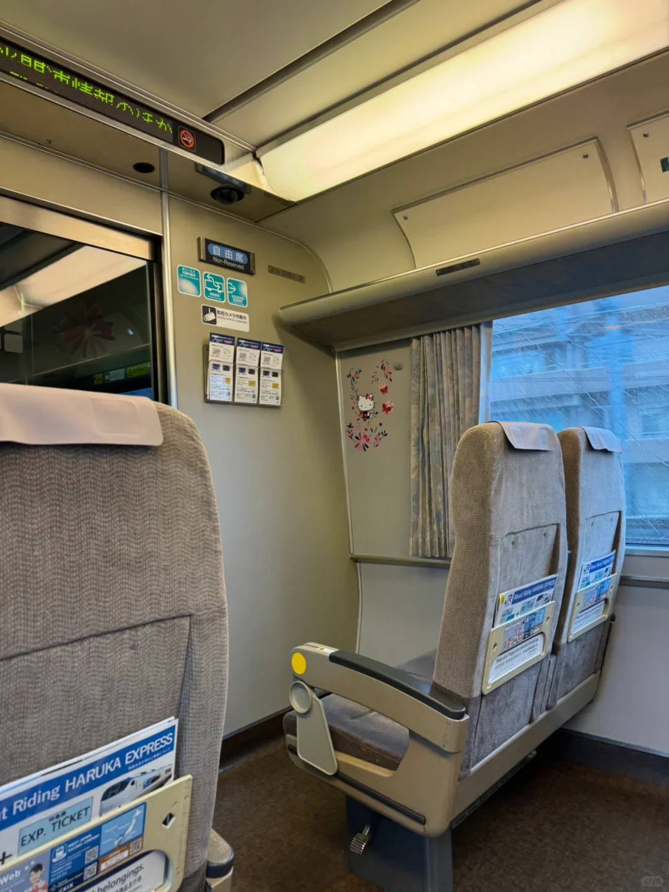

Самый спокойный путь из международного аэропорта Кансай (KIX) в Киото — limited express HARUKA компании JR West. Он отправляется прямо со станции аэропорта, останавливается только в Хинэно, Тэннодзи и Син-Осаке и доходит до станции Киото примерно за 75–80 минут без пересадок, а места гораздо просторнее, чем в пригородном поезде.

Этот гид посвящён одному поезду: где купить билет, какой билет стоит своих денег, как найти вход и платформу, в каком вагоне сидеть, куда девать багаж и как выйти со станции Киото к метро и автобусам. Для Намбы, Умэды и Нары смотрите [гид по прибытию в аэропорт Кансай](/blog/kansai-airport-arrival-guide). Тарифы и расписания меняются от сезона, поэтому перед поездкой проверяйте сайт JR West.

## 1. На 2-й уровень и в билетную кассу JR

После прилёта идите по указателям 鉄道 / Railways, поднимитесь на эскалаторе на 2-й уровень терминала 1 и перейдите по переходу к станции. Станция аэропорта Кансай делится между Nankai и JR; сторона JR — сине-белая касса с надписью JR Ticket Office над дверью.

Внутри можно сделать три вещи: купить билет в кассе, обменять железнодорожный проездной и получить электронный билет, купленный онлайн, в зелёных автоматах, экраны которых переключаются на английский. Автоматы под синей вывеской продают билеты на текущий день. При первом визите с багажом проще всего в кассу с сотрудником.

## 2. Сколько стоит: обычный тариф и билет для гостей

Обычный тариф — базовый билет плюс сбор за limited express, около 3 490 иен от аэропорта до Киото, дети — примерно за половину цены. Его может купить любой путешественник.

| Билет | Справочный тариф (KIX — Киото) | Условия |
| --- | --- | --- |
| Обычный (базовый билет + limited express) | около 3 490 иен | Любой путешественник; касса или автомат |
| HARUKA One-Way Ticket | около 2 200 иен | Иностранный паспорт, временный посетитель, фиксированный маршрут |
| Детский | около половины взрослого тарифа | Возраст 6–11 лет, могут проверить документы |

Иностранные гости получают HARUKA One-Way Ticket на том же маршруте примерно за 2 200 иен — примерно на треть дешевле. Условия — иностранный паспорт и статус временного посетителя, маршрут фиксирован: от аэропорта до городской зоны Киото. Купите его до полёта через JR West, турагента или партнёрскую платформу, затем обменяйте на бумажный билет в автомате или кассе. Квоты и периоды продажи ограничены, поэтому покупайте заранее, как только даты определены.

Один момент стоит прояснить: IC-карта вроде ICOCA или Suica покрывает только базовый тариф. Сбор за limited express оплачивается отдельно, поэтому прикладывание карты не пустит вас на HARUKA. Билет на limited express без места также не даёт права на место с бронью; бронь стоит на несколько сотен иен дороже, и в высокий сезон за неё стоит заплатить.

## 3. Вход и платформа: ищите Киото

Поднесите билет к турникетам напротив. Вставьте магнитный билет, заберите его, когда он выйдет с другой стороны, и сохраните — он понадобится снова, чтобы выйти со станции Киото. Синяя вывеска над входом гласит Kyoto, Shin-Osaka, Osaka и Wakayama (пересадка в Хинэно), и перепутать трудно.

На платформе HARUKA обычно отправляется с платформ 3 и 4, отмеченных табличкой Exp. HARUKA и схемой вагонов. Kansai Airport Rapid до Осаки использует те же платформы, поэтому не садитесь в первый подошедший поезд: у HARUKA на табло назначения написано Киото, и на кузове свой шрифт.

Отправления примерно каждые 30 минут, первый около 06:30 и последний около 22:00, поездка занимает 75–80 минут. Расписания меняются от сезона, поэтому уточняйте на сайте JR West или на табло платформы. Если вы рассчитываете на последний поезд, добавьте 45–60 минут, которые уходят на иммиграцию и багаж.

## 4. В поезде: места с бронью, вагоны без мест и багаж

HARUKA обычно ходит девятивагонным составом: вагоны 1–4 и 8–9 — с местами по брони, а вагоны 5, 6 и 7 — без мест (последнее слово за схемой на платформе). С билетом без места занимайте любое свободное место в этих трёх вагонах; с бронью садитесь туда, где указано в билете.

Билет без места означает, что вы не привязаны к отправлению, но и то, что в высокий сезон придётся стоять. В сезон сакуры, осенних листьев и длинных выходных, с детьми или двумя большими чемоданами бронируйте при покупке.

Багаж кладут на полки у дверей или в пространство в концах вагонов, где помещается чемодан на 28 дюймов, но места занимают по принципу кто первый пришёл. У HARUKA нет правила предварительного бронирования крупногабаритного багажа, как у синкансэна; тем не менее не блокируйте проход и выходы, когда поезд полон. В поезде есть туалеты, объявления — на японском и английском.

## 5. Семьдесят пять минут до Киото

Поезд пересекает морской мост, Осакский залив справа, присоединяется к линии Hanwa в Хинэно, доходит до Тэннодзи примерно за 35 минут, идёт по краю Осаки до Син-Осаки, затем на север по линии Киото и прибывает через 75–80 минут после отправления из аэропорта.

На станции Киото он обычно прибывает на платформы 30 и 31 с западной стороны; идите по указателям Central Exit или Hachijo Exit и закладывайте пять минут с багажом.

Есть более дешёвая альтернатива: Kansai Airport Rapid до станции Осака, затем Special Rapid до Киото — около 1 часа 45 минут примерно за половину тарифа, ценой пересадки в Осаке с сумками. При плотном графике или необходимости успеть на синкансэн поездка без пересадок выигрывает.

## 6. Пересадка на станции Киото: сначала выйдите из JR, потом метро

Станция Киото огромна, и первый визит обычно заканчивается паузой у турникетов. Порядок важен: сначала выйдите из турникетов JR, затем пересаживайтесь на метро или автобусы.

Линия метро Karasuma обозначена от Underground East Exit, а её турникеты стоят рядом с выходом JR, спрятанные так, что легко пройти прямо и обнаружить, что вы всё ещё в оплаченной зоне JR с неоплаченным билетом. Просуньте билет через турникет JR, выйдите, затем купите билет на метро или приложите карту. Shijo, Gojo и Karasuma Oike — все на этой линии.

Автобусный терминал находится снаружи Central Exit, где начинаются городские автобусы до Киёмидзу-дэра, Кинкаку-дзи и Арасиямы. Kintetsu до Нары отправляется со стороны Hachijo, и синкансэн тоже там — пересечь станцию занимает десять минут. С большим багажом воспользуйтесь камерами хранения или стойкой takuhaibin и отправляйтесь на осмотр без чемоданов.

## Полезные ссылки

- **На этом сайте**: [Международный аэропорт Кансай (KIX)](/airport/KIX), [Япония (JP)](/country/JP)
- **Другие статьи**: [Гид по прибытию в аэропорт Кансай](/blog/kansai-airport-arrival-guide), [Первый час в аэропорту Кансай: иммиграция, SIM-карты и ICOCA](/blog/kansai-airport-transport-sim-card)
- **Wikipedia**: [Kansai International Airport](https://en.wikipedia.org/wiki/Kansai_International_Airport), [Haruka (train)](https://en.wikipedia.org/wiki/Haruka_%28train%29), [Kyoto Station](https://en.wikipedia.org/wiki/Kyoto_Station)
- **Baidu Baike**: [Kansai International Airport](https://baike.baidu.com/item/%E5%85%B3%E8%A5%BF%E5%9B%BD%E9%99%85%E6%9C%BA%E5%9C%BA), [Haruka](https://baike.baidu.com/item/%E9%81%A5%E5%8F%B7%E5%88%97%E8%BD%A6), [Kyoto Station](https://baike.baidu.com/item/%E4%BA%AC%E9%83%BD%E7%AB%99)

Тарифы, условия скидок и расписания приведены по публикациям JR West; в день поездки действуют уведомления оператора. Фото: собрано из открытых материалов.
