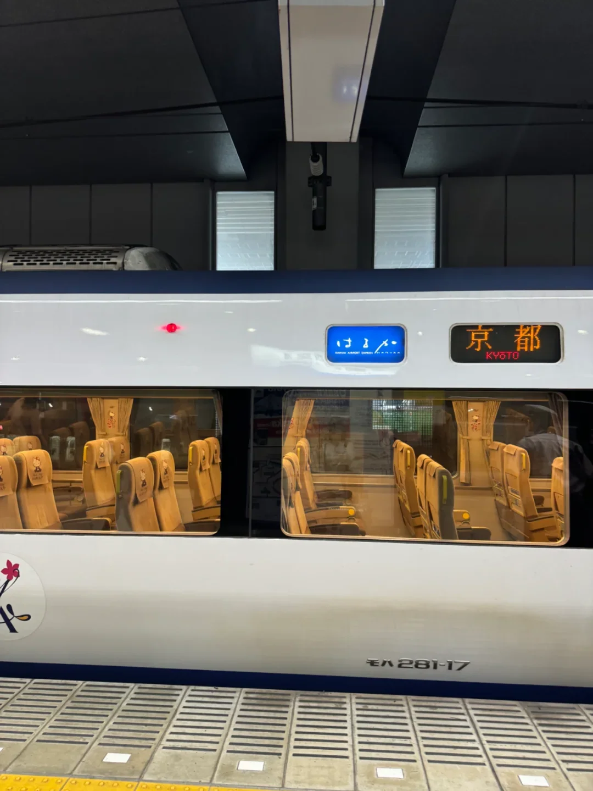

Njia tulivu zaidi kutoka Uwanja wa Ndege wa Kimataifa wa Kansai (KIX) hadi Kyoto ni treni ya JR West ya HARUKA limited express. Inaondoka moja kwa moja kutoka kituo cha uwanja wa ndege, inasimama Hineno, Tennoji na Shin-Osaka pekee, na inafika Kituo cha Kyoto kwa takriban dakika 75–80 bila kubadilisha, na viti vilivyo pana zaidi kuliko treni za kila siku.

Mwongozo huu unashughulikia treni hiyo moja: wapi kununua tikiti, tikiti ipi inafaa, jinsi ya kupata lango na jukwaa, behewa gani la kukaa, mizigo inakwenda wapi, na jinsi ya kutoka Kituo cha Kyoto kuelekea reli ya chini ya ardhi na bus. Kwa Namba, Umeda na Nara, angalia [mwongozo wa kuwasili uwanja wa ndege wa Kansai](/blog/kansai-airport-arrival-guide). Nauli na ratiba hubadilika kwa msimu, kwa hiyo angalia tovuti ya JR West yenyewe kabla ya kusafiri.

## 1. Kupanda hadi ghorofa ya 2 na ofisi ya tikiti ya JR

Baada ya kuwasili, fuata alama za 鉄道 / Railways, panda escalator hadi ghorofa ya 2 ya Terminal 1 na vuka njia ya kutembea hadi kituoni. Kituo cha Uwanja wa Ndege wa Kansai hugawanyika kati ya Nankai na JR; upande wa JR ni ofisi ya rangi ya bluu na nyeupe yenye "JR Ticket Office" juu ya mlango.

Mambo matatu hufanyika ndani: kununua tikiti kwenye dawati, kubadilisha pasi ya reli, na kuchukua tikiti ya kielektroniki iliyonunuliwa mtandaoni kutoka mashine za kijani, ambazo skrini zake hubadilika kuwa Kiingereza. Mashine zilizo chini ya alama ya bluu huuza tikiti za siku hiyo. Katika ziara ya kwanza ukiwa na mizigo, dawati lenye wahudumu ni rahisi zaidi.

## 2. Gharama: nauli ya kawaida na tikiti ya mgeni

Nauli ya kawaida ni tikiti ya msingi pamoja na ada ya limited express, takriban yen 3,490 kutoka uwanja wa ndege hadi Kyoto, na watoto kwa takriban nusu ya bei. Msafiri yeyote anaweza kuinunua.

| Tikiti | Nauli ya kumbukumbu (KIX hadi Kyoto) | Masharti |
| --- | --- | --- |
| Kawaida (tikiti ya msingi + limited express) | takriban yen 3,490 | Msafiri yeyote; dawati au mashine |
| Tikiti ya HARUKA ya Kwenda Tu | takriban yen 2,200 | Pasipoti ya kigeni, mgeni wa muda, njia isiyobadilika |
| Mtoto | takriban nusu ya nauli ya mtu mzima | Miaka 6–11, kitambulisho kinaweza kukaguliwa |

Wageni wa kigeni hupata Tikiti ya HARUKA ya Kwenda Tu kwa njia hiyo hiyo kwa takriban yen 2,200, takriban theluthi moja chini. Masharti ni pasipoti ya kigeni na hali ya mgeni wa muda, na njia haibadiliki: kutoka uwanja wa ndege hadi eneo la jiji la Kyoto. Inunue kabla ya kusafiri, kupitia JR West, wakala wa safari au jukwaa la mshirika, kisha ibadilishe kwa tikiti ya karatasi kwenye mashine au dawati. Idadi na vipindi vya mauzo ni vichache, kwa hiyo nunua mapema mara tarehe zako zikiwa tayari.

Jambo moja la kufafanua: kadi ya IC kama ICOCA au Suica inashughulikia tikiti ya msingi pekee. Ada ya limited express ni tofauti, kwa hiyo kugusa kadi kwenye lango hakutakufikisha kwenye HARUKA. Tikiti ya limited express isiyo na nafasi iliyowekwa pia haikupi haki ya kiti kilichowekwa nafasi; kuweka nafasi kunagharimu mamia machache ya yen zaidi, ambayo inafaa kulipa katika msimu wa kilele.

## 3. Lango na jukwaa: tafuta Kyoto

Chukua tikiti yako hadi malango yaliyo mbele. Sukuma tikiti ya sumaku ndani, ichukue inapotoka upande wa pili, na uiweke — unaihitaji tena ili kutoka Kituo cha Kyoto. Alama ya bluu juu inasoma Kyoto, Shin-Osaka, Osaka na Wakayama (badilisha Hineno), ambayo ni vigumu kuikosea.

Chini kwenye jukwaa, HARUKA kwa kawaida huondoka kwenye majukwaa 3 na 4, yaliyowekwa alama ya "Exp. HARUKA" na mchoro wa mabehewa. Treni ya Kansai Airport Rapid kuelekea Osaka hutumia majukwaa hayo hayo, kwa hiyo usipande treni ya kwanza unayoona: HARUKA ina Kyoto kwenye onyesho la mwisho na herufi zake maalum kwenye mwili wa treni.

Kuondoka hufanyika takriban kila dakika 30, ya kwanza karibu 06:30 na ya mwisho karibu 22:00, na safari huchukua dakika 75–80. Ratiba hubadilika kwa msimu, kwa hiyo thibitisha kwenye tovuti ya JR West au onyesho la jukwaa. Ikiwa unalenga treni ya mwisho, ongeza dakika 45–60 ambazo uhamiaji na mizigo huchukua.

## 4. Ndani ya treni: viti vilivyowekwa nafasi, mabehewa yasiyowekwa na mizigo

HARUKA kwa kawaida huendeshwa kama seti ya mabehewa tisa: mabehewa 1–4 na 8–9 yana nafasi zilizowekwa, na mabehewa 5, 6 na 7 hayana nafasi zilizowekwa (mchoro wa jukwaa ndio uamuzi wa mwisho). Ukiwa na tikiti isiyo na nafasi iliyowekwa, chukua kiti chochote kilicho huru katika mabehewa hayo matatu; ukiwa na nafasi iliyowekwa, kaa pale tikiti inavyosema.

Bila nafasi iliyowekwa inamaanisha haufungwi na saa fulani ya kuondoka, lakini pia inamaanisha kusimama katika msimu wa kilele. Wakati wa maua ya sakura, majani ya vuli na wikendi ndefu, ukiwa na watoto au masanduku mawili makubwa, weka nafasi unaponunua.

Mizigo huwekwa kwenye rafu karibu na milango au kwenye nafasi za mwisho wa kila behewa, ambapo sanduku la inchi 28 linaingia, lakini ni wa kwanza kufika ndiye anayepata. HARUKA haina kanuni ya kuweka nafasi mapema kwa mizigo mikubwa kama shinkansen; hata hivyo, usizuie njia ya kupita au milango treni ikiwa imejaa. Kuna vyoo ndani ya treni, na matangazo hufanywa kwa Kijapani na Kiingereza.

## 5. Dakika sabini na tano hadi Kyoto

Treni huvuka daraja la bahari na Ghuba ya Osaka upande wa kulia, inaungana na reli ya Hanwa Hineno, inafika Tennoji kwa takriban dakika 35, inapita pembezoni mwa Osaka hadi Shin-Osaka, kisha kaskazini juu ya reli ya Kyoto na kuwasili dakika 75–80 baada ya kuondoka uwanja wa ndege.

Kwenye Kituo cha Kyoto kwa kawaida huwasili kwenye majukwaa 30 na 31 upande wa magharibi; fuata alama za Central Exit au Hachijo Exit, na toa dakika tano ukiwa na mizigo.

Kuna njia mbadala ya bei nafuu: Kansai Airport Rapid hadi Osaka Station, kisha Special Rapid hadi Kyoto, takriban saa 1 na dakika 45 kwa takriban nusu ya nauli, kwa gharama ya kubadilisha treni Osaka ukiwa na mizigo. Ukiwa na ratiba finyu au shinkansen ya kukamata, safari ya kiti kimoja inashinda.

## 6. Kubadilisha Kituo cha Kyoto: toka JR kwanza, kisha reli ya chini ya ardhi

Kituo cha Kyoto ni kikubwa sana, na ziara ya kwanza kwa kawaida huishia kusimama kwenye malango. Mpangilio ni muhimu: toka malango ya JR kwanza, kisha badilisha kwenda reli ya chini ya ardhi au bus.

Reli ya chini ya ardhi ya Karasuma inaonyeshwa kwa alama kuanzia Underground East Exit, na malango yake yako kando ya lango la JR, yamefichwa kiasi kwamba ni rahisi kuingia moja kwa moja na kujikuta bado ukiwa ndani ya eneo la JR lililolipiwa ukiwa na tikiti isiyotumika. Sukuma tikiti yako kupitia lango la JR, toka, kisha nunua tikiti ya reli ya chini ya ardhi au gusa kadi. Shijo, Gojo na Karasuma Oike zote ziko kwenye reli hiyo.

Kituo cha bus kiko nje ya Central Exit, ambako bus za jiji huanza kuelekea Kiyomizu-dera, Kinkaku-ji na Arashiyama. Kintetsu ya kwenda Nara inaondoka upande wa Hachijo, na shinkansen iko hapo pia — kuvuka kituo huchukua dakika kumi. Ukiwa na mizigo mingi, tumia makabati ya sarafu au dawati la takuhaibin na uende kutembea bila masanduku.

## Viungo vinavyohusiana

- **Kwenye tovuti hii**: [Uwanja wa Ndege wa Kimataifa wa Kansai (KIX)](/airport/KIX), [Japani (JP)](/country/JP)
- **Makala zaidi**: [Mwongozo wa kuwasili uwanja wa ndege wa Kansai](/blog/kansai-airport-arrival-guide), [Saa yako ya kwanza kwenye Uwanja wa Ndege wa Kansai: uhamiaji, kadi za SIM na ICOCA](/blog/kansai-airport-transport-sim-card)
- **Wikipedia**: [Uwanja wa Ndege wa Kimataifa wa Kansai](https://en.wikipedia.org/wiki/Kansai_International_Airport), [Haruka (treni)](https://en.wikipedia.org/wiki/Haruka_%28train%29), [Kituo cha Kyoto](https://en.wikipedia.org/wiki/Kyoto_Station)
- **Baidu Baike**: [Uwanja wa Ndege wa Kimataifa wa Kansai](https://baike.baidu.com/item/%E5%85%B3%E8%A5%BF%E5%9B%BD%E9%99%85%E6%9C%BA%E5%9C%BA), [Haruka](https://baike.baidu.com/item/%E9%81%A5%E5%8F%B7%E5%88%97%E8%BD%A6), [Kituo cha Kyoto](https://baike.baidu.com/item/%E4%BA%AC%E9%83%BD%E7%AB%99)

Nauli, masharti ya punguzo na ratiba hufuata kile JR West inachapisha; matangazo ya mwendeshaji siku husika ndiyo yenye nguvu. Sifa ya picha: imeandaliwa kutokana na nyenzo za umma.
