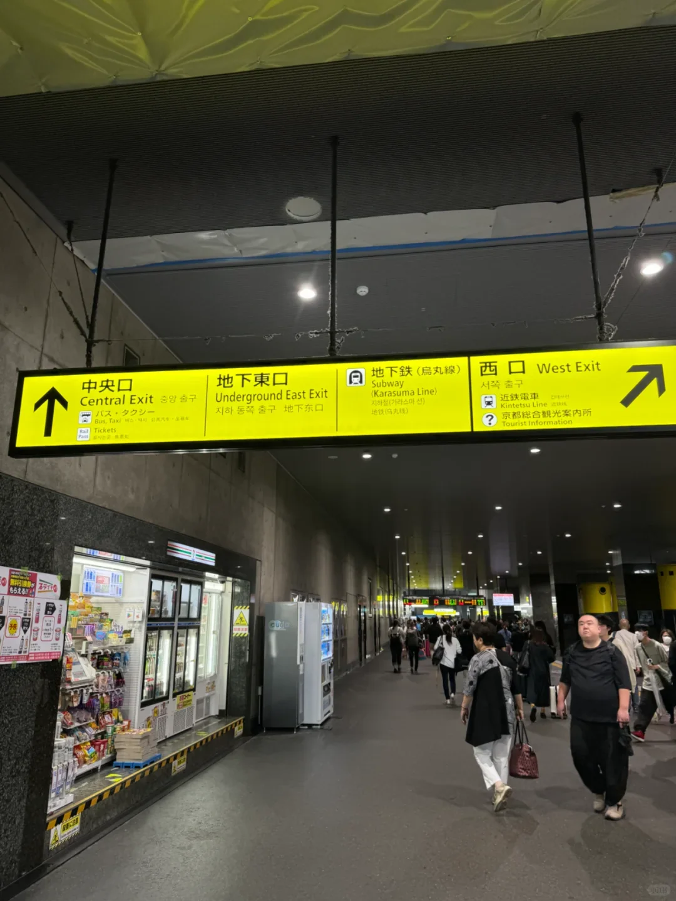

Kansai Uluslararası Havalimanı'ndan (KIX) Kyoto'ya en sakin yol, JR West'in HARUKA ekspresidir. Doğrudan havalimanı istasyonundan kalkar, yalnızca Hineno, Tennoji ve Shin-Osaka'da durur ve Kyoto İstasyonu'na aktarmasız, banliyö treninden çok daha geniş koltuklarla yaklaşık 75–80 dakikada ulaşır.

Bu rehber tek bir treni kapsıyor: bileti nereden alacağınız, hangi biletin buna değdiği, kapıyı ve peronu nasıl bulacağınız, hangi vagonda oturacağınız, bagajın nereye gittiği ve Kyoto İstasyonu'ndan metro ile otobüslere nasıl çıkacağınız. Namba, Umeda ve Nara için [Kansai havalimanı varış rehberine](/blog/kansai-airport-arrival-guide) bakın. Ücretler ve tarifeler sezonla değişir, bu yüzden seyahatten önce JR West'in kendi sitesini kontrol edin.

## 1. 2. kata çıkış ve JR bilet gişesi

Varıştan sonra 鉄道 / Railways tabelalarını izleyin, yürüyen merdivenle Terminal 1'in 2. katına çıkın ve yürüyüş yolunu geçerek istasyona gidin. Kansai Havalimanı İstasyonu Nankai ve JR arasında bölünür; JR tarafı, kapısının üzerinde "JR Ticket Office" yazan mavi-beyaz bir gişedir.

İçeride üç şey olur: gişede bilet almak, bir rail pass değiştirmek ve çevrim içi alınmış bir e-bileti ekranları İngilizceye geçen yeşil makinelerden almak. Mavi tabelanın altındaki makineler aynı gün biletleri satar. Bagajla ilk ziyarette görevli gişe en basitidir.

## 2. Ne kadar tutar: standart ücret ve ziyaretçi bileti

Standart ücret, temel bilet artı ekspres ücretidir; havalimanından Kyoto'ya yaklaşık 3.490 yen, çocuklar yaklaşık yarı fiyat. Her gezgin satın alabilir.

| Bilet | Referans ücret (KIX–Kyoto) | Koşullar |
| --- | --- | --- |
| Standart (temel bilet + ekspres) | yaklaşık 3.490 yen | Her gezgin; gişe veya makine |
| HARUKA Tek Yön Bileti | yaklaşık 2.200 yen | Yabancı pasaport, geçici ziyaretçi, sabit güzergâh |
| Çocuk | yetişkin ücretinin yaklaşık yarısı | 6–11 yaş, kimlik kontrol edilebilir |

Yabancı ziyaretçiler aynı güzergâhta HARUKA Tek Yön Biletini yaklaşık 2.200 yene, yani yaklaşık üçte bir daha ucuza alır. Koşullar yabancı pasaport ve geçici ziyaretçi statüsüdür; güzergâh sabittir: havalimanından Kyoto şehir bölgesine. Uçmadan önce JR West, bir seyahat acentesi veya bir iş ortağı platformu üzerinden alın, ardından makinede ya da gişede kâğıt bilete çevirin. Kotalar ve satış dönemleri sınırlıdır, tarihleriniz netleşince erken alın.

Açık olunması gereken bir nokta: ICOCA veya Suica gibi bir IC kart yalnızca temel ücreti kapsar. Ekspres ücreti ayrıdır, bu yüzden kartla turnikeden geçmek sizi HARUKA'ya bindirmez. Rezervesiz bir ekspres bileti de size rezerve koltuk hakkı vermez; rezervasyon birkaç yüz yen daha pahalıdır ve yoğun sezonda buna değer.

## 3. Kapı ve peron: Kyoto'yu arayın

Biletinizi karşıdaki turnikelere götürün. Manyetik bileti içeri itin, öbür uçtan çıktığında geri alın ve saklayın — Kyoto İstasyonu'ndan çıkarken yeniden gerekecek. Üstteki mavi tabelada Kyoto, Shin-Osaka, Osaka ve Wakayama (Hineno'da aktarma) yazıyor, karıştırmak zor.

Peronda HARUKA genellikle 3 ve 4 numaralı peronlardan kalkar; "Exp. HARUKA" tabelası ve vagon şemasıyla işaretlenmiştir. Osaka'ya giden Kansai Airport Rapid aynı peronları kullanır, bu yüzden gördüğünüz ilk trene binmeyin: HARUKA'nın hedef ekranında Kyoto yazar ve gövdesinde kendi yazısı vardır.

Kalkışlar yaklaşık her 30 dakikada bir, ilki 06:30 civarında ve sonuncusu 22:00 civarında; yolculuk 75–80 dakika sürer. Tarifeler sezonla değişir, JR West'in sitesinde veya peron ekranında doğrulayın. Son treni hedefliyorsanız göçmenlik ve bagajın aldığı 45–60 dakikayı ekleyin.

## 4. Trende: rezerve koltuklar, rezervesiz vagonlar ve bagaj

HARUKA genellikle dokuz vagonlu bir dizi olarak çalışır: 1–4 ve 8–9 numaralı vagonlar rezerve, 5, 6 ve 7 numaralı vagonlar rezervesizdir (peron şeması son sözü söyler). Rezervesiz biletle bu üç vagonda boş bir koltuğa oturun; rezervasyonla biletin gösterdiği yere oturun.

Rezervesiz, bir kalkış saatine bağlı olmadığınız anlamına gelir, ama yoğun sezonda ayakta kalmak da demektir. Kiraz çiçeği, sonbahar yaprakları ve uzun hafta sonlarında, çocuklarla veya iki büyük valizle bilet alırken rezervasyon yapın.

Bagaj kapıların yanındaki raflara ya da her vagonun ucundaki alana gider; 28 inçlik bir valiz oraya sığar, ama ilk gelen alır. HARUKA'da shinkansendeki gibi büyük bagaj için önceden rezervasyon kuralı yok; yine de tren doluyken koridoru veya çıkışları kapatmayın. Trende tuvalet var ve anonslar Japonca ile İngilizce.

## 5. Kyoto'ya yetmiş beş dakika

Tren, Osaka Körfezi sağda kalacak şekilde deniz köprüsünü geçer, Hineno'da Hanwa hattına katılır, Tennoji'ye yaklaşık 35 dakikada ulaşır, Osaka'nın kenarından Shin-Osaka'ya gider, sonra Kyoto hattı boyunca kuzeye çıkarak havalimanından ayrıldıktan 75–80 dakika sonra varır.

Kyoto İstasyonu'nda genellikle batı tarafındaki 30 ve 31 numaralı peronlara gelir; Merkez Çıkış veya Hachijo Çıkış tabelalarını izleyin ve bagajla beş dakika ayırın.

Daha ucuz bir alternatif var: Osaka İstasyonu'na Kansai Airport Rapid, ardından Kyoto'ya Special Rapid; yaklaşık 1 saat 45 dakika ve ücretin yaklaşık yarısı, karşılığında Osaka'da bagajlarınızla aktarma. Sıkı bir programınız veya yetişmeniz gereken bir shinkansen varsa tek trenle gitmek kazanır.

## 6. Kyoto İstasyonu'nda aktarma: önce JR'dan çıkın, sonra metro

Kyoto İstasyonu devasa ve ilk ziyaret genellikle turnikelerde bir duraklamayla biter. Sıra önemli: önce JR turnikelerinden çıkın, sonra metroya veya otobüslere geçin.

Karasuma metro hattı Yeraltı Doğu Çıkışı'ndan tabelalı ve turnikeleri JR çıkışının yanında, o kadar gizli ki doğrudan içeri yürüyüp hâlâ JR ücretli alanında ve bileti ödenmemiş hâlde olduğunuzu fark edebilirsiniz. Biletinizi JR turnikesinden geçirin, çıkın, sonra metro bileti alın veya dokunun. Shijo, Gojo ve Karasuma Oike bu hattın üzerinde.

Otobüs terminali Merkez Çıkış'ın dışında; şehir otobüsleri Kiyomizu-dera, Kinkaku-ji ve Arashiyama için oradan kalkıyor. Nara için Kintetsu Hachijo tarafından kalkıyor ve shinkansen de orada — istasyonu geçmek on dakika sürüyor. Çok bagajınız varsa madeni dolapları veya takuhaibin gişesini kullanın ve valizler olmadan gezin.

## İlgili bağlantılar

- **Bu sitede**: [Kansai Uluslararası Havalimanı (KIX)](/airport/KIX), [Japonya (JP)](/country/JP)
- **Daha fazla makale**: [Kansai havalimanı varış rehberi](/blog/kansai-airport-arrival-guide), [Kansai Havalimanı'ndaki ilk saatiniz: göçmenlik, SIM kartlar ve ICOCA](/blog/kansai-airport-transport-sim-card)
- **Wikipedia**: [Kansai Uluslararası Havalimanı](https://en.wikipedia.org/wiki/Kansai_International_Airport), [Haruka (tren)](https://en.wikipedia.org/wiki/Haruka_%28train%29), [Kyoto İstasyonu](https://en.wikipedia.org/wiki/Kyoto_Station)
- **Baidu Baike**: [Kansai Uluslararası Havalimanı](https://baike.baidu.com/item/%E5%85%B3%E8%A5%BF%E5%9B%BD%E9%99%85%E6%9C%BA%E5%9C%BA), [Haruka](https://baike.baidu.com/item/%E9%81%A5%E5%8F%B7%E5%88%97%E8%BD%A6), [Kyoto İstasyonu](https://baike.baidu.com/item/%E4%BA%AC%E9%83%BD%E7%AB%99)

Ücretler, indirim koşulları ve tarifeler JR West'in yayımladığına göredir; operatörün o günkü duyuruları geçerlidir. Görsel kaynağı: kamuya açık materyalden derlenmiştir.
