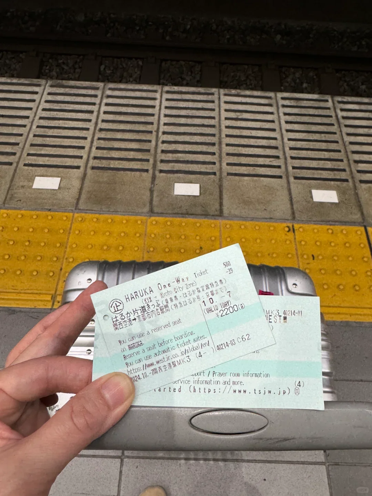

Найспокійніший спосіб дістатися з Міжнародного аеропорту Кансай (KIX) до Кіото — експрес HARUKA компанії JR West. Він вирушає безпосередньо зі станції аеропорту, зупиняється лише в Хіненo, Теннодзі та Сін-Осаці й доїжджає до станції Кіото приблизно за 75–80 хвилин без пересадок, а сидіння в ньому значно просторіші, ніж у приміському потязі.

Цей путівник присвячено одному потягу: де купити квиток, який квиток вигідніший, як знайти турнікети й платформу, у якому вагоні їхати, де розмістити багаж і як вийти зі станції Кіото до метро й автобусів. Про Намбу, Умеду й Нару читайте в [путівнику для прильоту в аеропорт Кансай](/blog/kansai-airport-arrival-guide). Тарифи й розклади змінюються залежно від сезону, тому перед поїздкою перевіряйте сайт JR West.

## 1. Підйом на рівень 2 до каси JR

Після прильоту йдіть за вказівниками 鉄道 / «Залізниця», підніміться ескалатором на рівень 2 термінала 1 і перейдіть переходом до станції. Станція Кансай-аеропорт поділена між Nankai і JR; бік JR — це синьо-біла каса з написом «Каса JR» над дверима.

Усередині можна зробити три речі: купити квиток у касі, обміняти залізничний проїзний і отримати електронний квиток, придбаний онлайн, у зелених автоматах, екран яких перемикається на англійську. Автомати під синьою вивіскою продають квитки на поточний день. Під час першого візиту з багажем найпростіше звернутися до каси з персоналом.

## 2. Скільки це коштує: звичайний тариф і квиток для туристів

Звичайний тариф складається з базового квитка й доплати за експрес; від аеропорту до Кіото це приблизно 3,490 єн, діти платять приблизно половину. Такий квиток може купити будь-який мандрівник.

| Квиток | Орієнтовна вартість (KIX — Кіото) | Умови |
| --- | --- | --- |
| Звичайний (базовий квиток + доплата за експрес) | близько 3,490 єн | Будь-який мандрівник; каса або автомат |
| Квиток HARUKA в один бік | близько 2,200 єн | Закордонний паспорт, статус тимчасового відвідувача, фіксований маршрут |
| Дитячий | близько половини вартості дорослого квитка | Вік 6–11 років, можуть перевірити документи |

Іноземні туристи можуть придбати квиток HARUKA в один бік на тому самому маршруті приблизно за 2,200 єн — приблизно на третину дешевше. Умови — закордонний паспорт і статус тимчасового відвідувача, а маршрут фіксований: від аеропорту до міської зони Кіото. Купуйте його до вильоту через JR West, туристичне агентство або партнерську платформу, а потім обміняйте на паперовий квиток в автоматі чи касі. Квоти й періоди продажу обмежені, тому купуйте заздалегідь, щойно визначитеся з датами.

Важливий момент: IC-картка, як-от ICOCA чи Suica, покриває лише базовий тариф. Доплата за експрес стягується окремо, тому, приклавши картку на турнікеті, ви не потрапите на HARUKA. Квиток на експрес без резервації також не дає права на місце за резервацією; резервація коштує на кілька сотень єн більше, і в сезон пік за неї варто доплатити.

## 3. Турнікети й платформа: шукайте Кіото

Підійдіть із квитком до турнікетів навпроти. Вставте магнітний квиток, забирайте його, коли він виїде з іншого боку, і зберігайте — він знадобиться, щоб вийти зі станції Кіото. На синій вивісці над турнікетами вказано Кіото, Сін-Осаку, Осаку й Вакаяму (пересадка в Хіненo), тож помилитися важко.

На платформі HARUKA зазвичай відправляється з платформ 3 і 4, позначених табличкою «Експрес HARUKA» та схемою вагонів. Швидкісний потяг Kansai Airport Rapid до Осаки використовує ті самі платформи, тому не сідайте в перший-ліпший потяг: у HARUKA на табло призначення вказано Кіото, а на кузові є власний напис.

Потяги вирушають приблизно кожні 30 хвилин, перший — близько 06:30, останній — близько 22:00, а поїздка триває 75–80 хвилин. Розклади змінюються залежно від сезону, тому уточнюйте на сайті JR West або на табло платформи. Якщо розраховуєте на останній потяг, додайте 45–60 хвилин, які займають імміграційний контроль і отримання багажу.

## 4. У потязі: місця за резервацією, вагони без резервації та багаж

HARUKA зазвичай курсує дев’ятивагонним складом: вагони 1–4 і 8–9 — із місцями за резервацією, а вагони 5, 6 і 7 — без резервації (остаточно орієнтуйтеся на схему на платформі). З квитком без резервації займайте будь-яке вільне місце в цих трьох вагонах; із резервацією — сідайте на місце, вказане в квитку.

Квиток без резервації не прив’язує вас до конкретного відправлення, але в сезон пік означає ймовірну поїздку стоячи. Під час цвітіння сакури, сезону осіннього листя й довгих вихідних, а також якщо ви з дітьми чи двома великими валізами, бронюйте місце одразу під час купівлі.

Багаж розміщують на полицях біля дверей або в просторі в кінці кожного вагона, де вміщується валіза розміром 28 дюймів, але місця займають у порядку черги. У HARUKA немає правила про попереднє бронювання для надгабаритного багажу, як у сінкансені; попри це, коли потяг заповнений, не загороджуйте прохід і виходи. У потязі є туалети, а оголошення лунають японською та англійською.

## 5. Сімдесят п’ять хвилин до Кіото

Потяг перетинає морський міст, залишаючи Осакську затоку праворуч, приєднується до лінії Hanwa в Хіненo, приблизно за 35 хвилин досягає Теннодзі, обходить Осаку по краю до Сін-Осаки, а потім прямує на північ лінією Кіото й прибуває через 75–80 хвилин після відправлення з аеропорту.

На станції Кіото він зазвичай прибуває на платформи 30 і 31 із західного боку; йдіть за вказівниками до Центрального виходу або виходу Хатідзьо й закладайте п’ять хвилин із багажем.

Є дешевша альтернатива: швидкісний потяг Kansai Airport Rapid до станції Осака, потім експрес Special Rapid до Кіото — приблизно 1 година 45 хвилин і приблизно половина вартості, але з пересадкою в Осаці з багажем. Якщо графік щільний або треба встигнути на сінкансен, поїздка без пересадок виграє.

## 6. Пересадка на станції Кіото: спершу вийдіть із JR, потім метро

Станція Кіото величезна, і перший візит зазвичай закінчується зупинкою перед турнікетами. Послідовність важлива: спершу вийдіть через турнікети JR, а вже потім переходьте на метро чи автобуси.

До лінії метро Karasuma ведуть вказівники від Підземного східного виходу, а її турнікети стоять поруч із виходом JR — настільки непримітно, що легко пройти прямо до них і виявити, що ви досі перебуваєте в платній зоні JR із квитком, який ще не пройшов турнікет. Просуньте квиток через турнікет JR, вийдіть, а потім купіть квиток на метро або прикладіть картку. Сідзьо, Ґодзьо й Карасума-Ойке — усі на цій лінії.

Автобусний термінал розташований назовні від Центрального виходу, звідки вирушають міські автобуси до Кійомідзу-дери, Кінкаку-дзі й Арасіями. Потяги Kintetsu до Нари відправляються з боку Хатідзьо, там же й сінкансен — перетнути станцію займає десять хвилин. Якщо багажу багато, скористайтеся камерами схову або стійкою takuhaibin і вирушайте оглядати місто без валіз.

## Пов’язані посилання

- **На цьому сайті**: [Міжнародний аеропорт Кансай (KIX)](/airport/KIX), [Японія (JP)](/country/JP)
- **Більше статей**: [путівник для прильоту в аеропорт Кансай](/blog/kansai-airport-arrival-guide), [Перша година в аеропорту Кансай: імміграційний контроль, SIM-картки та ICOCA](/blog/kansai-airport-transport-sim-card)
- **Вікіпедія**: [Міжнародний аеропорт Кансай](https://en.wikipedia.org/wiki/Kansai_International_Airport), [Haruka (потяг)](https://en.wikipedia.org/wiki/Haruka_%28train%29), [Станція Кіото](https://en.wikipedia.org/wiki/Kyoto_Station)
- **Baidu Baike**: [Міжнародний аеропорт Кансай](https://baike.baidu.com/item/%E5%85%B3%E8%A5%BF%E5%9B%BD%E9%99%85%E6%9C%BA%E5%9C%BA), [Haruka](https://baike.baidu.com/item/%E9%81%A5%E5%8F%B7%E5%88%97%E8%BD%A6), [Станція Кіото](https://baike.baidu.com/item/%E4%BA%AC%E9%83%BD%E7%AB%99)

Тарифи, умови знижок і розклади наведено за публікаціями JR West; у день поїздки переважають оголошення оператора. Джерело зображень: укладено з публічних матеріалів.
