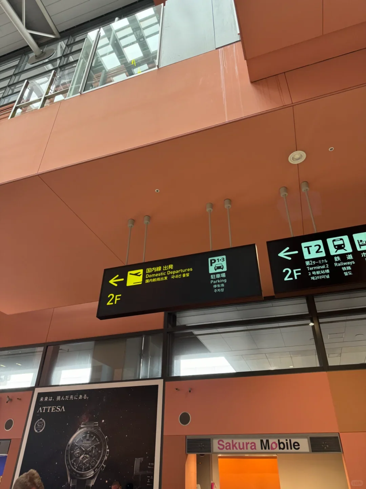
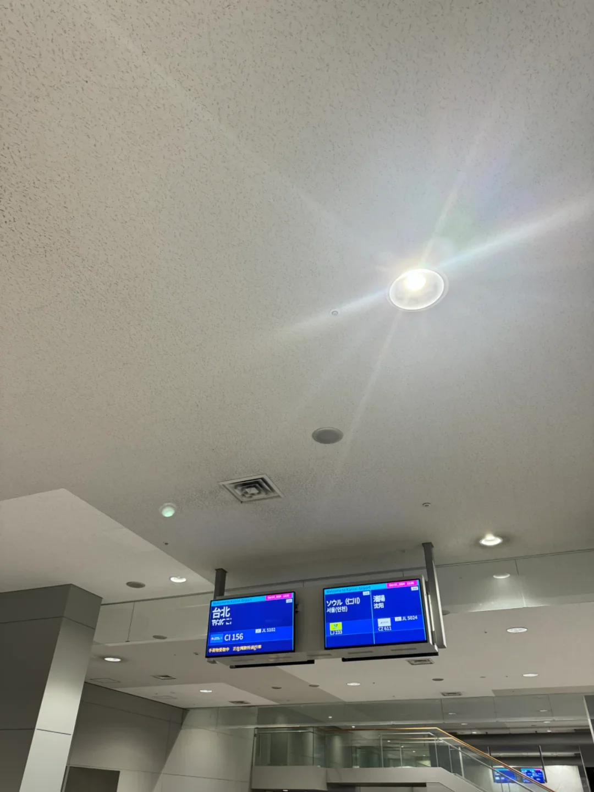

Mezinárodní letiště Kansai (KIX) odbavuje cestující rychleji než většina japonských bran, ale i při první návštěvě se lidé zaseknou na stejných několika věcech: zda vyplnili deklarace, který automat snímá otisky prstů, který pás patří jim, kam jít, až projdou, a jak brzy se vrátit na cestu domů.

Tento průvodce prochází oba směry popořadě a drží se samotného procesu — žádné srovnávání dopravy. Jak se dostat do Kjóta nebo Ósaky, najdete v [průvodci expresem JR HARUKA](/blog/kansai-airport-haruka-kyoto-guide) a v [průvodci příletem na letiště Kansai](/blog/kansai-airport-arrival-guide). Postupy se mění, proto si před cestou projděte, co zveřejňuje letiště a japonské úřady.

## 1. Před přistáním: vyplňte obě deklarace

Vstup do Japonska má dvě části: imigraci a celnici. Snadnější cestou je Visit Japan Web vyplněný před odletem, který vygeneruje QR kódy pro obojí — udělejte si snímky obrazovky a nechte je v galerii. Jedno vyplnění může pokrýt rodinu, která s vámi cestuje, a ve frontě nebudete shánět signál.

Bez něj si vyžádejte papírovou příletovou kartu v letadle nebo ji vyplňte u přepážek v příletové hale. Některé aerolinky už papírové formuláře nevydávají a místo toho po nástupu na palubu ukážou QR kód — bez dat je to nepříjemné, proto vyplňte vše předem. Kódy si uložte zvlášť: Wi-Fi na letišti vypadává a načítání naživo je nespolehlivé.

## 2. Z letadla k imigraci: karanténa, otisky prstů a fotografie

Držte se značek 国際線 到着 / International Arrivals. Většina letů na terminál 1 přilétá přes nástupní most; vzdálené stání znamená dvě až tři minuty jízdy autobusem. Terminál 2 je samostatná budova s kratší pěší trasou.

První zastávkou je karanténa a měření teploty, které může podle platných předpisů vyžadovat zdravotní prohlášení. Pak přicházejí samoobslužné kiosky: přiložte stránku pasu s fotografií na čtečku a podle pokynů se nechte vyfotografovat a sejmout otisky prstů. Obrazovky nabízejí angličtinu a personál je neustále k dispozici. S dětmi nebo když se otisk nepřečte, použijte přepážku s personálem.

Právě zde vzniká fronta: když přiletí několik letů naráz, znamená to dvacet až třicet minut, při rozložených příletech méně než deset.

## 3. Imigrace, zavazadla a celnice

Imigrační přepážky jsou rozdělené podle statusu a krátkodobí návštěvníci používají označené koridory. Předejte pas a QR kód, případně papírovou kartu; úředník se obvykle zeptá, jak dlouho a kde se budete zdržovat, sejme otisk prstu a pustí vás dál — pár minut. Poté najděte na obrazovkách pás svého letu. Zavazadla obvykle trvají 15–25 minut a vozíky jsou zdarma.

S zavazadly projděte koridorem pro nic k proclení. KIX používá samoobslužné celní terminály: naskenujte pas, naskenujte QR kód, odpovězte na několik otázek a projděte s zavazadly poslední kontrolou. Pokud máte co deklarovat — nadlimitní alkohol nebo tabák, maso, velké množství hotovosti — použijte červený koridor a řekněte to hned; dobrovolné přiznání je snazší než být nachytán.

## 4. Z haly nahoru k vlakům

Vyjdete do příletové haly terminálu 1 v 1. patře. Vlevo je směnárna, přepážky Wi-Fi a SIM karet a turistické informace; vpravo dveře k autobusům a taxi. Vlaky jsou o patro výš: vyjeďte eskalátorem, přejděte chodbou a jste u pokladen Nankai a JR.

Počítejte s tím takto: při hladkém průběhu asi 50 minut od dveří letadla k jízdence na HARUKU v ruce; při dlouhém čekání na zavazadla nebo když přilétá několik letů naráz, hodinu až hodinu a dvacet minut.

| Fáze | Orientační čas |
| --- | --- |
| Z letadla k imigraci | 10–25 min |
| Zavazadla | 15–25 min |
| Celnice k východu | 5–10 min |
| Z východu k vlakům | 5–8 min |

Pokud následuje vnitrostátní let, po odbavení se vydejte zpět nahoru do odletové úrovně vnitrostátních letů podle značek 国内線乗り継ぎ / Domestic Transfer. Zda jsou zavazadla odbavena až do cíle, závisí na tom, zda jsou oba lety na jedné jízdence; pokud ne, vyzvedněte je a znovu je odbavte a rezervujte si alespoň dvě hodiny.

## 5. Cesta domů: odbavení, přepážka tax free a bezpečnostní kontrola

Na mezinárodní odlet přijďte 2,5–3 hodiny předem. Přepážky se obvykle otevírají asi 2,5 hodiny před letem a zavírají přibližně hodinu před odletem, pokud to pravidla aerolinky dovolují, a v sezóně, o víkendech a během japonských svátků fronta u bezpečnostní kontroly výrazně naroste.

Odbavení se řadí podle letů a navigují vás obrazovky i pozemní personál. Jeden ostrůvek může obsluhovat několik letů najednou, proto si před zařazením do fronty přečtěte číslo letu a cíl — špatná fronta stojí skutečný čas. Jakmile máte palubní vstupenku a zavazadlo je odbavené, vydejte se ke vchodu pro mezinárodní odlety.

Kdo v Japonsku nakoupil zboží s tax free, má po odevzdání zavazadel a před bezpečnostní kontrolou ještě jednu zastávku: celní přepážku, kde samoobslužný terminál naskenuje pas. Zabere to pár vteřin a vynechání může znamenat, že po vás při odjezdu budou chtít doplatit spotřební daň. Následuje bezpečnostní kontrola: sundat kabát, elektronika a powerbanky zůstávají v tašce, vše do přihrádky. Zavazadla opouštějí skener jedním ze dvou východů — tím bližším, pokud je vše v pořádku, tím vzdálenějším vedle personálu, pokud je třeba se na ně podívat znovu a možná je prohledat.

Hmotnost zavazadel je další zádrhel: zvažte kufr u přepážky a těžké věci přendejte do příručního zavazadla, nebo doplaťte nadváhu tam, ne u brány.

## 6. Pasová kontrola a brána: kolik času si nechat

Pasová kontrola přichází po bezpečnostní kontrole — naskenování, fotografie, otisk prstu, pár minut — a pak už jste v oblasti duty free a u bran. Nástup obvykle začíná 30 minut před odletem a brána se zavírá 10–15 minut před odletem, jak oznámí aerolinka.

Počítejte pozpátku: 20 minut z oblasti bran k nástupu, 40 minut na bezpečnostní a pasovou kontrolu, 40 minut na odbavení a odevzdání zavazadel, plus cesta na letiště. Pomalá fronta se pak nezmění v běh.

Několik věcí, které lidi zaskočí. Lety odlétající z terminálu 2 vyžadují nejprve jízdu bezplatným kyvadlovým autobusem, takže připočtěte 15–20 minut na čekání a jízdu. Bezpečnostní kontrola v sezóně trvá dvakrát déle. Tekutiny a nože na špatném místě v příručním zavazadle znamenají prohledání tašky. A obrazovky aktualizují bránu v reálném čase, proto si tu svou zkontrolujte, jakmile projdete.

## Související odkazy

- **Na tomto webu**: [Mezinárodní letiště Kansai (KIX)](/airport/KIX), [Japonsko (JP)](/country/JP)
- **Další články**: [Z letiště Kansai do Kjóta expresem JR HARUKA](/blog/kansai-airport-haruka-kyoto-guide), [Průvodce příletem na letiště Kansai](/blog/kansai-airport-arrival-guide), [Vaše první hodina na letišti Kansai](/blog/kansai-airport-transport-sim-card)
- **Wikipedie**: [Mezinárodní letiště Kansai](https://en.wikipedia.org/wiki/Kansai_International_Airport)
- **Baidu Baike**: [Mezinárodní letiště Kansai](https://baike.baidu.com/item/%E5%85%B3%E8%A5%BF%E5%9B%BD%E9%99%85%E6%9C%BA%E5%9C%BA)

Pravidla vstupu a celní předpisy, časy odbavení a bezpečnostní kontroly odpovídají publikacím japonské vlády a letiště Kansai; rozhodující je, co se děje v daný den. Zdroj obrázků: sestaveno z veřejných materiálů.
