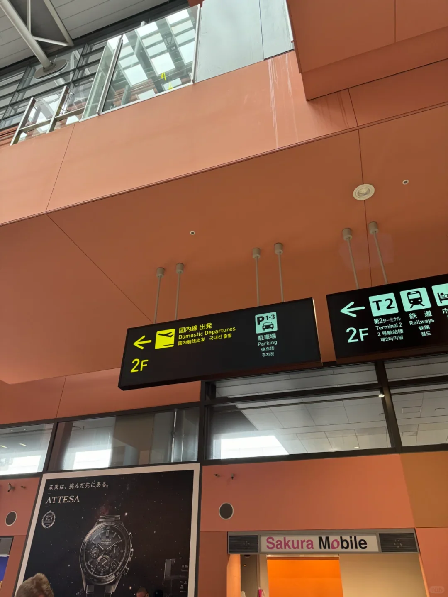
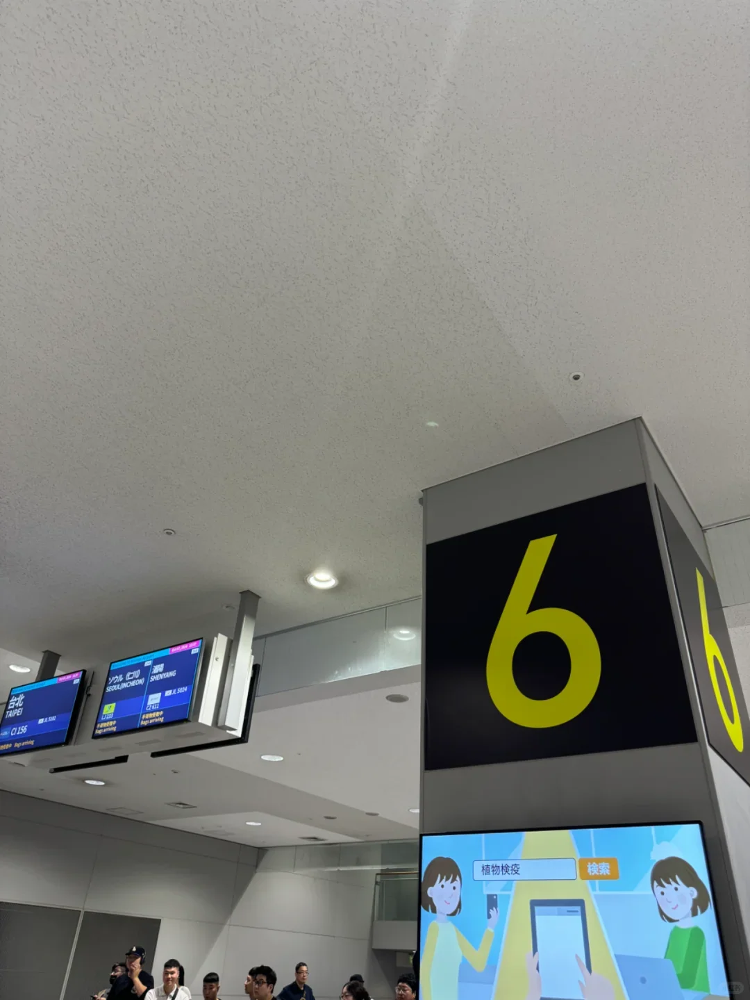
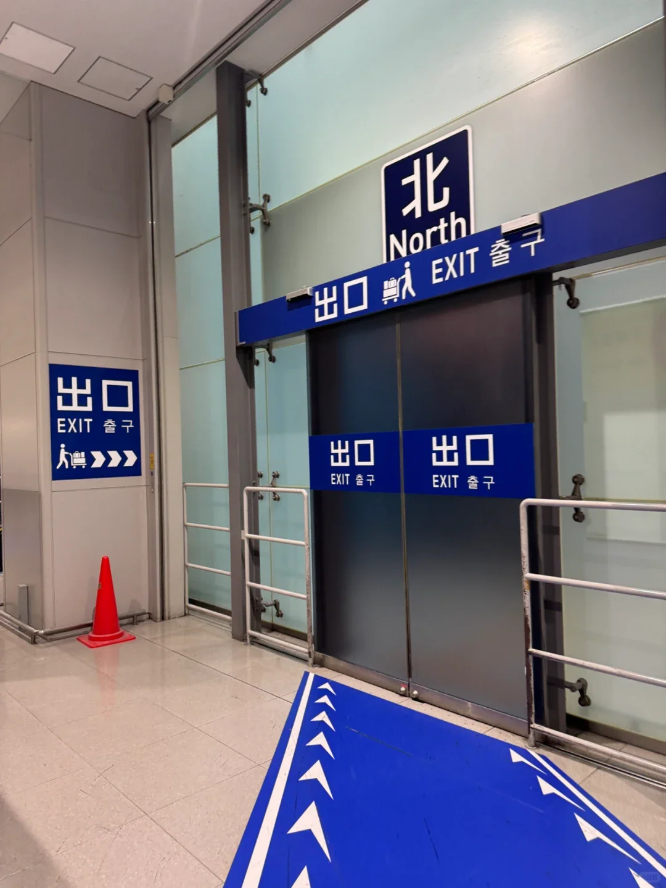
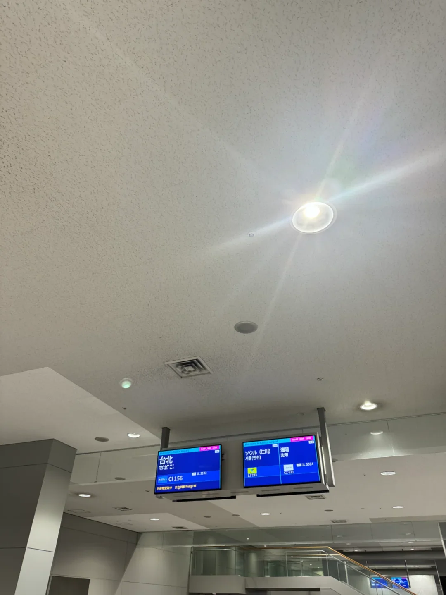

Der Kansai International Airport (KIX) fertigt Passagiere schneller ab als die meisten japanischen Einreiseflughäfen, doch bei der ersten Ankunft hakt es immer wieder an denselben Punkten: ob die Erklärungen abgegeben wurden, welcher Automat den Fingerabdruck nimmt, welches Gepäckband das richtige ist, wohin man nach der Einreise geht und wie früh man für den Heimflug zurückkehren sollte.

Dieser Leitfaden beschreibt beide Richtungen in der richtigen Reihenfolge und bleibt beim Ablauf selbst – kein Verkehrsmittelvergleich. Wie Sie nach Kyoto oder Osaka kommen, lesen Sie im [JR-HARUKA-Leitfaden](/blog/kansai-airport-haruka-kyoto-guide) und im [Ankunftsleitfaden für den Flughafen Kansai](/blog/kansai-airport-arrival-guide). Verfahren ändern sich; prüfen Sie daher vor der Reise, was der Flughafen und die japanischen Behörden veröffentlichen.

## 1. Vor der Landung: beide Erklärungen ausfüllen

Die japanische Einreise besteht aus zwei Teilen: Einreisekontrolle und Zoll. Der einfache Weg ist Visit Japan Web, vor dem Flug ausgefüllt; es erzeugt QR-Codes für beides – machen Sie Screenshots und bewahren Sie sie in der Fotogalerie auf. Eine Anmeldung kann die mitreisende Familie abdecken, und Sie müssen in der Schlange nicht nach einem Signal suchen.

Ohne Visit Japan Web bitten Sie im Flugzeug um eine Papierankunftskarte oder füllen eine an den Schaltern in der Ankunftshalle aus. Manche Airlines verteilen keine Papierformulare mehr und zeigen nach dem Einsteigen stattdessen einen QR-Code – ohne Daten unpraktisch, füllen Sie also vorab aus. Speichern Sie die Codes getrennt: Das Flughafen-WLAN ist unbeständig, und das Live-Laden ist unzuverlässig.

## 2. Vom Flugzeug zur Einreise: Quarantäne, Fingerabdrücke und Fotos

Folgen Sie den Schildern 国際線 到着 / International Arrivals. Die meisten Flüge in T1 kommen über eine Fluggastbrücke an; eine Außenposition bedeutet eine zwei- oder dreiminütige Busfahrt. T2 ist ein separates Gebäude mit einem kürzeren Weg.

Die erste Station ist die Quarantäne mit Temperaturkontrolle, die je nach geltenden Regeln eine Gesundheitserklärung erfordern kann. Danach kommen die Selbstbedienungsautomaten: Legen Sie die Fotoseite Ihres Passes auf das Lesegerät und folgen Sie den Aufforderungen, um Ihr Foto aufzunehmen und Ihre Fingerabdrücke zu erfassen. Die Bildschirme bieten Englisch an, und Mitarbeiter sind durchgehend zur Stelle. Mit Kindern oder einem Fingerabdruck, der nicht gelesen wird, nutzen Sie die besetzte Spur.

Hier bildet sich die Schlange: mehrere gleichzeitig landende Flüge bedeuten zwanzig oder dreißig Minuten, bei gestaffelten Ankünften unter zehn Minuten.

## 3. Einreise, Gepäck und Zoll

Die Einreiseschalter sind nach Status getrennt, und Kurzzeitbesucher nutzen die gekennzeichneten Spuren. Übergeben Sie Ihren Pass und den QR-Code oder die Papierkarte; der Beamte fragt in der Regel, wie lange Sie bleiben und wo Sie wohnen, nimmt einen Fingerabdruck und winkt Sie durch – eine Sache von ein paar Minuten. Suchen Sie dann auf den Bildschirmen das Gepäckband Ihres Flugs. Das Gepäck braucht meist 15–25 Minuten, und die Gepäckwagen sind kostenlos.

Mit dem Gepäck nehmen Sie die Spur „Nichts zu verzollen“. KIX nutzt Selbstbedienungsterminals für den Zoll: Pass scannen, QR-Code scannen, ein paar Fragen beantworten und das Gepäck durch die letzte Kontrolle tragen. Wenn Sie etwas zu verzollen haben – übermäßig viel Alkohol oder Tabak, Fleisch, große Bargeldbeträge –, nutzen Sie die rote Spur und geben Sie es zuerst an; freiwillig anzugeben ist einfacher, als erwischt zu werden.

## 4. Aus der Halle hinauf zu den Bahnen

Sie gelangen in die Ankunftshalle von T1 auf Ebene 1. Links befinden sich der Geldwechsel, die WLAN- und SIM-Schalter und der Touristeninformationsschalter; rechts die Türen zu Bussen und Taxis. Die Bahn ist eine Ebene höher: Nehmen Sie die Rolltreppe, überqueren Sie den Gang, und Sie sind bei den Fahrkartenbereichen von Nankai und JR.

Planen Sie es so: Bei reibungslosem Ablauf etwa 50 Minuten von der Flugzeugtür bis zum HARUKA-Ticket in der Hand; bei langer Gepäckwartezeit oder wenn mehrere Flüge gleichzeitig landen, eine Stunde bis eine Stunde und zwanzig Minuten.

| Phase | Richtzeit |
| --- | --- |
| Flugzeug bis Einreise | 10–25 Min. |
| Gepäck | 15–25 Min. |
| Zoll bis Ausgang | 5–10 Min. |
| Ausgang bis Bahnebene | 5–8 Min. |

Wenn ein Inlandsflug folgt, folgen Sie nach der Einreise den Schildern 国内線乗り継ぎ / Domestic Transfer wieder hinauf zur Ebene der Inlandsabflüge. Ob Ihr Gepäck durchgecheckt ist, hängt davon ab, ob beide Flüge auf einem Ticket stehen; wenn nicht, holen Sie es ab und checken es erneut ein und planen Sie mindestens zwei Stunden ein.

## 5. Der Weg nach Hause: Check-in, Tax-Free-Schalter und Sicherheitskontrolle

Für einen internationalen Abflug sollten Sie 2,5–3 Stunden vorher da sein. Die Schalter öffnen in der Regel etwa 2,5 Stunden vor dem Flug und schließen rund eine Stunde vorher, soweit die Regeln der Airline es zulassen, und in der Hochsaison, an Wochenenden und an japanischen Feiertagen wächst die Sicherheitsschlange deutlich darüber hinaus.

Der Check-in ist nach Flug organisiert, und Bildschirme sowie Bodenpersonal weisen Ihnen den Weg. Ein Check-in-Bereich kann mehrere Flüge gleichzeitig abfertigen; lesen Sie daher Flugnummer und Ziel, bevor Sie sich anstellen – die falsche Schlange kostet wirklich Zeit. Sobald die Bordkarte ausgestellt und der Koffer aufgegeben ist, gehen Sie zum Eingang für internationale Abflüge.

Wer in Japan steuerfreie Waren gekauft hat, hat nach der Gepäckabgabe und vor der Sicherheitskontrolle einen weiteren Halt: den Zollschalter, an dem ein Selbstbedienungsterminal Ihren Pass scannt. Das dauert Sekunden, und wer ihn überspringt, kann bei der Ausreise zur Zahlung der Verbrauchsteuer aufgefordert werden. Danach folgt die Sicherheitskontrolle: Mantel aus, Elektronik und Powerbanks bleiben in der Tasche, alles in die Wanne. Die Taschen verlassen den Scanner über einen von zwei Ausgängen – den nahen, wenn alles in Ordnung ist, den entfernten neben dem Personal, wenn ein zweiter Blick und möglicherweise eine Durchsuchung nötig sind.

Das Gepäckgewicht ist der andere Stolperstein: Wiegen Sie den Koffer am Schalter und packen Sie schwere Gegenstände in das Handgepäck um, oder zahlen Sie dort das Übergepäck statt am Gate.

## 6. Passkontrolle und Gate: wie viel Zeit Sie einplanen sollten

Die Passkontrolle kommt nach der Sicherheitskontrolle – scannen, fotografieren, Fingerabdruck, ein paar Minuten –, und danach sind Sie im Duty-Free- und Gate-Bereich. Das Boarding beginnt meist 30 Minuten vor dem Abflug, und das Gate schließt 10–15 Minuten vorher, wie die Airline bekannt gibt.

Rechnen Sie rückwärts: 20 Minuten vom Gate-Bereich bis zum Boarding, 40 Minuten für Sicherheitskontrolle und Passkontrolle, 40 Minuten für Check-in und Gepäckabgabe, plus die Anreise. Dann wird aus einer langsamen Schlange kein Sprint.

Ein paar Dinge, bei denen Menschen hängen bleiben. Für Flüge ab T2 ist zuerst der kostenlose Shuttle nötig, also planen Sie 15–20 Minuten für Wartezeit und Fahrt ein. Die Sicherheitskontrolle in der Hochsaison dauert doppelt so lange. Flüssigkeiten und Messer an der falschen Stelle im Handgepäck kosten eine Taschenkontrolle. Und die Bildschirme aktualisieren das Gate in Echtzeit; prüfen Sie Ihr Gate, sobald Sie durch sind.

## Weiterführende Links

- **Auf dieser Website**: [Flughafen Kansai International (KIX)](/airport/KIX), [Japan (JP)](/country/JP)
- **Weitere Artikel**: [Vom Flughafen Kansai nach Kyoto mit dem JR HARUKA](/blog/kansai-airport-haruka-kyoto-guide), [Ankunftsleitfaden Flughafen Kansai](/blog/kansai-airport-arrival-guide), [Ihre erste Stunde am Flughafen Kansai](/blog/kansai-airport-transport-sim-card)
- **Wikipedia**: [Kansai International Airport](https://en.wikipedia.org/wiki/Kansai_International_Airport)
- **Baidu Baike**: [Kansai International Airport](https://baike.baidu.com/item/%E5%85%B3%E8%A5%BF%E5%9B%BD%E9%99%85%E6%9C%BA%E5%9C%BA)

Einreise- und Zollbestimmungen, Check-in- und Sicherheitszeiten folgen den Veröffentlichungen der japanischen Regierung und des Flughafens Kansai; maßgeblich ist, was am Tag gilt. Bildnachweis: aus öffentlichem Material zusammengestellt.
