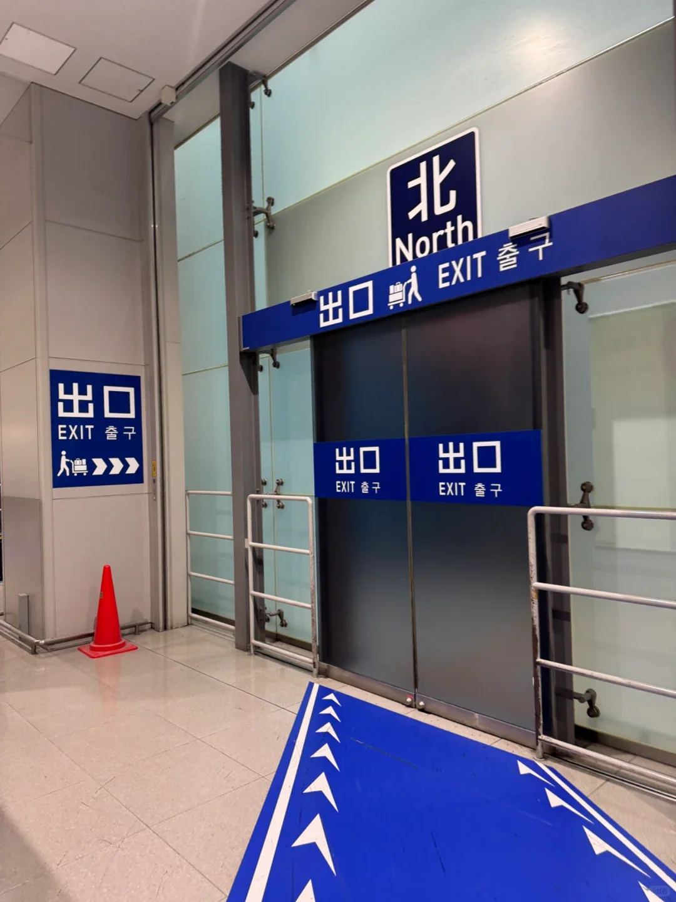

Aeroportul Internațional Kansai (KIX) procesează pasagerii mai repede decât majoritatea porților de intrare din Japonia, dar o primă sosire se împiedică tot de aceleași câteva puncte: dacă declarațiile au fost depuse, ce aparat ia amprenta, ce bandă de bagaje este a ta, încotro mergi după ce ai trecut și cât de devreme să te întorci pentru zborul de acasă.

Acest ghid parcurge ambele direcții în ordine și se ține de procesul în sine — fără comparații de transport. Pentru drumul spre Kyoto sau Osaka, vezi [ghidul JR HARUKA](/blog/kansai-airport-haruka-kyoto-guide) și [ghidul de sosire pe Aeroportul Kansai](/blog/kansai-airport-arrival-guide). Procedurile se schimbă, așa că verifică ce publică aeroportul și autoritățile japoneze înainte de călătorie.

## 1. Înainte de aterizare: depune ambele declarații

Intrarea în Japonia are două părți: imigrația și vama. Calea simplă este Visit Japan Web, completat înainte de zbor, care produce coduri QR pentru ambele — fă-le capturi de ecran și ține-le în galeria foto. O singură completare poate acoperi familia care călătorește cu tine și nu vei căuta semnal în coadă.

Fără el, cere un card de sosire pe hârtie în avion sau completează unul la ghișeele din sala de sosiri. Unele companii aeriene nu mai dau formulare pe hârtie și afișează un cod QR după îmbarcare — incomod fără date mobile, așa că depune din timp. Salvează codurile separat: Wi-Fi-ul aeroportului vine și pleacă, iar încărcarea lor în direct nu este fiabilă.

## 2. De la aeronavă la imigrație: carantină, amprente și fotografii

Urmează indicatoarele pentru 国際線 到着 / International Arrivals. Majoritatea zborurilor din T1 sosesc prin pasarelă; un stand îndepărtat înseamnă o cursă de autobuz de două-trei minute. T2 este o clădire separată, cu o plimbare mai scurtă.

Prima oprire este carantina și controlul temperaturii, care poate cere o declarație de sănătate în funcție de regulile în vigoare. Urmează chioșcurile self-service: pune pagina cu fotografie a pașaportului pe cititor, urmează instrucțiunile pentru a-ți face fotografia și a-ți înregistra amprentele. Ecranele oferă engleză, iar personalul este la dispoziție. Cu copii sau cu o amprentă care nu se citește, folosește culoarul cu personal.

Aici se formează coada: mai multe zboruri care aterizează împreună înseamnă douăzeci sau treizeci de minute, sosirile eșalonate sub zece.

## 3. Imigrație, bagaje și vamă

Ghișeele de imigrație sunt împărțite după statut, iar vizitatorii pentru șederi scurte folosesc culoarele marcate. Predă pașaportul și codul QR, sau cardul de hârtie; ofițerul întreabă de obicei cât timp și unde stai, ia o amprentă și te lasă să treci — câteva minute. Apoi găsește-ți pe ecrane banda de bagaje a zborului. Bagajele durează de obicei 15–25 de minute, iar cărucioarele sunt gratuite.

Cu bagajele, ia culoarul „nimic de declarat". KIX folosește terminale vamale self-service: scanează pașaportul, scanează codul QR, răspunde la câteva întrebări și treci cu bagajele prin ultimul punct de control. Dacă ai ceva de declarat — alcool sau tutun în exces, carne, sume mari de numerar — folosește culoarul roșu și spune-o din start; este mai simplu să declari decât să fii prins.

## 4. Din sală sus la trenuri

Ieși în holul de sosiri al T1, la nivelul 1. În stânga sunt schimbul valutar, ghișeele Wi-Fi și SIM și biroul de informații turistice; în dreapta, ușile spre autobuze și taxiuri. Gara este cu un nivel mai sus: ia scara rulantă, traversează pasarela și ajungi în zonele de bilete Nankai și JR.

Bugetează așa: dacă totul merge bine, aproximativ 50 de minute de la ușa aeronavei până la biletul HARUKA în mână; cu o așteptare lungă la bagaje sau când aterizează mai multe zboruri deodată, o oră până la o oră și douăzeci de minute.

| Etapă | Timp orientativ |
| --- | --- |
| Aeronavă – imigrație | 10–25 min |
| Bagaje | 15–25 min |
| Vamă – ieșire | 5–10 min |
| Ieșire – nivelul gării | 5–8 min |

Dacă urmează un zbor intern, după ce treci de formalități urmează indicatoarele 国内線乗り継ぎ / Domestic Transfer înapoi la nivelul plecărilor interne. Dacă bagajele sunt înregistrate până la destinație depinde de faptul dacă ambele zboruri sunt pe același bilet; dacă nu, ridică-le și înregistrează-le din nou și lasă cel puțin două ore.

## 5. Drumul spre casă: check-in, ghișeul tax-free și securitatea

Pentru o plecare internațională, sosește cu 2,5–3 ore înainte. Ghișeele se deschid de obicei cu circa 2,5 ore înainte de zbor și se închid cu aproximativ o oră înainte, în limitele regulilor companiei aeriene, iar în sezonul de vârf, la sfârșit de săptămână și de sărbătorile japoneze coada la securitate crește mult peste asta.

Check-in-ul se face pe cozi pe zboruri, iar ecranele și personalul de sol te îndrumă. O singură zonă de ghișee poate deservi mai multe zboruri deodată, așa că citește numărul zborului și destinația înainte de a te așeza la coadă — coada greșită costă timp real. După ce cartea de îmbarcare este emisă și bagajul predat, îndreaptă-te spre intrarea pentru plecări internaționale.

Cine a cumpărat produse tax-free în Japonia mai are o oprire după predarea bagajului și înainte de securitate: ghișeul vamal, unde un terminal self-service îți scanează pașaportul. Durează câteva secunde, iar dacă îl sari poți fi pus să plătești taxa pe consum la ieșire. Urmează securitatea: hainele jos, electronicele și bateriile externe rămân în geantă, totul în tavă. Bagajele ies din scanner pe una din două ieșiri — cea apropiată dacă totul e în regulă, cea îndepărtată, lângă personal, dacă are nevoie de o a doua privire și poate de o percheziție.

Greutatea bagajelor este cealaltă piedică: cântărește valiza la ghișeu și mută obiectele grele în bagajul de mână, sau plătește excesul acolo, nu la poartă.

## 6. Controlul pașapoartelor și poarta: cât timp să lași

Controlul pașapoartelor vine după securitate — scanare, fotografie, amprentă, câteva minute — și apoi ești în zona duty-free și a porților. Îmbarcarea începe de obicei cu 30 de minute înainte de plecare, iar poarta se închide cu 10–15 minute înainte, după cum anunță compania aeriană.

Calculează invers: 20 de minute de la zona porților la îmbarcare, 40 de minute pentru securitate și controlul pașapoartelor, 40 de minute pentru check-in și predarea bagajului, plus drumul până acolo. Astfel, o coadă lentă nu se transformă într-o alergare.

Câteva lucruri care îi prind nepregătiți pe călători. Zborurile care pleacă din T2 cer mai întâi naveta gratuită, așa că adaugă 15–20 de minute pentru așteptare și cursă. Securitatea din sezonul de vârf durează de două ori mai mult. Lichidele și cuțitele puse greșit în bagajul de mână te costă o percheziție. Iar ecranele actualizează poarta în timp real, așa că verifică-ți poarta după ce ai trecut.

## Linkuri conexe

- **Pe acest site**: [Aeroportul Internațional Kansai (KIX)](/airport/KIX), [Japonia (JP)](/country/JP)
- **Mai multe articole**: [De la Aeroportul Kansai la Kyoto cu JR HARUKA](/blog/kansai-airport-haruka-kyoto-guide), [Ghidul de sosire pe Aeroportul Kansai](/blog/kansai-airport-arrival-guide), [Prima oră pe Aeroportul Kansai](/blog/kansai-airport-transport-sim-card)
- **Wikipedia**: [Kansai International Airport](https://en.wikipedia.org/wiki/Kansai_International_Airport)
- **Baidu Baike**: [Kansai International Airport](https://baike.baidu.com/item/%E5%85%B3%E8%A5%BF%E5%9B%BD%E9%99%85%E6%9C%BA%E5%9C%BA)

Regulile de intrare și vamale, orele de check-in și de securitate urmează publicațiilor guvernului japonez și ale Aeroportului Kansai; ce se întâmplă în ziua respectivă are prioritate. Credit foto: compilate din material public.
