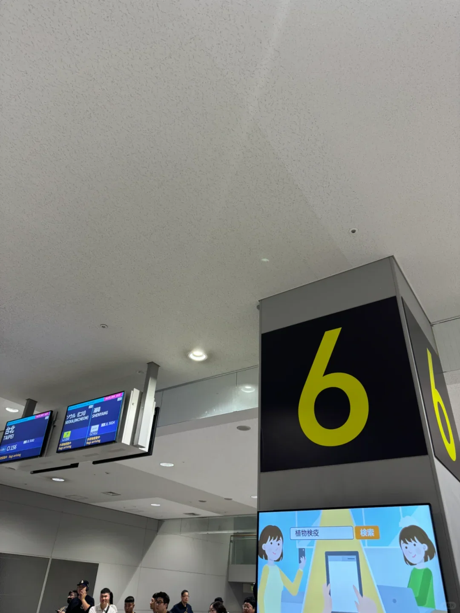

Uwanja wa Ndege wa Kimataifa wa Kansai (KIX) hupitisha abiria haraka kuliko malango mengi ya Japani, lakini kuwasili kwa mara ya kwanza bado hukwama kwenye mambo machache yale yale: kama matangazo yamewasilishwa, mashine ipi inachukua alama ya kidole, carousel ipi ni yako, wapi pa kwenda ukishapita, na jinsi ya kurudi mapema kwa ndege ya kurudi nyumbani.

Mwongozo huu unapitia pande zote mbili kwa mpangilio na unakaa kwenye mchakato wenyewe — hakuna kulinganisha usafiri. Kwa kuingia Kyoto au Osaka, angalia [mwongozo wa JR HARUKA](/blog/kansai-airport-haruka-kyoto-guide) na [mwongozo wa kuwasili uwanja wa ndege wa Kansai](/blog/kansai-airport-arrival-guide). Taratibu hubadilika, kwa hiyo angalia kile uwanja wa ndege na mamlaka za Japani zinachapisha kabla ya kusafiri.

## 1. Kabla ya kutua: wasilisha matangazo yote mawili

Kuingia Japani kuna sehemu mbili: uhamiaji na forodha. Njia rahisi ni Visit Japan Web, inayojazwa kabla ya kusafiri, ambayo hutoa misimbo ya QR kwa zote mbili — ipige picha za skrini na uihifadhi kwenye ghala la picha. Uwasilishaji mmoja unaweza kuhusu familia inayosafiri nawe, na hutakuwa ukisaka mtandao kwenye foleni.

Bila hiyo, omba kadi ya kuwasili ya karatasi ndani ya ndege au jaza moja kwenye madawati ya ukumbi wa kuwasili. Mashirika mengine ya ndege hayatoi tena fomu za karatasi na huonyesha msimbo wa QR baada ya kupanda — jambo gumu bila data, kwa hiyo wasilisha mapema. Hifadhi misimbo tofauti: Wi-Fi ya uwanja wa ndege huja na huenda, na kuipakia moja kwa moja hakutegemewi.

## 2. Kutoka ndegani hadi uhamiajini: kizuizi cha afya, alama za vidole na picha

Fuata alama za 国際線 到着 / International Arrivals. Ndege nyingi za T1 huwasili kupitia daraja la kuingia ndegani; eneo la mbali linamaanisha safari ya bus ya dakika mbili au tatu. T2 ni jengo tofauti lenye mwendo mfupi wa kutembea.

Kituo cha kwanza ni kizuizi cha afya na kipimo cha joto, ambacho kinaweza kuhitaji tangazo la afya kulingana na kanuni zilizopo. Kisha huja mashine za kujihudumia: weka ukurasa wa picha wa pasipoti yako kwenye kifaa cha kusoma, fuata maelekezo ili kupiga picha yako na kurekodi alama za vidole. Skrini zina Kiingereza na wahudumu wapo kila wakati. Ukiwa na watoto, au alama ya kidole isiyosomeka, tumia njia yenye wahudumu.

Hapa ndipo foleni hutokea: ndege kadhaa zinazotua pamoja zinamaanisha dakika ishirini au thelathini, na kuwasili kwa kupishana chini ya kumi.

## 3. Uhamiaji, mizigo na forodha

Madawati ya uhamiaji yamegawanywa kwa hali ya msafiri, na wageni wa kukaa muda mfupi hutumia njia zilizowekwa alama. Kabidhi pasipoti yako na msimbo wa QR, au kadi ya karatasi; afisa kwa kawaida huuliza utakaa muda gani na wapi, huchukua alama ya kidole na akupitishe — dakika kadhaa. Kisha tafuta carousel ya ndege yako kwenye skrini. Mizigo kwa kawaida huchukua dakika 15–25, na mikokoteni ni bure.

Ukiwa na mizigo yako, tumia njia ya hakuna cha kutangaza. KIX hutumia mashine za forodha za kujihudumia: changanua pasipoti, changanua msimbo wa QR, jibu maswali machache, na beba mizigo yako kupitia kituo cha mwisho cha ukaguzi. Ikiwa una kitu cha kutangaza — pombe au tumbaku iliyozidi, nyama, kiasi kikubwa cha fedha taslimu — tumia njia nyekundu na ukiseme kwanza; kujitangaza ni rahisi kuliko kukamatwa.

## 4. Kutoka ukumbini na kupanda hadi treni

Unatokea kwenye ukumbi wa kuwasili wa T1 kwenye ghorofa ya 1. Upande wa kushoto ni ubadilishaji fedha, madawati ya Wi-Fi na SIM na dawati la taarifa za watalii; upande wa kulia, milango ya bus na teksi. Reli iko ghorofa moja juu: panda escalator, vuka njia ya kutembea, na uko kwenye maeneo ya tikiti ya Nankai na JR.

Panga muda hivi: safari isiyo na usumbufu, takriban dakika 50 kutoka mlango wa ndege hadi tikiti ya HARUKA mkononi; ukiwa na kusubiri mizigo kwa muda mrefu, au ndege kadhaa zikitua kwa wakati mmoja, saa moja hadi saa moja na dakika ishirini.

| Hatua | Muda wa kumbukumbu |
| --- | --- |
| Kutoka ndegani hadi uhamiajini | dakika 10–25 |
| Mizigo | dakika 15–25 |
| Forodha hadi toka | dakika 5–10 |
| Toka hadi ghorofa ya reli | dakika 5–8 |

Ikiwa ndege ya ndani inafuata, fuata alama za 国内線乗り継ぎ / Domestic Transfer kurudi juu hadi ghorofa ya kuondoka kwa ndege za ndani baada ya kumaliza. Kama mizigo yako imesafirishwa moja kwa moja inategemea kama ndege zote mbili ziko kwenye tikiti moja; kama sivyo, ichukue na uikague tena, na toa angalau saa mbili.

## 5. Safari ya kurudi: kujiandikisha, dawati la bidhaa zisizo na kodi na ukaguzi wa usalama

Kwa kuondoka kwa ndege ya kimataifa, wasili saa 2.5–3 kabla. Madawati kwa kawaida hufunguliwa takriban saa 2.5 kabla ya ndege na hufungwa karibu saa moja kabla yake, kanuni za shirika zikiruhusu, na katika msimu wa kilele, wikendi na sikukuu za Japani foleni ya usalama huongezeka zaidi ya hapo.

Kujiandikisha hupangwa kwa foleni kwa ndege, na skrini pamoja na wahudumu wa ardhini hukuelekeza. Kisiwa kimoja kinaweza kuhudumia ndege kadhaa kwa wakati mmoja, kwa hiyo soma namba ya ndege na unakoelekea kabla ya kuingia foleni — foleni isiyo sahihi hugharimu muda halisi. Mara tikiti ya kupanda itolewe na begi likaguliwe, elekea mlango wa kuondoka kwa ndege za kimataifa.

Yeyote aliyenunua bidhaa zisizo na kodi nchini Japani ana kituo kimoja zaidi baada ya kuacha mizigo na kabla ya ukaguzi wa usalama: dawati la forodha, ambako mashine ya kujihudumia huchanganua pasipoti yako. Huchukua sekunde, na kuiruka kunaweza kumaanisha kuombwa kulipa kodi ya matumizi unapoondoka. Ukaguzi wa usalama hufuata: vua makoti, vifaa vya kielektroniki na benki za nishati hubaki kwenye begi lako, kila kitu kwenye trei. Mizigo hutoka kwenye mashine ya kupima kupitia moja ya njia mbili — ile ya karibu ikiwa kila kitu kiko sawa, ile ya mbali kando ya wahudumu ikiwa inahitaji kuangaliwa mara ya pili na pengine kukaguliwa.

Uzito wa mizigo ni kikwazo kingine: pima sanduku kwenye dawati na hamishia vitu vizito kwenye mzigo wako wa mkono, au lipa ziada hapo badala ya langoni.

## 6. Udhibiti wa pasipoti na lango: muda kiasi gani wa kuacha

Udhibiti wa pasipoti huja baada ya ukaguzi wa usalama — changanua, piga picha, alama ya kidole, dakika kadhaa — na kisha uko kwenye eneo la bidhaa zisizo na kodi na malango. Kupanda kwa kawaida huanza dakika 30 kabla ya kuondoka na lango hufungwa dakika 10–15 kabla yake, kama shirika linavyotangaza.

Hesabu kwa kurudi nyuma: dakika 20 kutoka eneo la malango hadi kupanda, dakika 40 kwa ukaguzi wa usalama na udhibiti wa pasipoti, dakika 40 kwa kujiandikisha na kuacha mizigo, pamoja na safari ya kufika. Foleni ya polepole basi haigeuki kuwa kukimbia.

Mambo machache yanayowashangaza watu. Ndege zinazoondoka T2 zinahitaji bus ya bure kwanza, kwa hiyo ongeza dakika 15–20 kwa kusubiri na safari. Ukaguzi wa usalama wa msimu wa kilele huchukua muda mara mbili. Vimiminika na visu vilivyo mahali pasipofaa kwenye mzigo wako wa mkono hukugharimu ukaguzi wa begi. Na skrini husasisha lango kwa wakati halisi, kwa hiyo angalia lako ukishapita.

## Viungo vinavyohusiana

- **Kwenye tovuti hii**: [Uwanja wa Ndege wa Kimataifa wa Kansai (KIX)](/airport/KIX), [Japani (JP)](/country/JP)
- **Makala zaidi**: [Kutoka Uwanja wa Ndege wa Kansai hadi Kyoto kwa JR HARUKA](/blog/kansai-airport-haruka-kyoto-guide), [Mwongozo wa kuwasili uwanja wa ndege wa Kansai](/blog/kansai-airport-arrival-guide), [Saa yako ya kwanza kwenye Uwanja wa Ndege wa Kansai](/blog/kansai-airport-transport-sim-card)
- **Wikipedia**: [Uwanja wa Ndege wa Kimataifa wa Kansai](https://en.wikipedia.org/wiki/Kansai_International_Airport)
- **Baidu Baike**: [Uwanja wa Ndege wa Kimataifa wa Kansai](https://baike.baidu.com/item/%E5%85%B3%E8%A5%BF%E5%9B%BD%E9%99%85%E6%9C%BA%E5%9C%BA)

Kanuni za kuingia na forodha, muda wa kujiandikisha na ukaguzi wa usalama hufuata machapisho ya serikali ya Japani na Uwanja wa Ndege wa Kansai; kinachotokea siku husika ndicho chenye nguvu. Sifa ya picha: imeandaliwa kutokana na nyenzo za umma.
