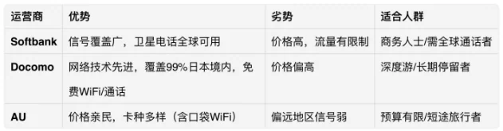

জাপানে বেশিরভাগ প্রথম ভ্রমণে কানসাই আন্তর্জাতিক বিমানবন্দর (KIX) থেকেই দেশটি শুরু হয়, আর বিমান থামার পরের এক ঘণ্টাই গতি ঠিক করে দেয়: ঘোষণাপত্র জমা দেওয়া হলো কি না, ফোনে ডেটা আছে কি না, আপনি কোন লাইনে দাঁড়াবেন এবং শেষে কোন ট্রেনে উঠবেন।

এই গাইডটি সেই এক ঘণ্টাকে ক্রমানুসারে ধরে এগোয় — **প্রস্তুতি**, **সিম কার্ড**, **আগমন সম্পন্ন করা**, **টার্মিনালের মধ্যে যাতায়াত**, **শহর** এবং **ICOCA** — একটি চেকলিস্ট হিসেবে, টার্মিনালের আরেকটি বিবরণ হিসেবে নয়। ভাড়া ও সময়সূচি বদলায়, তাই অপারেটরদের নিজেদের সাইটে দেখে নিন।

## 1. ওড়ার আগে: Visit Japan Web ও আগমন কার্ড

ইমিগ্রেশন আগেই অথবা মাটিতে নামার পর সামলানো যায়; পার্থক্য কেবল লাইনে কতক্ষণ দাঁড়াতে হবে তা নিয়ে।

- **আগেই জমা দিন।** ওঠার আগে অফিসিয়াল Visit Japan Web সাইটে আপনার আগমনের বিবরণ পূরণ করুন, সিস্টেম একটি QR কোড দেবে; কাস্টমসে সেটি স্ক্যান করলে লাইনের একটা বড় অংশ এড়ানো যায়।
- **বিমানে বসে পূরণ করুন।** আগে জমা না দিলে কেবিন ক্রুদের কাছে আগমন কার্ড চান এবং নাম, পাসপোর্ট নম্বর ও ফ্লাইট নম্বর লিখুন। আগমন কার্ড প্রত্যেকের জন্য একটি; কাস্টমস ঘোষণাপত্র দলপ্রতি একটি।
- **নেমে স্ক্যান করে জমা দিন।** দেরিতে নামলে লাইনে দাঁড়িয়ে ফোনে সব পূরণ করতে পারেন, তবে অনলাইনে যেতে জাপানি সিম আগেই ঢোকানো থাকতে হবে।

তিনটির মধ্যে আগে জমা দেওয়াই সবচেয়ে সহজ, বিশেষত যখন একসঙ্গে কয়েকটি ফ্লাইট নামে। জমা দেওয়াটি দুটি আলাদা বিষয় কভার করে — ইমিগ্রেশন ও কাস্টমস — তাই মাঝপথে পেজ বন্ধ করবেন না। QR কোডগুলো সেভ করুন বা স্ক্রিনশট নিন: বিমানবন্দরের ওয়াই-ফাই আসে-যায়।

## 2. সিম কার্ড বাছাই

তিনটি বড় অপারেটর মূলত কভারেজ, দাম এবং আপনার কলের প্রয়োজন আছে কি না — এই বিষয়গুলোতে আলাদা।

| অপারেটর | শক্তি | দুর্বলতা | কাদের জন্য উপযুক্ত |
| --- | --- | --- | --- |
| Softbank | বিস্তৃত কভারেজ; স্যাটেলাইট ফোন বিশ্বজুড়ে কাজ করে | ব্যয়বহুল; সীমিত ডেটা | যেসব ব্যবসায়িক ভ্রমণকারীর বিশ্বব্যাপী কল দরকার |
| Docomo | উন্নত নেটওয়ার্ক, জাপানের প্রায় 99% এলাকা কভার, বিনামূল্যে ওয়াই-ফাই ও কল অন্তর্ভুক্ত | বেশ খরচসাপেক্ষ | দীর্ঘ অবস্থান ও গভীর ভ্রমণ |
| AU | সস্তা, পকেট ওয়াই-ফাইসহ নানা ধরনের প্ল্যান | প্রত্যন্ত এলাকায় দুর্বল সিগন্যাল | স্বল্প বাজেটে ছোট ভ্রমণ |

যুক্তিটি সহজ: শহরের ছোট ভ্রমণে সস্তা অপশন নেওয়া যায়, আর গ্রামাঞ্চল বা ফোনে বুকিংয়ের ক্ষেত্রে দামের চেয়ে কভারেজকে আগে রাখতে হয়। প্ল্যান প্রায়ই বদলায়, তাই প্রতিটি অপারেটরের সাইট দেখুন।

কানসাইয়ের আগমন লেভেলে ওয়াই-ফাই ভাড়া ও সিম কার্ডের কাউন্টার আছে, তাই নেমে কেনা সম্ভব; তবে ম্যাপের ওপর নির্ভর করলে আগে কেনা কার্ড বেশি নিশ্চিন্ত — ইমিগ্রেশনের লাইনে দাঁড়ানোর সময়ই সেটি ঢুকিয়ে সংযোগ পরীক্ষা করে নিতে পারেন।

## 3. আগমন সম্পন্ন করা: T1 বনাম T2

কানসাইয়ের দুটি টার্মিনাল সুবিধা ও পরিবহনে এতটাই আলাদা যে আপনার ফ্লাইট কোনটি ব্যবহার করে তা জানা দরকার।

### টার্মিনাল 1 (পূর্ণ-সেবা এয়ারলাইনস)

- **এয়ারলাইনস:** All Nippon Airways (ANA), Japan Airlines (JAL), Cathay Pacific এবং অন্যান্য।
- **সুবিধা:** ডিউটি-ফ্রি দোকান ও রেস্তোরাঁ, তবে ব্যস্ত সময়ে নিরাপত্তা তল্লাশিতে লম্বা লাইন — ওড়ার প্রায় 2.5 ঘণ্টা আগে পৌঁছান।
- **আগমনের প্রক্রিয়া:** কিছু ফ্লাইটে প্রথমে 2 মিনিটের শাটলে টার্মিনালে যেতে হয়; তারপর ফিঙ্গারপ্রিন্ট ও আগমন কার্ড (প্রত্যেকে একটি) → পাসপোর্ট ও কাস্টমস ঘোষণাপত্র (দলপ্রতি একটি) → ব্যাগেজ → "কিছু ঘোষণা করার নেই" চ্যানেল।
- **ব্যাগেজ:** দূরের স্ট্যান্ডে বিমান থাকলে বাসে যাওয়া-আসার জন্য 20 মিনিটের বাফার ধরে নিন।

### টার্মিনাল 2 (কম-খরচের এয়ারলাইনস)

- **এয়ারলাইনস:** Peach, Spring Airlines এবং অন্যান্য।
- **সুবিধা:** কম ডিউটি-ফ্রি দোকান ও সীমিত খাবার, তবে আগমন দ্রুত — 15 মিনিটের মধ্যে শেষ।
- **ব্যাগেজ:** সরাসরি কনভেয়ার বেল্টে, শাটল বাস নেই।

মোটামুটি একটি নিয়ম: কম লাগেজ নিয়ে তাড়াহুড়ো থাকলে T2 সত্যিই দ্রুত, কিন্তু পরিবহনের অপশন কম — শহরে যেতে হলে বাস, নয়তো T1-এ ফিরতে হবে। T1 থেকে বেরোতে বেশি সময় লাগে, তবে ট্রেন একই ভবনে। T2-এর আন্তর্জাতিক পরিচালনা ছোট, তাই কনভেয়ারও কাছে — শিশুদের সঙ্গে ভ্রমণে যা গুরুত্বপূর্ণ।

## 4. T2 থেকে T1: বিনামূল্যের শাটল বাস

T2-এ নেমে ট্রেন নেওয়ার পরিকল্পনা থাকলে আপনার প্রথম কাজ বিনামূল্যের শাটল বাস।

- **কত ঘন ঘন:** প্রতি 5–10 মিনিটে, যাত্রা প্রায় 5 মিনিট, পথে একটি হ্রদ পড়ে।
- **নামার পর:** T1-এ লেভেল 2-এ উঠে কেন্দ্রীয় হলের (সেখানে একটি Lawson আছে) ভেতর দিয়ে ওয়াকওয়ে পেরিয়ে রেলওয়ে টিকিট এলাকায় যান।

এখানে দুটি জায়গায় ভুল হয়। শাটলের সময় খুব টানটান করবেন না: 5 মিনিটের যাত্রা, সঙ্গে অপেক্ষা ও ব্যাগ তোলানামা মিলিয়ে 15–20 মিনিট লাগে। আর T1-এ নিচতলায় স্টেশন খুঁজবেন না — টিকিট এলাকা লেভেল 2-এ।

## 5. শহরে ঢোকা: ট্রেন, বাস ও ট্যাক্সি

আগে ঠিক করুন কোথায় ঘুমাবেন: নান্বা ও শিনসাইবাশি মানে নানকাই লাইন, কিয়োটো ও শিন-ওসাকা মানে JR, আর নারা, কোবে বা ইউনিভার্সাল স্টুডিওজ মানে বাস।

### Nankai Rapi:t লিমিটেড এক্সপ্রেস

- **রুট:** কানসাই বিমানবন্দর → নান্বা, প্রায় 38 মিনিট; শিনসাইবাশি ও কুরোমন মার্কেট দুটিই নান্বার আশপাশে।
- **ভাড়া:** একপথে প্রায় ¥1,450, অপারেটরের সাইটে আগে কিনলে প্রায় ¥1,100।
- **কেন:** সবচেয়ে দ্রুত অপশন, আর কেনাকাটার উদ্দেশ্যে এলে এটি স্বাভাবিক পছন্দ।

### JR HARUKA লিমিটেড এক্সপ্রেস

- **রুট:** কানসাই বিমানবন্দর → তেননোজি প্রায় 26 মিনিটে, এরপর শিন-ওসাকা ও কিয়োটো পর্যন্ত।
- **ভাড়া:** JR West তাদের নিজস্ব সাইটে যা প্রকাশ করে তা-ই; বিদেশি দর্শনার্থীরা ডিসকাউন্ট টিকিট কিনতে পারেন।
- **কেন:** আরামদায়ক আসন, আর বারবার ট্রেন বদলাতে না চাইলে ভারী লাগেজের সঙ্গে ভালো মানায়।

একটি বিষয় ঠিকভাবে জানা দরকার, কারণ এ নিয়ে অনেক বিভ্রান্তি আছে: **HARUKA উমেদা বা ওসাকা স্টেশনে যায় না।** এটি তেননোজি, শিন-ওসাকা ও কিয়োটো পর্যন্ত চলে; উমেদা ও ওসাকা স্টেশনের জন্য শিন-ওসাকা বা তেননোজিতে বদলাতে হবে, আর বদল ও অপেক্ষার সময় আপনার হিসাবে ধরতে হবে।

### বিমানবন্দর বাস

- **লিমোজিন বাস:** T1 ও T2 → নান্বা OCAT, প্রায় 45 মিনিট, একপথে প্রায় ¥1,300, পথে শিনসাইবাশি ও উমেদায় থামে।
- **নানকাই বাস:** T1 ও T2 → তেনগাচায়া স্টেশন, প্রায় 40 মিনিট, একপথে প্রায় ¥980।

### ট্যাক্সি

- **খরচ:** নান্বা পর্যন্ত প্রায় ¥12,000, উমেদা পর্যন্ত প্রায় ¥15,000।
- **কখন:** কেবল দেরিতে আগমন বা অযৌক্তিক পরিমাণ লাগেজের ক্ষেত্রে।

## 6. ICOCA এবং মাটিতে শেখা কয়েকটি বিষয়

ICOCA হলো কানসাইজুড়ে — মেট্রো, JR ও বাসে — চলে এমন পরিবহন কার্ড, যা প্রতিবার টিকিট কেনার ঝামেলা থেকে মুক্তি দেয়। কন্ট্যাক্টলেস Visa কার্ডও সামান্য ছাড়ে গেট খোলে, তবে কার্ডটি স্মারক হিসেবেও ভালো: Astro Boy ও Hello Kitty সংস্করণের সংগ্রাহক আছে।

### একটি কেনা

- **কর্মী থাকা কাউন্টারে:** লেভেল 2-এর JR টিকিট অফিস, বা নানকাই টিকিট কাউন্টার — দুটিতেই চাইনিজ ভাষী কর্মী আছেন। খরচ ¥500 ডিপোজিট এবং আপনি যত টাকা লোড করবেন, যেমন ¥2,000।
- **টিকিট মেশিনে:** কার্ডের ধরন বাছুন → লোড করার অঙ্ক বাছুন → নগদ বা ক্রেডিট কার্ডে পরিশোধ করুন → কার্ড নিন।

**রিফান্ড:** ডিপোজিট ও রিফান্ডের নিয়ম কেনার সময় JR West যা প্রকাশ করে তা-ই, এবং সাম্প্রতিক বছরগুলোতে সেগুলো বদলেছে; আগে কাউন্টারে ব্যালেন্স ও কোনো ফি আছে কি না নিশ্চিত করুন। রিফান্ড সাধারণত কানসাইয়ের ভেতরেই সামলানো হয়। ব্যালেন্স কমে গেলে গেট আটকে দেয়, তাই নতুন টিকিট কেনার বদলে ভাড়া মেশিন বা কনভিনিয়েন্স স্টোরে টপ আপ করুন।

কিছু নোট:

- **ভাষা:** বিমানবন্দর, স্টেশন ও পর্যটন এলাকায় চাইনিজ সাইনবোর্ড আছে, আর Google Translate কাজের ব্যাকআপ।
- **দেরিতে আগমন:** শেষ ট্রেন প্রায় 23:43; সেটি মিস করলে বিমানবন্দর বাস আর ট্যাক্সির মধ্যে বাছতে হবে।
- **লাগেজ:** T2 দ্রুত খালি হয়, যা টানটান সময়সূচিতে সুবিধাজনক; T1-এ পরিবহনের সংযোগ ভালো।

## সম্পর্কিত লিংক

- **এই সাইটে**: [কানসাই আন্তর্জাতিক বিমানবন্দর (KIX)](/airport/KIX), [জাপান (JP)](/country/JP)
- **Wikipedia**: [কানসাই আন্তর্জাতিক বিমানবন্দর](https://en.wikipedia.org/wiki/Kansai_International_Airport), [ICOCA](https://en.wikipedia.org/wiki/ICOCA)
- **Baidu Baike**: [কানসাই আন্তর্জাতিক বিমানবন্দর](https://baike.baidu.com/item/%E5%85%B3%E8%A5%BF%E5%9B%BD%E9%99%85%E6%9C%BA%E5%9C%BA)
- **অফিসিয়াল সাইট**: [Visit Japan Web](https://services.digital.go.jp/en/visit-japan-web/)

ছবির উৎস: প্রকাশ্য উপকরণ থেকে সংকলিত। প্রবেশের নিয়ম, ভাড়া, সময়সূচি ও পরিবহন কার্ডের শর্ত বিমানবন্দর ও অপারেটররা যা প্রকাশ করে তা-ই; ভ্রমণের দিন তাদের ওয়েবসাইট দেখে নিন।
