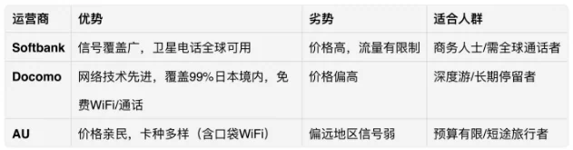

Pour la plupart des premiers voyages au Japon, l'aéroport international du Kansai (KIX) est là où le pays commence, et l'heure qui suit l'arrêt de l'avion donne le rythme : la déclaration est-elle remplie, votre téléphone a-t-il des données, dans quelle file vous mettez-vous et dans quel train finissez-vous.

Ce guide déroule cette heure dans l'ordre — **préparation**, **cartes SIM**, **passage de l'arrivée**, **déplacement entre terminaux**, **la ville** et **ICOCA** — sous forme de liste de vérification, et non d'une énième description de terminal. Les tarifs et les horaires changent : consultez les sites des opérateurs.

## 1. Avant de partir : Visit Japan Web et la carte d'arrivée

L'immigration peut se préparer à l'avance ou sur place ; la différence, c'est le temps passé à faire la queue.

- **Remplir à l'avance.** Saisissez vos informations d'arrivée sur le site officiel Visit Japan Web avant l'embarquement et le système délivre un QR code ; scannez-le à la douane pour sauter une bonne partie de la file.
- **Remplir dans l'avion.** Sans saisie préalable, demandez une carte d'arrivée à l'équipage et inscrivez votre nom, votre numéro de passeport et votre numéro de vol. La carte d'arrivée est individuelle ; la déclaration de douane est une par groupe.
- **Scanner et remplir à l'arrivée.** Si vous atterrissez tard, vous pouvez tout remplir sur votre téléphone en faisant la queue, mais il faut déjà avoir une SIM japonaise insérée pour avoir du réseau.

Des trois, la saisie anticipée est la plus simple, surtout quand plusieurs vols atterrissent en même temps. La saisie couvre deux choses distinctes — l'immigration et la douane —, alors ne fermez pas la page à moitié. Enregistrez ou capturez d'écran les QR codes : le Wi-Fi de l'aéroport va et vient.

## 2. Choisir une carte SIM

Les trois grands opérateurs diffèrent surtout par la couverture, le prix et le besoin ou non de passer des appels.

| Opérateur | Points forts | Points faibles | Idéal pour |
| --- | --- | --- | --- |
| Softbank | Couverture étendue ; les téléphones satellite fonctionnent partout dans le monde | Cher ; données limitées | Voyageurs d'affaires ayant besoin d'appels internationaux |
| Docomo | Réseau avancé, couvre environ 99 % du Japon, Wi-Fi gratuit et appels inclus | Plutôt cher | Longs séjours et voyages approfondis |
| AU | Moins cher, large choix de forfaits dont le pocket Wi-Fi | Signal faible dans les zones reculées | Courts séjours à petit budget |

La logique est simple : un court séjour en ville peut se contenter de l'option bon marché, tandis que la campagne ou les réservations par téléphone font passer la couverture avant le prix. Les forfaits changent souvent : consultez le site de chaque opérateur.

Le niveau des arrivées du Kansai dispose de comptoirs de location de Wi-Fi et de cartes SIM : acheter en atterrissant est possible ; mais si vous dépendez des cartes, une carte achetée à l'avance est plus tranquille — le temps d'attente à l'immigration est le bon moment pour l'insérer et tester la connexion.

## 3. Passer l'arrivée : T1 contre T2

Le Kansai a deux terminaux qui diffèrent assez par les équipements et les transports pour qu'il vaille la peine de savoir lequel sert votre vol.

### Terminal 1 (compagnies classiques)

- **Compagnies :** All Nippon Airways (ANA), Japan Airlines (JAL), Cathay Pacific et d'autres.
- **Équipements :** boutiques duty-free et restaurants, mais longues files à la sûreté aux heures de pointe — arrivez environ 2 h 30 avant le départ.
- **Parcours d'arrivée :** sur certains vols, une navette de 2 minutes vous amène d'abord au terminal ; puis empreintes et carte d'arrivée (une par personne) → passeport et déclaration de douane (une par groupe) → bagages → le couloir « rien à déclarer ».
- **Bagages :** si l'avion est garé en poste éloigné, le trajet en bus impose de prévoir 20 minutes de marge.

### Terminal 2 (compagnies low-cost)

- **Compagnies :** Peach, Spring Airlines et d'autres.
- **Équipements :** moins de boutiques duty-free et offre de restauration limitée, mais l'arrivée est rapide — terminée en 15 minutes.
- **Bagages :** directement au tapis roulant, sans navette.

Règle approximative : pressé et peu chargé, le T2 est vraiment plus rapide, mais il offre moins de transports — rejoindre la ville suppose un bus ou un retour au T1. Le T1 est plus long à passer, mais les trains sont dans le bâtiment. L'activité internationale du T2 est réduite, donc le tapis roulant est proche aussi, ce qui compte quand on voyage avec des enfants.

## 4. Du T2 au T1 : la navette gratuite

Si vous atterrissez au T2 et comptez prendre le train, votre première tâche est la navette gratuite.

- **Fréquence :** toutes les 5 à 10 minutes, pour un trajet d'environ 5 minutes qui longe un lac en chemin.
- **À la descente :** au T1, montez au niveau 2, entrez dans le hall central (il y a un Lawson) et traversez la passerelle vers les guichets ferroviaires.

Deux erreurs classiques ici. Ne rognez pas trop sur la navette : 5 minutes de trajet plus l'attente et le chargement des bagages demandent 15 à 20 minutes. Et ne cherchez pas la gare au rez-de-chaussée du T1 — les guichets sont au niveau 2.

## 5. Vers la ville : trains, bus et taxis

Décidez d'abord où vous dormez : Namba et Shinsaibashi, c'est la ligne Nankai ; Kyoto et Shin-Osaka, c'est JR ; Nara, Kobe ou Universal Studios, c'est le bus.

### Limited express Nankai Rapi:t

- **Trajet :** aéroport du Kansai → Namba, environ 38 minutes ; Shinsaibashi et le marché Kuromon sont tous deux autour de Namba.
- **Tarif :** environ 1 450 ¥ l'aller simple, ou environ 1 100 ¥ acheté à l'avance sur le site de l'opérateur.
- **Pourquoi :** l'option la plus rapide, et l'évidence si vous venez pour faire du shopping.

### Limited express JR HARUKA

- **Trajet :** aéroport du Kansai → Tennoji en 26 minutes environ, puis Shin-Osaka et Kyoto.
- **Tarif :** selon les publications de JR West sur son site ; les visiteurs étrangers peuvent acheter un billet à tarif réduit.
- **Pourquoi :** des sièges confortables, et un bon choix avec de gros bagages si vous préférez éviter les changements répétés.

Un point à retenir, car il prête souvent à confusion : **le HARUKA ne dessert pas Umeda ni la gare d'Osaka.** Il va à Tennoji, Shin-Osaka et Kyoto ; pour Umeda et la gare d'Osaka, vous changez à Shin-Osaka ou à Tennoji, et la correspondance et l'attente font partie de votre temps de trajet.

### Bus de l'aéroport

- **Bus limousine :** T1 et T2 → Namba OCAT, environ 45 minutes, environ 1 300 ¥ l'aller simple, avec arrêt à Shinsaibashi et Umeda en chemin.
- **Bus Nankai :** T1 et T2 → gare de Tengachaya, environ 40 minutes, environ 980 ¥ l'aller simple.

### Taxis

- **Coût :** environ 12 000 ¥ pour Namba, environ 15 000 ¥ pour Umeda.
- **Quand :** seulement pour une arrivée tardive ou une quantité déraisonnable de bagages.

## 6. ICOCA et quelques leçons du terrain

ICOCA est la carte de transport qui fonctionne dans tout le Kansai — métro, JR et bus — et supprime la corvée d'acheter un billet à chaque trajet. Une carte Visa sans contact ouvre aussi les portillons avec une petite réduction, mais la carte est un meilleur souvenir : les éditions Astro Boy et Hello Kitty ont leurs collectionneurs.

### L'acheter

- **Au guichet avec personnel :** le comptoir de vente JR du niveau 2, ou le guichet Nankai, tous deux avec du personnel parlant chinois. Le coût est une caution de 500 ¥ plus le montant chargé, par exemple 2 000 ¥.
- **À la borne :** choisissez le type de carte → choisissez le montant à charger → payez en espèces ou par carte bancaire → prenez la carte.

**Remboursements :** les règles de caution et de remboursement sont celles publiées par JR West au moment de l'achat, et elles ont changé ces dernières années ; vérifiez d'abord le solde et les éventuels frais au guichet. Les remboursements se font généralement dans le Kansai. Si le solde est insuffisant, le portillon vous bloque : rechargez à une borne ou dans un konbini plutôt que d'acheter un nouveau billet.

Quelques notes :

- **Langue :** les aéroports, les gares et les zones touristiques ont une signalétique en chinois, et Google Translate est un recours utile.
- **Arrivées tardives :** le dernier train est vers 23:43 ; si vous le manquez, il vous reste le bus de l'aéroport ou le taxi.
- **Bagages :** le T2 est plus rapide à passer, ce qui convient à un programme serré ; le T1 est mieux relié pour les transports.

## Liens utiles

- **Sur ce site** : [Aéroport international du Kansai (KIX)](/airport/KIX), [Japon (JP)](/country/JP)
- **Wikipédia** : [Aéroport international du Kansai](https://en.wikipedia.org/wiki/Kansai_International_Airport), [ICOCA](https://en.wikipedia.org/wiki/ICOCA)
- **Baidu Baike** : [Aéroport international du Kansai](https://baike.baidu.com/item/%E5%85%B3%E8%A5%BF%E5%9B%BD%E9%99%85%E6%9C%BA%E5%9C%BA)
- **Site officiel** : [Visit Japan Web](https://services.digital.go.jp/en/visit-japan-web/)

Source des images : compilé à partir de sources publiques. Les règles d'entrée, tarifs, horaires et conditions des cartes de transport sont celles publiées par l'aéroport et les opérateurs ; consultez leurs sites le jour du départ.
