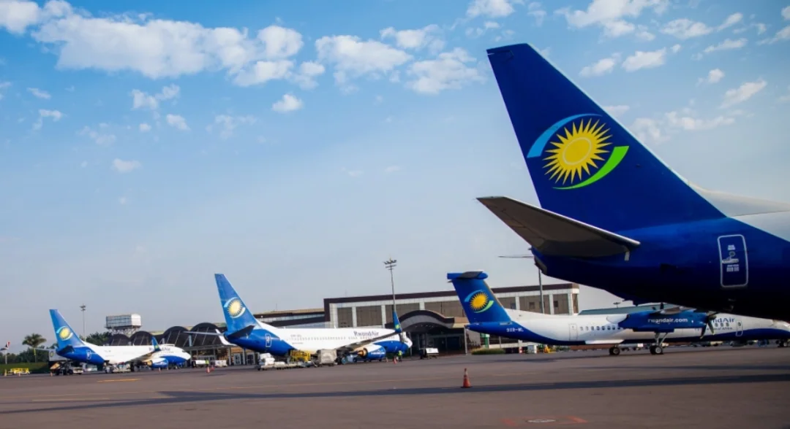

สนามบินนานาชาติคิกาลี (KGL) ติดอันดับ 3 ของแอฟริกาในงาน Skytrax World Airport Awards 2026 เป็นรองเพียงสนามบินมาร์ราเกช เมนาราในโมร็อกโกและสนามบินนานาชาติคิงชากาในแอฟริกาใต้ สำหรับสนามบินที่ถูกศูนย์กลางภูมิภาคขนาดใหญ่บดบังมานาน ตำแหน่งนี้คือสิ่งที่ผู้เดินทางต่างชาติมองเห็นได้จริง

คิกาลีเป็นประตูหลักของรวันดาและฐานของ RwandAir การก้าวขึ้นมาไม่ใช่เรื่องบังเอิญ เพราะหลายปีที่ผ่านมาประเทศยังลงทุนในโครงสร้างพื้นฐานด้านการบินและการบริการอย่างต่อเนื่อง ทั้งปรับการไหลของผู้โดยสารให้ราบรื่น เพิ่มประสิทธิภาพการบริการ และปรับปรุงสภาพอาคารผู้โดยสาร ต่อไปนี้จะอธิบายว่าคิกาลีอยู่ในตารางแอฟริกาตรงไหน สกายแทรกซ์ได้ผลลัพธ์มาอย่างไร และอันดับนี้มีความหมายอย่างไรต่อผู้เดินทางและการแข่งขันระหว่างศูนย์กลางการบินในแอฟริกา

## อันดับ 3 ของแอฟริกา: คิกาลีอยู่ตรงไหน

| อันดับ | สนามบิน | ประเทศ |
| --- | --- | --- |
| 1 | มาร์ราเกช เมนารา | โมร็อกโก |
| 2 | คิงชากา อินเตอร์เนชันแนล | แอฟริกาใต้ |
| 3 | คิกาลี อินเตอร์เนชันแนล | รวันดา |

พิธีมอบรางวัลจัดขึ้นที่ลอนดอนเมื่อวันที่ 18 มีนาคม โดยรวมผู้เล่นหลักของอุตสาหกรรมไว้ด้วยกัน นอกเหนือจากสามอันดับแรก สิบอันดับของแอฟริกาที่ระบุในผลรางวัลยังรวมถึงพอร์ตเอลิซาเบธ บลูมฟอนเทน และอีสต์ลอนดอนในแอฟริกาใต้ เอ็นเทบเบในยูกันดา อันตานานารีโวในมาดากัสการ์ ราบัตในโมร็อกโก และลูอันดาในแองโกลา

สนามบินเหล่านี้มีสิ่งหนึ่งที่เหมือนกัน คือส่วนใหญ่เป็นประตูของประเทศตนเองมากกว่าจะเป็นศูนย์กลางเปลี่ยนเครื่องระดับทวีป การที่คิกาลีจบที่อันดับ 3 หมายความว่าในมาตรวัดที่สำคัญที่นี่ — ประสบการณ์จริงของผู้เดินทางที่มีต่อสนามบิน — คิกาลีได้คะแนนสูงกว่าสนามบินหลายแห่งที่มีเครือข่ายใหญ่กว่า

## การจัดอันดับเกิดขึ้นได้อย่างไร

รางวัล Skytrax World Airport Awards ได้รับการยอมรับอย่างกว้างขวางว่าเป็นหนึ่งในการจัดอันดับที่น่าเชื่อถือที่สุดของอุตสาหกรรม และผลลัพธ์มาจากการสำรวจความพึงพอใจของผู้โดยสารประจำปีที่ใหญ่ที่สุดในโลก ต่างจากรางวัลที่ตัดสินโดยคณะกรรมการ ผลลัพธ์ที่นี่ตัดสินจากคะแนนของผู้โดยสารทั้งหมด

ตามข้อมูลของสกายแทรกซ์ การสำรวจปี 2026 จัดขึ้นระหว่างเดือนสิงหาคม 2025 ถึงกุมภาพันธ์ 2026 และรวบรวมคำตอบจากผู้เดินทางในมากกว่า 100 ประเทศ การสำรวจครอบคลุมประสบการณ์ทั้งสนามบิน ตั้งแต่เช็คอิน ความปลอดภัย ตรวจคนเข้าเมือง การช้อปปิ้ง การเปลี่ยนเครื่อง ไปจนถึงขึ้นเครื่อง รางวัลนี้จัดมาตั้งแต่ปี 1999 และสนามบินไม่ได้เข้าร่วมกระบวนการหรือมีอิทธิพลต่อผลลัพธ์ ซึ่งเป็นเหตุผลที่การจัดอันดับนี้ถูกอ้างถึงบ่อยครั้ง

สำหรับผู้เดินทาง ความหมายในทางปฏิบัติเรียบง่าย: อันดับคือคะแนนที่ผู้โดยสารทั่วไปให้ในการเดินทางจริง ไม่ใช่ความประทับใจของคณะกรรมการตัดสิน

## ผลลัพธ์บอกอะไรเกี่ยวกับการลงทุนของรวันดา

สื่อท้องถิ่นตีความผลของคิกาลีเป็นหลักฐานของการพัฒนาที่ชัดเจนในการบริหารและให้บริการสนามบินของรวันดา และเป็นผลตอบแทนจากกลยุทธ์การสร้างศูนย์กลางการบินระดับภูมิภาค การลงทุนในช่วงหลังมุ่งเน้นสามเรื่อง คือปรับการไหลของผู้โดยสารให้ราบรื่น เพิ่มประสิทธิภาพการบริการ และปรับปรุงสภาพอาคารผู้โดยสาร

ทั้งสามเรื่องฟังดูเรียบง่าย แต่สำหรับสนามบินขนาดจำกัด สิ่งเหล่านี้คือสิ่งที่เปลี่ยนความรู้สึกของการเดินทางได้จริง การไหลที่ราบรื่นหมายถึงการเปลี่ยนเครื่องโดยไม่ต้องต่อคิวซ้ำแล้วซ้ำเล่า ประสิทธิภาพการบริการที่ดีขึ้นหมายถึงกระเป๋าและด่านตรวจคนเข้าเมืองไม่กินเวลา และสภาพที่ดีขึ้นหมายถึงที่นั่ง ร้านอาหาร และป้ายที่ชัดเจนในพื้นที่ผู้โดยสารขาออก ศูนย์กลางขนาดใหญ่แก้ปัญหาเหล่านี้ได้พร้อมกันด้วยอาคารผู้โดยสารใหม่ ส่วนสนามบินขนาดจำกัดต้องซื้อสิ่งเหล่านี้ทีละเล็กทีละน้อยผ่านการบริหารจัดการ

## การแข่งขันระหว่างศูนย์กลาง และมาตรฐานชางงี

การแข่งขันระหว่างศูนย์กลางการบินในแอฟริกากำลังคับคั่งขึ้น ทางเหนือ มาร์ราเกชและราบัตยืนหยัดด้วยเที่ยวบินนักท่องเที่ยวและเส้นทางยุโรป ในแอฟริกาใต้ คิงชากา พอร์ตเอลิซาเบธ และอีสต์ลอนดอนรวมกันเป็นกลุ่มประตูภูมิภาค ส่วนแอฟริกาตะวันออก ตลาดเปลี่ยนเครื่องถูกสายการบินไม่กี่แห่งครอบงำมานาน พวกเขาให้บริการผู้โดยสารต่างกลุ่ม แต่ในตารางความพึงพอใจของผู้โดยสารเดียวกัน พวกเขาถูกเปรียบเทียบในกลุ่มเดียวกัน

นอกทวีป ชางงีคือจุดอ้างอิงตามปกติ ในปี 2026 สนามบินชางงีของสิงคโปร์ได้รับการยกย่องเป็นสนามบินที่ดีที่สุดในโลกเป็นครั้งที่ 14 พร้อมรางวัลประเภทอื่น ๆ เช่น อาหารในสนามบินที่ดีที่สุดและสนามบินที่ดีที่สุดในเอเชีย สนามบินที่ครองตำแหน่งสูงสุดได้นานขนาดนั้นไม่ได้ทำด้วยความก้าวหน้าครั้งเดียว แต่ด้วยการรักษาคุณภาพของประสบการณ์ทุกส่วนให้สูงไว้

สำหรับคิกาลี อันดับ 3 ของแอฟริกาเป็นจุดเริ่มต้นมากกว่าจุดหมาย ผู้สังเกตการณ์ในอุตสาหกรรมกล่าวว่าอันดับนี้จะเสริมตำแหน่งของรวันดาบนแผนที่การบินระหว่างประเทศ และช่วยดึงดูดสายการบินและผู้เดินทางเพิ่มขึ้น อีกทั้งการทำงานด้านโครงสร้างพื้นฐานและเครือข่ายเส้นทางอย่างต่อเนื่องอาจเร่งการก้าวสู่สถานะศูนย์กลางภูมิภาคในอีกไม่กี่ปีข้างหน้า

## ความหมายต่อผู้เดินทาง

หากคุณกำลังมุ่งหน้าไปรวันดา หรือเปลี่ยนเครื่องที่คิกาลีไปยังประเทศเพื่อนบ้าน คุณค่าทางปฏิบัติของการจัดอันดับอยู่ที่ความคาดหวัง: คะแนนของผู้โดยสารด้านเช็คอิน ความปลอดภัย ตรวจคนเข้าเมือง และกระเป๋าเดินทาง ทำให้สนามบินแห่งนี้อยู่ในกลุ่มบนของแอฟริกา แต่ไม่ได้หมายความว่าจะมีเที่ยวบินมากขึ้น ค่าโดยสารถูกลง หรือการเปลี่ยนเครื่องสั้นลง

สิ่งที่ตัดสินการเดินทางยังคงเป็นตารางบิน วีซ่าและเอกสารของคุณ และคุณไปถึงสนามบินเร็วแค่ไหน มองการจัดอันดับเป็นตัวกรอง ไม่ใช่คำสัญญา — ซึ่งเป็นวิธีอ่านตารางอันดับสนามบินใด ๆ อย่างถูกต้อง

## ลิงก์ที่เกี่ยวข้อง

- **บนเว็บไซต์นี้**: [แอฟริกาใต้ (ZA)](/country/ZA), [โมร็อกโก (MA)](/country/MA)
- **วิกิพีเดีย**: [Kigali International Airport](https://en.wikipedia.org/wiki/Kigali_International_Airport)
- **Baidu Baike**: [Kigali International Airport](https://baike.baidu.com/item/%E5%9F%BA%E5%8A%A0%E5%88%A9%E5%9B%BD%E9%99%85%E6%9C%BA%E5%9C%BA)

ที่มาภาพ: Kigali Chinese Business News ชื่อรางวัล อันดับ และเกณฑ์เป็นไปตามที่สกายแทรกซ์เผยแพร่ สำหรับเที่ยวบิน วีซ่า และบริการสนามบิน โปรดตรวจสอบช่องทางของสายการบินและสนามบินเอง
