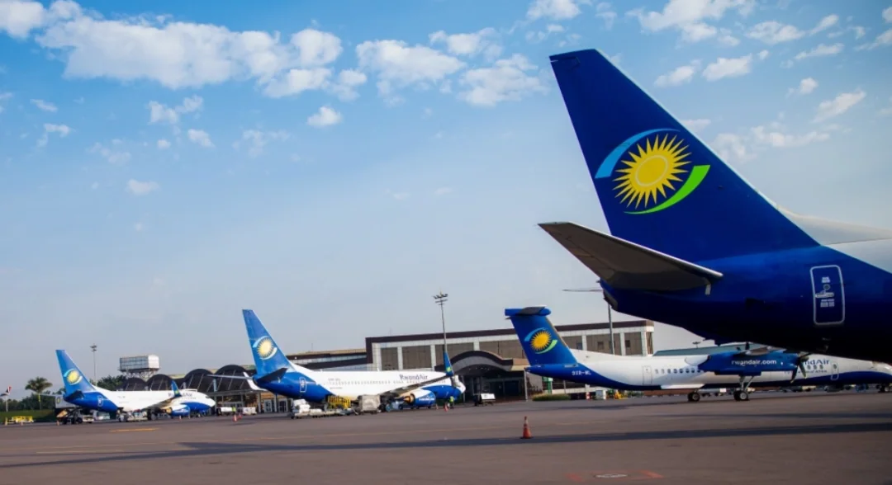

2026 年 Skytrax 世界機場大獎揭曉，盧安達基加利國際機場（KGL）排名非洲第三。排在它前面的是摩洛哥馬拉喀什梅納拉機場和南非沙卡國王國際機場。對一座長期被區域大型樞紐掩蓋的機場來說，這個名次讓國際旅客看得見它。

基加利國際機場是盧安達的主要門戶，也是盧安達航空（RwandAir）的基地。名次的提升並非偶然：過去幾年，盧安達在航空基礎設施和服務體系上持續投入，最佳化旅客流程、提升服務效率、改善機場環境。下面把非洲榜單上的位置、評選的口徑，以及這個名次對旅客和區域競爭的意義分開講。

## 一、非洲第三：榜單上的位置

2026 年非洲區的前三名如下：

| 名次 | 機場 | 國家 |
| --- | --- | --- |
| 1 | 馬拉喀什梅納拉機場 | 摩洛哥 |
| 2 | 沙卡國王國際機場 | 南非 |
| 3 | 基加利國際機場 | 盧安達 |

頒獎典禮於 3 月 18 日在倫敦舉行，全球航空業的主要參與者到場。除前三名外，進入非洲前十的機場還包括南非的伊麗莎白港機場、布隆方丹機場和東倫敦機場，烏干達的恩德培國際機場，馬達加斯加的塔那那利佛機場，摩洛哥的拉巴特機場和安哥拉的羅安達機場。

這份名單有一個共同點：它們大多是各自國家的門戶機場，而不是洲際中轉樞紐。基加利能排到第三，說明在“旅客實際體驗”這條標準上，它拿到的分數高於不少航線網路更完整的同行。

## 二、3 月 18 日的倫敦：榜單怎麼評出來

Skytrax 世界機場大獎被公認為機場行業最具權威性的評選之一，結果基於全球規模最大的年度旅客滿意度調查。與傳統評審機制不同，這個獎項完全由旅客評分決定。

據 Skytrax 介紹，2026 年度的評選調查於 2025 年 8 月至 2026 年 2 月進行，收集了來自 100 多個國家旅客的反饋意見，評估範圍覆蓋旅客在機場的完整體驗：值機、安檢、出入境、購物、轉機以及登機。獎項自 1999 年設立，機場本身既不參與評選過程，也無法對結果產生影響——這一點是它被反覆引用的原因。

對旅客來說，這套機制的含義很直接：名次是普通旅客在真實出行中打出的分數，而不是評審團的印象分。

## 三、排名背後：盧安達的投入

基加利的名次被當地媒體解讀為盧安達機場運營與服務水平顯著提升的證明，也是其打造區域航空樞紐戰略的成效。近年來的投入集中在三件事上：最佳化旅客流程、提升服務效率、改善機場環境。

這三件事聽起來平淡，但對一座規模有限的機場來說，恰恰是最能改變旅客感受的部分。流程最佳化意味著轉機不用反覆排隊，服務效率意味著行李和邊檢不拖時間，環境改善意味著候機區有座位、有餐飲、有清楚的標識。大型樞紐可以用一座新航廈一次性解決這些問題，規模有限的機場只能靠持續的管理投入一點點去換。

## 四、非洲樞紐的競爭

非洲的樞紐競爭正在變得更擁擠。北非的馬拉喀什、拉巴特憑藉旅遊客流和歐洲航線保持存在感；南非的沙卡國王、伊麗莎白港、東倫敦組成一組區域性門戶；東非的中轉市場則長期由少數幾家航空公司主導。它們服務的客流方向不同，但在“旅客滿意度”這張表上被放在同一個池子裡比較。

在同一片大陸之外，樟宜常被當作參照：2026 年，新加坡樟宜機場第 14 次獲評“全球最佳機場”，同時還拿下全球最佳機場餐飲、亞洲最佳機場等多項單項獎。一座機場能長期佔據榜首，靠的不是單點突破，而是把每個環節都維持在高位。

對基加利來說，非洲第三是起點而不是終點。業內人士指出，這個名次將進一步提升盧安達在國際航空版圖中的地位，併為吸引更多航空公司和國際旅客創造條件；隨著基礎設施持續完善、航空網路不斷拓展，盧安達有望在未來幾年加速向區域航空樞紐邁進。

## 五、對旅客意味著什麼

如果你計劃去盧安達，或者經基加利轉機前往周邊國家，這個名次的實際參考價值在於服務預期：值機、安檢、出入境和行李這幾個環節的旅客評價，在非洲屬於上游。它不意味著航班更多、票價更低，也不意味著轉機時間能壓縮。

真正影響行程的仍是航班時刻、簽證與證件，以及你到達機場的時間。把榜單當作一個篩選訊號，而不是承諾——這是讀任何機場排名的正確方式。

## 相關連結

- **本站頁面**：[南非（ZA）](/tw/country/ZA)、[摩洛哥（MA）](/tw/country/MA)
- **維基百科**：[基加利國際機場](https://zh.wikipedia.org/wiki/%E5%9F%BA%E5%8A%A0%E5%88%A9%E5%9B%BD%E9%99%85%E6%9C%BA%E5%9C%BA)

圖片來源：基加利華商資訊報。獎項名稱、名次與評選口徑以 Skytrax 公佈為準；航班、簽證與機場服務資訊，請以航空公司和機場官方渠道為準。
