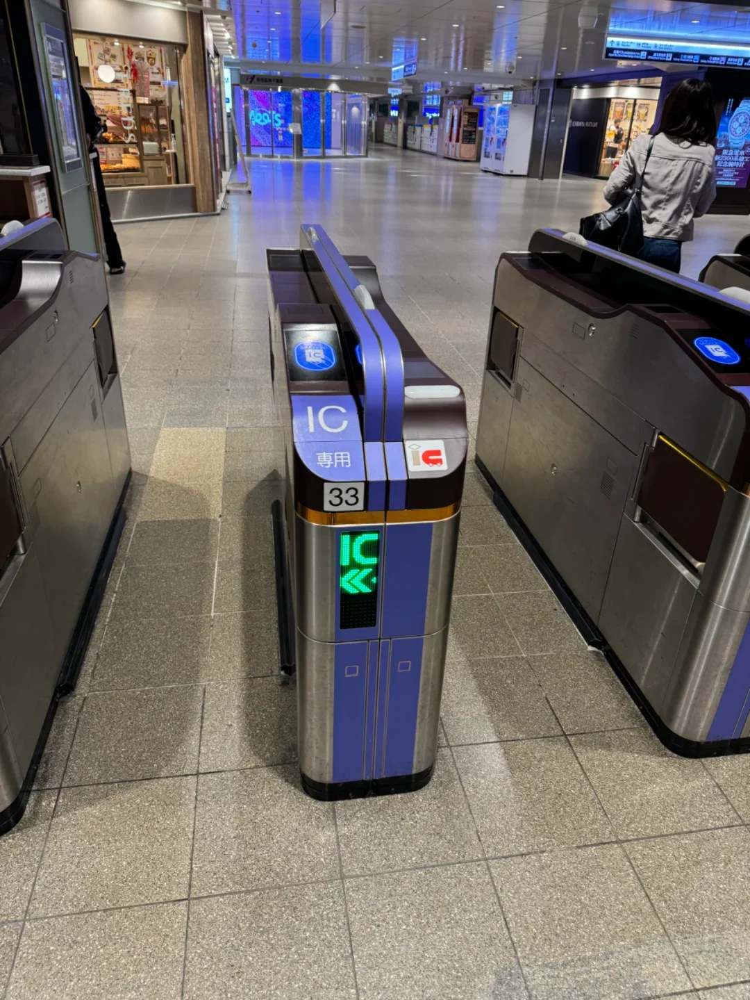

Nejpřímější spojení z kjótské čtvrti Shijo do ósacké Umedy není JR, ale trať Hankyu Kyoto Line. Vede z Kyoto-Kawaramachi pod ulicí Shijo-dori do Hankyu Osaka-Umeda: jednotné jízdné 410 jenů, nejrychlejším expresem asi 43 minut. Žádná šinkansenová sláva, žádné police na zavazadla — příměstská železnice, a právě proto funguje.

O tom, zda cesta proběhne hladce, rozhodují čtyři věci: kde nastoupíte, čím se šest typů vlaků liší, jak číst nástupiště a jak na druhém konci opustit terminál. Jízdné a časy jsou orientační; rozhodující je web Hankyu.

## Dvě výchozí místa: Kawaramachi a Karasuma

Hankyu má v centru dvě stanice. **Kyoto-Kawaramachi** je konečná, na západním břehu řeky Kamo na východním konci Shijo-dori. **Hankyu Karasuma** leží pod křižovatkou Shijo-Karasuma a navazuje na stanici Shijo na lince metra Karasuma; Kawaramachi je o jednu zastávku dál na východ.

V okolí Shijo-Karasuma nebo trhu Nishiki ušetříte s Karasumou kus chůze; u řeky, v Gionu nebo blízko chrámu Kennin-ji je blíž Kawaramachi. Jízdné do Umedy spadá z obou stanic do stejného pásma — obvykle 410 jenů i z Karasumy, i když poslední slovo má jízdní tabulka na stanici.

Najděte si cestu k „Hankyu Karasuma" nebo „Kyoto-Kawaramachi" a sejděte do podzemí u červeného loga Hankyu; chodby pod zemí se větví všemi směry.

## Šest typů vlaků, jedno jízdné

Na trati jezdí šest tříd: expres, příměstský expres, zrychlený expres, zrychlený vlak, polorychlý vlak a osobní vlak. Názvy vypadají odstrašujícím dojmem; pravidlo je jednoduché — čím vyšší třída, tím méně zastávek, a **jízdné se nikdy nemění**.

Expresy zvládnou cestu z Kawaramachi do Umedy asi za 43 minut, polorychlý vlak za asi 1 hodinu 7 minut. Zrychlený expres, zrychlený vlak a příměstský expres leží mezi nimi a příměstský expres jezdí jen ve špičce, takže v poledne na nástupišti nebude.

| Položka | Kyoto-Kawaramachi → Osaka-Umeda |
| --- | --- |
| Jízdné | 410 jenů, stejné u všech typů vlaků (včetně expresu) |
| Expres | asi 43 minut |
| Polorychlý vlak | asi 1 hodina 7 minut |
| Sezení | Nerezervované; některé expresy mají vůz PRiVACE s místenkou za příplatek |
| Platba | IC karta nebo papírová jízdenka, přiložená nebo vložená na obou koncích |

Na rozdíl od JR nevybírá Hankyu příplatek za expres: „特急" na tabuli jednoduše znamená nejrychlejší vlak. Tam, kde je připojen vůz PRiVACE, nástupiště označuje, kde zastavuje; běžné vozy zůstávají nerezervované.

## Nástup: najděte „Hankyu" a projeďte turniketem

Stanice Hankyu jsou malé, turnikety stojí uprostřed haly. Přiložte kartu ICOCA, Suica nebo podobnou při vstupu a na druhém konci při výstupu; podle vzdálenosti se odečte 410 jenů. Bez karty si kupte jednotlivou jízdenku v automatu — bez data, platí ten den.

S kartou nemusíte nikdy počítat jízdné: stejná karta funguje na Hankyu, v metru, na JR i v autobusech a automaty na dobití berou mince i bankovky do 10 000 jenů.

Za turnikety se držte značek na Osaka-Umeda. Hankyu Karasuma má dvě nástupiště — 1 pro Kyoto-Kawaramachi, 2 pro Osaka-Umeda — takže směr se dá jen těžko splést.

## Nástupiště: stejná kolej, pokaždé jiný vlak

Tady Hankyu lidi nejčastěji zaskočí: na jednom nástupišti může dopoledne přijet polorychlý vlak, v poledne expres, odpoledne zrychlený expres. Podsvícený displej nad nástupištěm ukazuje čas odjezdu, třídu a cíl, proto se řiďte časem, ne zvykem.

**Čtěte i cíl.** Ne každý vlak z nástupiště směrem na Umedu tam končí: některé polorychlé a osobní spoje pokračují na linku metra Sakaisuji směrem k Tengachaya. Nastupte jen tehdy, když na čelním displeji svítí Osaka-Umeda.

Pomůže barva: expres červený, zrychlený expres a zrychlený vlak modrý nebo zelený, polorychlý vlak zelený, osobní černý. Když na japonštinu nestačíte, jeďte podle barvy.

A pozor na **vůz jen pro ženy**: příměstské expresy a některé expresy vyhrazují ve špičce pracovních dnů jeden vůz, označený růžově na podlaze nástupiště i na dveřích.

## Asi 45 minut do Umedy a jak z terminálu

Z Kyoto-Kawaramachi do Osaka-Umeda je to expresem asi 43 minut; s pěšími přesuny a čekáním počítejte 50 minut až hodinu. Vlak zastavuje v Takatsuki-shi, Ibaraki-shi a Awaji, kde navazuje linka Senri a metro směrem k Tenjinbashisuji.

Osaka-Umeda je konečná a vystupují všichni. Východy ústí do suterénu obchodního domu Hankyu; pět až deset minut západně chodbami vás dovede k nádraží JR Ósaka, k metru Midosuji a k Hanshin Umeda. Chayamachi nebo centrální východ pro JR a Grand Front, strana Midosuji pro metro a Hanshin, přímo pro obchodní dům a Hep Five. S zavazadly zůstaňte pod zemí — výtahy a žádný déšť.

## Jízdné, časy a pár praktických poznámek

Jízdné se účtuje podle úseků: 410 jenů z Kyoto-Kawaramachi do Umedy, poloviční cena pro děti, žádný příplatek za expres. Rezervovat není třeba nic kromě vozu PRiVACE.

Vlaky jezdí od chvíle po páté hodině ráno do zhruba 23 hodin, podle stanice a dne, proto si před pozdní cestou zkontrolujte jízdní řád. Polorychlé a osobní vlaky jsou ve špičce narvané, takže se s velkými kufry vyhněte době od 07:30 do 09:00. Jíst ve vlaku se tu nevede a police na zavazadla tu nejsou: kufr mějte u nohou, mimo dveře.

## Související odkazy

- **Na tomto webu**: [Japonsko (JP)](/country/JP)
- **Wikipedie**: [Hankyu Railway](https://en.wikipedia.org/wiki/Hankyu_Railway), [nádraží Kyoto-Kawaramachi](https://en.wikipedia.org/wiki/Kyoto-Kawaramachi_Station), [nádraží Osaka-Umeda](https://en.wikipedia.org/wiki/Osaka-Umeda_Station)
- **Baidu Baike**: [Hankyu Railway](https://baike.baidu.com/item/%E9%98%AA%E6%80%A5%E7%94%B5%E9%93%81)

Jízdné a časy vycházejí z informací, které zveřejňuje Hankyu; rozhodující je provozovatel a displeje na stanicích. Zdroj obrázku: původní cestovní průvodce.
