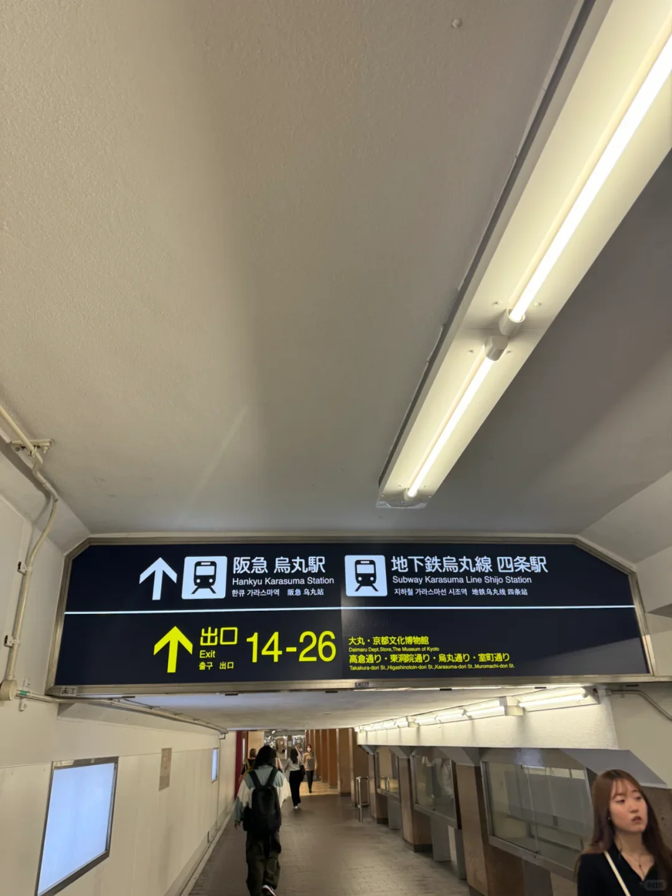
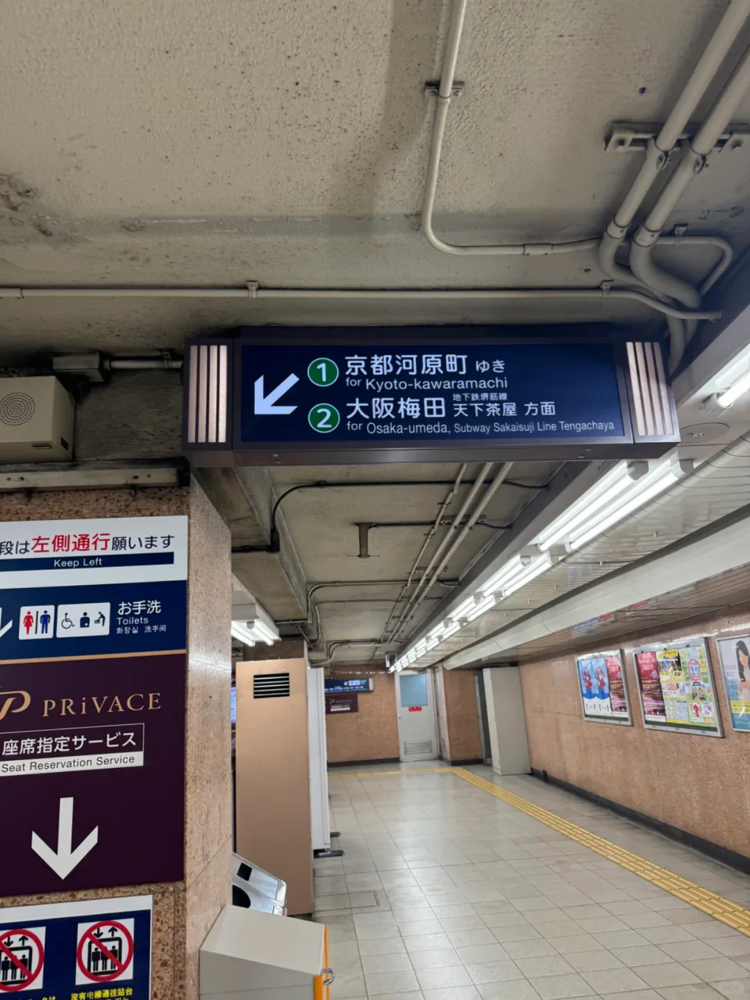
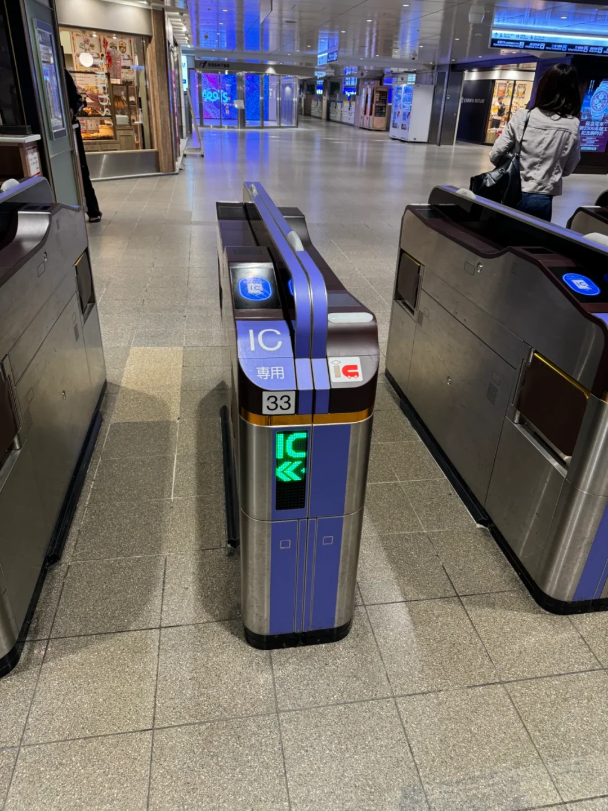
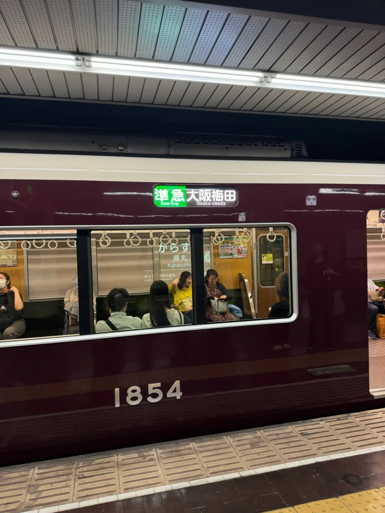
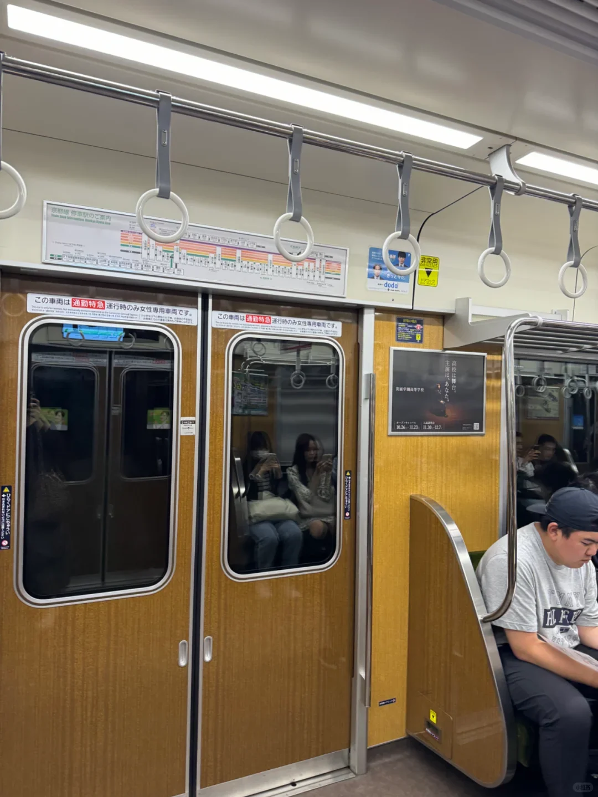

La ligne la plus directe entre le quartier de Shijo, à Kyoto, et Umeda, à Osaka, n'est pas JR mais la ligne Hankyu Kyoto. Elle relie Kyoto-Kawaramachi, sous Shijo-dori, à Hankyu Osaka-Umeda : 410 yens au tarif unique, environ 43 minutes avec le limited express le plus rapide. Pas de cérémonie shinkansen, pas de porte-bagages — un train de banlieue, et c'est exactement pour cela qu'il fonctionne.

Quatre choses décident de la fluidité du trajet : où vous montez, en quoi les six types de trains diffèrent, comment lire le quai et comment sortir du terminal à l'arrivée. Les tarifs et les temps sont indicatifs ; le site de Hankyu fait foi.

## Deux points de départ : Kawaramachi et Karasuma

Hankyu a deux gares dans le centre. **Kyoto-Kawaramachi** est le terminus, sur la rive ouest de la rivière Kamo, à l'extrémité est de Shijo-dori. **Hankyu Karasuma** se trouve sous le carrefour Shijo-Karasuma et permet la correspondance avec la station Shijo du métro Karasuma ; Kawaramachi est un arrêt à l'est.

Autour de Shijo-Karasuma ou du marché Nishiki, Karasuma vous épargne une marche ; au bord de la rivière, à Gion ou près du Kennin-ji, Kawaramachi est plus proche. Le tarif pour Umeda reste dans la même fourchette depuis l'une ou l'autre — généralement 410 yens même depuis Karasuma, mais le tableau tarifaire de la gare fait foi.

Mettez le cap sur « Hankyu Karasuma » ou « Kyoto-Kawaramachi » et descendez sous terre à l'enseigne rouge Hankyu ; les couloirs souterrains partent dans toutes les directions.

## Six types de trains, un seul tarif

La ligne compte six catégories : limited express, commuter express, rapid express, rapid, semi-express et local. Les noms impressionnent ; la règle est simple — plus la catégorie est élevée, moins il y a d'arrêts, et **le tarif ne change jamais**.

Les limited express mettent environ 43 minutes de Kawaramachi à Umeda, les semi-express environ 1 heure 7. Les rapid express, rapid et commuter express se situent entre les deux, et le commuter express ne circule qu'aux heures de pointe : il n'apparaîtra pas à midi.

| Élément | Kyoto-Kawaramachi → Osaka-Umeda |
| --- | --- |
| Tarif | 410 yens, identique sur tous les types de trains (limited express compris) |
| Limited express | environ 43 minutes |
| Semi-express | environ 1 heure 7 |
| Places | Non réservées ; certains limited express comportent une voiture réservée PRiVACE en supplément |
| Paiement | Carte IC ou billet papier, validé ou inséré aux deux extrémités |

Contrairement à JR, Hankyu ne prélève aucun supplément limited express : « 特急 » sur le panneau désigne simplement le train le plus rapide. Quand une voiture PRiVACE est attelée, le quai indique où elle s'arrête ; les voitures ordinaires restent sans réservation.

## Entrer : trouvez « Hankyu », validez et passez

Les gares Hankyu sont petites, avec les portillons au milieu du hall. Validez avec une carte ICOCA, Suica ou équivalent et ressortez à l'autre bout ; 410 yens sont déduits selon la distance. Sans carte, achetez un billet simple à la borne — sans date, valable le jour même.

Une carte, c'est ne plus jamais calculer un tarif : la même fonctionne chez Hankyu, dans le métro, sur JR et dans les bus, et les bornes de recharge acceptent les pièces et les billets jusqu'à 10 000 yens.

Une fois les portillons passés, suivez les panneaux Osaka-Umeda. Hankyu Karasuma a deux quais — le 1 pour Kyoto-Kawaramachi, le 2 pour Osaka-Umeda —, difficile de se tromper de sens.

## Le quai : la même voie, un train différent à chaque fois

C'est là que Hankyu surprend : sur un même quai, un semi-express peut arriver en milieu de matinée, un limited express à midi, un rapid express l'après-midi. L'écran lumineux au-dessus du quai indique l'heure de départ, la catégorie et la destination : fiez-vous à l'heure plutôt qu'à l'habitude.

**Lisez aussi la destination.** Tous les trains au départ de ce quai ne terminent pas à Umeda : certains semi-express et omnibus continuent sur le métro Sakaisuji vers Tengachaya. Ne montez que lorsque l'afficheur de tête indique Osaka-Umeda.

La couleur aide : limited express en rouge, rapid express et rapid en bleu ou vert, semi-express en vert, omnibus en noir. Si le japonais vous résiste, fiez-vous à la couleur.

Et la **voiture réservée aux femmes** : les commuter express et certains limited express réservent une voiture aux heures de pointe en semaine, signalée en rose sur le sol du quai et sur les portes.

## Environ 45 minutes jusqu'à Umeda, puis la sortie du terminal

De Kyoto-Kawaramachi à Osaka-Umeda, comptez environ 43 minutes en limited express ; avec les marches et une attente, prévoyez 50 minutes à une heure. Le train dessert Takatsuki-shi, Ibaraki-shi et Awaji, où se font les correspondances avec la ligne Senri et le métro vers Tenjinbashisuji.

Osaka-Umeda est le terminus et tout le monde descend. Les sorties débouchent dans le sous-sol du grand magasin Hankyu ; cinq à dix minutes vers l'ouest par les couloirs vous amènent à la gare JR d'Osaka, au métro Midosuji et à Hanshin Umeda. Côté Chayamachi ou centre pour JR et Grand Front, côté Midosuji pour le métro et Hanshin, tout droit pour le grand magasin et Hep Five. Avec des bagages, restez en sous-sol — des ascenseurs, et pas de pluie.

## Tarifs, horaires et quelques notes pratiques

Le tarif est calculé par section : 410 yens de Kyoto-Kawaramachi à Umeda, moitié prix pour les enfants, aucun supplément sur le limited express. Rien à réserver, sauf la voiture PRiVACE.

Les trains circulent d'un peu après 5 heures du matin à environ 23 heures, selon la gare et le jour : vérifiez les horaires avant un trajet tardif. Les semi-express et les omnibus sont bondés à l'heure de pointe : évitez 07:30 à 09:00 avec de grandes valises. On ne mange pas à bord et il n'y a pas de porte-bagages : gardez la valise à vos pieds, sans gêner les portes.

## Liens utiles

- **Sur ce site** : [Japon (JP)](/country/JP)
- **Wikipédia** : [Hankyu Railway](https://en.wikipedia.org/wiki/Hankyu_Railway), [Gare de Kyoto-Kawaramachi](https://en.wikipedia.org/wiki/Kyoto-Kawaramachi_Station), [Gare d'Osaka-Umeda](https://en.wikipedia.org/wiki/Osaka-Umeda_Station)
- **Baidu Baike** : [Hankyu Railway](https://baike.baidu.com/item/%E9%98%AA%E6%80%A5%E7%94%B5%E9%93%81)

Les tarifs et horaires suivent les informations publiées par Hankyu ; l'exploitant et l'affichage en gare font foi. Crédit photo : le guide de voyage d'origine.
