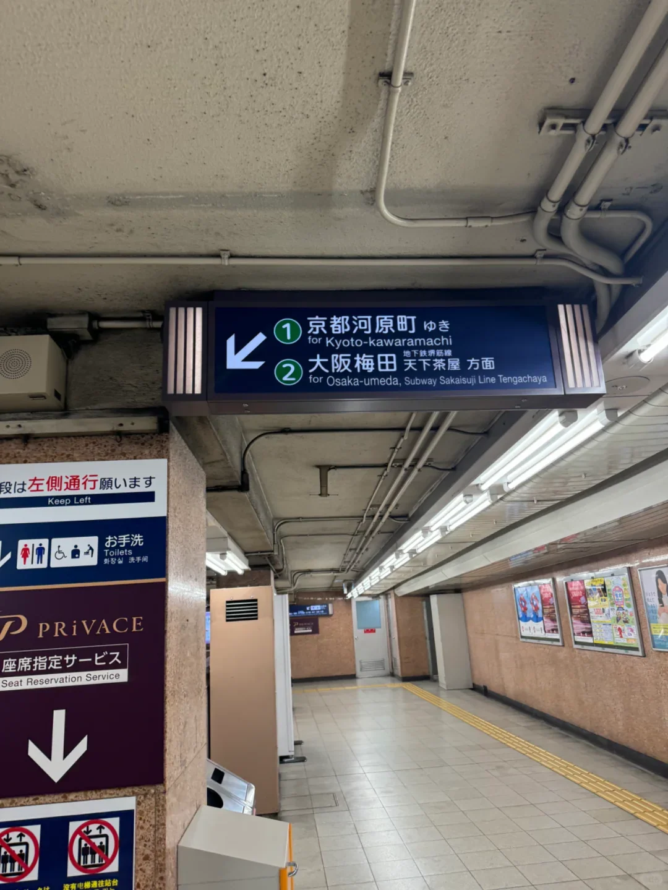

京都の四条エリアから大阪の梅田へ最も直接的に向かう路線はJRではなく、阪急京都線です。四条通の地下を走り、京都河原町から阪急大阪梅田まで。運賃は一律410円、最速の特急で約43分です。新幹線のような儀式も、荷物棚もありません。通勤鉄道であり、だからこそ機能するのです。

旅がスムーズに進むかどうかは4つの点で決まります。どこから乗るか、6種類の列車がどう違うか、ホームをどう読むか、そして終点でターミナルからどう出るかです。運賃と時間は目安であり、阪急の公式サイトが最終的な情報源です。

## 二つの出発点：河原町と烏丸

阪急は市中心部に二つの駅があります。**京都河原町**は終点で、四条通の東端、鴨川の西岸にあります。**阪急烏丸**は四条烏丸交差点の下にあり、地下鉄烏丸線の四条駅に接続しています。河原町は一つ東の駅です。

四条烏丸や錦市場の周辺なら烏丸のほうが歩く距離が短く、川沿いや祇園、建仁寺の近くなら河原町が近いです。梅田までの運賃はどちらからも同じ帯に入ります。烏丸からでも通常410円ですが、最終的な判断は駅の運賃表によります。

「阪急烏丸」または「京都河原町」を目指し、赤い阪急の看板がある地下へ入ります。地下の通路はあらゆる方向に分かれています。

## 6種類の列車、運賃は一つ

この路線には特急、通勤特急、快速急行、快速、準急、普通の6種類が走っています。名前は威圧的に見えますが、ルールは単純です。等級が高いほど停車駅が少なく、**運賃は決して変わりません**。

特急は河原町から梅田まで約43分、準急は約1時間7分です。快速急行、快速、通勤特急はその中間に位置し、通勤特急はラッシュ時のみの運行なので、日中には現れません。

| 項目 | 京都河原町 → 大阪梅田 |
| --- | --- |
| 運賃 | 410円、すべての列車で同じ（特急を含む） |
| 特急 | 約43分 |
| 準急 | 約1時間7分 |
| 座席 | 自由席。一部の特急には追加料金でPRiVACE指定席車が連結される |
| 支払い | ICカードまたは紙のきっぷ。両端の改札でタッチまたは投入 |

JRと違い、阪急は特急料金を徴収しません。案内板の「特急」は単に最速の列車という意味です。PRiVACE車が連結される場合、ホームに停車位置が示されます。一般車は自由席のままです。

## 乗車：「阪急」を見つけてタッチ

阪急の駅は小さく、改札はコンコースの中央にあります。ICOCAやSuicaなどのカードで入り、終点で出ます。410円が距離に応じて引き落とされます。カードがなければ券売機で片道きっぷを買います。日付はなく、当日限り有効です。

カードがあれば運賃を計算する必要はありません。同じ一枚が阪急、地下鉄、JR、バスで使え、チャージ機は現金と1万円までの紙幣に対応しています。

改札を抜けたら、大阪梅田の案内に従います。阪急烏丸にはホームが二つあり、1番線が京都河原町行き、2番線が大阪梅田行きなので、方向を間違えることはほとんどありません。

## ホーム：同じ線路に、毎回違う列車

ここが阪急の落とし穴です。同じホームに、午前中は準急、正午には特急、午後には快速急行がやってくることがあります。ホーム上の点灯式案内表示に出発時刻、種別、行き先が出るので、習慣で乗るのではなく時刻を合わせましょう。

**行き先も確認してください。** 梅田行きのホームに来る列車がすべて梅田で終わるわけではありません。一部の準急と普通は堺筋線に直通し、天下茶屋方面へ向かいます。前面表示が大阪梅田と出ているときだけ乗車してください。

色も助けになります。特急は赤、快速急行と快速は青または緑、準急は緑、普通は黒です。日本語が難しければ、色で判断しましょう。

そして**女性専用車**。通勤特急と一部の特急は平日ラッシュ時に1両を女性専用とし、ホームの床とドアにピンクで表示されます。

## 梅田まで約45分、そしてターミナルを出る

京都河原町から大阪梅田までは特急で約43分です。徒歩と待ち時間を含めると、50分から1時間を見ておきましょう。列車は高槻市、茨木市、淡路に停まり、淡路では千里線と地下鉄天神橋筋六丁目方面が接続します。

大阪梅田は終点で、全員が降ります。出口は阪急百貨店の地下につながっており、西へ5〜10分歩くとJR大阪駅、地下鉄御堂筋線、阪神梅田に着きます。JRとグランフロントなら茶屋町か中央、地下鉄と阪神なら御堂筋側、百貨店とHEP FIVEならまっすぐです。荷物があるときは地下にとどまりましょう。エレベーターがあり、雨にも濡れません。

## 運賃、時間、いくつかの実用メモ

運賃は区間ごとに課金されます。京都河原町から梅田まで410円、子どもは半額、特急に追加料金はありません。予約が必要なのはPRiVACE車だけです。

列車は午前5時少し過ぎから午後11時ごろまで運行され、駅や日によって異なるため、遅い時間の移動前には時刻表を確認してください。準急と普通はラッシュ時に混雑するので、大きなスーツケースがある場合は7時30分から9時を避けましょう。車内での飲食はマナー違反とされ、荷物棚もありません。スーツケースは足元に置き、ドアをふさがないようにしてください。

## 関連リンク

- **このサイト内**：[日本 (JP)](/country/JP)
- **Wikipedia**：[阪急電鉄](https://en.wikipedia.org/wiki/Hankyu_Railway)、[京都河原町駅](https://en.wikipedia.org/wiki/Kyoto-Kawaramachi_Station)、[大阪梅田駅](https://en.wikipedia.org/wiki/Osaka-Umeda_Station)
- **百度百科**：[阪急電鉄](https://baike.baidu.com/item/%E9%98%AA%E6%80%A5%E7%94%B5%E9%93%81)

運賃と時間は阪急の公表情報に基づきます。運行事業者と駅の表示が最終的な情報源です。画像出典：元の旅行ガイド。
