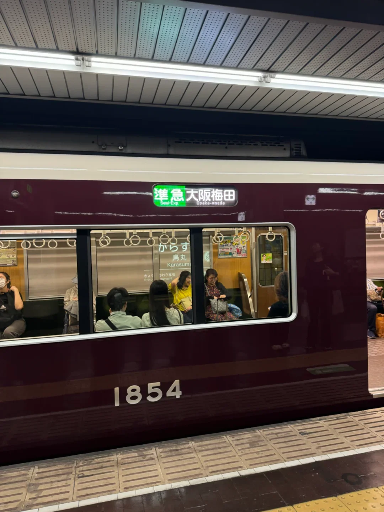
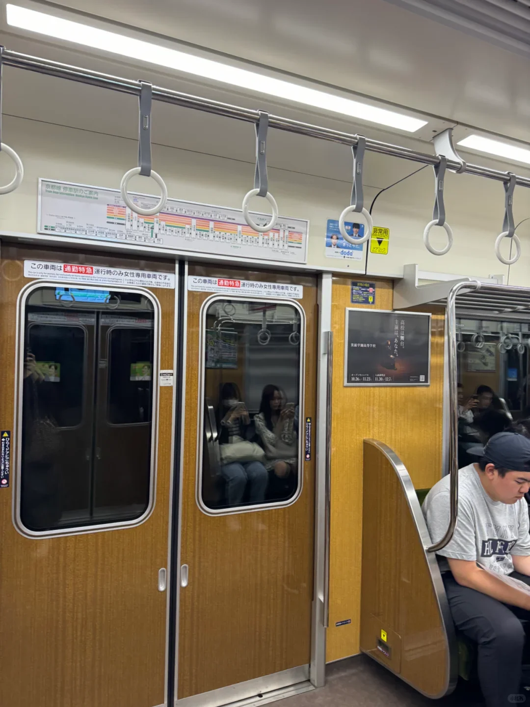

Den mest direkta linjen från Kyotos Shijo-distrikt till Umeda i Osaka är inte JR utan Hankyu Kyoto-linjen. Den går från Kyoto-Kawaramachi, under Shijo-dori, till Hankyu Osaka-Umeda: ett fast pris på 410 yen, cirka 43 minuter med det snabbaste expresståget. Ingen shinkansen-pomp, inga bagagehyllor – en pendlarbana, och det är precis därför den fungerar.

Fyra saker avgör om resan går smidigt: var du stiger på, hur de sex tågtyperna skiljer sig, hur du läser av perrongen och hur du tar dig ut från terminalen i andra änden. Priser och tider är vägledande; Hankyus egen webbplats är avgörande.

## Två startpunkter: Kawaramachi och Karasuma

Hankyu har två stationer i centrum. **Kyoto-Kawaramachi** är ändstationen, på Kamoflodens västra strand vid Shijo-doris östra ände. **Hankyu Karasuma** ligger under korsningen Shijo-Karasuma och ansluter till Shijo station på Karasuma-tunnelbanan; Kawaramachi ligger en station österut.

Runt Shijo-Karasuma eller Nishiki-marknaden sparar Karasuma en promenad; vid floden, i Gion eller nära Kennin-ji är Kawaramachi närmare. Priset till Umeda ligger i samma intervall från båda – oftast 410 yen även från Karasuma, även om stationens pristabell är det som gäller.

Navigera till ”Hankyu Karasuma” eller ”Kyoto-Kawaramachi” och gå under jord vid den röda Hankyu-skylten; gångarna därnere förgrenar sig åt alla håll.

## Sex tågtyper, ett pris

Linjen trafikeras av sex klasser: expresståg, pendlingsexpress, snabbexpress, snabbtåg, halvexpress och lokaltåg. Namnen ser krångliga ut; regeln är enkel – ju högre klass, desto färre stopp, och **priset ändras aldrig**.

Expresstågen tar cirka 43 minuter från Kawaramachi till Umeda, halvexpressen cirka 1 timme och 7 minuter. Snabbexpress, snabbtåg och pendlingsexpress ligger däremellan, och pendlingsexpressen går bara i högtrafik, så den dyker inte upp mitt på dagen.

| Post | Kyoto-Kawaramachi → Osaka-Umeda |
| --- | --- |
| Pris | 410 yen, samma på alla tågtyper (även expresståg) |
| Expresståg | cirka 43 minuter |
| Halvexpress | cirka 1 timme och 7 minuter |
| Sittplats | Oreserverade; vissa expresståg har en reserverad PRiVACE-vagn mot tillägg |
| Betalning | IC-kort eller pappersbiljett, som blippas eller sticks in i båda ändar |

Till skillnad från JR tar Hankyu inte ut något expresstågstillägg: ”特急” på skyltarna betyder helt enkelt det snabbaste tåget. Där en PRiVACE-vagn kopplas på visar perrongen var den stannar; vanliga vagnar är fortfarande oreserverade.

## Att ta sig in: hitta ”Hankyu”, blippa igenom

Hankyus stationer är små, med grindarna mitt i biljetthallen. Blippa in med ett ICOCA-, Suica- eller liknande kort och ut i andra änden; 410 yen dras efter avstånd. Utan kort köper du en enkelbiljett i automaten – inget datum, giltig samma dag.

Med ett kort slipper du räkna ut priset: samma kort fungerar på Hankyu, tunnelbanan, JR och bussarna, och påfyllningsautomaterna tar mynt och sedlar upp till 10 000 yen.

Efter grindarna följer du skyltarna mot Osaka-Umeda. Hankyu Karasuma har två perronger – spår 1 mot Kyoto-Kawaramachi, spår 2 mot Osaka-Umeda – så det är svårt att ta fel riktning.

## Perrongen: samma spår, olika tåg varje gång

Det är här Hankyu lurar folk: på samma perrong kan en halvexpress komma mitt på förmiddagen, ett expresståg mitt på dagen och en snabbexpress på eftermiddagen. Den upplysta skärmen ovanför perrongen visar avgångstid, klass och destination, så matcha tiden i stället för att stiga på av gammal vana.

**Läs även destinationen.** Inte alla tåg från perrongen mot Umeda slutar där: en del halvexpress- och lokaltåg fortsätter in på Sakaisuji-tunnelbanan mot Tengachaya. Stig bara på när skärmen framtill visar Osaka-Umeda.

Färgerna hjälper: expresståg rött, snabbexpress och snabbtåg blått eller grönt, halvexpress grönt, lokaltåg svart. Om japanskan besegrar dig, gå på färgen.

Och **damvagnen**: pendlingsexpressen och vissa expresståg avsätter en vagn under vardagarnas högtrafik, markerad i rosa på perronggolvet och på dörrarna.

## Cirka 45 minuter till Umeda – och ut ur terminalen

Kyoto-Kawaramachi till Osaka-Umeda tar cirka 43 minuter med expresståg; med promenaderna och en väntan bör du räkna med 50 minuter till en timme. Tåget stannar i Takatsuki-shi, Ibaraki-shi och Awaji, där Senri-linjen och tunnelbanan mot Tenjinbashisuji ansluter.

Osaka-Umeda är ändstationen och alla stiger av. Utgångarna öppnar mot varuhuset Hankyus källarplan; fem till tio minuter västerut i gångarna kommer du till JR Osaka Station, Midosuji-tunnelbanan och Hanshin Umeda. Chayamachi eller centralt för JR och Grand Front, Midosuji-sidan för tunnelbanan och Hanshin, rakt fram för varuhuset och Hep Five. Med bagage: håll dig under jord – hissar, och inget regn.

## Priser, tider och några praktiska anteckningar

Priset beräknas efter avstånd: 410 yen från Kyoto-Kawaramachi till Umeda, halva priset för barn, inget tillägg på expresståget. Inget behöver reserveras utom PRiVACE-vagnen.

Tågen går från strax efter klockan 5 på morgonen till omkring 23 på kvällen, med variation mellan stationer och dagar, så kontrollera tidtabellen före en sen resa. Halvexpress- och lokaltåg är fullpackade i rusningstid, så undvik 07:30–09:00 med stora väskor. Man äter inte ombord och det finns ingen bagagehylla: håll väskan vid fötterna, fri från dörrarna.

## Relaterade länkar

- **På den här webbplatsen**: [Japan (JP)](/country/JP)
- **Wikipedia**: [Hankyu Railway](https://en.wikipedia.org/wiki/Hankyu_Railway), [Kyoto-Kawaramachi station](https://en.wikipedia.org/wiki/Kyoto-Kawaramachi_Station), [Osaka-Umeda station](https://en.wikipedia.org/wiki/Osaka-Umeda_Station)
- **Baidu Baike**: [Hankyu](https://baike.baidu.com/item/%E9%98%AA%E6%80%A5%E7%94%B5%E9%93%81)

Priser och tider följer Hankyus publicerade uppgifter; operatören och stationernas skyltar är avgörande. Bildkredit: den ursprungliga reseguiden.
