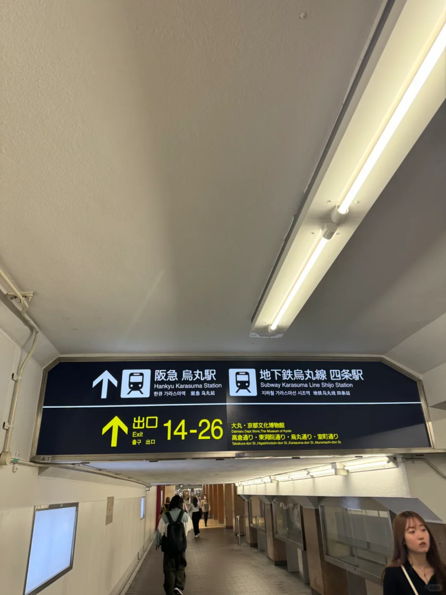

Kyoto'nun Shijo semtinden Osaka'nın Umeda bölgesine en doğrudan hat JR değil, Hankyu Kyoto Hattı. Shijo-dori'nin altından Kyoto-Kawaramachi'den başlayıp Hankyu Osaka-Umeda'ya uzanıyor: sabit 410 yen, en hızlı limited ekspresle yaklaşık 43 dakika. Shinkansen töreni yok, bagaj rafı yok — bir banliyö demiryolu ve zaten bu yüzden işe yarıyor.

Yolculuğun sorunsuz geçip geçmeyeceğini dört şey belirliyor: nereden bineceğiniz, altı tren türünün nasıl farklılaştığı, peronu nasıl okuyacağınız ve diğer uçta terminalden nasıl çıkacağınız. Ücretler ve süreler gösterge niteliğinde; kesin bilgi Hankyu'nun kendi sitesinde.

## İki başlangıç noktası: Kawaramachi ve Karasuma

Hankyu'nun merkezde iki istasyonu var. **Kyoto-Kawaramachi**, Shijo-dori'nin doğu ucunda, Kamo Nehri'nin batı kıyısındaki son istasyon. **Hankyu Karasuma** ise Shijo-Karasuma kavşağının altında ve Karasuma metro hattındaki Shijo istasyonuna bağlanıyor; Kawaramachi bunun bir durak doğusunda.

Shijo-Karasuma veya Nishiki pazarı çevresindeyseniz Karasuma yürüyüşten tasarruf ettirir; nehir kenarında, Gion'da veya Kennin-ji yakınındaysanız Kawaramachi daha yakın. İki istasyondan da Umeda'ya ücret aynı bantta — genellikle Karasuma'dan bile 410 yen, ancak son söz istasyonun ücret tablosunda.

“Hankyu Karasuma” veya “Kyoto-Kawaramachi” olarak yol tarifi alın ve kırmızı Hankyu tabelasının olduğu yerden yer altına inin; aşağıdaki geçitler her yöne ayrılıyor.

## Altı tren türü, tek ücret

Hatta altı sınıf çalışıyor: limited ekspres, banliyö ekspresi, hızlı ekspres, hızlı, yarı ekspres ve yerel. Adlar göz korkutucu görünüyor; kural basit — sınıf yükseldikçe durak azalıyor ve **ücret hiç değişmiyor**.

Limited ekspresler Kawaramachi'den Umeda'ya yaklaşık 43 dakika, yarı ekspres yaklaşık 1 saat 7 dakika sürüyor. Hızlı ekspres, hızlı ve banliyö ekspresi arada yer alıyor; banliyö ekspresi yalnızca yoğun saatlerde çalıştığı için öğlen saatlerinde görünmez.

| Kalem | Kyoto-Kawaramachi → Osaka-Umeda |
| --- | --- |
| Ücret | 410 yen, her tren türünde aynı (limited ekspres dahil) |
| Limited ekspres | yaklaşık 43 dakika |
| Yarı ekspres | yaklaşık 1 saat 7 dakika |
| Oturma | Numarasız; bazı limited ekspreslerde ek ücretle PRiVACE rezervasyonlu vagon |
| Ödeme | IC kart veya kâğıt bilet, iki uçta da okutulur veya geçirilir |

JR'den farklı olarak Hankyu limited ekspres ek ücreti almıyor: panodaki “特急” sadece en hızlı tren anlamına geliyor. PRiVACE vagonu bağlıysa peron nerede duracağını işaretliyor; normal vagonlar numarasız kalıyor.

## Biniş: “Hankyu”yu bulun, kartla geçin

Hankyu istasyonları küçük, turnikeler koridorun ortasında. ICOCA, Suica veya benzeri bir kartla girişte okutun, diğer uçta çıkışta okutun; 410 yen mesafeye göre düşülüyor. Kartınız yoksa makineden tek bilet alın — tarih yok, o gün geçerli.

Kart, ücret hesaplamayı tamamen ortadan kaldırıyor: aynı kart Hankyu, metro, JR ve otobüslerde geçiyor; yükleme makineleri 10.000 yene kadar nakit ve banknot kabul ediyor.

Turnikelerden sonra Osaka-Umeda tabelalarını izleyin. Hankyu Karasuma'da iki peron var — 1 numara Kyoto-Kawaramachi, 2 numara Osaka-Umeda — yani yönü karıştırmak zor.

## Peron: aynı ray, her seferinde farklı tren

Hankyu'nun insanları yanılttığı yer burası: bir perona sabah ortasında yarı ekspres, öğlen limited ekspres, öğleden sonra hızlı ekspres gelebilir. Peronun üstündeki ışıklı ekran kalkış saatini, sınıfı ve varış yerini gösteriyor; alışkanlıkla binmek yerine saati eşleştirin.

**Varış yerini de okuyun.** Umeda yönündeki her tren orada bitmiyor: bazı yarı ekspres ve yerel seferler Sakaisuji metro hattına geçip Tengachaya yönüne devam ediyor. Yalnızca ön ekranda Osaka-Umeda yazdığında binin.

Renk yardımcı oluyor: limited ekspres kırmızı, hızlı ekspres ve hızlı mavi veya yeşil, yarı ekspres yeşil, yerel siyah. Japonca sizi yenerse renge göre gidin.

Bir de **kadınlara özel vagon**: banliyö ekspresleri ve bazı limited ekspresler hafta içi yoğun saatlerde bir vagonu ayırıyor; peron zemininde ve kapılarda pembe ile işaretli.

## Umeda'ya yaklaşık 45 dakika ve terminalden çıkış

Kyoto-Kawaramachi'den Osaka-Umeda'ya limited ekspresle yaklaşık 43 dakika; yürüyüşler ve bekleme dahil 50 dakika ile bir saat arası planlayın. Tren Takatsuki-shi, Ibaraki-shi ve Awaji'de duruyor; burada Senri Hattı ve Tenjinbashisuji yönüne giden metro bağlanıyor.

Osaka-Umeda son istasyon ve herkes iniyor. Çıkışlar Hankyu mağazasının bodrum katına açılıyor; yürüyen yollarda batıya beş ila on dakika JR Osaka İstasyonu, Midosuji metrosu ve Hanshin Umeda'ya ulaştırıyor. JR ve Grand Front için Chayamachi veya merkez, metro ve Hanshin için Midosuji tarafı, mağaza ve Hep Five için doğrudan geçin. Bavulluysanız yer altında kalın — asansörler var, yağmur yok.

## Ücretler, süreler ve birkaç pratik not

Ücret mesafeye göre alınıyor: Kyoto-Kawaramachi'den Umeda'ya 410 yen, çocuklar yarı fiyat, limited ekspresde ek ücret yok. PRiVACE vagonu dışında rezervasyon gereken bir şey yok.

Trenler sabah 5'ten biraz sonra ile gece 11 civarı arasında çalışıyor; istasyona ve güne göre değişiyor, bu yüzden geç bir yolculuk öncesi tarifeyi kontrol edin. Yarı ekspres ve yerel trenler yoğun saatlerde tıklım tıklım oluyor; büyük valizlerle 07.30–09.00 arasından kaçının. Trende yemek yemek adet değil ve bagaj rafı yok: valizi ayaklarınızın dibinde, kapılardan uzak tutun.

## İlgili bağlantılar

- **Bu sitede**: [Japonya (JP)](/country/JP)
- **Wikipedia**: [Hankyu Demiryolu](https://en.wikipedia.org/wiki/Hankyu_Railway), [Kyoto-Kawaramachi İstasyonu](https://en.wikipedia.org/wiki/Kyoto-Kawaramachi_Station), [Osaka-Umeda İstasyonu](https://en.wikipedia.org/wiki/Osaka-Umeda_Station)
- **Baidu Baike**: [Hankyu Demiryolu](https://baike.baidu.com/item/%E9%98%AA%E6%80%A5%E7%94%B5%E9%93%81)

Ücretler ve süreler Hankyu'nun yayımladığı bilgilere dayanıyor; işletmeci ve istasyon ekranları kesin kaynaktır. Görsel kredisi: özgün seyahat rehberi.
