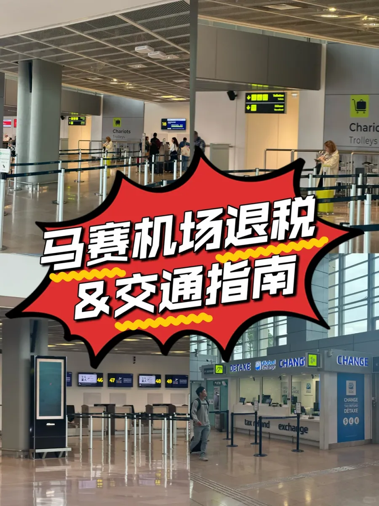

मार्से प्रोवांस हवाई अड्डा (MRS) मारिन्यान में, प्रोवांस और रिवेरा के बीच स्थित है, और ऐक्स, अविग्नों या ख़ुद मार्से में ठहरने वाले किसी भी व्यक्ति के लिए दक्षिणी फ़्रांस पहुँचने का सबसे व्यावहारिक रास्ता है। हाल ही में शुरू हुआ मार्से–शंघाई मार्ग इसका मतलब है कि चीन से आने वाले यात्रियों को इस क्षेत्र तक पहुँचने के लिए अब पेरिस में विमान नहीं बदलना पड़ता।

यह जगह शार्ल डि गॉल या ओर्ली जैसी बिल्कुल नहीं लगती। यहाँ शांति है और भीड़ नहीं, चेक-इन, सुरक्षा और रिफ़ंड तेज़ हैं, और बहुत से उतरने वाले यात्रियों की पहली प्रतिक्रिया यही होती है कि यह उनकी अपेक्षा से अलग है। पर शांत हवाई अड्डा आपको कम संकेत भी देता है: कोई लंबी कतार नहीं जो बताए कि आगे क्या करना है, इसलिए आपको पहले से पता होना चाहिए कि रिफ़ंड कियोस्क कहाँ है, बस 40 किस स्तर से निकलती है और बस 91 कहाँ रुकती है।

यह गाइड टर्मिनल को, PABLO रिफ़ंड प्रक्रिया को क्रम से, प्रोवांस TGV स्टेशन से बस 40 को, मार्से से बस 91 और Uber को, और अंत में किराए, समय और दिन की योजना को कवर करती है।

## 1. मार्से हवाई अड्डा कैसा है

हवाई अड्डा मूल रूप से एक ही सुगठित टर्मिनल है, प्रस्थान और आगमन एक ही इमारत में। चेक-इन डेस्क हॉल में कतारबद्ध हैं और नंबर चालीस के दशक तक जाते हैं। एक ओर मुद्रा विनिमय और टैक्स रिफ़ंड डेस्क है, जिसके ऊपर DÉTAXE, Global Exchange और CHANGE के संकेत हैं और पास ही सामान ट्रॉली (Chariots / Trolleys) का संकेत है। उस कोने को पा लें तो रिफ़ंड और बची हुई मुद्रा, दोनों एक ही जगह निपटा सकते हैं।

शांति का फ़ायदा रफ़्तार है। चेक-इन पर कोई कतार नहीं, सुरक्षा में कुछ मिनट, और रिफ़ंड कियोस्क के सामने अक्सर कोई होता ही नहीं। मई 2025 के यात्रियों ने दर्ज किया कि चेक-इन और सुरक्षा में कतार नहीं थी और रिफ़ंड व चेक-इन प्रक्रिया सुगम रही। शांति का कम दिखने वाला नुक़सान यह है कि कम डेस्क खुले रहते हैं और कर्मचारी हमेशा नज़र में नहीं होते, इसलिए काग़ज़ात अधूरे हुए तो दूसरी बार आपको ही आना पड़ेगा। पहली बार में सब कुछ साथ लाएँ।

ढाँचे के लिहाज़ से मार्से हब नहीं है। उड़ानें ज़्यादातर पॉइंट-टू-पॉइंट हैं, ट्रांज़िट यात्री कम हैं, और हॉल में कभी बड़े कनेक्टिंग हवाई अड्डे वाला धक्का-मुक्की का एहसास नहीं होता। एयरसाइड छोटा है और दुकानें सीमित: अगर आपको घंटों पहले पहुँचकर घूमना पसंद है तो यह जगह नहीं है; अगर आप समय कस कर रखना पसंद करते हैं तो वह भी चलेगा, बशर्ते रिफ़ंड, सामान जमा करना और सुरक्षा पहले हों और घूमना आख़िर में।

चीन से आने वाले यात्रियों के लिए बड़ा बदलाव सीधा मार्ग है: पेरिस में कनेक्शन नहीं, और आप सीधे दक्षिण में उतरते हैं। इसका मतलब यह भी है कि रिफ़ंड और परिवहन का होमवर्क पेरिस में नहीं, यहीं करना है, क्योंकि MRS पर चीनी साइनबोर्ड बहुत कम हैं।

## 2. PABLO रिफ़ंड: हरी बत्ती, लाल बत्ती

क्रम का एक नियम है: **सामान चेक-इन कराने से पहले रिफ़ंड लें**। कस्टम को सामान देख पाना चाहिए, और एक बार बैग बेल्ट पर चला गया तो आपने उसे व्यावहारिक रूप से भेज दिया। मार्से में सेल्फ़-सर्विस कियोस्क **चेक-इन पंक्ति 17 और 18 के बीच, गलियारे से थोड़ा पीछे** है, स्क्रीन पर DETAXE / TAX REFUND, वही उपकरण जो फ़्रांस के सभी हवाई अड्डों पर इस्तेमाल होता है।

स्कैनिंग नीस या पेरिस जैसी ही है: रिफ़ंड फ़ॉर्म का बारकोड लाल रीडर पर रखें और स्क्रीन फ़ैसला दिखाती है। **हरी बत्ती का मतलब फ़ॉर्म सत्यापित हुआ** — इलेक्ट्रॉनिक संदेश कस्टम मोहर के बराबर है, इसलिए सीधे चेक-इन जाएँ। **लाल बत्ती का मतलब किसी व्यक्ति को इसे देखना है**: अपना पासपोर्ट, फ़ॉर्म और सामान लेकर कस्टम डेस्क पर जाएँ और मोहर लगवाएँ। आम कारण हैं PABLO से जारी न किया गया फ़ॉर्म, न पढ़ा जाने वाला बारकोड, पासपोर्ट से न मिलता नाम, या ऐसी जाँच जिसमें ख़रीद देखनी हो।

नक़द लेना है तो एक और कदम है: **चेक-इन पंक्ति 46 के सामने, PAUL कैफ़े के बगल में** वाला एक्सचेंज डेस्क सत्यापित फ़ॉर्म के बदले भुगतान करता है। यह चेक-इन के उसी स्तर पर, कुछ क़दम दूर है, इसीलिए यहाँ नक़द रिफ़ंड आमतौर पर मिनटों में हो जाते हैं और लोग हवाई अड्डे को तेज़ कहते हैं।

नियम फ़्रांस में हर जगह जैसे हैं: आपको यूरोपीय संघ से बाहर रहना होगा, आयु 16 या अधिक होनी चाहिए, और **एक दुकान में एक दिन में कर सहित €100 से अधिक** ख़र्च करना होगा; फ़ॉर्म ख़रीद के महीने के बाद तीसरे महीने के अंत से पहले सत्यापित होना चाहिए; और सामान आपके साथ जाना चाहिए और दिखाने के लिए उपलब्ध होना चाहिए। ये शर्तें पूरी हों तो पूरा काम दस मिनट से कम में हो जाता है। एक भी छूटे तो बड़े हवाई अड्डे की तुलना में मदद कम मिलेगी, इसलिए बफ़र रखें।

लाल बत्ती इनकार नहीं है — यह सिर्फ़ फ़ैसला किसी व्यक्ति के हाथ में देती है। खिड़की पर अधिकारी तीन बातें जाँचता है: कि आप वही व्यक्ति हैं जो फ़ॉर्म पर है, कि सामान फ़ॉर्म से मेल खाता है, और कि तारीख़ अब भी मान्य है। तीनों ठीक तो मोहर काग़ज़ात पूरा कर देती है। कोई एक चूका तो फ़ॉर्म रद्द। इसमें सबसे ज़्यादा गड़बड़ क्रम से होती है: पहले बैग चेक-इन कराया तो सामान चला गया, इसलिए अधिकारी कुछ सत्यापित ही नहीं कर सकता।

## 3. प्रोवांस TGV स्टेशन से बस 40

नीस से आ रहे हों तो ट्रेन आरामदायक विकल्प है: **ऐक्स-एन-प्रोवांस TGV** तक TGV। ध्यान रखें कि यह स्टेशन शहर में नहीं है — यह ऐक्स के बाहर खुले मैदान में है, तेज़ रफ़्तार ट्रेनों के लिए बना — और हवाई अड्डा मार्से की तुलना में ऐक्स के ज़्यादा नज़दीक है, इसलिए यहाँ से ट्रांसफ़र शहर से शुरू करने से तेज़ है।

स्टेशन से **स्तर 0** पर उतरें और बस 40 खोजें। स्टॉप पर हरा-सफ़ेद lecar 40 संकेत है जिस पर AÉROPORT लिखा है, स्टेशन भवन के बाहर छज्जे के नीचे। **हवाई अड्डे तक चौदह मिनट, €12**, और कोच आपको टर्मिनल के दरवाज़े पर उतार देता है — न पार्किंग, न शटल।

प्रस्थानें बार-बार नहीं हैं। स्टॉप के पास की पीली समय-सारिणी दोपहर भर में लगभग आधे घंटे के अंतराल पर चलती है — 17:45, 18:17, 18:47 — और आख़िरी के बाद आप अपने दम पर हैं। इसलिए ट्रेन से उतरकर पहला काम कॉफ़ी खोजना नहीं, समय-सारिणी पढ़ना है: अगली बस बीस मिनट में है तो आराम से चलें; अभी-अभी एक गई है तो तय करें कि रुकें या कार बुलाएँ। कोच सफ़ेद है, गंतव्य डिस्प्ले पर AIX GARE TGV और किनारे पर AÉROPORT Marseille Provence, इसलिए ग़लती मुश्किल है।

एक जाल जानने लायक है: ऐक्स के दो स्टेशन हैं। **ऐक्स-एन-प्रोवांस TGV** वह है जो खेतों में है और जहाँ तेज़ रफ़्तार ट्रेनें रुकती हैं; **Gare d’Aix-en-Provence** शहर के केंद्र का स्टेशन है जहाँ क्षेत्रीय ट्रेनें रुकती हैं। बस 40 केवल पहले से निकलती है, इसलिए शहर के स्टेशन पहुँचने का मतलब है पहले वापस TGV स्टेशन जाना। अपने टिकट पर लगा प्रत्यय देखें और चक्कर बचाएँ।

TGV स्टेशन के आसपास खेतों के सिवा कुछ नहीं, इसलिए प्रतीक्षा में करने को कुछ नहीं। जल्दी पहुँचे हैं तो ऐक्स में ज़्यादा देर रुकें और बस के हिसाब से पहुँचें; TGV देर से आई और बस छूट गई तो कार लगभग €15 की है — सस्ती नहीं, पर यात्रा बिगाड़ेगी नहीं।

## 4. मार्से से बस 91, या Uber

मार्से से रास्ता अलग है: **Gare Saint-Charles से बस 91**, हवाई अड्डे तक लगभग **30 मिनट**। सेंट-शार्ल शहर के केंद्र के उत्तर में एक पहाड़ी पर है; स्टेशन से बाहर हवाई अड्डा बस के संकेतों पर चलें और स्टॉप बाहर सड़क पर है। स्टॉप पर किराया नहीं लिखा — भुगतान अंदर होता है, इसलिए चालक से मौजूदा दाम पूछें।

टैक्सी और राइड-हेलिंग ज़्यादा सरल विकल्प हैं, और आँकड़े तुलना में आसान हैं: ऐक्स से Uber **लगभग 10 मिनट** लेता है और तक़रीबन **€15** से शुरू होता है, जबकि मार्से से **लगभग 30 किमी** तय करता है और तक़रीबन **€26** से शुरू होता है। यही गणित ज़्यादातर मामले तय कर देता है। ऐक्स से दो लोग यात्रा करें तो प्रति व्यक्ति €8 से कम, €12 की बस से सस्ता, बिना प्रतीक्षा और सूटकेस घसीटे; जिसके पास समय है और जो अकेला है, उसके लिए बस 40 बेहतर है।

बहुत सामान, सुबह की उड़ान या देर रात आगमन हो तो Uber निश्चितता ख़रीदता है: कोई समय-सारिणी जिस पर दाँव लगाना पड़े, कोई अनजान स्टेशन में ढूँढ़ने वाला प्लेटफ़ॉर्म नहीं, और टर्मिनल के दरवाज़े पर ड्रॉप-ऑफ़। बजट में हैं और जल्दी में नहीं, तो बसें बिल्कुल ठीक हैं।

ध्यान रखें कि बस 91 के 30 मिनट साफ़ सड़कों की शर्त पर हैं। मार्से से बाहर का मार्ग शहरी एक्सप्रेसवे से जाता है, और व्यस्त घंटे या गर्मियों की छुट्टियों का यातायात इसे बढ़ा देता है, इसलिए उड़ान पकड़नी हो तो थोड़ा समय अतिरिक्त रखें।

## 5. किराए, समय और योजना

दोनों शुरुआती बिंदुओं को साथ रखें तो समझौता साफ़ है। ऐक्स-एन-प्रोवांस TGV स्टेशन दूरी और रफ़्तार में जीतता है पर आवृत्ति में हारता है; सेंट-शार्ल प्रस्थानों और शहर तक पहुँच में जीतता है पर यात्रा समय और अनिश्चित यातायात में हारता है।

| शुरुआती बिंदु | बस | यात्रा | बस किराया | Uber |
| --- | --- | --- | --- | --- |
| ऐक्स-एन-प्रोवांस TGV (स्तर 0 स्टॉप) | 40 (Lecar 40) | 14 मिनट | €12 | लगभग 10 मिनट, तक़रीबन €15 से |
| Gare Saint-Charles, मार्से | 91 | लगभग 30 मिनट | अंदर भुगतान (लिखा नहीं) | लगभग 30 किमी, तक़रीबन €26 से |

समय के बारे में, हवाई अड्डे की प्रक्रिया वाक़ई तेज़ है, पर अंतर्राष्ट्रीय उड़ान के लिए फिर भी **2 से 3 घंटे** रखें: यहाँ रिफ़ंड, सामान जमा और सुरक्षा आमतौर पर आधे घंटे से चालीस मिनट लेते हैं, और बाक़ी बफ़र है। बस 40 लेने वाले को प्रस्थानों के बीच का अंतराल भी जोड़ना होगा — कोचों के बीच आधा घंटा मतलब एक छूटी तो आधा घंटा गया, इसलिए ट्रेन और उड़ान एक ही घंटे में न रखें।

उड़ान सुबह की है तो एक और बात देखें: बस 40 और बस 91 का पहला प्रस्थान। दोनों सामान्य निर्धारित सेवाएँ हैं और पहली गाड़ी से पहले कुछ नहीं, इसलिए सुबह की उड़ान का मतलब टैक्सी या Uber, और ऐक्स या मार्से से भोर-पूर्व कार दिन के किराए से महँगी पड़ती है। इसे एक रात पहले बुक करें।

संक्षेप में:

- **नीस से**: ऐक्स-एन-प्रोवांस TGV तक TGV, फिर स्तर 0 से बस 40 — 14 मिनट, €12।
- **मार्से से**: Gare Saint-Charles से बस 91, लगभग 30 मिनट।
- **दो या अधिक लोग, सामान, कसी समय-सीमा**: Uber, ऐक्स से लगभग 10 मिनट और €15, मार्से से लगभग 30 किमी और €26।
- **रिफ़ंड**: पंक्ति 17 और 18 के बीच कियोस्क पर स्कैन करें; हरा मतलब चेक-इन जाएँ, लाल मतलब कस्टम के पास जाएँ; नक़द पंक्ति 46 के सामने, PAUL के बगल वाले डेस्क पर मिलता है।

यह अक्टूबर 2026 की स्थिति दर्शाता है। समय-सारिणियाँ, किराए और डेस्क की जगहें बदलती हैं, इसलिए उसी दिन हवाई अड्डे और ऑपरेटर की वेबसाइटें देखें।

## संबंधित लिंक

- **इस साइट पर**: [फ़्रांस (FR)](/country/FR)
- **विकिपीडिया**: [मार्से प्रोवांस हवाई अड्डा](https://en.wikipedia.org/wiki/Marseille_Provence_Airport)
- **बाइडू बाइके**: [मार्से प्रोवांस हवाई अड्डा](https://baike.baidu.com/item/%E9%A9%AC%E8%B5%9B%E6%99%AE%E7%BD%97%E6%97%BA%E6%96%AF%E6%9C%BA%E5%9C%BA)
