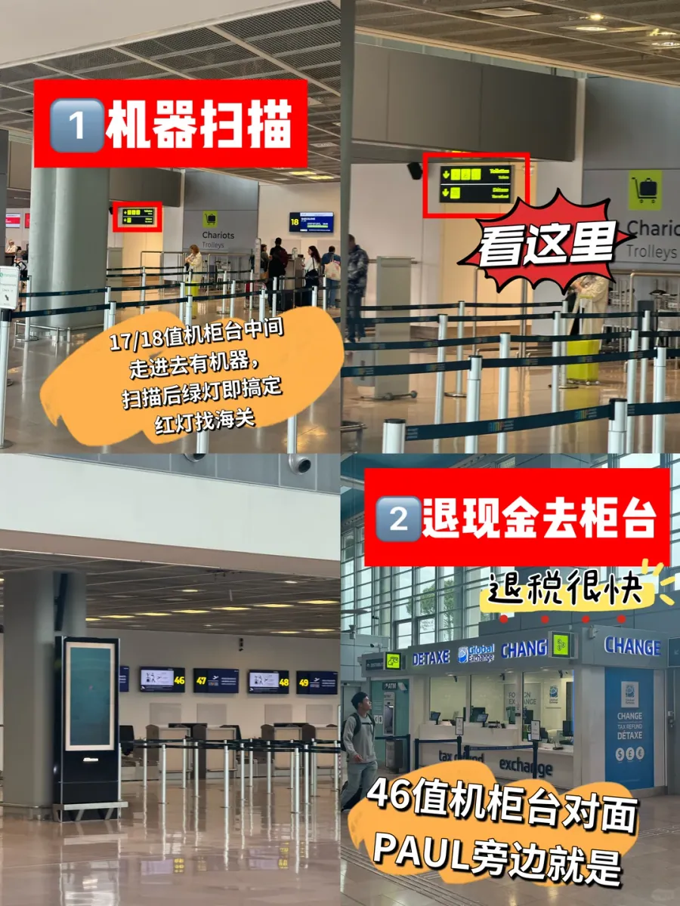
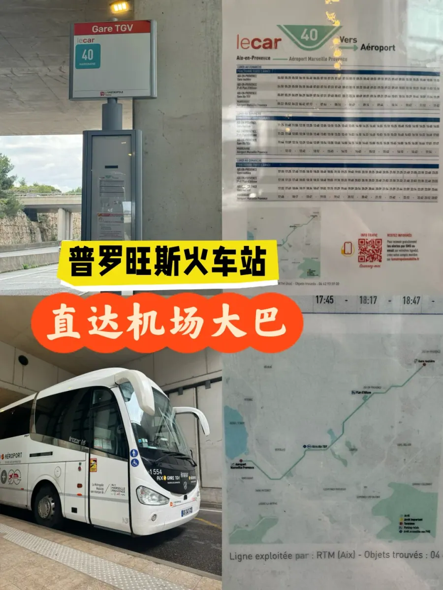

マルセイユ・プロヴァンス空港（MRS）はプロヴァンスとリヴィエラの間、マリニャーヌにあり、エクス＝アン＝プロヴァンス、アヴィニョン、マルセイユに滞在する人にとって南フランスへの最も実用的な玄関口です。最近開設されたマルセイユ〜上海線により、中国からの旅行者はこの地域へ来るのにパリで乗り継ぐ必要がなくなりました。

空港の雰囲気はシャルル・ド・ゴールやオルリーとはまったく異なります。静かで混雑しておらず、チェックイン、保安検査、還付は素早く、到着した多くの旅客の第一印象は「想像と違う」というものです。しかし静かな空港は案内も少ないということでもあります。次に何をすべきか教えてくれる長い列がないため、還付端末がどこにあるか、バス40番が何階から出るか、バス91番がどこに停まるかを事前に知っておく必要があります。

このガイドでは、ターミナル自体、PABLO還付の手順、プロヴァンスTGV駅からのバス40番、マルセイユからのバス91番とUber、そして最後に運賃、所要時間、一日の計画の立て方を扱います。

## 1. マルセイユ空港とはどんな場所か

空港は実質的に一つのコンパクトなターミナルで、出発と到着が同じ建物にあります。チェックインカウンターがホールに並び、番号は40番台まで続きます。片側には両替と免税還付のカウンターがあり、上にDÉTAXE、Global Exchange、CHANGEの看板、近くに荷物カート（Chariots / Trolleys）の看板があります。その一角を見つければ、還付と余った通貨の両替を一度に済ませられます。

静かさの利点は速さです。チェックインに列はなく、保安検査は数分、還付端末の前には誰もいないこともしばしばです。2025年5月の旅行者は、チェックインと保安検査に列がなく、還付とチェックインの手続きがスムーズだったと述べています。静かさの欠点は、開いているカウンターが少なく、係員が常に見えるとは限らないことです。書類が不完全なら、二度足を運ぶのはあなた自身になります。最初にすべてを持参してください。

構造上、マルセイユはハブではありません。便はほとんどがポイント・トゥ・ポイントで、乗り継ぎ客は稀であり、ホールには大きな乗り継ぎ空港のようなせき立てられる感じがありません。制限エリアは狭く、店も限られています。何時間も早く着いて買い物を楽しみたい人には向きませんが、ぎりぎりまで時間を詰めたい人には、還付、荷物預け、保安検査を先に済ませ、ぶらぶらするのを最後にすれば問題ありません。

中国からの旅行者にとって大きな変化は直行路線です。パリでの乗り継ぎがなく、南フランスに直接降り立てます。つまり還付と交通の下調べもパリではなくここで済ませる必要があります。MRSでは中国語の案内がはるかに少ないからです。

## 2. PABLO還付：青信号と赤信号

順序のルールが一つあります。**荷物を預ける前に還付を申請すること**。税関が商品を確認できる必要があり、一度荷物をベルトに載せてしまえば、実質的に商品を送り出したことになります。マルセイユのセルフサービス端末は**チェックイン17番と18番の列の間、通路から奥まった場所**にあり、画面にDETAXE / TAX REFUNDと表示されています。フランスの空港で共通の機器です。

スキャンはニースやパリと同じです。還付書類のバーコードを赤いリーダーにかざすと、画面が判定を返します。**青信号は書類が承認された印**です。電子メッセージは税関のスタンプに相当するため、そのままチェックインへ進めます。**赤信号は人による確認が必要**という意味です。パスポート、書類、商品を持って税関カウンターへ行き、スタンプをもらいましょう。よくある理由は、PABLO経由で発行されていない書類、バーコードが読み取れない、名前がパスポートと一致しない、購入品を確認したい抜き打ち検査です。

現金で受け取る場合はもう一つ手順があります。**チェックイン46番列の向かい、PAULのカフェの隣**にある両替カウンターで、承認済みの書類と引き換えに支払われます。チェックインと同じ階にあり、数歩の距離です。だからこそここでの現金還付は数分で終わり、人々がこの空港を速いと評するのです。

ルールはフランスのどこでも同じです。EU外に居住していること、16歳以上であること、**同じ店で同じ日に税込み€100以上**購入すること。書類は購入月の翌月から3か月目の末日までに承認される必要があります。商品は同行し、提示できる状態でなければなりません。これらの条件を満たせば、手続き全体は10分足らずで終わります。一つでも欠けると、大きな空港ほど助けが得られないので、余裕を持ってください。

赤信号は拒否ではありません。判断が人に委ねられるだけです。窓口で係員は三つを確認します。書類に記載された本人か、商品が書類と一致するか、日付がまだ有効か。三つすべてが揃えば、スタンプで書類が完成します。一つでも欠ければ書類は無効です。最も多いミスは順序です。先に荷物を預けてしまうと商品がなくなり、係員は何も承認できません。

## 3. プロヴァンスTGV駅からのバス40番

ニースから来るなら、列車が快適な選択です。TGVで**エクス＝アン＝プロヴァンスTGV駅**へ向かいます。この駅は市街地になく、エクスの外の野原に高速列車用に造られた駅です。空港はマルセイユよりもエクスに近いため、ここからの移動は市街地から出発するより速いのです。

駅から**0階**へ降り、バス40番を見つけます。停留所にはAÉROPORTと書かれた緑と白のlecar 40の標識があり、駅舎の外の屋根の下にあります。**空港まで14分、€12**で、バスはターミナルの入口に直接停まります。駐車場もシャトルも不要です。

便は頻繁ではありません。停留所脇の黄色い時刻表は午後おおむね30分間隔で、17:45、18:17、18:47となっており、最終便を逃すと自力で移動するしかありません。だから列車を降りて最初にすべきはコーヒーを探すことではなく、時刻表を読むことです。次のバスが20分後ならゆっくり歩き、ちょうど出たばかりなら待つか車を呼ぶかを決めましょう。バスは白く、行き先表示にAIX GARE TGV、側面にAÉROPORT Marseille Provenceとあるので間違えようがありません。

知っておきたい落とし穴が一つあります。エクスには駅が二つあります。**エクス＝アン＝プロヴァンスTGV駅**は野原にあり高速列車が発着する駅で、**エクス＝アン＝プロヴァンス駅**は市街地にあり地域列車が発着する駅です。バス40番は前者からのみ出るので、市街地の駅に着いた場合はまずTGV駅まで戻る必要があります。きっぷの末尾を確認し、遠回りを避けましょう。

TGV駅の周りには野原しかなく、待つ間にできることはありません。早く着きすぎたならエクスにもう少し長く滞在し、バスの時刻に合わせて来るのがよいでしょう。TGVが遅れて一本逃した場合、車なら約€15です。安くはありませんが、旅を台無しにするほどではありません。

## 4. マルセイユからのバス91番、またはUber

マルセイユ市内からはルートが異なります。**サン・シャルル駅からバス91番**で、空港まで約**30分**です。サン・シャルル駅は市街地北の丘の上にあり、駅を出て空港バスの案内に従うと、外の道路沿いに停留所があります。運賃は停留所に掲示されておらず、車内で支払うため、最新の料金を運転手に確認してください。

タクシーと配車サービスはより簡単な選択で、数字を比べるのも容易です。エクスからのUberは**約10分**、最低**€15**程度、マルセイユからは**約30 km**で最低**€26**程度です。この計算でほとんどの場合は決まります。エクスから2人で行くなら1人€8未満で、€12のバスより安く、待ち時間もスーツケースを引きずる手間もありません。時間に余裕のある1人ならバス40番のほうが得です。

荷物が多い、早朝便、深夜到着なら、Uberは確実性を買います。時刻表に賭ける必要も、不慣れな駅でホームを探す必要もなく、ターミナルの入口まで送ってもらえます。予算重視で急がないなら、バスで十分です。

バス91番の30分は道路が空いている場合の想定です。マルセイユを出るルートは都市高速道路を使い、ラッシュ時や夏休みの交通で延びるため、フライトに間に合わせるなら余裕を見てください。

## 5. 運賃、所要時間、計画

二つの出発点を並べると、トレードオフは明らかです。エクス＝アン＝プロヴァンスTGV駅は距離と速さで勝りますが、便数で劣ります。サン・シャルル駅は便数と市街地へのアクセスで勝りますが、所要時間と予測できない渋滞で劣ります。

| 出発点 | バス | 所要時間 | バス運賃 | Uber |
| --- | --- | --- | --- | --- |
| エクス＝アン＝プロヴァンスTGV駅（0階の停留所） | 40番（Lecar 40） | 14分 | €12 | 約10分、最低€15程度 |
| マルセイユ・サン・シャルル駅 | 91番 | 約30分 | 車内で支払い（掲示なし） | 約30 km、最低€26程度 |

時間について、空港の手続きは本当に速いのですが、国際線なら**2〜3時間**は見ておきましょう。還付、荷物預け、保安検査はここでは通常30〜40分で、残りは余裕です。バス40番を使う人は便の間隔も加える必要があります。30分間隔なら一本逃すと30分の損失なので、列車とフライトを同じ時間帯に組まないでください。

フライトが早い場合はもう一つ確認を。バス40番と91番の始発です。どちらも通常の定期便で、始発前の運行はありません。早朝便ならタクシーかUberになり、夜明け前のエクスやマルセイユからの車は昼間より高くなります。前日の夜に予約しておきましょう。

要点は次のとおりです。

- **ニースから**：TGVでエクス＝アン＝プロヴァンスTGV駅へ、0階からバス40番で14分、€12。
- **マルセイユから**：サン・シャルル駅からバス91番で約30分。
- **2人以上、荷物あり、予定が詰まっている**：Uber。エクスから約10分・€15、マルセイユから約30 km・€26。
- **還付**：17〜18番列の間の端末でスキャン。青ならチェックインへ、赤なら税関へ。現金は46番列の向かい、PAULの隣のカウンターで支払われます。

これは2026年10月時点の状況です。時刻表、運賃、カウンターの位置は変わるため、当日は空港と運行会社のウェブサイトを確認してください。

## 関連リンク

- **このサイト内**：[フランス (FR)](/country/FR)
- **Wikipedia**：[マルセイユ・プロヴァンス空港](https://en.wikipedia.org/wiki/Marseille_Provence_Airport)
- **百度百科**：[マルセイユ・プロヴァンス空港](https://baike.baidu.com/item/%E9%A9%AC%E8%B5%9B%E6%99%AE%E7%BD%97%E6%97%BA%E6%96%AF%E6%9C%BA%E5%9C%BA)
