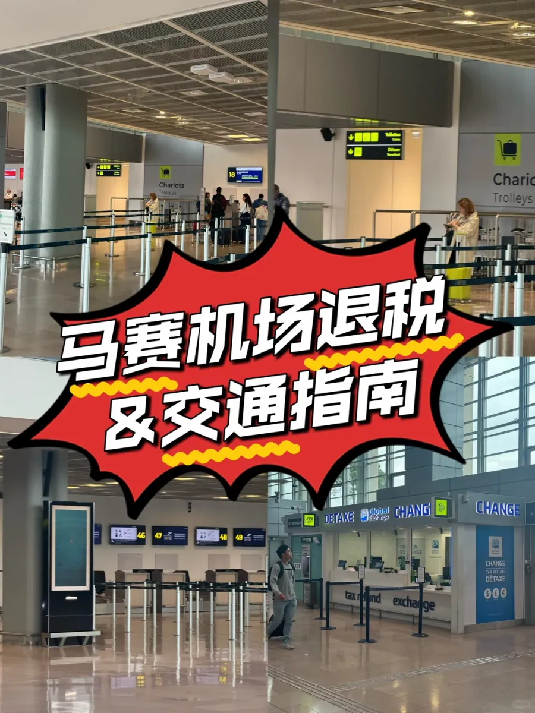
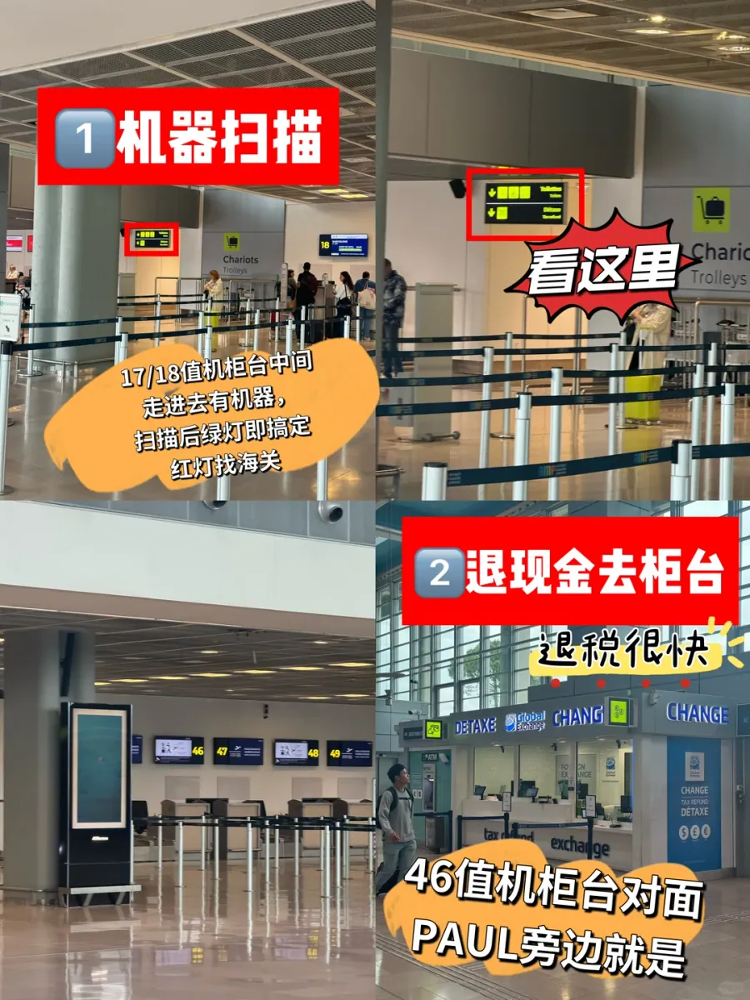
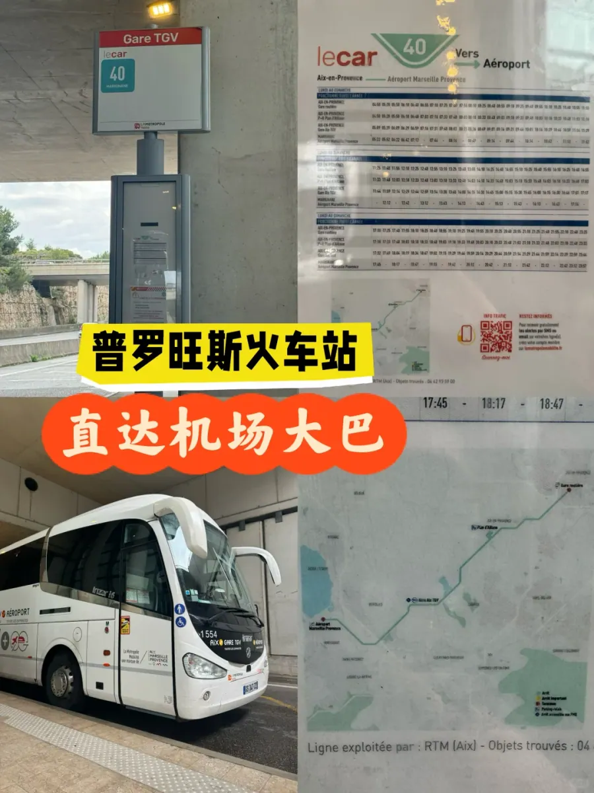

马赛普罗旺斯机场（MRS）坐落在马里尼亚讷（Marignane），是普罗旺斯与蔚蓝海岸之间最实用的落地口。近两年开通的马赛—上海直飞，让从中国来南法度假的人不必再经巴黎转机；对住在艾克斯、阿维尼翁或者马赛市区的人来说，这座机场本来也比巴黎的两个机场顺手得多。

它和大家熟悉的戴高乐、奥利完全不是一种气质。马赛机场人少、不杂乱，值机、安检、退税都很快，很多旅客落地后的第一反应是「和想象中不一样」。但「快」也意味着信息密度低：没有长长的队伍提醒你下一步该做什么，退税机器在哪、40 路从哪一层发车、91 路在火车站哪个位置，都得自己先弄清楚。

这篇按五个部分整理：机场是什么样、PABLO 退税怎么走、从普罗旺斯高铁站坐 40 路、从马赛坐 91 路或 Uber，最后是票价、时间和行程安排。

## 一、马赛机场是什么样

马赛机场的主体是一栋紧凑的航站楼，出发和到达在同一栋建筑里，值机柜台沿大厅一字排开，编号一直排到 40 多号。大厅一侧是外币兑换与退税柜台，柜台上方挂着 DÉTAXE、Global Exchange 和 CHANGE 的招牌，附近还有行李推车（Chariots / Trolleys）的指引牌——第一次来的人只要认准这块区域，退税和换钱两件事就能一起办掉。

人少的直接好处是流程快。值机不排队，安检几分钟就能过，退税机器前面常常一个人都没有；2025 年 5 月有旅客记录，这里「值机安检还不排队」，退税、值机都很顺。间接的好处是心情——不会因为被队伍推着走而漏掉某道手续。代价则相反：柜台开得少，工作人员不一定在你视线里，材料不齐就得自己多跑一趟，所以该带的证件和单据要一次带全。

对从中国出发的旅客，最大的变化是那条新开的直飞航线：不用在巴黎转机，落地就是南法。这也意味着退税和交通的功课最好在马赛做完——这座机场的中文指引没有巴黎那么密集，临时找人问不一定问得到。

从结构上说，马赛也不是枢纽机场。这里的航班以点对点为主，中转旅客很少，所以大厅里不会出现戴高乐那种被人流推着走的场面。候机区不大，店铺数量有限，过了安检能逛的地方不多：如果你习惯提前很久到机场、靠逛店打发时间，这里会显得有点空；反过来，把时间卡得紧一些也不至于手忙脚乱，前提是退税、托运、安检这三件事排在前面，别留到最后十分钟。

## 二、PABLO 退税：绿灯与红灯

退税的顺序只有一条铁律：**托运之前先退税**。海关有可能要求看商品，而商品一旦进了托运带，就等于你已经把它送走了，后面再想补验证基本没有余地。马赛机场的自助退税机在 **17／18 号值机柜台中间往里走**的位置，机身和法国其他机场一样，屏幕上写着 DETAXE / TAX REFUND。

扫码这一步和在尼斯、巴黎是一样的：把退税单上的条形码对准机器的红色读取口，屏幕读到码之后给出结果。**绿灯代表验证通过**，这条电子信息与海关盖章等效，你直接去托运就行，不必再找柜台。**红灯代表需要人工处理**，带着护照、退税单和商品去海关柜台，由关员核对后盖章；常见原因是单据不是 PABLO 系统开具、条形码读不出来、姓名对不上，或者单纯被抽到要看货。

选择退现金的人还有一步：拿着已经验证过的单据，去 **46 号值机柜台对面、PAUL 咖啡旁边**的兑换柜台领欧元。这个位置和值机区在同一层，走几步就到，所以马赛的现金退税通常几分钟就能结束——这也是很多人说这里「退税很快」的原因。

规则本身和法国其他地方一致，值得在购物时就记牢：常住地在欧盟以外、年满 16 岁、同一家店同一天含税消费超过 100 欧元；退税单要在购物当月结束后的第三个月之内完成验证；商品必须随行李同行，随时可以出示。马赛机场人少，这几条满足了，整个过程通常不超过十分钟；但如果机器故障或者关员暂时不在，能帮忙的人也比大机场少，所以要给自己留出缓冲。

红灯的处理方式值得单独说清楚，因为它并不等于退税失败，只是把决定权交回给人。带着护照、退税单和商品去海关柜台，关员通常只核对三件事：人是不是单据上的人、商品是不是单据上的商品、日期有没有过期。三样都对，盖章就完成了；哪一样对不上，这一单就只能作废。最容易出问题的是顺序：先托运、再退税，商品已经进了行李带，关员看不到实物，柜台不会通融，这一单也就白买了。

## 三、从普罗旺斯高铁站坐 40 路

从尼斯方向过来，火车是最舒服的方式：坐 TGV 到 **Aix-en-Provence（普罗旺斯高铁站）**。要提醒一句，这个站不在艾克斯市区，而是修在郊外的田野中间，专门服务高铁线路；机场离艾克斯比离马赛市区更近，所以从这一站过去，往往比从马赛市区出发更快。

出站后到 **0 层**找 40 路。站牌是绿白相间的 lecar 40，写着 AÉROPORT，就立在站房外的雨棚下面。**14 分钟到机场，票价 12 欧**，车会直接停在航站楼门口，比自己开车找停车位省事得多。

班次不算密。站牌旁的黄色时刻表上，傍晚的班次是 17:45、18:17、18:47 这样半小时一班的节奏，末班之后就只能打车。所以下火车的第一件事不是找咖啡，而是先看一眼时刻表：如果下一班在二十分钟后，慢慢走过去刚好；如果刚走一班，就要算算是等还是叫车。车是白色的 Lecar 大巴，车头电子牌写着 AIX GARE TGV，车身印着 AÉROPORT Marseille Provence 的字样和整条线路图，不太会认错。

还有一个容易踩的坑：艾克斯有两个火车站。**Aix-en-Provence TGV** 在郊外，停的是高铁；**Gare d'Aix-en-Provence** 在市区边上，停的是区域列车。40 路只从前者的 0 层发车，如果在市区那个站下车，得先回到高铁站才能坐上机场大巴。买票时看清站名后缀，能省掉一次折返。

站周围是开阔的田野，除了等车没有别的事可做。如果到得早，不如在艾克斯市区多待一会儿，算好班次再过来；反过来，如果 TGV 晚点、下一班 40 路又刚好错过，叫车大约 15 欧上下——不算便宜，但也不至于打乱整趟行程。

## 四、从马赛坐 91 路或 Uber

从马赛市区出发，走法是另一条：在**圣夏尔火车站（Gare Saint-Charles）坐 91 路**，大约 **30 分钟**到机场。圣夏尔站在市区北侧的高地上，出站后跟着机场巴士的指示牌走，站台就在车站外的马路边；这条路线的票价没有在站牌上标出，上车购票，以现场为准。

打车是更省心的选项，价格也算得清：从艾克斯叫 Uber **10 分钟左右**到机场，最便宜的**15 欧上下**；从马赛叫车则是**近 30 公里**，最便宜的**26 欧上下**。这两个数字放在一起，结论很清楚——两个人的时候，从艾克斯打车摊下来每人不到 8 欧，比 12 欧的大巴还便宜，还省了等车和拖箱子的力气；一个人又不赶时间，40 路更划算。

行李多、赶早班机、或者落地时间偏晚的人，Uber 的确定性更值钱：不用赌班次、不用在陌生车站找站台，直接到航站楼门口。预算优先、时间宽裕，大巴完全够用。

要注意的是，91 路的「约 30 分钟」是路况顺畅时的车程。马赛市区到机场要走一段城外快速路，早晚高峰和夏季的度假车流都会让时间变长，赶飞机的话最好把这段不确定性算进去，宁可早到。

## 五、票价、时间与行程安排

把两个出发地放在一张表里，差别一眼就能看出来。艾克斯普罗旺斯高铁站的优势是近和快，劣势是班次间隔；马赛圣夏尔站的优势是班次和市区直达，劣势是路程长、遇到堵车时间不好估。

| 出发地 | 大巴线路 | 车程 | 大巴票价 | Uber |
| --- | --- | --- | --- | --- |
| 艾克斯普罗旺斯高铁站（0 层站台） | 40 路（Lecar 40） | 14 分钟 | 12 欧 | 约 10 分钟，最低 15 欧左右 |
| 马赛圣夏尔火车站 | 91 路 | 约 30 分钟 | 车上购票（站牌未标价） | 近 30 公里，最低 26 欧左右 |

时间上，马赛机场的流程确实快，但国际航班仍建议**提前 2 至 3 小时**到：退税、托运、安检在这座机场通常半小时到四十分钟能走完，剩下的是给意外留的余量。坐 40 路的人要把班次间隔算进去，宁可早到一小时在候机厅坐着，也不要把高铁到站和航班起飞卡在同一小时里——40 路半小时一班，错过一班就是半小时。

如果航班在清晨，还要多查一件事：40 路和 91 路的首班时间。这两条线都是普通的班车，首班之前没有车，只能靠出租车或 Uber；而清晨从艾克斯或马赛叫车的价格，会比白天高一些，最好提前一晚约好。

按行程收几句话：

- **从尼斯方向来**：TGV 到艾克斯普罗旺斯，出站到 0 层坐 40 路，14 分钟、12 欧；
- **从马赛市区来**：圣夏尔火车站坐 91 路，约 30 分钟；
- **两人以上、行李多、赶时间**：从艾克斯叫 Uber 约 10 分钟、15 欧上下，从马赛约 30 公里、26 欧上下；
- **退税**：先在 17／18 号柜台中间的机器扫码，绿灯直接托运，红灯找海关；退现金去 46 号柜台对面 PAUL 旁边的柜台。

本文记录的是 2026 年 10 月的现场情况，班次、票价和柜台位置都可能调整，出行前请以机场与运营方的官网当日信息为准。

## 相关链接

- **本站页面**：[法国（FR）](/zh/country/FR)
- **维基百科**：[马赛普罗旺斯机场](https://zh.wikipedia.org/wiki/%E9%A9%AC%E8%B5%9B%E6%99%AE%E7%BD%97%E6%97%BA%E6%96%AF%E6%9C%BA%E5%9C%BA)
- **百度百科**：[马赛普罗旺斯机场](https://baike.baidu.com/item/%E9%A9%AC%E8%B5%9B%E6%99%AE%E7%BD%97%E6%97%BA%E6%96%AF%E6%9C%BA%E5%9C%BA)
